# Module 9 — Troubleshooting & Preventing Message Loss on Confluent Kafka

> **Course:** Apache Kafka & Confluent Kafka Administration
> **Module objective:** Troubleshoot Confluent Kafka clusters and diagnose,
> resolve, and prevent message loss and other production issues.

---

## Table of contents

1. [Why this module matters](#1-why-this-module-matters)
2. [Common Confluent Cloud and Platform errors and log analysis](#2-common-confluent-cloud-and-platform-errors-and-log-analysis)
3. [Root causes of message loss: acks, replication factor, quotas and throttling](#3-root-causes-of-message-loss-acks-replication-factor-quotas-and-throttling)
4. [Troubleshooting connectivity and client-side issues](#4-troubleshooting-connectivity-and-client-side-issues)
5. [Consumer lag analysis and remediation in Confluent](#5-consumer-lag-analysis-and-remediation-in-confluent)
6. [Confluent support and escalation model](#6-confluent-support-and-escalation-model)
7. [Best-practice checklist for preventing message loss](#7-best-practice-checklist-for-preventing-message-loss)
8. [Hands-on lab: diagnosing message-loss and connectivity scenarios](#8-hands-on-lab-diagnosing-message-loss-and-connectivity-scenarios)
9. [Troubleshooting quick reference](#9-troubleshooting-quick-reference)
10. [Bridging to the rest of the course](#10-bridging-to-the-rest-of-the-course)
11. [Key takeaways](#11-key-takeaways)
12. [Glossary](#12-glossary)
13. [References](#13-references)

> **How to read the diagrams:** Diagrams are written in [Mermaid](https://mermaid.js.org/),
> which renders automatically in GitHub, VS Code (with a Mermaid extension), and most
> modern Markdown viewers. If a diagram appears as code, install/enable a Mermaid
> preview to see the rendered version.

> **Builds on:** [Module 8 — Monitoring & Performance Tuning with Confluent Kafka](./module-08-monitoring-performance-tuning.md).
> This module assumes the durability contract (`acks`, `min.insync.replicas`)
> from Module 3 §6, the producer retry model and error classes from Module 4
> §3.3 and §9, ISR, ELR and unclean election from Module 5 §2–§3, the role
> bindings and API keys from Module 7 §4–§5, and the indicators, alerts and
> Metrics API from Module 8 §2–§4. It focuses on **what to do when those
> alerts fire**: finding the root cause, fixing it, and changing the
> configuration so the same incident cannot lose data again.

---

## 1. Why this module matters

Module 8 gave you the alerts. This module is about the minutes after one
fires. Billing calls: *"Yesterday's invoice run is 40 000 CDRs short."* The
NOC says: *"The mediation pods can't reach the cluster since the firewall
change."* A developer insists: *"Kafka lost our messages."* Each statement may
be true, partly true or false, and your job is to find out which, with
evidence, before anyone changes a setting.

For an IBM MQ administrator, the instincts transfer but the defaults do not.
In MQ, a persistent message under syncpoint is either on a queue or in the
dead-letter queue; "lost" usually means "someone used non-persistent
messages". In Kafka, data is lost by **configuration and by applications**,
almost never by the broker: an `acks=1` producer on a leader that crashes, a
producer callback that logs and drops after `delivery.timeout.ms`, a consumer
that commits before it processes, a lagging consumer overtaken by retention.
The cluster did exactly what it was configured to do — and that is the root
cause you have to prove.

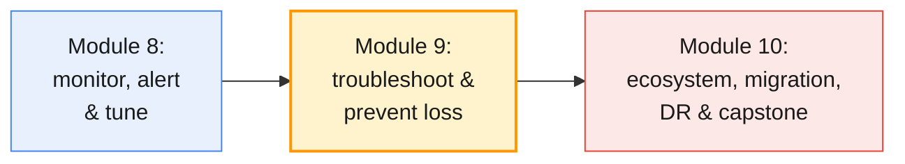

The module works on the same targets as Modules 6–8: the shared **Confluent
Platform** cluster on AWS (where you can see broker logs through the trainer),
your **Confluent Cloud** environment `env-lNN` (where you cannot), and the
shared **Apache Kafka** cluster for comparison.

By the end of this module you will be able to:

- Apply a **repeatable triage method** and find the evidence for a Confluent
  Cloud or Platform incident in client logs, broker logs, Control Center and
  the Metrics API.
- Explain the **root causes of message loss** — `acks`, replication factor,
  `min.insync.replicas`, unclean election, quotas and throttling, consumer
  commits and retention — and show where each one happens.
- Diagnose **connectivity and client-side** failures layer by layer: DNS,
  TCP, TLS, SASL, authorization and metadata.
- Analyse **consumer lag** and choose the right remediation: scale, fix,
  skip, replay or reset offsets.
- Open a **Confluent support case** that gets answered quickly, and run an
  internal escalation path around it.
- Apply a **best-practice checklist** that prevents message loss across
  producers, topics, brokers, consumers and operations.

---

## 2. Common Confluent Cloud and Platform errors and log analysis

### 2.1 A triage method that holds up in a post-mortem

```mermaid
flowchart LR
    S["1. Scope<br/>who, what, since when?"] --> E["2. Evidence<br/>metrics, logs,<br/>CLI state"]
    E --> H["3. Hypothesis<br/>one cause that<br/>explains all of it"]
    H --> F["4. Fix<br/>smallest safe change"]
    F --> V["5. Verify<br/>the indicator<br/>returns to normal"]
    V --> P["6. Prevent<br/>config, alert,<br/>runbook"]
    H -.->|"evidence contradicts"| E

    style S fill:#cce5ff,stroke:#4285f4,stroke-width:1px,color:#1a1a1a
    style E fill:#fff3cd,stroke:#ff9800,stroke-width:2px,color:#1a1a1a
    style H fill:#fff3cd,stroke:#ff9800,stroke-width:1px,color:#1a1a1a
    style F fill:#fce8e6,stroke:#ea4335,stroke-width:1px,color:#1a1a1a
    style V fill:#d4edda,stroke:#28a745,stroke-width:1px,color:#1a1a1a
    style P fill:#d4edda,stroke:#28a745,stroke-width:1px,color:#1a1a1a
```

Most bad incident handling skips step 2: someone restarts a broker or raises
a timeout because it "usually helps", the symptom moves, and the root cause
is gone from the logs. Write down the time (in UTC) and the evidence before
you change anything.

| Step | Questions to answer | Typical evidence |
| ---- | ------------------- | ---------------- |
| **Scope** | One client or all? One topic, one partition, one broker? Cloud, Platform or both? Since when — and what changed then? | Ticket, deploy log, change calendar |
| **Evidence** | What do the cluster and the client each say? | Module 8 indicators, `kafka-topics.sh --describe`, `kafka-consumer-groups.sh --describe`, client logs, broker logs |
| **Hypothesis** | Which single cause explains *every* observation? | If one observation does not fit, the hypothesis is wrong |
| **Fix** | What is the smallest change that removes the cause? | One change, recorded with its time |
| **Verify** | Is the indicator that alerted back to normal? Is data intact? | URP 0, lag draining, error rate 0, offset counts reconcile |
| **Prevent** | Which setting, alert or runbook stops a repeat? | §7 checklist |

> **Common trap for MQ administrators:** treating "messages missing" as a
> broker fault and starting with the broker. In Kafka, start with the
> **client**: what did the producer's callback report, and what did the
> consumer commit? The broker logs rarely contain the word "lost", because
> from the broker's point of view nothing was.

### 2.2 Where the evidence lives

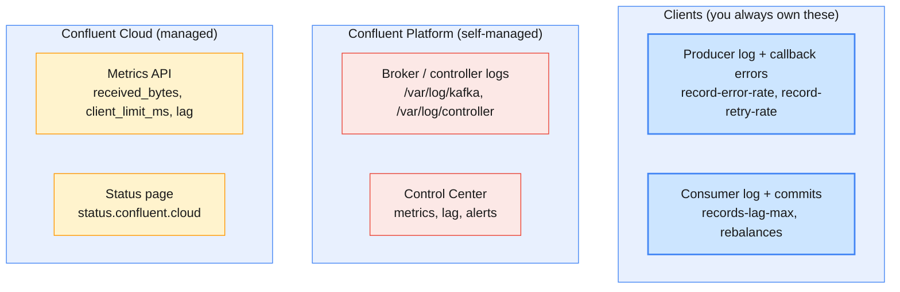

| Evidence | Confluent Cloud | Confluent Platform | Apache Kafka (course) |
| -------- | --------------- | ------------------ | --------------------- |
| **Client logs and metrics** | Yours | Yours | Yours |
| **Broker and controller logs** | Not available — Confluent's side of the shared responsibility | Yours (`server.log`, `controller.log` …) | Yours (`/var/log/kafka`) |
| **Cluster metrics** | Metrics API, Cloud Console | Control Center, JMX | JMX exporter → Prometheus/Grafana |
| **Partition and group state** | Kafka CLI with an API key, Confluent CLI | Kafka CLI, Confluent CLI, Admin REST | Kafka CLI |
| **Platform incidents** | `status.confluent.cloud` and Confluent Support | Your own monitoring | Your own monitoring |

On Confluent Cloud, the client is the only log you have. That makes client
logging at `INFO` (with `WARN` for the Kafka client libraries as a minimum) and
the producer error metrics non-negotiable for Cloud applications.

### 2.3 Reading Confluent Platform logs

On the course's Confluent Platform cluster the files are where cp-ansible put
them (`infra/guides/confluent-platform-cluster-connect.md` §4). Learners have
no shell on the CP hosts; the trainer reads them during the lab through SSM.

| Host | File | What you look for |
| ---- | ---- | ----------------- |
| **Broker** (`cp-broker-1…3`) | `/var/log/kafka/server.log` | Startup and shutdown, ISR changes, leader changes, `ERROR` / `WARN` around the incident time |
| **Broker** | `/var/log/kafka/kafka-authorizer.log` | Authorization decisions — who was denied what |
| **Broker** | `/var/log/kafka/metadata-service.log` | MDS: logins, token and role-binding problems |
| **Broker** | `/var/log/kafka/data-balancer.log` | Self-Balancing: what it moved and why |
| **Controller** (`cp-ctl-1…3`) | `/var/log/controller/server.log`, `controller.log` | Quorum leadership, broker registrations and fencing, partition leader elections |
| **Services** (`cp-services`) | `/var/log/confluent/control-center/control-center.log`, `prometheus.log`, `alertmanager.log` | Why Control Center shows no data or an alert did not notify |
| **Any host** | `journalctl -u confluent-server` / `-u confluent-kcontroller` | Service start failures before the log file is opened |

```bash
# (trainer, on a CP broker through SSM, as root)
# 1. Everything at WARN or above in the incident window (times in the log are the host's, UTC on the course hosts)
grep -E '^\[2026-10-12 09:(1|2)[0-9]' /var/log/kafka/server.log | grep -E ' (WARN|ERROR|FATAL) '
# 2. One partition's story across the window
grep 'lNN.cdr.voice-0' /var/log/kafka/server.log | tail -n 50
# 3. Did the service restart?
journalctl -u confluent-server --since "2026-10-12 09:00" --no-pager | grep -E 'Started|Stopped|Main process exited'
```

> **Log-analysis rule:** read the **controller** log first for anything
> involving leadership — which brokers were fenced, which partitions changed
> leader, and when. Then read the **broker** logs of the leaders involved.
> Broker logs show the consequence; the controller log shows the decision.

### 2.4 The errors you will meet

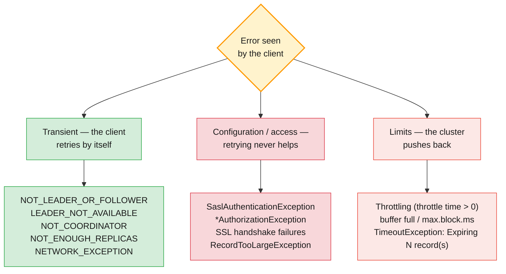

Module 4 §9.2 lists the producer exceptions and whether they are retriable.
What changes on Confluent is *how often* you see each class and *where* to
look next:

| Error / log line | Usually means on Confluent | First check |
| ---------------- | -------------------------- | ----------- |
| **`NOT_LEADER_OR_FOLLOWER`, `LEADER_NOT_AVAILABLE`, `NOT_COORDINATOR`, `UNKNOWN_TOPIC_OR_PARTITION` as `WARN`s** | Normal during Confluent Cloud maintenance and rolling restarts; clients recover by themselves | Did they stop within a minute or two? If yes, no action |
| **`NOT_ENOUGH_REPLICAS` as a `WARN`** | ISR below `min.insync.replicas`; `acks=all` writes are refused until it recovers | `kafka-topics.sh --describe --under-min-isr-partitions`; Control Center URP |
| **`Connection to node … terminated during authentication`** | Expected once against a freshly restarted broker; constant means wrong credentials or mechanism | §4.2 layer 4 |
| **`SaslAuthenticationException`** | Wrong key or secret, key for another cluster, deleted key or owner (Cloud); wrong LDAP password (CP) | Module 7 §9 |
| **`TopicAuthorizationException` / `GroupAuthorizationException`** | Role binding or ACL missing, revoked, or on the wrong pattern | `confluent iam rbac role-binding list`; Module 7 §9 |
| **`TimeoutException: Expiring N record(s)`** | Records spent longer than `delivery.timeout.ms` in the producer — broker unreachable, ISR too small, or throttled. **Data is lost unless the application handles the callback** | §3.4 |
| **Throttle time > 0** (`produce-throttle-time-avg`, Cloud `client_limit_milliseconds`) | A quota (CP) or a cluster-type limit (Cloud) is biting | §3.4, Module 8 §5.2 |
| **`RecordTooLargeException`** | Payload above `max.request.size` or the topic's `max.message.bytes` | Module 4 §11 |
| **`OffsetOutOfRange` followed by a reset in the consumer log** | Committed offset no longer exists — retention deleted it, or offsets expired | §3.5 |

> **The production baseline:** classify the error *before* you act.
> Transient errors are noise unless they persist past the retry window;
> configuration errors need a change, not a restart; limit errors need less
> load or more capacity. Restarting a client that has a configuration error
> only adds a rebalance to the incident.

### 2.5 Troubleshooting without broker logs: Confluent Cloud

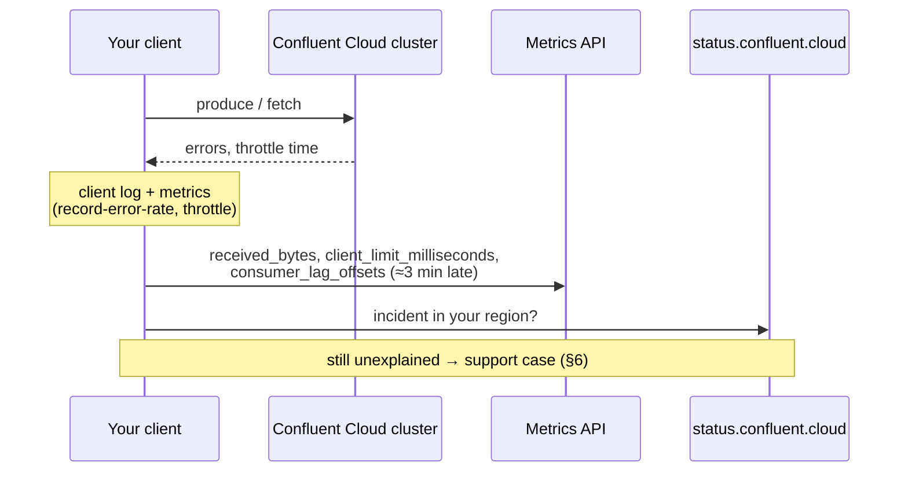

On Confluent Cloud you correlate three views:

| Question | Where to look |
| -------- | ------------- |
| Are bytes still arriving at the cluster? | Metrics API `received_bytes` / `received_records` per topic (Module 8 §4.3) |
| Is the cluster throttling us? | `client_limit_milliseconds`; client `produce-throttle-time-avg` / `fetch-throttle-time-avg` |
| Are records accepted but not stored? | `received_bytes` high while `retained_bytes` flattens — the pattern Confluent's observability guide shows for a revoked authorization |
| Is it Confluent? | `status.confluent.cloud` for your cloud and region, then a support case |

> **Administrator takeaway:** on Cloud, "the broker log" is replaced by a
> client log you configured *before* the incident and a Metrics API that is
> three minutes behind. If the application team did not log producer
> callback failures, there is no way to reconstruct which records failed.

---

## 3. Root causes of message loss: acks, replication factor, quotas and throttling

### 3.1 Where messages are lost

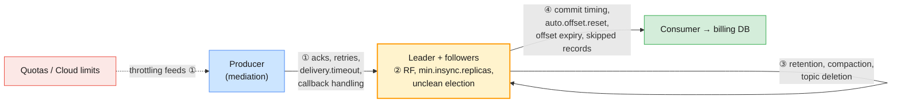

Module 4 §7.1 introduced the three hops. For troubleshooting, split them into
four places where data disappears, and ask in each one *what the system
promised*:

| Place | Loss mechanism | Promise broken? |
| ----- | -------------- | --------------- |
| **① Producer** | `acks=0`; record expires after `delivery.timeout.ms` and the callback ignores it; process killed with records still in the buffer | No — the client never got an acknowledgement, or got a failure and dropped it |
| **② Replication** | `acks=1` and the leader dies before followers copy; `min.insync.replicas=1`; RF 1; unclean leader election | Only for unclean election: acknowledged data disappears |
| **③ Storage** | Retention or compaction removes records nobody has read yet; someone deletes the topic | No — the configuration said so |
| **④ Consumer** | Commit before processing then crash; reset to `latest` after an `OffsetOutOfRange`; poison pill skipped without a dead-letter topic | No — the consumer told Kafka it was done |

> **Common trap:** reporting "Kafka lost messages" when the evidence shows the
> producer never received an acknowledgement. The incident is real; the
> cause is a producer configuration or application decision. Get the
> producer's error count for the window before you open the broker logs.

### 3.2 acks and min.insync.replicas

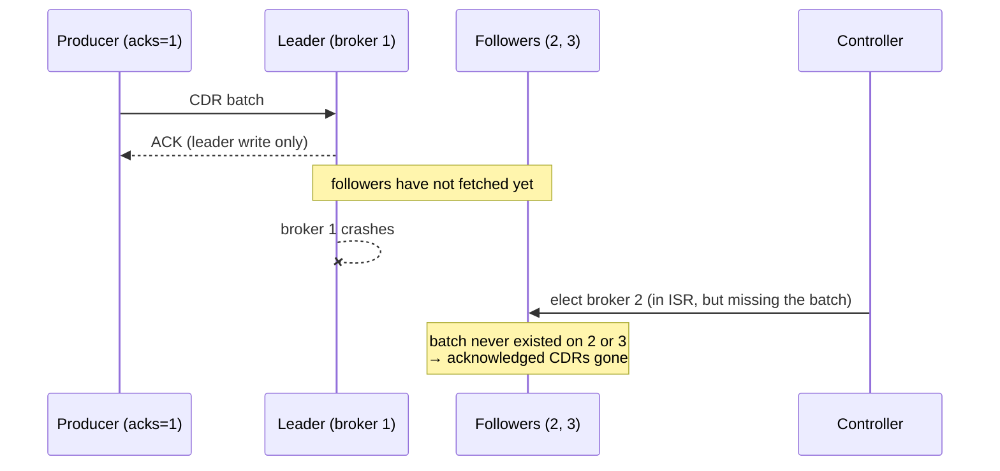

Module 3 §6.4 walked through the durability scenarios. The loss cases to
recognise in an incident are:

| Configuration | Failure | Result |
| ------------- | ------- | ------ |
| **`acks=0`** | Any | The producer never knows; loss is invisible |
| **`acks=1`** | Leader dies before followers fetch | Acknowledged records lost after a *clean* election |
| **`acks=all`, `min.insync.replicas=1`** | ISR shrinks to the leader, then the leader dies | Acknowledged records lost: one replica was "all" |
| **`acks=all`, RF 3, `min.insync.replicas=2`** | One broker down | ✅ No loss; writes continue |
| **Same, two brokers down** | ISR 1 | ✅ No loss; writes refused with `NOT_ENOUGH_REPLICAS` until a replica returns |
| **`min.insync.replicas` = RF** (e.g. 3 of 3) | One broker down | ⚠️ No loss, but every `acks=all` write fails — an outage you built yourself |

On **Confluent Cloud** RF is always 3 and `min.insync.replicas` can only be 1
or 2 (Module 6 Lab 02), but **`acks` is the client's choice**. Cloud cannot
protect a CDR that a producer sent with `acks=1`. On the **course's Confluent
Platform cluster** the defaults are RF 3, `min.insync.replicas=2` and no
unclean election (`infra/confluent/cp-ansible/hosts.yml`), but a topic owner
can still override `min.insync.replicas` on their own topic — which is what
§8.2 does on purpose.

> **The production baseline (again, because it is the whole module):**
> RF 3, `min.insync.replicas=2` on the topic, `acks=all` and idempotence on
> the producer (Module 3 §6.4, Module 4 §3.4). Any topic or producer that
> deviates needs a written reason.

### 3.3 Replication factor and unclean leader election

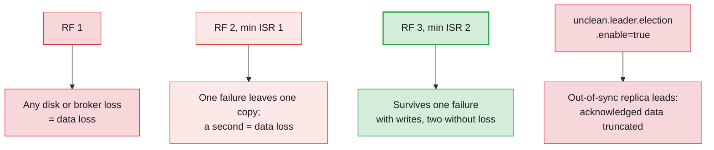

| Check during an incident | Command | Red flag |
| ------------------------ | ------- | -------- |
| **RF and min ISR of the topic** | `kafka-topics.sh --describe --topic <t>`; `kafka-configs.sh --describe --entity-type topics --entity-name <t>` | RF < 3, `min.insync.replicas=1` on a billing topic |
| **Partitions currently at risk** | `kafka-topics.sh --describe --under-min-isr-partitions` / `--under-replicated-partitions` | Any billing partition listed |
| **Partitions already down** | `kafka-topics.sh --describe --unavailable-partitions` | Any; check `Elr` before deciding (Module 5 §2.4) |
| **Unclean election allowed?** | `kafka-configs.sh --describe --entity-type topics --entity-name <t> --all \| grep unclean` | `true` anywhere it is not documented |
| **Was there an unclean election?** | Controller log around the incident; offsets that went *backwards* in consumers | Committed offset greater than the new log-end offset |

> **Common trap:** "fixing" an offline partition by turning on
> `unclean.leader.election.enable` for the cluster. It brings the partition
> back and silently truncates the acknowledged records the old leader had.
> If you must, use the per-partition `kafka-leader-election.sh
> --election-type unclean` from Module 5 §3.3, and record it in the incident
> as a deliberate data-loss decision.

### 3.4 Quotas and throttling: how slowness becomes loss

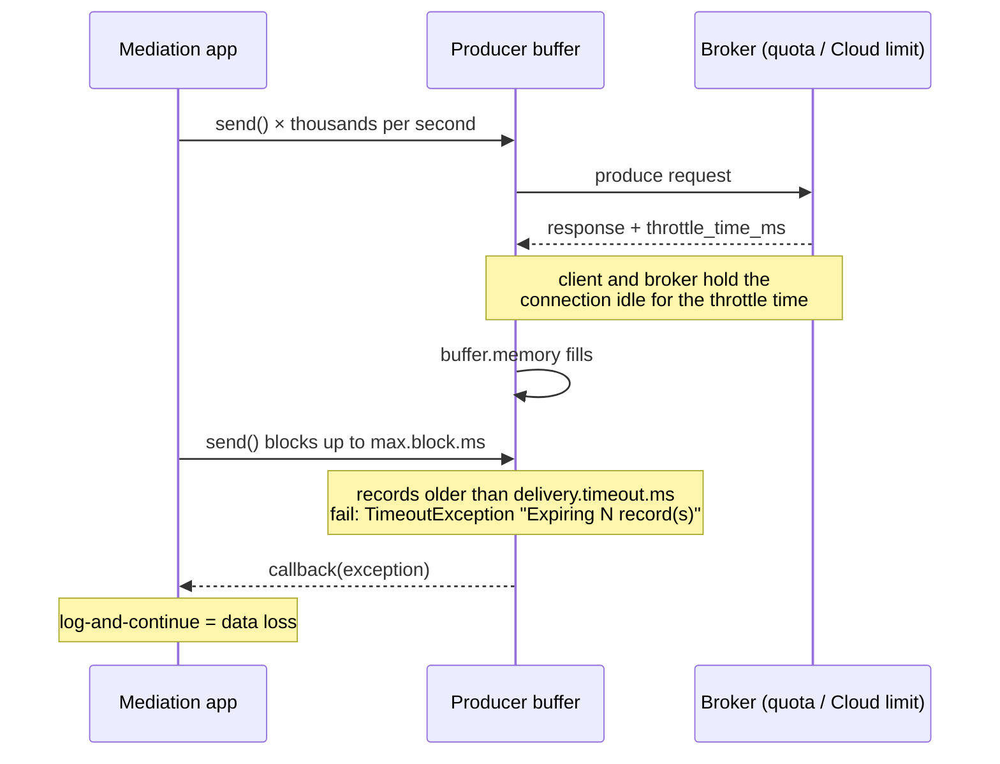

Throttling on its own never loses data: the broker only **delays** responses
to a client over its quota, and well-behaved clients wait (Apache Kafka design
docs, *Quotas*). Loss happens one step later, in the producer, when records
wait so long that `delivery.timeout.ms` expires, or when `send()` blocks past
`max.block.ms` and the application treats that as "skip".

| Where the limit comes from | How it shows | Remedy |
| -------------------------- | ------------ | ------ |
| **Client quota on a self-managed cluster** (`producer_byte_rate`, `consumer_byte_rate`, `request_percentage` per user or client ID) | Client `produce-throttle-time-avg` / `-max` > 0; broker JMX throttle metrics | Raise the quota for that principal, or spread the load over time |
| **Confluent Cloud cluster-type limits** (ingress, egress, requests, connections, partitions; Module 8 §5.2) | Metrics API `client_limit_milliseconds` > 0; client throttle time | Batch and compress; move to a larger cluster type or more CKUs |
| **Dedicated `cluster_load_percent` > 80 %** | Latency, then throttling | Expand CKUs (Module 8 §5.3) |
| **The shared Apache cluster** | Every learner capped per broker by `bootstrap-security.sh` (1 MiB/s produce, 2 MiB/s consume) | — it is the course's protection, not a fault |

| Producer setting | Role in a throttling incident | Default (Kafka 4.x) |
| ---------------- | ----------------------------- | ------------------- |
| `delivery.timeout.ms` | Upper bound on a record's life in the producer; after it, the callback gets a `TimeoutException` | 120000 (2 min) |
| `buffer.memory` | Where records wait while throttled | 33554432 (32 MiB) |
| `max.block.ms` | How long `send()` blocks when the buffer is full or metadata is missing | 60000 |
| `retries` / `enable.idempotence` | Keep retrying transient errors without duplicates | `MAX_INT` / `true` |

> **Administrator takeaway:** a throttling alert is a **data-loss early
> warning** for any producer that does not handle callback failures. Pair
> every throttle alert (Module 8 §3.5) with the question "what does this
> producer do when a record expires?" — and get the answer in writing.

### 3.5 Loss on the consumer side

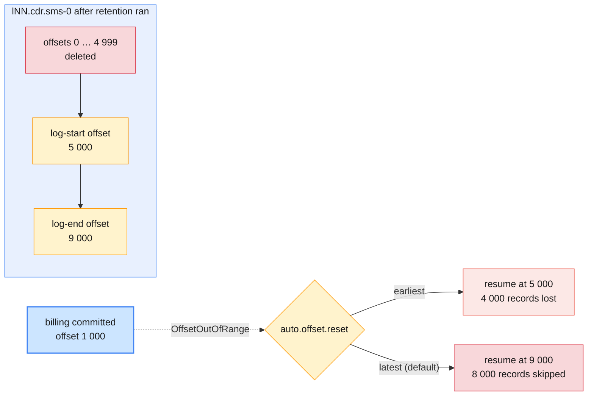

| Mechanism | How it happens | Evidence | Prevention |
| --------- | -------------- | -------- | ---------- |
| **Lag overtakes retention** | Consumer behind by more than `retention.ms` (or `retention.bytes`); oldest segments deleted before they were read | Committed offset below the log-start offset (`kafka-get-offsets.sh --time -2`) | Alert on lag *in time* well below retention (§5.4) |
| **Reset to `latest`** | `OffsetOutOfRange` or no committed offset → `auto.offset.reset=latest` (the default) skips everything up to the end | Consumer log shows the reset; lag drops to 0 instantly without processing | `earliest` for billing consumers; or `none` and alert |
| **Offsets expired** | Group empty longer than `offsets.retention.minutes` (7 days by default) → offsets deleted → reset policy applies | `--describe` shows no offsets for the group | Longer offset retention for seasonal jobs; `earliest` |
| **Commit before processing** | Auto-commit with asynchronous processing, or manual commit before the DB write; crash in between | Gap in the billing DB, no gap in Kafka | Commit after processing (Module 4 §5.2) |
| **Poison pill skipped** | Error handler `seek(offset + 1)` without writing the record anywhere | One offset per incident missing downstream | Dead-letter topic plus alert (Module 4 §9.4) |
| **`read_committed` vs aborted transactions** | Records from aborted transactions are correctly invisible | Producer logs show aborts | Not loss — investigate the producer |

Kafka 4.x also accepts `auto.offset.reset=by_duration:<ISO-8601 duration>`,
which resets to a point in time (for example `by_duration:PT6H`) instead of
the very beginning or end — useful for consumers that would rather replay a
bounded window than all of retention.

> **Common trap for MQ administrators:** assuming a consumer "keeps its
> place" no matter what, the way a queue keeps undelivered messages. A Kafka
> consumer's place is an offset that can expire, be reset, or point at data
> that retention has already deleted. The queue does not wait for the
> consumer.

### 3.6 Proving loss — or proving there was none

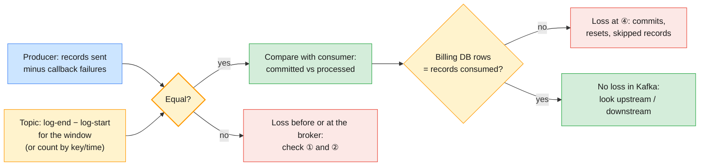

Reconcile counts at each hop and the gap tells you which hop to investigate.
Offsets are the cheapest counter you have: for a topic with no compaction and
no transactions, *log-end minus log-start* per partition is the number of
records retained. For CDRs, reconcile on the business key as well (CDR ID or
`MSISDN` + timestamp), because duplicates from retries can hide a gap.

---

## 4. Troubleshooting connectivity and client-side issues

### 4.1 Six layers between a client and a partition

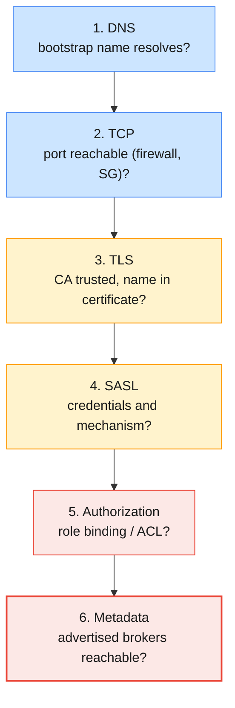

A Kafka client fails at the first broken layer and often reports it vaguely —
"disconnected", "timed out waiting for a node assignment". Test the layers
from the bottom up, from the **same host and network** as the failing client.

| Layer | Test | Healthy result | Typical failure |
| ----- | ---- | -------------- | --------------- |
| **1. DNS** | `getent hosts cp-kafka.lab.internal` | One or more IPs | Typo, private zone not resolvable from this VPC |
| **2. TCP** | `timeout 5 bash -c '</dev/tcp/HOST/9092'` (or `nc -zv HOST 9092`) | Exit code 0 | Security group / firewall; wrong port; cluster stopped |
| **3. TLS** | `openssl s_client -connect HOST:9092 -servername HOST -CAfile CA` | Certificate chain verifies | Untrusted CA, expired certificate, IP instead of hostname |
| **4. SASL** | `kafka-broker-api-versions.sh --bootstrap-server HOST:9092 --command-config FILE` | One line per broker | `SaslAuthenticationException`; protocol mismatch hangs |
| **5. Authorization** | `kafka-topics.sh --describe --topic T` / produce one record | Topic described / record written | `TopicAuthorizationException`, `GroupAuthorizationException` |
| **6. Metadata** | Same commands, watch *which* hosts the client then contacts | Bootstrap returns brokers the client can reach | Advertised listener names or ports unreachable from the client |

Confluent recommends `openssl s_client` over a bare TCP test for Cloud,
because a TCP test cannot tell a timeout, an incomplete TLS handshake and a
missing SNI header apart.

### 4.2 The tools, layer by layer, on the course clusters

```bash
# (VM) Layers 1–3 against the shared Confluent Platform cluster
source ~/kafka/confluent.env                      # CP, CP_CA, …
getent hosts cp-kafka.lab.internal                # three broker IPs
timeout 5 bash -c '</dev/tcp/cp-kafka.lab.internal/9092' && echo "9092 open"
openssl s_client -connect cp-kafka.lab.internal:9092 -servername cp-kafka.lab.internal \
  -CAfile $CP_CA -brief </dev/null

# Layers 4–6: the Kafka protocol itself
kafka-broker-api-versions.sh --bootstrap-server $CP --command-config ~/kafka/cp.properties | grep "(id:"

# The same TLS test against Confluent Cloud (Confluent's connectivity guide)
openssl s_client -connect $CCLOUD -servername ${CCLOUD%:*} -brief </dev/null
```

> **Common trap:** running the test from your laptop when the failing client
> runs in a Kubernetes pod or another VPC. Connectivity is a property of the
> *path*, not of the cluster. On the course, only ports 9092, 8090, 8081,
> 8083, 8088 and 9021 of the Confluent Platform hosts are open to the lab VMs
> — port 9091 (replication) answers inside the cluster and times out from
> your VM.

### 4.3 The bootstrap and advertised-listener trap

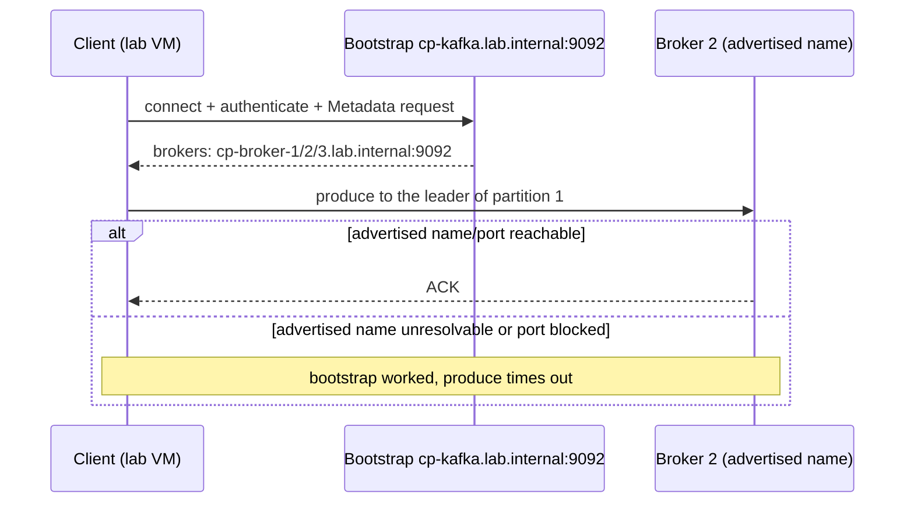

The bootstrap address is only used for the **first** connection. After that
the client talks to whatever hostnames and ports the brokers **advertise**.
"I can connect but cannot produce" is almost always this: a NAT, proxy,
load balancer or private-link setup where the advertised names do not resolve
or route from the client's network.

| Symptom | Cause | Fix |
| ------- | ----- | --- |
| **Bootstrap works, some partitions time out** | One broker's advertised address unreachable | Test each broker host from the client (`cp-broker-N.lab.internal`) |
| **Works inside the VPC, fails from outside** | Advertised names are private | A listener with external names, or connect from inside |
| **Works after restart, fails again later** | Client cached old IPs (Cloud brokers moved) | Java `networkaddress.cache.ttl=30`, `client.dns.lookup=use_all_dns_ips` (Confluent client FAQ) |
| **TLS error only via IP address** | Hostname verification: the IP is not in the certificate | Use the DNS name (Module 7 §9) |

### 4.4 Client-side health: settings and metrics

| Client metric | What it tells you during an incident |
| ------------- | ------------------------------------ |
| **`record-error-rate`** (producer) | Records that finally failed — the loss counter at hop ① |
| **`record-retry-rate`** (producer) | Transient errors being absorbed by retries |
| **`buffer-available-bytes`** (producer) | Falling: records piling up, throttling or unreachable brokers |
| **`produce-throttle-time-avg` / `fetch-throttle-time-avg`** | A quota or Cloud limit is biting (§3.4) |
| **`records-lag-max`** (consumer) | The consumer's own view of lag; vanishes when the consumer is down (Module 8 §6.2) |
| **`outgoing-byte-rate`** (producer) | Dropping to zero: connectivity; staying high with errors: authorization |

Confluent's client-observability guide demonstrates these on Confluent Cloud:
when the cluster becomes unreachable, `record-error-rate` and
`record-retry-rate` rise, `buffer-available-bytes` falls and the log shows
`NETWORK_EXCEPTION`; when a write permission is revoked, the log shows
`TopicAuthorizationException` and `record-error-rate` rises while bytes still
reach the cluster.

> **The production baseline for client teams:** producers default to two
> minutes of retries and consumers and admin clients to one minute, so a
> short broker restart should never surface as an application error. Keep
> the defaults unless you have measured a reason, and alert on
> `record-error-rate > 0` for every billing producer.

---

## 5. Consumer lag analysis and remediation in Confluent

### 5.1 Lag triage

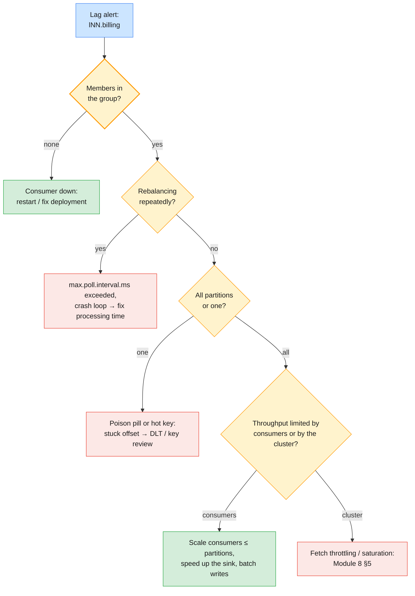

Module 8 §2.6 defined lag and its patterns. Here you go from the pattern to
the action. Four commands answer the first four diamonds:

```bash
# (VM) Members, assignment and lag per partition
kafka-consumer-groups.sh --bootstrap-server $CP --command-config $CFG \
  --describe --group $ME.billing --members --verbose
# Group state: Stable, PreparingRebalance, Empty, Dead
kafka-consumer-groups.sh --bootstrap-server $CP --command-config $CFG \
  --describe --group $ME.billing --state
# Lag per partition, twice, one minute apart: growing, flat or draining?
kafka-consumer-groups.sh --bootstrap-server $CP --command-config $CFG \
  --describe --group $ME.billing
# What one consumer can read when nothing else limits it (separate group)
kafka-consumer-perf-test.sh --bootstrap-server $CP --command-config $CFG \
  --topic $ME.cdr.voice --group $ME.perf --num-records 50000 --timeout 30000
```

### 5.2 Lag in messages, lag in time

| Measurement | Formula / source | Why it matters |
| ----------- | ---------------- | -------------- |
| **Lag (records)** | Log-end offset − committed offset, per partition | What every tool shows |
| **Growth rate** | Δlag / Δt from two readings | Positive: falling behind; negative: catching up |
| **Lag (time)** | Lag ÷ producer rate for that topic | The number billing cares about: "invoices are 12 minutes behind" |
| **Time to drain** | Lag ÷ (consumer rate − producer rate) | When the incident will end without intervention |
| **Headroom to retention** | `retention.ms` − lag (time) | How long until lag becomes loss (§5.4) |

Example from Module 8 Lab 02: with the consumer stopped and 200 CDRs per
second arriving, lag grows by about 12 000 per minute. If one consumer reads
2 000 records per second, the backlog drains at 1 800 per second, so a
60 000-record backlog takes a little over half a minute. If it reads 150 per
second, the lag never drains, and adding consumers (up to the partition
count) is the only fix that does not touch the code.

| Where you read lag | Freshness | Notes |
| ------------------ | --------- | ----- |
| `kafka-consumer-groups.sh --describe` | Now | Works on all three clusters; the incident tool |
| Control Center Consumer Lag page | ~1 minute | Broker-computed; survives the consumer being down (Module 8 §3.3) |
| Metrics API `consumer_lag_offsets` | ~3 minutes | Cloud; good for trends and alert feeds (Module 8 §4) |
| Client `records-lag-max` | Live, while the consumer runs | Disappears with the consumer |

### 5.3 The remediation playbook

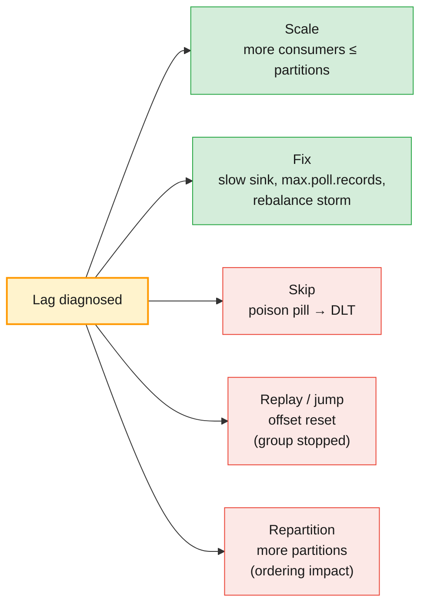

| Remedy | Use when | Risk | Covered in |
| ------ | -------- | ---- | ---------- |
| **Add consumers** | Lag on all partitions, members < partitions, sink can take more | None beyond a rebalance | Module 4 §4.1 |
| **Speed up processing** | Members = partitions, consumer CPU or sink is the bottleneck | Code change | Module 4 §4.3 |
| **Lower `max.poll.records` / raise `max.poll.interval.ms`** | Group keeps rebalancing, `CommitFailedException` in logs | Slightly lower throughput | Module 4 §4.4, §11 |
| **Dead-letter the poison pill** | One partition stuck at one offset | That record needs separate handling | Module 4 §9.3–§9.4 |
| **Reset offsets forward** (`--to-latest`, `--to-datetime`) | Business accepts skipping a window (e.g. stale telemetry) | **Deliberate data loss** for that group — get sign-off | Module 4 §5.5 |
| **Reset offsets backward** (`--shift-by -N`, `--to-datetime`) | Replay after a bug in the consumer | Duplicates downstream unless the consumer is idempotent | Module 4 §5.5, §7.5 |
| **Add partitions** | Members = partitions and you still need more parallelism | Key-to-partition mapping changes for new records | Module 5 §7.4 |
| **More capacity** | Fetch throttling or broker saturation, not the consumer | Cost | Module 8 §5 |

```bash
# (VM) Offset surgery: stop every member first, always dry-run, then execute
kafka-consumer-groups.sh --bootstrap-server $CP --command-config $CFG \
  --group $ME.billing --topic $ME.cdr.voice \
  --reset-offsets --to-datetime 2026-10-12T09:00:00.000 --dry-run
kafka-consumer-groups.sh --bootstrap-server $CP --command-config $CFG \
  --group $ME.billing --topic $ME.cdr.voice \
  --reset-offsets --to-datetime 2026-10-12T09:00:00.000 --execute
```

> **Common trap:** resetting to `--to-latest` to "clear the lag alert". The
> alert goes green and billing silently skips every CDR in between. A
> forward reset on a billing group is a data-loss decision that belongs in
> the incident record with the business owner's name on it.

### 5.4 When lag becomes loss

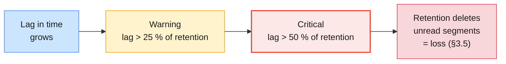

Retention does not care whether a group has read a segment. For a
`cdr.voice` topic with seven days of retention, a billing consumer that stops
on Friday evening and is noticed on the following Saturday morning has lost
data. The thresholds in the diagram are a starting point; what matters is that
**some** lag alert fires long before retention is reached and that it is
expressed in time.

| Emergency lever when lag approaches retention | Effect | Catch |
| --------------------------------------------- | ------ | ----- |
| **Raise `retention.ms` on the topic** (temporarily) | Buys time; deletion pauses for the unread segments | More disk (CP) or storage cost (Cloud); revert afterwards |
| **Scale or fix consumers** (§5.3) | Ends the incident | Takes longer than a config change |
| **Copy the backlog** to a recovery topic with a separate consumer | Preserves data while the main consumer is fixed | Extra tooling and storage |

### 5.5 Lag on Confluent Cloud

```bash
# (VM) The Cloud view of the same question, with the Cloud key from Module 8 Lab 01
FROM=$(date -u -d '-30 min' +%Y-%m-%dT%H:%M:00Z); TO=$(date -u +%Y-%m-%dT%H:%M:00Z)
jq -n --arg lkc "$LKC" --arg g "$ME.billing" --arg i "$FROM/$TO" '{
  aggregations: [{metric: "io.confluent.kafka.server/consumer_lag_offsets"}],
  filter: {op: "AND", filters: [
    {field: "resource.kafka.id", op: "EQ", value: $lkc},
    {field: "metric.consumer_group_id", op: "EQ", value: $g}]},
  granularity: "PT1M", intervals: [$i], group_by: ["metric.partition"]
}' | curl -s --netrc-file ~/kafka/metrics.netrc -H 'Content-Type: application/json' \
       -d @- $MAPI/query | jq -c '.data[]'
```

The query is the one Module 8 Lab 01 used in its watch script, grouped by
partition: one partition climbing while the others stay flat points at a
poison pill or a hot key; all partitions climbing points at consumer
throughput.

---

## 6. Confluent support and escalation model

### 6.1 Who owns what

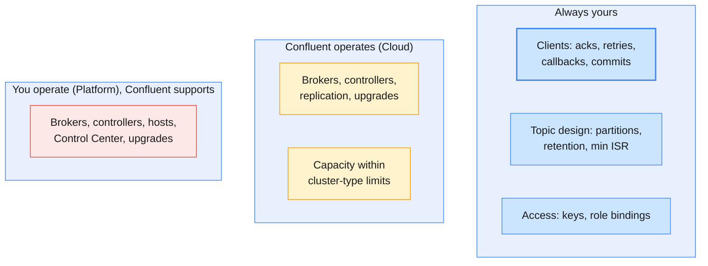

Module 6 §4.1 described the shared-responsibility split. In an incident it
decides who can act: on Cloud you cannot restart a broker or read its log, so
anything below the client and topic layer is a support case; on Platform you
can do everything, and Confluent Support advises on the evidence you provide.

### 6.2 Support plans and priorities (Confluent Cloud)

| Plan | Intended for | P1 initial response | P2 | P3 | P4 |
| ---- | ------------ | ------------------- | -- | -- | -- |
| **Free** | Billing and account questions only | — | — | — | — |
| **Developer** | Non-production; fully managed components only | 8 business hours | 8 business hours | 8 business hours | 2 business days |
| **Business** | Production | 60 minutes | 4 hours | 8 business hours | 2 business days |
| **Premier** | Production, with a Cloud commitment | 30 minutes | 2 hours | 8 business hours | 2 business days |

Figures from Confluent's Cloud support page at the time of writing; check the
current terms for your contract. Priorities follow business impact: **P1**
critical (production down or data at risk), **P2** moderate, **P3** minimal,
**P4** general guidance. Two scope limits matter to administrators: no plan
covers private-networking configuration or external DNS providers, and the
Developer plan does not cover self-managed components (brokers, Control
Center, Replicator, self-managed connectors). For Confluent Platform, what
is covered and how fast follows your subscription's support terms.

> **Common trap:** opening every case as P1. Support triage re-grades the
> priority, and you lose credibility for the day you really need the
> 30-minute response. A lag alert on a dev cluster is P3; billing producers
> failing in production is P1.

### 6.3 Opening a case that gets answered

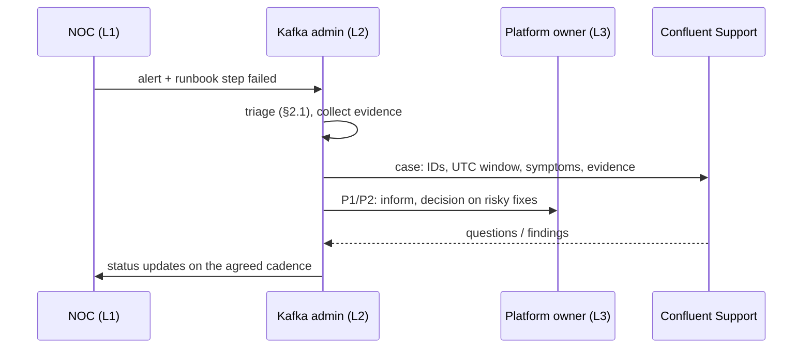

Open cases from the Cloud Console (help icon → **Support portal**) or directly
at `support.confluent.io`. A case is answered faster when the first message
already contains:

| Include | Example |
| ------- | ------- |
| **Identifiers** | Organization, environment `env-…`, cluster `lkc-…` (Cloud); cluster ID and CP version (Platform) |
| **Time window in UTC** | `2026-10-12 09:12–09:31 UTC` |
| **What is broken, measured** | "Produce p99 from 40 ms to 3 s; `client_limit_milliseconds` 900 on topic `cdr.voice`" |
| **What changed** | Deploys, config changes, traffic growth, network changes |
| **Client details** | Library and version, relevant config (secrets removed), exact error text |
| **Evidence** | Metrics API output, client log excerpt, Control Center screenshots; on CP the diagnostics bundle |
| **What you already tried** | And what each attempt changed |

On Confluent Platform, Confluent's **Diagnostics Bundle Tool** collects logs,
configuration files, process information and host information from broker and
Connect hosts into one `.tar.gz`, redacting passwords by default:

```bash
# (CP host, as an administrator) Bundle for the incident window
java -jar diagnostics-bundle-<version>.jar collect --logs-start=2026-10-12T09:00:00Z
```

Upload bundles through Confluent's secure file transfer, not as case
attachments in e-mail. **Never send message content** — CDRs contain
subscriber data.

### 6.4 Your internal escalation path

| Level | Who | Owns | Escalates when |
| ----- | --- | ---- | -------------- |
| **L1** | NOC / operations | Alert acknowledgement, runbook first steps (restart a consumer, check status page) | The runbook step fails or data may be at risk |
| **L2** | Kafka administrators (you) | Triage, evidence, configuration fixes, offset resets with sign-off, support cases | Root cause is in Confluent's side, or a fix carries data-loss risk |
| **L3** | Platform owner, application owners | Decisions on data-loss trade-offs, capacity spend, application changes | Business impact needs a management decision |
| **Vendor** | Confluent Support | Managed-cluster problems (Cloud), product defects, expert guidance (CP) | — |

> **Administrator takeaway:** write the escalation path into the runbook
> *before* the incident: which alerts page whom, which actions L1 may take
> alone, who may approve an offset reset or an unclean election, and which
> support plan and priority apply to each cluster.

---

## 7. Best-practice checklist for preventing message loss

### 7.1 Defence in depth

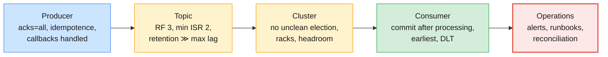

No single setting prevents loss. Each layer closes the gaps the previous one
leaves, and operations catch what slips through anyway.

### 7.2 The checklist

| # | Layer | Check | Applies to | Why (section) |
| - | ----- | ----- | ---------- | ------------- |
| 1 | **Producer** | `acks=all` | All | §3.2, Module 3 §6 |
| 2 | **Producer** | `enable.idempotence=true` (default) and not disabled by a conflicting setting | All | Module 4 §2.3 |
| 3 | **Producer** | Callback failures handled explicitly — persist, retry later or stop; never log-and-continue | All | §3.4, Module 4 §9.2 |
| 4 | **Producer** | `delivery.timeout.ms` chosen deliberately; `record-error-rate` alerted | All | §3.4, §4.4 |
| 5 | **Producer** | `flush()` / `close()` on shutdown so buffered records are sent | All | Module 4 §8.3 |
| 6 | **Topic** | RF 3 | CP, Apache (fixed on Cloud) | §3.3 |
| 7 | **Topic** | `min.insync.replicas=2` on the topic, not just the broker default | All | §3.2 |
| 8 | **Topic** | Retention far longer than the worst plausible consumer outage (weekend + holiday) | All | §5.4 |
| 9 | **Topic** | Cleanup policy deliberate: no `compact` on event streams like `cdr.voice` | All | Module 3 §5.6 |
| 10 | **Cluster** | `unclean.leader.election.enable=false` everywhere | CP, Apache | §3.3 |
| 11 | **Cluster** | Replicas spread across racks / AZs (`broker.rack`) | CP, Apache | Module 5 §3.5 |
| 12 | **Cluster** | Quotas or cluster type sized with headroom; throttling alerted | All | §3.4, Module 8 §5 |
| 13 | **Cluster** | `auto.create.topics.enable=false`, so typos fail loudly instead of writing to a new RF-1 topic | CP, Apache | Module 3 §2 |
| 14 | **Consumer** | Commit **after** processing; at-least-once plus idempotent processing | All | Module 4 §5.2, §7.5 |
| 15 | **Consumer** | `auto.offset.reset=earliest` (or `none` + alert) for billing consumers | All | §3.5 |
| 16 | **Consumer** | Poison pills go to a dead-letter topic, with an alert | All | Module 4 §9.4 |
| 17 | **Consumer** | Offset resets only with a dry run, stopped group and sign-off | All | §5.3 |
| 18 | **Operations** | Alerts: under-min-ISR, offline partitions, lag in time, throttle time, producer errors | All | Module 8 §3.5 |
| 19 | **Operations** | Daily reconciliation of counts between hops for revenue streams | All | §3.6 |
| 20 | **Operations** | Runbooks and escalation path written and rehearsed | All | §6.4 |

> **The production baseline:** items 1, 3, 7, 10, 14 and 18 are the six that
> appear in almost every message-loss post-mortem. If you can only audit six
> things on a new application this week, audit those.

### 7.3 Auditing an existing topic and producer

```bash
# (VM) Topic side: RF, min ISR, unclean election, retention, cleanup policy
kafka-topics.sh --bootstrap-server $CP --command-config $CFG --describe --topic $ME.cdr.voice
kafka-configs.sh --bootstrap-server $CP --command-config $CFG --describe --all \
  --entity-type topics --entity-name $ME.cdr.voice \
  | grep -E 'min.insync.replicas|unclean.leader.election.enable|retention.ms|cleanup.policy'
# Producer side: read the application's configuration, not its documentation
grep -E '^(acks|enable.idempotence|delivery.timeout.ms|retries|max.block.ms)' app-producer.properties
```

> **Common trap:** auditing the topic and trusting the producer. The topic
> can be perfect — RF 3, `min.insync.replicas=2` — and a producer with
> `acks=1` still bypasses all of it, because `min.insync.replicas` only
> applies to `acks=all` writes (Module 3 §6.4).

---

## 8. Hands-on lab: diagnosing message-loss and connectivity scenarios

> **Lab status:** `labs/module-09/` is not written yet. This section is a
> **preview** of the hands-on, built from the Module 8 labs' end state and the
> course environment (`infra/LAB-SETUP.md` §7: *"Trainer-injected faults on
> CC `env-trainer` and CP"*). The Module 9 labs will be the runtime
> companion; when they exist, their commands and expected outputs take
> precedence over this preview.

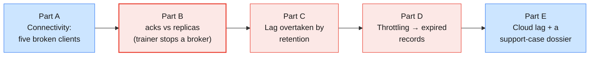

Variables, as in the Module 8 labs (Module 8 left `sa-lNN-app` with
`DeveloperRead` and `MetricsViewer`, its Kafka key in `sa-app.properties` and
its Cloud key in `metrics.netrc`):

```bash
# (VM)
source ~/kafka/confluent.env            # CP, MDS_URL, CP_REST, CP_CA, C3_URL
ME=lNN                                  # your prefix
CFG=~/kafka/cp.properties               # your LDAP user on the shared Confluent Platform
SA_CFG=~/kafka/sa-app.properties        # sa-lNN-app on Confluent Cloud
MAPI=https://api.telemetry.confluent.cloud/v2/metrics/cloud
ENV_ID=env-xxxxx; LKC=lkc-xxxxx         # ← from your Module 7 notes
mkdir -p ~/kafka/m9 && cd ~/kafka/m9
```

### 8.1 Part A — Connectivity: five broken clients

Make five broken copies of your working client file, each with one fault, and
diagnose each one with the layer tests from §4.2 before you look at the fault
list.

```bash
# (VM) 1. The faults (do not read the sed lines too closely — diagnose first)
sed 's/^security.protocol=SASL_SSL/security.protocol=SASL_PLAINTEXT/' $CFG > bad-protocol.properties
grep -v '^ssl.truststore' $CFG > bad-ca.properties
sed 's/password="[^"]*"/password="not-my-password"/' $CFG > bad-password.properties
chmod 600 bad-*.properties
BROKER_IP=$(getent hosts cp-broker-1.lab.internal | awk '{print $1}')

# 2. One helper: list topics with a 40-second ceiling, show the last lines
try() { echo "== $1  $2"; timeout 40 kafka-topics.sh --bootstrap-server "$1" \
          --command-config "$2" --list 2>&1 | tail -n 3; }

try $CP                              $CFG                     # baseline: works
try cp-kafka.lab.internal:9091       $CFG                     # fault 1
try $CP                              bad-protocol.properties  # fault 2
try $CP                              bad-ca.properties        # fault 3
try $CP                              bad-password.properties  # fault 4
try $BROKER_IP:9092                  $CFG                     # fault 5

# 3. Layer tests that separate them
timeout 5 bash -c '</dev/tcp/cp-kafka.lab.internal/9091' && echo open || echo "9091: no TCP"
openssl s_client -connect cp-kafka.lab.internal:9092 -servername cp-kafka.lab.internal -brief </dev/null
openssl s_client -connect cp-kafka.lab.internal:9092 -servername cp-kafka.lab.internal \
  -CAfile $CP_CA -brief </dev/null
```

Fill in the table: for each fault, the layer (§4.1), the error the client
printed (or the fact that it printed nothing and hit the timeout), and the
test that proved it. Notice which faults fail fast with a clear exception
and which only time out — the second kind is why you need the layer tests.

### 8.2 Part B — acks versus replicas

```bash
# (VM) 4. A durable topic: RF 3, min ISR 2
confluent kafka topic create $ME.loss --url $CP_REST --certificate-authority-path $CP_CA \
  --partitions 3 --replication-factor 3 --config min.insync.replicas=2

# 5. Baseline: both acks settings succeed
for a in "acks=all" "acks=1"; do echo "== $a"
  kafka-producer-perf-test.sh --bootstrap-server $CP --command-config $CFG \
    --topic $ME.loss --num-records 5000 --record-size 200 --throughput 1000 \
    --command-property client.id=$ME-loss $a | tail -1
done
```

**The trainer now stops one broker** (announced in the room) for about ten
minutes.

```bash
# (VM) 6. What the cluster says
kafka-topics.sh --bootstrap-server $CP --command-config $CFG --describe --topic $ME.loss
kafka-topics.sh --bootstrap-server $CP --command-config $CFG --describe \
  --topic $ME.loss --under-replicated-partitions

# 7. ISR 2, min ISR 2: acks=all still succeeds
kafka-producer-perf-test.sh --bootstrap-server $CP --command-config $CFG \
  --topic $ME.loss --num-records 5000 --record-size 200 --throughput 1000 \
  --command-property client.id=$ME-loss acks=all | tail -1

# 8. Make the topic demand more replicas than are alive
kafka-configs.sh --bootstrap-server $CP --command-config $CFG --alter \
  --entity-type topics --entity-name $ME.loss --add-config min.insync.replicas=3

# 9. Same load, both acks settings, with a short delivery timeout
for a in "acks=all" "acks=1"; do echo "== $a"
  kafka-producer-perf-test.sh --bootstrap-server $CP --command-config $CFG \
    --topic $ME.loss --num-records 2000 --record-size 200 --throughput 500 \
    --command-property client.id=$ME-loss $a request.timeout.ms=5000 delivery.timeout.ms=15000 \
    2>&1 | grep -E 'NOT_ENOUGH_REPLICAS|NotEnoughReplicas|TimeoutException|records sent' | sort | uniq -c | head
done
```

Expect `acks=all` to log `NOT_ENOUGH_REPLICAS` warnings while it retries and
to fail once `delivery.timeout.ms` expires, and `acks=1` to report success for
records that exist on only two brokers of a topic that asked for three. That
is the difference: `acks=all` *refused* data it could not protect, `acks=1`
*accepted* it. Because the ISR is now below `min.insync.replicas`, the strict
min-ISR rule (Module 3 §6.2) should also stop the high watermark: consumers
do not see the `acks=1` records until the broker returns.

```bash
# (VM) 10. Put it back
kafka-configs.sh --bootstrap-server $CP --command-config $CFG --alter \
  --entity-type topics --entity-name $ME.loss --add-config min.insync.replicas=2
```

When the trainer restarts the broker, run step 6 again and watch the ISR
return to three replicas.

### 8.3 Part C — Lag overtaken by retention

```bash
# (VM) 11. A topic with a deliberately short retention: 3 minutes, 1-minute segments
confluent kafka topic create $ME.cdr.sms --url $CP_REST --certificate-authority-path $CP_CA \
  --partitions 3 --replication-factor 3 \
  --config min.insync.replicas=2 --config retention.ms=180000 --config segment.ms=60000

# 12. 6 000 SMS CDRs, then billing reads 1 000 and stops
kafka-producer-perf-test.sh --bootstrap-server $CP --command-config $CFG \
  --topic $ME.cdr.sms --num-records 6000 --record-size 200 --throughput 100 \
  --command-property client.id=$ME-sms | tail -1
kafka-console-consumer.sh --bootstrap-server $CP --command-config $CFG \
  --topic $ME.cdr.sms --group $ME.billing --from-beginning --max-messages 1000 > /dev/null

# 13. Wait about 8 minutes (retention is checked every 5 minutes by default),
#     producing a little now and then so segments roll
kafka-producer-perf-test.sh --bootstrap-server $CP --command-config $CFG \
  --topic $ME.cdr.sms --num-records 300 --record-size 200 --throughput 10 | tail -1

# 14. Evidence: log-start offsets have passed billing's committed offsets
kafka-get-offsets.sh --bootstrap-server $CP --command-config $CFG --topic $ME.cdr.sms --time -2
kafka-consumer-groups.sh --bootstrap-server $CP --command-config $CFG --describe --group $ME.billing

# 15. Billing restarts with the default reset policy (latest)
kafka-console-consumer.sh --bootstrap-server $CP --command-config $CFG \
  --topic $ME.cdr.sms --group $ME.billing --timeout-ms 15000 > /dev/null
kafka-consumer-groups.sh --bootstrap-server $CP --command-config $CFG --describe --group $ME.billing
```

In step 14, compare each partition's earliest offset with `CURRENT-OFFSET`:
where the earliest offset is higher, retention has deleted records billing
never read. In step 15 lag drops to zero **without** billing processing
anything: the reset to `latest` skipped even the records retention had kept.
Write down how many records billing lost (§3.5) and which two settings would
have prevented it.

Then practise the remediation side on the same group:

```bash
# (VM) 16. Replay what is still retained (group stopped): dry run, then execute
kafka-consumer-groups.sh --bootstrap-server $CP --command-config $CFG \
  --group $ME.billing --topic $ME.cdr.sms --reset-offsets --to-earliest --dry-run
kafka-consumer-groups.sh --bootstrap-server $CP --command-config $CFG \
  --group $ME.billing --topic $ME.cdr.sms --reset-offsets --to-earliest --execute
kafka-consumer-groups.sh --bootstrap-server $CP --command-config $CFG --describe --group $ME.billing
```

### 8.4 Part D — Throttling that turns into expired records

**The trainer applies a produce quota to each learner user** on the
Confluent Platform cluster for this part. It is set per learner, not as a
user default, so the service principals of Control Center, Connect and
Schema Registry are not throttled:

```bash
# (trainer VM, as the trainer, after source ~/kafka/confluent.env) Throttle learners to 256 KiB/s per broker
for u in $(seq -f "l%02g" 1 18); do
  kafka-configs.sh --bootstrap-server $CP --command-config ~/kafka/cp.properties --alter \
    --entity-type users --entity-name $u --add-config producer_byte_rate=262144
done
```

```bash
# (VM) 17. Unlimited load: watch throughput flatten and throttle time appear
kafka-producer-perf-test.sh --bootstrap-server $CP --command-config $CFG \
  --topic $ME.loss --num-records 50000 --record-size 1000 --throughput -1 \
  --command-property client.id=$ME-flood --print-metrics \
  | grep -E 'records sent|produce-throttle-time-(avg|max)|record-error-rate'

# 18. Same load, with a producer that gives up quickly
kafka-producer-perf-test.sh --bootstrap-server $CP --command-config $CFG \
  --topic $ME.loss --num-records 50000 --record-size 1000 --throughput -1 \
  --command-property client.id=$ME-flood request.timeout.ms=3000 delivery.timeout.ms=5000 \
  2>&1 | grep -c 'Expiring'
```

Step 17 shows throttling with no loss: the producer slows down and every
record arrives. Step 18 shows the same throttling becoming loss: records
expire in the producer, and an application that ignores those callbacks has
dropped them. Compare the number of expired records with
`kafka-get-offsets.sh --time -1` on `$ME.loss` before and after the run.

The trainer removes the quotas afterwards
(`--delete-config producer_byte_rate` with the same loop).

### 8.5 Part E — Cloud lag and a support-case dossier

```bash
# (VM) 19. Cloud context; read-only: Module 8 left sa-lNN-app with DeveloperRead
confluent environment use $ENV_ID; confluent kafka cluster use $LKC
CCLOUD=$(confluent kafka cluster describe -o json | jq -r .endpoint | sed 's#SASL_SSL://##')
openssl s_client -connect $CCLOUD -servername ${CCLOUD%:*} -brief </dev/null
kafka-consumer-groups.sh --bootstrap-server $CCLOUD --command-config $SA_CFG \
  --describe --group $ME.billing

# 20. The same lag from the Metrics API, per partition (§5.5 query)

# 21. A broken Cloud client: the right key with a wrong secret
sed 's/password="[^"]*"/password="not-the-secret"/' $SA_CFG > bad-cloud.properties; chmod 600 bad-cloud.properties
timeout 40 kafka-topics.sh --bootstrap-server $CCLOUD --command-config bad-cloud.properties --list 2>&1 | tail -n 3
```

Finish by writing `~/kafka/m9/case.md` as if you were opening a Confluent
Cloud support case for fault 21 or for Part C: identifiers (`env-…`,
`lkc-…`), a UTC time window, the measured symptom, what changed, the client
version (`kafka-topics.sh --version`), the exact error text and what you
tried (§6.3). Choose a priority (§6.2) and justify it in one line. Do not
paste secrets or record contents.

**Clean up:**

```bash
# (VM) Platform: your topics and groups only
confluent kafka topic delete $ME.loss --url $CP_REST --certificate-authority-path $CP_CA --force
confluent kafka topic delete $ME.cdr.sms --url $CP_REST --certificate-authority-path $CP_CA --force
for g in billing perf; do
  kafka-consumer-groups.sh --bootstrap-server $CP --command-config $CFG --delete --group $ME.$g
done
# Local files with credentials
rm -f ~/kafka/m9/bad-*.properties
```

| Observation | Concept | Where it's covered |
| ----------- | ------- | ------------------ |
| Some broken clients fail fast with an exception, others only time out | Layered connectivity; TCP and protocol mismatches hide behind timeouts | §4.1–§4.2 |
| The client trusts the hostname, not the broker IP | TLS hostname verification | §4.3, Module 7 §9 |
| With one broker down, `acks=all` keeps working at min ISR 2 | RF 3 / min ISR 2 tolerates one failure | §3.2, Module 3 §6.4 |
| With min ISR 3, `acks=all` fails and `acks=1` "succeeds" | `acks=1` accepts data the cluster cannot protect | §3.2 |
| `acks=1` records are not readable until the ISR recovers | Strict min-ISR rule holds the high watermark | Module 3 §6.2 |
| Earliest offset passes the committed offset | Lag overtaken by retention | §3.5, §5.4 |
| Lag drops to zero without processing | `auto.offset.reset=latest` skipped the backlog | §3.5 |
| Throughput flattens and throttle time rises, no errors | Quota throttling delays, it does not drop | §3.4 |
| Short `delivery.timeout.ms` turns throttling into expired records | Producer-side loss | §3.4 |
| Wrong Cloud secret fails at authentication | Layer 4: SASL | §4.1, Module 7 §9 |
| A case needs IDs, UTC times, measured symptoms and no record contents | Support case quality | §6.3 |

---

## 9. Troubleshooting quick reference

```mermaid
flowchart TB
    S["Incident"] --> Q1{"Can clients<br/>connect at all?"}
    Q1 -->|no| A1["§4: DNS → TCP → TLS →<br/>SASL → authz → metadata"]
    Q1 -->|yes| Q2{"Producers<br/>failing?"}
    Q2 -->|yes| A2["Error class (§2.4):<br/>NOT_ENOUGH_REPLICAS → ISR<br/>throttle → quota / limits<br/>authz → bindings"]
    Q2 -->|no| Q3{"Consumers<br/>behind?"}
    Q3 -->|yes| A3["§5 lag triage"]
    Q3 -->|no| A4["Missing data:<br/>reconcile hops (§3.6)"]

    style S fill:#cce5ff,stroke:#4285f4,stroke-width:1px,color:#1a1a1a
    style Q1 fill:#fff3cd,stroke:#ff9800,stroke-width:2px,color:#1a1a1a
    style Q2 fill:#fff3cd,stroke:#ff9800,stroke-width:1px,color:#1a1a1a
    style Q3 fill:#fff3cd,stroke:#ff9800,stroke-width:1px,color:#1a1a1a
    style A1 fill:#fce8e6,stroke:#ea4335,stroke-width:1px,color:#1a1a1a
    style A2 fill:#fce8e6,stroke:#ea4335,stroke-width:1px,color:#1a1a1a
    style A3 fill:#fce8e6,stroke:#ea4335,stroke-width:1px,color:#1a1a1a
    style A4 fill:#fce8e6,stroke:#ea4335,stroke-width:1px,color:#1a1a1a
```

| Symptom | Likely cause | Check / fix |
| ------- | ------------ | ----------- |
| **Client hangs, then "timed out waiting for a node assignment"** | Port blocked, cluster stopped, or protocol mismatch | §4.2 layer tests from the client's host |
| **`SSLHandshakeException` / PKIX** | CA not trusted, certificate expired, IP used instead of hostname | `openssl s_client -CAfile`; Module 7 §9 |
| **`SaslAuthenticationException`** | Wrong secret, wrong key for this cluster, deleted key or owner | Re-check the client file; Module 7 §5.3 |
| **Bootstrap works, produce times out on some partitions** | Advertised broker addresses unreachable | §4.3 |
| **Many `NOT_LEADER_OR_FOLLOWER` warnings for a minute** | Rolling restart or Cloud maintenance | None if they stop |
| **`NOT_ENOUGH_REPLICAS` persists** | ISR < `min.insync.replicas` | `--under-min-isr-partitions`; recover the broker; never lower min ISR on billing topics to "fix" it |
| **`TimeoutException: Expiring N record(s)`** | Records outlived `delivery.timeout.ms` | Find the cause (ISR, throttling, network); make sure the app handled the callbacks |
| **Throttle time > 0** | Quota (CP) or cluster limit (Cloud) | §3.4; Module 8 §5.2 |
| **Lag on one partition, stuck offset** | Poison pill or hot key | DLT the record; key review (§5.3) |
| **Lag on all partitions, group stable** | Consumers too slow | Scale ≤ partitions, speed up the sink |
| **Group rebalancing in a loop** | `max.poll.interval.ms` exceeded or crash loop | Lower `max.poll.records`; fix the crash |
| **Lag dropped to 0 with no processing** | Offset reset to `latest` (`OffsetOutOfRange`, expired offsets) | §3.5; switch billing to `earliest`; quantify the gap |
| **Committed offset below log-start offset** | Lag exceeded retention | Raise retention temporarily; fix consumers; report the loss |
| **Billing DB short, Kafka counts match** | Consumer-side loss: commit before processing, skipped records | Consumer code review (§3.5) |
| **Partition offline** | No ISR or ELR replica alive | Recover a replica; unclean election only as a recorded decision (§3.3) |
| **Cloud: everything fails in one region** | Platform incident | `status.confluent.cloud`; P1 case if production (§6) |

---

## 10. Bridging to the rest of the course

| Question this module raises | Answered in |
| --------------------------- | ----------- |
| How do I avoid loss when records cross clusters with Replicator or migrate from Apache Kafka to Confluent? | Module 10 |
| How do schemas prevent the "poison pill" class of consumer failures? | Module 10 (Schema Registry, compatibility) |
| What does disaster recovery add when a whole cluster or region is lost? | Module 10 (Replicator, multi-datacenter replication) |
| How do managed connectors report errors and dead-letter records? | Module 10 |
| How do I run the whole detect–diagnose–fix–prevent loop end to end? | Module 10 capstone |

```mermaid
flowchart LR
    M9["Module 9:<br/>troubleshoot &<br/>prevent loss"] --> M10["Module 10:<br/>ecosystem, migration,<br/>DR & capstone"]
    M10 --> END["Course capstone:<br/>administer, monitor,<br/>troubleshoot"]
    style M9 fill:#fff3cd,stroke:#ff9800,stroke-width:2px,color:#1a1a1a
    style M10 fill:#fce8e6,stroke:#ea4335,stroke-width:1px,color:#1a1a1a
    style END fill:#fce8e6,stroke:#ea4335,stroke-width:1px,color:#1a1a1a
```

Previous guides: [Module 3](./module-03-cluster-configuration-storage-retention.md)
for `acks`, `min.insync.replicas` and retention,
[Module 4](./module-04-producing-consuming-messages.md) for producer errors,
commits, offset resets and dead-letter topics,
[Module 5](./module-05-cluster-operations-replication-ha.md) for ISR, ELR and
unclean election, [Module 7](./module-07-administering-kafka-security.md) for
authentication and authorization errors, and
[Module 8](./module-08-monitoring-performance-tuning.md) for the indicators
and alerts that start every investigation here.

---

## 11. Key takeaways

1. **Evidence before action.** Scope, evidence, hypothesis, fix, verify,
   prevent — and write down the UTC time before you change anything.
2. **Start with the client.** On Confluent Cloud the client log and the
   Metrics API are the only evidence; on Platform the controller log explains
   leadership and the broker log shows the consequence.
3. **Classify every error.** Transient errors are retried by the client;
   configuration errors need a change; limit errors need less load or more
   capacity.
4. **Loss is configured, not random.** `acks=0/1`, `min.insync.replicas=1`,
   RF below 3 and unclean election are the replication-side causes; RF 3,
   min ISR 2, `acks=all` and idempotence are the cure.
5. **Throttling becomes loss in the producer.** Quotas and Cloud limits only
   delay responses; records are lost when `delivery.timeout.ms` expires and
   the application ignores the callback.
6. **Consumers lose data too.** Commit before processing, resets to
   `latest`, expired offsets and lag that outlives retention all lose records
   the broker stored correctly.
7. **Connectivity has six layers.** DNS, TCP, TLS, SASL, authorization and
   advertised-listener metadata — test from the client's own network, bottom
   up.
8. **Lag needs a time unit and a remedy.** Convert lag to minutes and to
   headroom against retention; scale, fix, dead-letter or reset — and treat a
   forward reset as a signed-off data-loss decision.
9. **Support is part of the design.** Know your plan and priorities, open
   cases with IDs, UTC windows and measured symptoms, use the diagnostics
   bundle on Platform, and never send message content.
10. **Prevention is a checklist.** Producer, topic, cluster, consumer and
    operations each close gaps the others leave; reconcile counts between
    hops for every revenue stream.

---

## 12. Glossary

| Term | Definition |
| ---- | ---------- |
| **Triage** | The structured first phase of an incident: scope, evidence and a hypothesis before any fix |
| **Root cause** | The single cause that explains every observation in an incident |
| **Transient (retriable) error** | An error the client retries automatically, such as `NOT_LEADER_OR_FOLLOWER` or `NOT_ENOUGH_REPLICAS` |
| **Non-retriable error** | An error that needs a change, such as an authorization failure or an oversized record |
| **`acks`** | Producer setting for how many replicas must confirm a write: `0`, `1` or `all` |
| **`min.insync.replicas`** | Topic or broker setting for the minimum ISR size that `acks=all` writes require |
| **Unclean leader election** | Electing an out-of-sync replica as leader; restores availability at the cost of acknowledged data |
| **Delivery timeout** | `delivery.timeout.ms`: the longest a record may stay in the producer before its callback fails |
| **Throttling** | Broker delaying responses to a client over its quota or the cluster's limits |
| **Quota** | Per-user or per-client byte-rate or request-time limit on a self-managed cluster |
| **Advertised listener** | The host and port a broker tells clients to use after bootstrap |
| **SNI** | Server Name Indication: the TLS field carrying the hostname; Confluent Cloud routing depends on it |
| **Log-start offset** | The earliest offset still stored in a partition; rises as retention deletes segments |
| **`OffsetOutOfRange`** | Consumer error when its position no longer exists in the partition; triggers `auto.offset.reset` |
| **`auto.offset.reset`** | Where a consumer starts without a valid offset: `earliest`, `latest`, `none` or `by_duration:` |
| **Dead-letter topic (DLT)** | A topic that receives records a consumer cannot process, so the partition can move on |
| **Offset reset** | Administrative change of a group's committed offsets (`--reset-offsets`); skips or replays data |
| **Reconciliation** | Comparing record counts between producer, topic and consumer to locate a loss |
| **Support priority (P1–P4)** | Confluent's case severity, from critical business impact to general guidance |
| **Diagnostics Bundle Tool** | Confluent Platform tool that packages logs, configs and host information for Support |
| **Escalation path** | Who handles an incident at each level (NOC, Kafka admin, platform owner, vendor) and when it moves up |

---

## 13. References

**Apache Kafka (official)**

- Producer configs (4.3) — <https://kafka.apache.org/43/configuration/producer-configs/>
- Consumer configs (4.3) — <https://kafka.apache.org/43/configuration/consumer-configs/>
- Topic configs (4.3) — <https://kafka.apache.org/43/configuration/topic-configs/>
- Design: replication, quotas (4.3) — <https://kafka.apache.org/43/design/design/>
- Basic Kafka operations (4.3) — <https://kafka.apache.org/43/operations/basic-kafka-operations/>
- Monitoring (4.3) — <https://kafka.apache.org/43/operations/monitoring/>

**Kafka Improvement Proposals (KIPs)**

- KIP-966: Eligible Leader Replicas — <https://cwiki.apache.org/confluence/display/KAFKA/KIP-966%3A+Eligible+Leader+Replicas>

**Confluent Cloud**

- Test connectivity to Confluent Cloud — <https://docs.confluent.io/cloud/current/networking/testing.html>
- Observability for Kafka clients to Confluent Cloud — <https://docs.confluent.io/cloud/current/monitoring/ccloud-observability.html>
- Confluent Cloud Apache Kafka client FAQ — <https://docs.confluent.io/cloud/current/client-apps/client-faq.html>
- Monitor consumer lag in Confluent Cloud — <https://docs.confluent.io/cloud/current/monitoring/monitor-lag.html>
- Confluent Cloud Metrics — <https://docs.confluent.io/cloud/current/monitoring/metrics-api.html>
- Confluent Support for Confluent Cloud — <https://docs.confluent.io/cloud/current/support.html>
- Confluent Cloud support plans — <https://www.confluent.io/confluent-cloud/support/>
- Confluent Cloud status — <https://status.confluent.cloud/>

**Confluent Platform**

- Diagnostics Bundling Tool for Confluent Platform — <https://docs.confluent.io/platform/current/tools/diagnostics-tool.html>
- Kafka replication (Confluent docs) — <https://docs.confluent.io/kafka/design/replication.html>
- Producer configuration reference — <https://docs.confluent.io/platform/current/installation/configuration/producer-configs.html>
- Consumer configuration reference — <https://docs.confluent.io/platform/current/installation/configuration/consumer-configs.html>

**Course environment**

- Lab environment setup — [`infra/LAB-SETUP.md`](../infra/LAB-SETUP.md)
- Connect to the shared Confluent Platform cluster (hosts, logs) — [`infra/guides/confluent-platform-cluster-connect.md`](../infra/guides/confluent-platform-cluster-connect.md)

**Books**

- *Kafka: The Definitive Guide*, 2nd ed. (Shapira, Palino, Sivaram, Petty; O'Reilly)

---

> **Next module:** _Module 10 — Ecosystem, Migration, Backup/DR & Capstone_,
> where you meet the rest of the Confluent ecosystem — managed connectors,
> Schema Registry and ksqlDB — protect data across clusters with Replicator
> and multi-datacenter replication, plan a migration from Apache Kafka to
> Confluent, and run the end-to-end capstone that brings administration,
> monitoring and troubleshooting together.
