# Module 10 — Ecosystem, Migration, Backup/DR & Capstone

> **Course:** Apache Kafka & Confluent Kafka Administration
> **Module objective:** Administer the Confluent Kafka ecosystem and evaluate
> migration considerations from Apache Kafka to Confluent Kafka.

---

## Table of contents

1. [Why this module matters](#1-why-this-module-matters)
2. [Confluent managed connectors overview (source/sink)](#2-confluent-managed-connectors-overview-sourcesink)
3. [Confluent Schema Registry: schema evolution and compatibility](#3-confluent-schema-registry-schema-evolution-and-compatibility)
4. [ksqlDB on Confluent — overview](#4-ksqldb-on-confluent--overview)
5. [Backup and DR: Confluent Replicator and multi-datacenter replication](#5-backup-and-dr-confluent-replicator-and-multi-datacenter-replication)
6. [Migration considerations: Apache Kafka → Confluent Kafka](#6-migration-considerations-apache-kafka--confluent-kafka)
7. [Best practices for application developers integrating with Kafka](#7-best-practices-for-application-developers-integrating-with-kafka)
8. [Best practices for Kafka administrators and operations teams](#8-best-practices-for-kafka-administrators-and-operations-teams)
9. [Hands-on lab: ecosystem, migration rehearsal and capstone](#9-hands-on-lab-ecosystem-migration-rehearsal-and-capstone)
10. [Bridging to the rest of the course](#10-bridging-to-the-rest-of-the-course)
11. [Key takeaways](#11-key-takeaways)
12. [Glossary](#12-glossary)
13. [References](#13-references)

> **How to read the diagrams:** Diagrams are written in [Mermaid](https://mermaid.js.org/),
> which renders automatically in GitHub, VS Code (with a Mermaid extension), and most
> modern Markdown viewers. If a diagram appears as code, install/enable a Mermaid
> preview to see the rendered version.

> **Builds on:** [Module 9 — Troubleshooting & Preventing Message Loss on Confluent Kafka](./module-09-troubleshooting-preventing-message-loss.md).
> This module assumes the Confluent components and the two Confluent targets
> from Module 6 §2 and §4 (with the Schema Registry, Connect and ksqlDB labs
> 06–08 of `labs/module-06`), role bindings and service accounts from Module 7
> §4–§5, the indicators and alerts from Module 8 §2–§3, and the loss model and
> prevention checklist from Module 9 §3 and §7. It focuses on the **rest of the
> ecosystem as an operator sees it**, on **protecting data across clusters**,
> on **moving a production platform** from Apache Kafka to Confluent, and on
> the **practices** developers and operations teams need to run it for years.

---

## 1. Why this module matters

Nine modules have made you the administrator of a cluster. Real platforms are
more than a cluster. The billing team's CDRs arrive through a **connector**
from the mediation database, every record is shaped by a **schema** that six
teams depend on, the fraud team runs a **SQL query** that never stops, the
regulator asks what happens if the data centre burns down, and management
wants the Apache Kafka estate moved to Confluent without pausing billing.
Each of those is a new component to secure, monitor, back up and upgrade —
and each one fails in its own way.

For an IBM MQ administrator, much of this has a familiar shape. Connectors
play the role of MQ bridges and channel exits that move data in and out of the
messaging layer; Schema Registry is the message-format contract you used to
keep in a copybook or an XSD on a shared drive, now enforced at send time;
Replicator and MirrorMaker 2 are the cross-site channels of a multi-instance
or replicated queue manager design; and a migration is a queue-manager
consolidation with one important difference: **Kafka consumers keep their own
position**, and that position does not travel between clusters by itself.

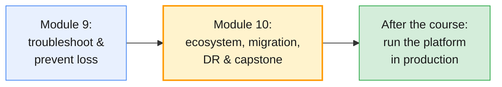

The module works on all four course targets: your **Confluent Cloud**
environment `env-lNN` (managed connectors, Schema Registry), the shared
**Confluent Platform** cluster on AWS (Schema Registry, Connect with
Replicator, ksqlDB), the shared **Apache Kafka** cluster as the migration
source, and your own Docker cluster as a recovery site in the capstone.

By the end of this module you will be able to:

- Operate **fully managed and self-managed connectors**: choose between them,
  give them a least-privilege identity, read their status and handle failed
  tasks and dead-letter records.
- Administer **Schema Registry**: choose and enforce a compatibility mode,
  evolve a schema safely, protect subjects with RBAC and explain why schema
  IDs never travel between registries.
- Explain where **ksqlDB** fits, what it puts on your cluster and what you
  must monitor when it runs in production.
- Design **backup and DR** with Replicator, MirrorMaker 2 or Cluster Linking,
  stating RPO, RTO and how consumer positions survive a failover.
- Plan and rehearse a **migration from Apache Kafka to Confluent**: data copy,
  client cutover, dual-write trade-offs, go/no-go and rollback.
- Apply the **best practices** that keep a Kafka platform healthy: the
  developer's integration contract and the operations team's day-2 routine.
- Run the **end-to-end capstone**: administer, monitor and troubleshoot a
  live scenario on the Confluent cluster.

---

## 2. Confluent managed connectors overview (source/sink)

### 2.1 Kafka Connect in one picture

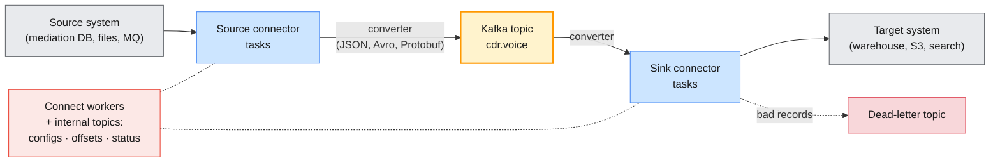

Kafka Connect is the integration runtime of Apache Kafka: a cluster of
**workers** that run **connectors**, each split into **tasks** that move data.
A **source** connector reads an external system and produces to topics; a
**sink** connector consumes topics and writes to an external system. A
**converter** turns records into bytes and back, and is where Schema Registry
plugs in (§3). In distributed mode, Connect keeps all of its state in three
compacted Kafka topics — `config.storage.topic`, `offset.storage.topic` and
`status.storage.topic` — so a Connect cluster is "a group of workers plus a
few topics", which is exactly how you met it in Module 6 Lab 07.

| Term | What it is | Administrator view |
| ---- | ---------- | ------------------ |
| **Worker** | A JVM process in a Connect cluster | Capacity, heap, restarts, plugin path |
| **Plugin** | The connector's code (JARs) | Installed per worker on Platform; a catalog entry on Cloud |
| **Connector** | A configured instance of a plugin | Has a name, a config, a state |
| **Task** | A unit of work; `tasks.max` caps the count | The thing that actually fails |
| **Converter** | Serializes keys and values | Must match what producers and consumers expect |
| **SMT** | Single Message Transform: a per-record tweak | Keep them small; heavy logic belongs in stream processing |

### 2.2 Fully managed versus self-managed

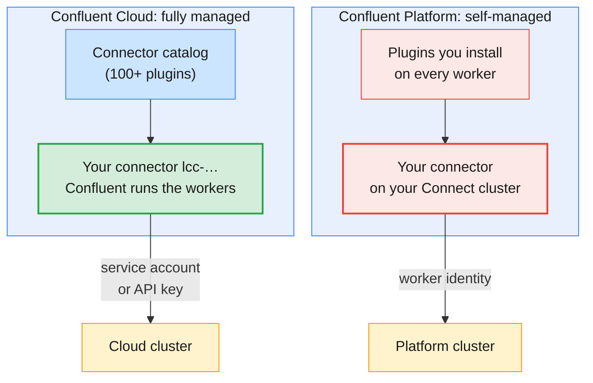

| Question | Fully managed (Cloud) | Self-managed (Platform or Apache Connect) |
| -------- | --------------------- | ----------------------------------------- |
| **Who installs and patches the plugin?** | Confluent | You, on every worker, with a rolling restart |
| **Who sizes and scales workers?** | Confluent; you set `tasks.max` | You: worker count, heap, CPU |
| **How do you configure it?** | Confluent CLI, Cloud Console, Connect API; catalog names such as `DatagenSource` | Connect REST API (`/connectors`), full Java class names, converters spelled out |
| **Whose identity reaches Kafka?** | The connector's: `kafka.auth.mode` = `SERVICE_ACCOUNT` or `KAFKA_API_KEY` | The worker's own principal; per-connector overrides if allowed |
| **Networking** | Egress from Confluent's network to your source/target (public, or private egress endpoints) | Whatever your worker hosts can reach |
| **Cost model** | Task-hours plus throughput; a **paused** connector still accrues its hourly base cost | Your hosts and licences |
| **What it cannot do** | Only catalog plugins (or custom-connector uploads); some connectors lack features such as restart | Anything you can install — and anything you can break |

> **Cost trap on Confluent Cloud:** pausing a managed connector does not stop
> the bill. Confluent's connector overview states that paused managed
> connectors keep accruing their hourly base cost. Delete connectors you are
> not using, as Module 6 Lab 07 made you do the same session.

### 2.3 Operating a managed connector

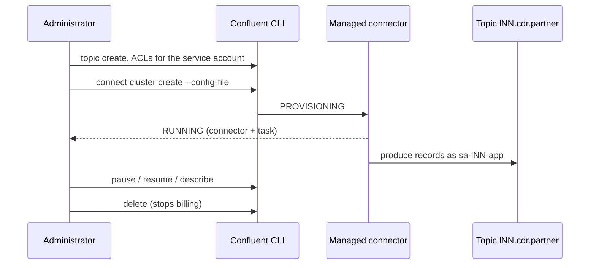

The lifecycle you practised in Module 6 Lab 07 becomes a production routine
once you add three rules:

| Rule | Why | How |
| ---- | --- | --- |
| **The topic exists before the connector** | Brokers do not create topics on demand (`auto.create.topics.enable=false` on the course clusters); a missing topic fails the task, not the create | Create topics from your topic catalog first |
| **A connector gets its own identity** | A connector with a user's API key dies when that user leaves, and its secret sits in a config file | `kafka.auth.mode=SERVICE_ACCOUNT` with `kafka.service.account.id`; grant exactly the ACLs or roles the connector needs |
| **Configs are code** | A connector created in the UI cannot be reviewed, repeated or rolled back | Keep the JSON in Git without secrets; create with `--config-file` |

For a source connector in service-account mode, Confluent's documentation
lists two ACLs on the service account: `DESCRIBE` on the cluster and `WRITE`
on the target topic. A sink connector needs `READ` on its topics and on its
consumer group (named `connect-lcc-…`), plus `WRITE` on its dead-letter topic.

> **Administrator rule:** never paste a connector configuration that contains
> `kafka.api.secret` into a ticket or a chat. `confluent connect cluster
> describe` masks it, but the JSON file on your disk does not. Service-account
> mode removes the secret from the file altogether.

### 2.4 When a connector fails: tasks, retries and dead letters

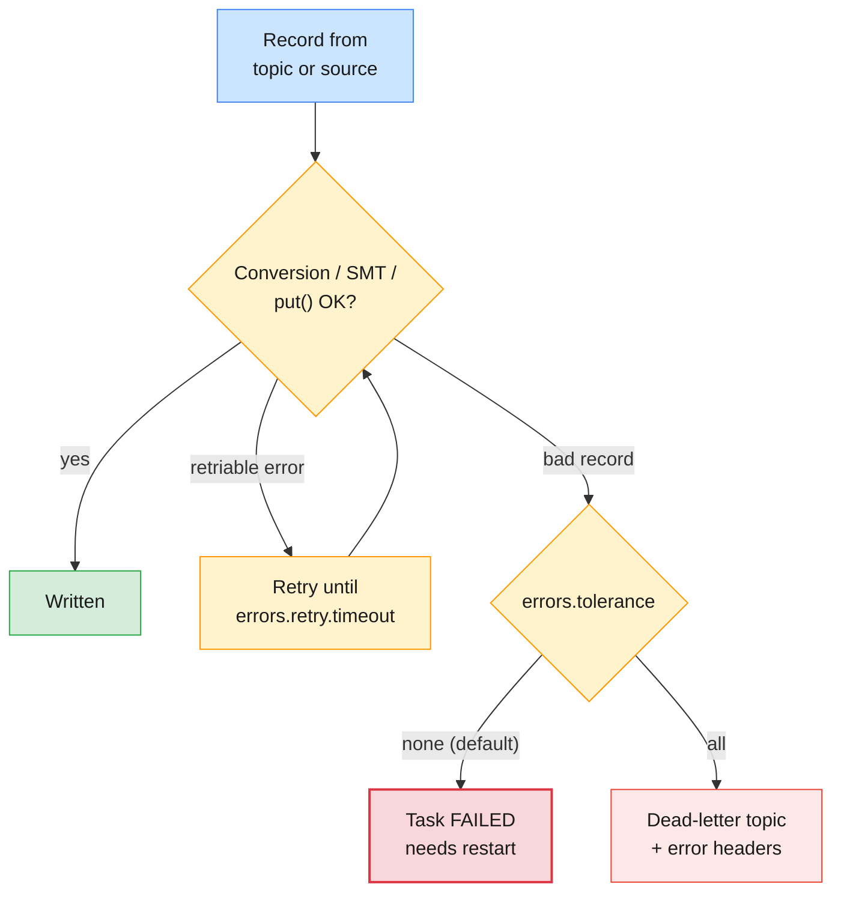

| Setting (Apache Kafka Connect) | Default | Effect |
| ------------------------------ | ------- | ------ |
| `errors.tolerance` | `none` | Fail fast: the first bad record fails the task |
| `errors.retry.timeout` | `0` | How long retriable errors are retried before failing |
| `errors.log.enable` | `false` | Log each error; `errors.log.include.messages` adds the payload (sensitive) |
| `errors.deadletterqueue.topic.name` | *(empty)* | Sink connectors only: route bad records to this topic |
| `errors.deadletterqueue.context.headers.enable` | `false` | Add the failing topic, partition, offset and exception as headers |

On **Confluent Cloud**, managed sink connectors route serialization errors to
a dead-letter topic named `dlq-<connector-ID>` by default and keep running;
each DLQ record carries headers such as `__connect.errors.topic` and
`__connect.errors.exception.message`.

> **Common trap:** a connector whose **state** is `RUNNING` can have a
> `FAILED` task that has moved nothing for hours (Module 6 Lab 07 Part 4).
> Alert on **task state** and on the DLQ topic's growth, not on the connector
> state alone — the Module 8 §3.4 alert pattern applies unchanged.

> **A dead-letter topic is not a solution:** it is a queue of work for a
> human. Give every DLQ an owner, a retention long enough for that owner to
> act (Module 9 §5.4), and a replay procedure — the same rules as the retry
> and dead-letter topics of Module 4 §9.4.

### 2.5 Self-managed Connect on Confluent Platform

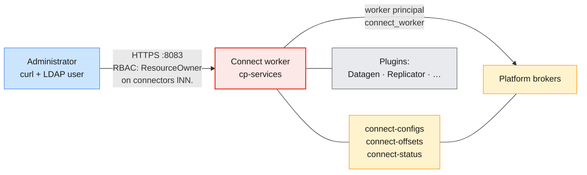

On the course's Platform cluster, Connect runs on the services node next to
Schema Registry and ksqlDB, behind the REST API you drove with the `cn`
helper. The endpoints an administrator uses every week:

| Endpoint | Use |
| -------- | --- |
| `GET /connector-plugins` | What is installed (Datagen, Replicator) |
| `GET /connectors` / `POST /connectors` | List / create |
| `GET /connectors/<name>/status` | Connector and **task** states, `worker_id`, `trace` |
| `PUT /connectors/<name>/pause` · `/resume` | Stop and restart data movement, keep the config |
| `POST /connectors/<name>/tasks/<id>/restart` | Restart one failed task after fixing the cause |
| `GET /connectors/<name>/config` · `PUT …/config` | Read / replace the configuration |
| `DELETE /connectors/<name>` | Remove (source offsets stay in the offsets topic) |

> **Production baseline for self-managed Connect:** at least two workers per
> Connect cluster so tasks move when one stops; internal topics with
> replication factor 3; one Connect cluster per team or per criticality class,
> because one misbehaving connector shares a JVM with everything else on that
> worker; plugin versions pinned and identical on every worker; and the REST
> API behind TLS and RBAC, because anyone who can `PUT` a config can point
> your data anywhere.

---

## 3. Confluent Schema Registry: schema evolution and compatibility

### 3.1 Why schemas, and what goes on the wire

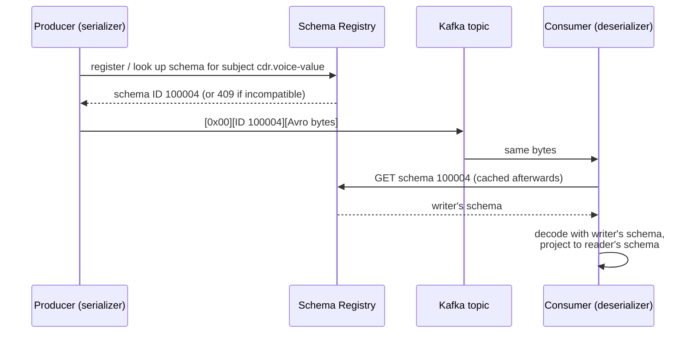

Kafka stores bytes and never looks inside them. Without a contract, the first
producer that renames a field breaks every consumer, and you find out from a
poison-pill incident (Module 9 §3.5). Schema Registry moves that failure to
**send time**: the serializer asks the registry before it writes, and an
incompatible schema is refused with `409` — the record never reaches Kafka, as
you saw in Module 6 Lab 06 Part 4.3. Each record carries a **magic byte**
(`0x00`) and a **4-byte schema ID** in front of the payload.

| Format | Strengths | Watch out for |
| ------ | --------- | ------------- |
| **Avro** | Compact, mature evolution rules, defaults drive compatibility | Needs the schema to read anything |
| **Protobuf** | Familiar to gRPC teams, field numbers make evolution explicit | Never reuse a field number |
| **JSON Schema** | Human-readable payloads | Larger records; compatibility rules are subtler with open content models |

### 3.2 Subjects and naming strategies

A **subject** is the name under which versions of a schema evolve. The
serializer derives it from the topic and record with a naming strategy, set by
`key.subject.name.strategy` and `value.subject.name.strategy`:

| Strategy | Subject for topic `cdr.voice` | Use when |
| -------- | ----------------------------- | -------- |
| **TopicNameStrategy** (default) | `cdr.voice-value` | One record type per topic — the normal case |
| **RecordNameStrategy** | `com.telco.Cdr` | The same type on many topics, evolved once |
| **TopicRecordNameStrategy** | `cdr.voice-com.telco.Cdr` | Several types on one topic, each evolved per topic |

On the course's Platform registry your RBAC binding is `ResourceOwner` on
`Subject:lNN.` (prefixed), so TopicNameStrategy with prefixed topics gives
you prefixed subjects automatically. With RecordNameStrategy the subject is
the record's full name and **does not** carry your prefix — a reason to agree
the strategy before RBAC is designed.

### 3.3 Compatibility types

| Mode | Checked against | Allowed changes | Deploy first |
| ---- | --------------- | --------------- | ------------ |
| **BACKWARD** (default) | Latest version | Delete fields; add **optional** fields (with defaults) | **Consumers** |
| **BACKWARD_TRANSITIVE** | All versions | Same | Consumers |
| **FORWARD** | Latest version | Add fields; delete optional fields | **Producers** |
| **FORWARD_TRANSITIVE** | All versions | Same | Producers |
| **FULL** | Latest, both ways | Add or delete **optional** fields only | Either, independently |
| **FULL_TRANSITIVE** | All versions, both ways | Same | Either |
| **NONE** | Nothing | Anything | Coordinated big-bang — avoid |

BACKWARD is the default because it lets you **rewind consumers to the start of
a topic**: a new consumer can read every record ever written. Kafka Streams
applications are only supported under BACKWARD.

> **Common trap — non-transitive modes:** BACKWARD checks the new schema only
> against the **latest** version. Three individually compatible steps can
> still produce a schema that cannot read version 1, and a topic with 7-day or
> compacted retention still holds version-1 records. For business topics whose
> data outlives a few releases (`billing.charges`, compacted `subscriber.plan`),
> choose a **transitive** mode.

### 3.4 Evolving a CDR schema safely

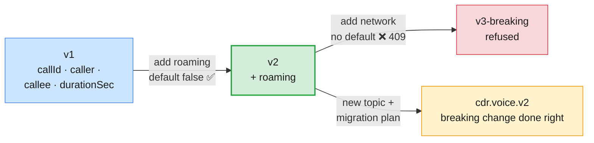

| Change to an Avro record | BACKWARD | FORWARD | FULL |
| ------------------------ | -------- | ------- | ---- |
| Add a field **with** a default | ✅ | ✅ | ✅ |
| Add a field **without** a default | ❌ | ✅ | ❌ |
| Delete a field that had a default | ✅ | ✅ | ✅ |
| Delete a field without a default | ✅ | ❌ | ❌ |
| Rename a field | ❌ unless the new schema declares the old name as an alias | ❌ | ❌ |
| Change a type (`int` → `string`) | ❌ (except Avro promotions such as `int` → `long`) | ❌ | ❌ |

A genuinely **breaking** change — a new identifier scheme, a split record —
does not go through compatibility at all. It goes to a **new topic** (or a new
subject with a new major version in the name), producers write both for a
transition period or a stream job translates old to new, and consumers move
one by one. That is a small migration, and §6's tools apply to it.

> **The production baseline for producers:** in production, applications
> should not register schemas. Set `auto.register.schemas=false` (and
> `use.latest.version=true` where it fits) in the serializer, and let a CI
> pipeline register reviewed schemas with a compatibility check first — the
> `POST /compatibility/subjects/<subject>/versions/latest` call from Module 6
> Lab 06 Part 4.1. A developer's laptop should never be able to change the
> contract of a billing topic.

### 3.5 Administering Schema Registry

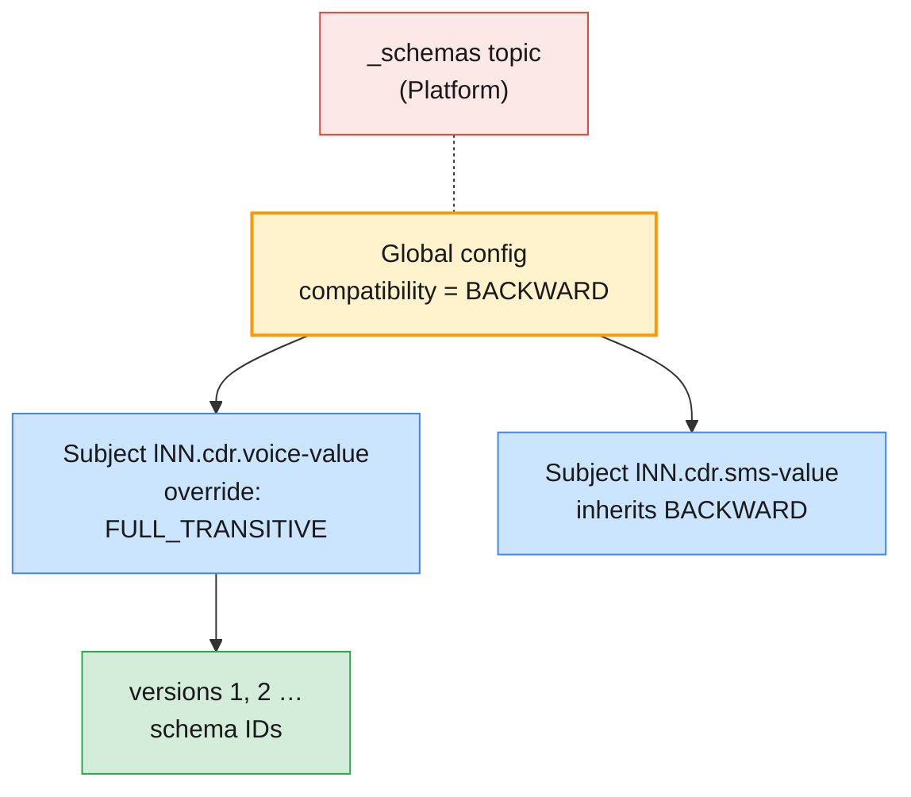

| Task | REST call | Notes |
| ---- | --------- | ----- |
| Read the global rule | `GET /config` | `{"compatibilityLevel":"BACKWARD"}` on a fresh registry |
| Set a subject's rule | `PUT /config/<subject>` with `{"compatibility":"FULL_TRANSITIVE"}` | Overrides the global rule for that subject |
| Test before registering | `POST /compatibility/subjects/<subject>/versions/latest?verbose=true` | `is_compatible` plus the reasons |
| Register | `POST /subjects/<subject>/versions` | Returns the ID (existing ID if the schema is already known) |
| List versions | `GET /subjects/<subject>/versions` | `[1,2]` |
| Soft delete | `DELETE /subjects/<subject>` | Hidden but recoverable; IDs stay valid for old records |
| Hard delete | `DELETE /subjects/<subject>?permanent=true` (after a soft delete) | Records that use the ID become **unreadable** |

| Aspect | Confluent Cloud | Confluent Platform (course) |
| ------ | --------------- | --------------------------- |
| **How many** | One registry per environment (`lsrc-…`), part of Stream Governance (Essentials or Advanced) | One shared registry on `cp-services:8081` |
| **Credentials** | Its own API key (`--resource lsrc-…`); the Kafka key returns `401` | LDAP user over HTTPS with the course CA |
| **Authorization** | You own the whole registry of `env-lNN` | RBAC `ResourceOwner` on `Subject:lNN.` |
| **Schema IDs** | Start at 100000 | Start at 1 |
| **Storage** | Managed | The `_schemas` topic on the Platform cluster: back it up with the cluster (§5.6) |

> **Common trap — schema IDs are local:** an ID means something only in the
> registry that issued it. Replicating Avro bytes to another cluster whose
> consumers use a **different** registry produces records that decode to
> garbage or fail. Any DR or migration design must say how schemas move:
> one shared registry for both sites, Replicator's schema translation, or
> Schema Linking (§5.3).

---

## 4. ksqlDB on Confluent — overview

### 4.1 What ksqlDB puts on your cluster

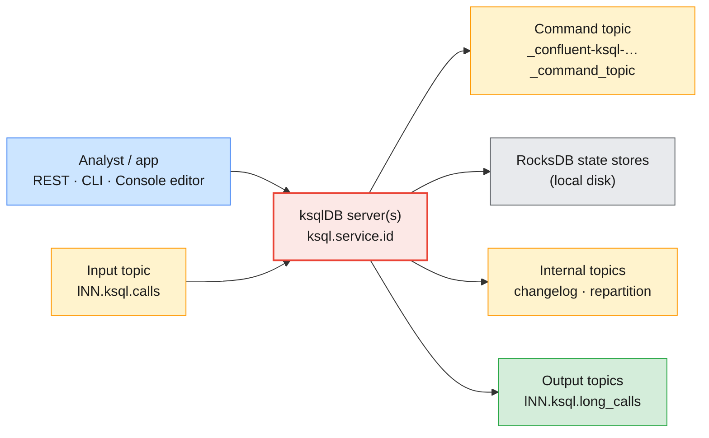

ksqlDB is a SQL engine built on Kafka Streams. Every `CREATE STREAM … AS
SELECT` or `CREATE TABLE … AS SELECT` becomes a **persistent query**: a Kafka
Streams application running inside the ksqlDB server, consuming input topics
and producing output topics forever. Servers that share a `ksql.service.id`
form one cluster and share the statements recorded in the **command topic**.
Aggregations and joins keep state in local **RocksDB** stores, backed by
compacted **changelog** topics, and re-keying creates **repartition** topics.
Module 6 Lab 08 showed the result: one SQL file created three `lNN.ksql.*`
topics plus internal `_confluent-ksql-…` topics.

| Query type | Runs | Example |
| ---------- | ---- | ------- |
| **Persistent** | Forever, on the server, writing a topic | `CREATE STREAM long_calls AS SELECT … WHERE durationSec > 600` |
| **Push** | While the client is connected (`EMIT CHANGES`) | Watch new long calls arrive |
| **Pull** | Once, against a table's current state | `SELECT … FROM minutes_by_caller WHERE caller = '…'` |

### 4.2 Operating ksqlDB

| Concern | What to watch or set |
| ------- | -------------------- |
| **Capacity** | Each persistent query is a Streams app: threads, memory, RocksDB disk. Size from the number of queries and their state, not from SQL lines |
| **Lag** | Each query has a consumer group; its lag is the query's freshness (Module 8 §2.6) |
| **State** | Local disk fills with state stores; a restarted server restores state from changelogs, which can take minutes for large tables |
| **Command topic** | Losing or corrupting it loses the query definitions. Treat it like Connect's config topic: RF 3, back up the SQL as code |
| **Security** | The server's principal reads and writes topics on behalf of users; RBAC decides which topics each user may name (Module 6 Lab 08 Part 6) |
| **Deployment mode** | **Interactive** (statements over REST, shared by users) or **headless** (a fixed SQL file, no REST statements) for production pipelines |
| **Name collisions** | One server, one namespace: prefix every stream and table name (the `${ME}_` convention of Lab 08) |

> **Strategic note:** Confluent's own ksqlDB documentation now states that
> for **new** stream-processing workloads, Confluent Platform for **Apache
> Flink** is the recommended engine; ksqlDB remains fully supported for
> existing applications. On Confluent Cloud, Flink SQL is the managed
> equivalent. Plan new pipelines accordingly, and keep ksqlDB skills for the
> estates that already run it.

| Choose | When |
| ------ | ---- |
| **ksqlDB** | Existing ksqlDB estates; simple filters, enrichments and aggregates expressed in SQL; teams already operating it |
| **Flink SQL** (Cloud or Platform) | New SQL pipelines, larger state, richer windowing and joins, Confluent's forward path |
| **Kafka Streams** (Java) | Logic that belongs inside an application the team already deploys |
| **A plain consumer** | Per-record business rules with side effects, such as TelcoPulse's fraud detector |

---

## 5. Backup and DR: Confluent Replicator and multi-datacenter replication

### 5.1 Replication is not backup

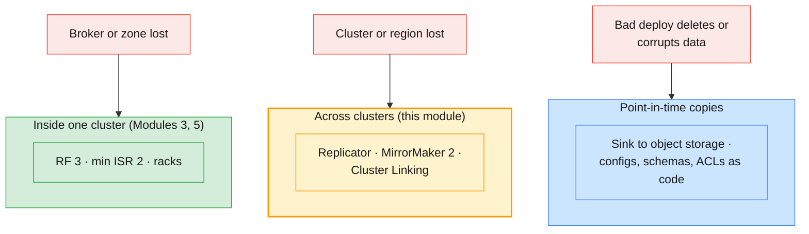

Three different failures need three different defences. Replication inside a
cluster (Module 5) survives a broker or a zone. Cross-cluster replication
survives a cluster or a region — but it copies **everything**, including a
producer bug's garbage and a topic deletion's consequences, within seconds.
Only point-in-time copies protect against "we wrote nonsense for an hour".
For Kafka, that usually means a sink connector archiving business topics to
object storage, plus the platform's **definition** — topics, configs, role
bindings, schemas, connector configs — kept as code you can re-apply.

| Term | Question it answers | Typical CDR-platform target |
| ---- | ------------------- | --------------------------- |
| **RPO** (recovery point objective) | How much acknowledged data may be lost? | Seconds to 5 minutes across sites; 0 within a site |
| **RTO** (recovery time objective) | How long until the business runs again? | 15–30 minutes, rehearsed |
| **Failover** | Switch clients to the second site | Decision by a named person, not by a script alone |
| **Failback** | Return to the primary after repair | Planned like a migration (§6), never improvised |

> **Apache Kafka's guidance:** run an independent cluster per data centre,
> with applications talking only to their local cluster, and mirror between
> clusters. A single cluster stretched across a **high-latency** link is
> "generally not advisable". Stretched clusters (and Confluent's multi-region
> clusters) are designs for low-latency metro distances only.

### 5.2 Multi-datacenter patterns

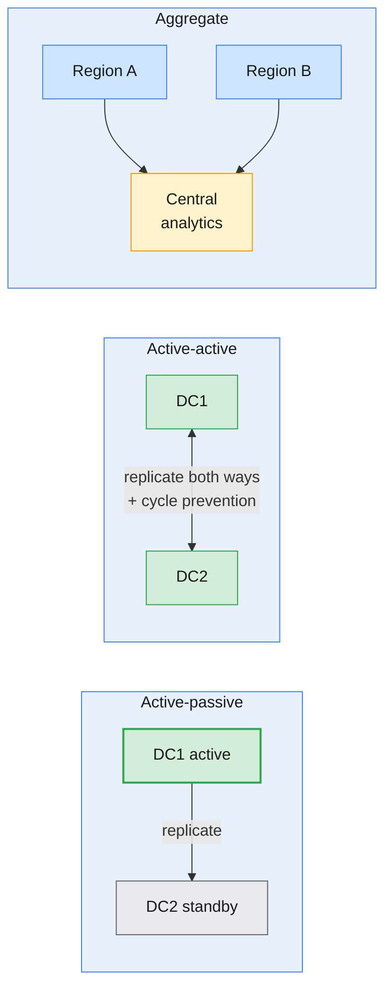

| Pattern | Good for | Hard parts |
| ------- | -------- | ---------- |
| **Active-passive** | DR for billing and charging: one writer site | Consumer positions on the standby; keeping the standby warm and tested |
| **Active-active** | Regional producers, local latency, both sites writing | Loops (needs provenance headers or renaming), duplicate processing, ordering across sites |
| **Aggregate (hub)** | Analytics over all regions | Topic naming per source; volume on the hub |
| **Stretched / multi-region cluster** | RPO 0 across close sites | Latency on every `acks=all` write; quorum placement for controllers |

### 5.3 Confluent Replicator

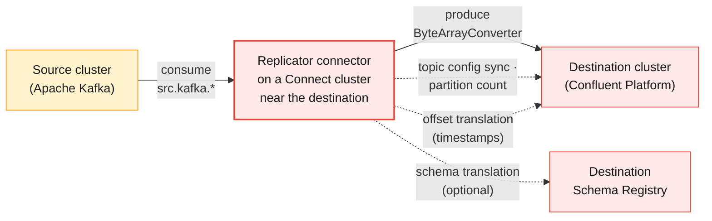

Replicator is a **source connector** (`io.confluent.connect.replicator.ReplicatorSourceConnector`)
that consumes from one cluster and produces to another. It copies the data,
creates the destination topics with the same partition count and replicates
topic configuration changes. Confluent recommends running it on a Connect
cluster **close to the destination**: a cross-site link then carries only
consumer fetches, and a network cut stalls replication instead of failing
produce requests. It needs an enterprise Connect licence (`confluent.license`).

| Property | Default | What it controls |
| -------- | ------- | ---------------- |
| `src.kafka.bootstrap.servers` · `dest.kafka.bootstrap.servers` | — | The two clusters; any valid client property with the `src.kafka.` / `dest.kafka.` prefix is forwarded (security protocol, SASL, truststore) |
| `topic.whitelist` · `topic.regex` · `topic.blacklist` | empty · null · empty | Which topics to copy |
| `topic.rename.format` | `${topic}` | Destination name; `${topic}.replica` marks copies clearly |
| `topic.auto.create` | `true` | Create missing destination topics |
| `topic.preserve.partitions` | `true` | Keep the partition count (and so key → partition mapping) |
| `topic.config.sync` | `true` | Keep destination topic configs in step with the source |
| `key.converter` · `value.converter` | worker's | `io.confluent.connect.replicator.util.ByteArrayConverter` copies bytes unchanged |
| `offset.timestamps.commit` · `offset.translator.tasks.max` | `true` · `-1` | Offset translation for failover |
| `provenance.header.enable` | `false` | Tag records with their origin so active-active setups do not loop |

**Offset translation.** Replicator does not preserve offsets: record 5 000 on
the source may be record 4 998 on the destination. To let consumers resume at
the right place after a failover, Java consumers on the source run the
`io.confluent.connect.replicator.offsets.ConsumerTimestampsInterceptor`
(`interceptor.classes`), which records committed offsets and timestamps in a
local `__consumer_timestamps` topic; Replicator uses it to set the group's
offsets on the destination. It is for Java consumers only and does not work
with transactional workloads.

> **Common trap — "we replicate, so we can fail over":** without offset
> translation (or another stated method), consumers on the standby start at
> `auto.offset.reset` — `latest` skips everything replicated before the
> failover, `earliest` re-bills it all. The failover runbook must say which
> method sets positions, and the drill must prove it.

### 5.4 Replicator, MirrorMaker 2 or Cluster Linking

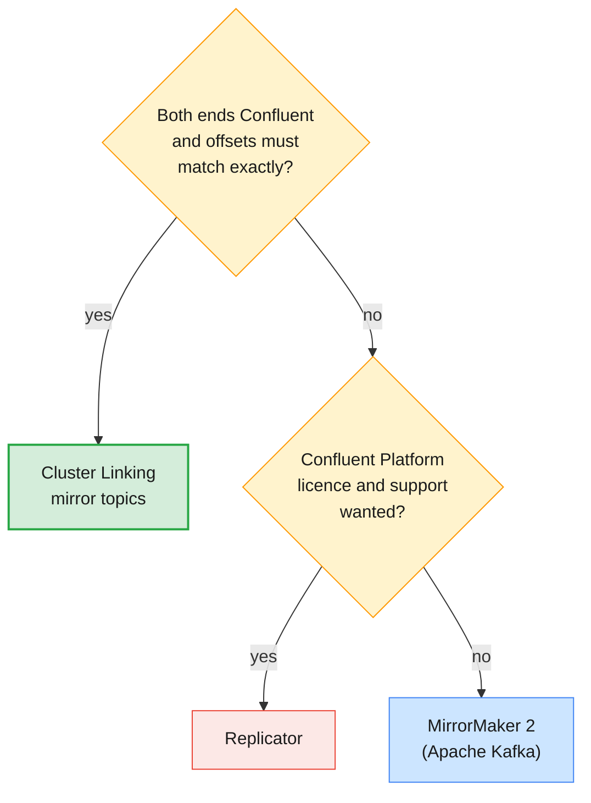

| | **MirrorMaker 2** | **Replicator** | **Cluster Linking** |
| --- | --- | --- | --- |
| **Ships with** | Apache Kafka (`connect-mirror-maker.sh`, KIP-382) | Confluent Platform (enterprise licence) | Confluent Server and Confluent Cloud |
| **Runs as** | Connect connectors (dedicated MM2 cluster or existing Connect) | A connector on a Connect cluster | Inside the destination brokers: no Connect at all |
| **Offsets** | Not preserved; checkpoints and `sync.group.offsets.enabled` translate group offsets | Not preserved; timestamp interceptor translates | **Preserved byte for byte**: same partition, same offset |
| **Topic names** | `source.topic` by default; `IdentityReplicationPolicy` keeps names | `topic.rename.format` (default unchanged) | Mirror topic has the same name, read-only until promoted |
| **Configs and ACLs** | `sync.topic.configs.enabled`, `sync.topic.acls.enabled` | Topic config sync | Topic configs, consumer offsets and ACLs sync |
| **Schemas** | Not handled | Optional schema translation (Schema Linking recommended) | Pair with Schema Linking |
| **Source** | Any Kafka | Any Kafka | Confluent Platform, Confluent Cloud, or Apache Kafka 3.0+; Cloud destinations must be **Dedicated or Enterprise** clusters |
| **Failover** | Repoint clients, use translated offsets | Repoint clients, use translated offsets | **Promote** mirror topics to writable, repoint clients |

> **In the course:** the Confluent Cloud clusters are **Basic**, so they cannot
> be Cluster Linking destinations. The course therefore uses **Replicator from
> the shared Apache cluster into Confluent Platform** for the migration
> exercise (`infra/LAB-SETUP.md` §5), and the capstone adds **MirrorMaker 2**
> from Platform to your own Docker cluster as a second site. Cluster Linking
> is the tool you would evaluate first on a real Confluent-to-Confluent
> estate.

### 5.5 A failover and failback runbook

```mermaid
sequenceDiagram
    participant IC as Incident commander
    participant DC1 as Primary (DC1)
    participant DC2 as Standby (DC2)
    participant APP as Producers / consumers
    IC->>DC1: confirm outage (Module 9 §2.1 triage)
    IC->>IC: decide: fail over or hold (RPO/RTO vs expected repair time)
    IC->>DC2: stop replication into DC2 (or promote mirror topics)
    IC->>DC2: set consumer group positions (translated / timestamp)
    IC->>APP: repoint consumers, then producers
    APP->>DC2: billing resumes; measure RTO
    Note over DC1,DC2: Later: replicate DC2 → DC1, plan failback like a migration
```

| Step | Check before moving on |
| ---- | ---------------------- |
| **1. Declare** | Outage confirmed with evidence; expected repair time compared with the RTO |
| **2. Freeze** | Replication stopped (or mirror topics promoted); the last replicated timestamp recorded — that is your measured RPO |
| **3. Positions** | Each critical group's offsets set on DC2 by the stated method; `kafka-consumer-groups.sh --describe` shows them |
| **4. Consumers** | Consumers on DC2 running, lag falling, duplicates within the expected window |
| **5. Producers** | Producers repointed; produce rate and error rate normal |
| **6. Communicate** | Status every 10–15 minutes in business terms (the capstone's Peak Night format) |
| **7. Failback** | Never the reverse of failover in a hurry: re-seed DC1 from DC2, then plan a cutover with go/no-go (§6.5) |

### 5.6 Backing up what replication does not cover

| Asset | Backed up by | Restore test |
| ----- | ------------ | ------------ |
| Business topic data (point in time) | Sink connector to object storage, partitioned by time | Re-produce one hour into a scratch topic |
| Topic definitions and configs | Topic catalog as code (capstone Phase 2) | Apply to an empty cluster |
| Role bindings, ACLs, quotas | Scripts in Git (Module 7 §4.4) | Apply to a test cluster; run deny tests |
| Schemas | `_schemas` topic replicated, or export via REST, or Schema Linking | Register into an empty registry; IDs must match where bytes depend on them |
| Connector and ksqlDB definitions | JSON and SQL files in Git (secrets excluded) | Recreate on a test Connect / ksqlDB cluster |
| Consumer positions | Not backed up — re-derived (timestamps, translation) | Part of every failover drill |

> **Administrator takeaway:** a DR plan that has not been rehearsed is a
> hypothesis. Measure RPO by sampling the newest record on both sites, measure
> RTO from decision to first business record on the standby, and repeat the
> drill after every major change — the capstone's Phase 9 makes you do
> exactly this.

---

## 6. Migration considerations: Apache Kafka → Confluent Kafka

### 6.1 Assess before you move

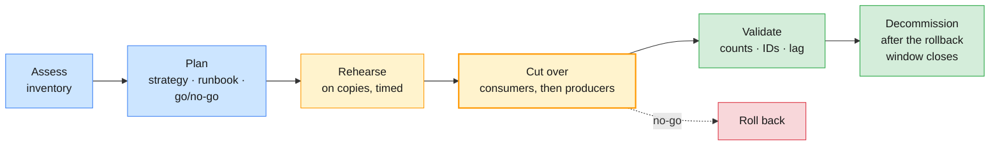

A migration from Apache Kafka to Confluent is mostly **not** about brokers —
Confluent Server runs the same protocol and the same client libraries work
unchanged (Module 6 §2.3). It is about everything around the brokers. The
assessment inventory:

| Inventory item | Why it matters | Source on the course clusters |
| -------------- | -------------- | ----------------------------- |
| **Topics**: partitions, RF, configs, cleanup policy | Must be recreated or replicated identically; partition count fixes key placement | `kafka-topics.sh --describe`, `kafka-configs.sh --describe` |
| **Access**: SCRAM users, ACLs, quotas | ACLs map to role bindings (Module 7 §7.2); quotas must exist on day 1 | `kafka-acls.sh --list`, `kafka-configs.sh --entity-type users` |
| **Consumer groups and positions** | Decide where each group starts on the target | `kafka-consumer-groups.sh --describe --all-groups` |
| **Clients**: languages, versions, configs, owners | Each one changes bootstrap, protocol, credentials, truststore | Application inventory, `client.id` in broker metrics |
| **Volumes**: produce rate, retention, peak | Sizes replication bandwidth and the target cluster | Module 8 dashboards |
| **Schemas and connectors** | Registries and connectors move too | Registry subjects, Connect `/connectors` |
| **Semantics**: transactions, compaction, idempotence | Copy tools do not preserve transactional markers or offsets (except Cluster Linking) | Producer configs, topic configs |

### 6.2 Moving the data

| Option | How | Strength | Limit |
| ------ | --- | -------- | ----- |
| **Replicate, then cut over** | Replicator, MirrorMaker 2 or Cluster Linking copies continuously; clients move when lag is ~0 | Short pause, rollback is easy while the source stays authoritative | Offsets differ (except Cluster Linking); consumer positions need a method |
| **Dual write** | Producers write to both clusters for a period | No replication tool | Two writes can diverge; no atomicity across clusters (§6.4) |
| **Drain and big bang** | Stop producers, let consumers finish, move everything at once | Simplest to explain | Longest pause; rollback means doing it again in reverse |
| **No history** | New data only on the target; old data ages out on the source | Nothing to copy | Consumers that need history read two clusters for a while |

### 6.3 Client cutover: consumers first

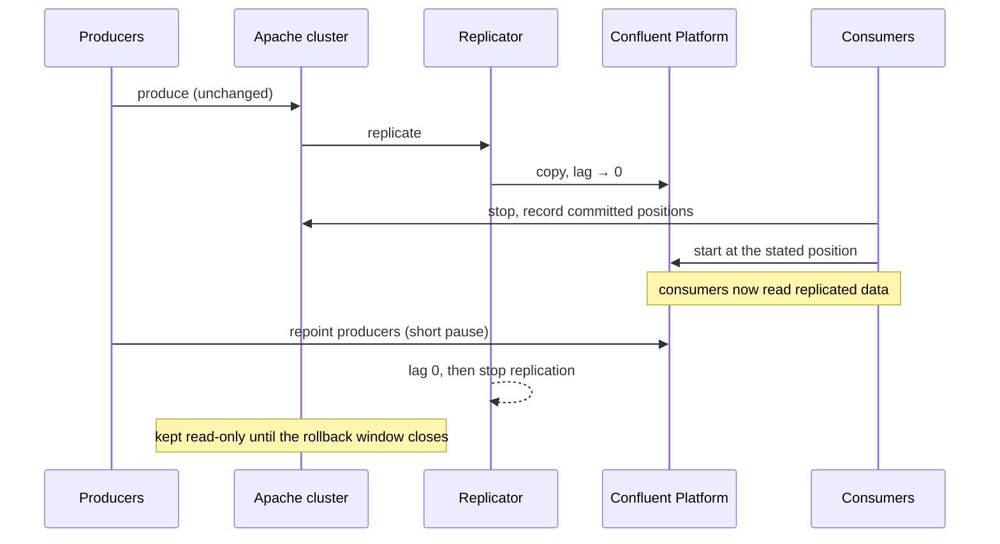

Moving **consumers first** keeps the source authoritative for as long as
possible: if the target misbehaves, consumers go back to the source and lose
nothing. Producers move last, in the shortest possible window, and replication
stops only when it has fully caught up.

| The consumer-position decision | Method | When it is valid |
| ------------------------------ | ------ | ---------------- |
| **Same offsets** | Export positions from the source (`--reset-offsets --to-current --export --dry-run`), apply on the target (`--from-file`) | Only when target offsets equal source offsets: empty target, no compaction or transaction markers, or Cluster Linking |
| **Translated offsets** | Replicator interceptor or MirrorMaker 2 checkpoints | Java consumers with the interceptor; MM2 with checkpoints enabled |
| **By timestamp** | `--reset-offsets --to-datetime` a little before the stop time | Always possible; produces a small, bounded set of duplicates |
| **Earliest / latest** | `auto.offset.reset` | Almost never right for billing: full re-processing or a silent gap |

> **Common trap:** "the new consumer group will just start". A group that has
> never committed on the target follows `auto.offset.reset`, whose default is
> `latest` (Module 4 §5.4). Every CDR replicated before the consumer started
> is silently skipped — the Module 9 §3.5 loss pattern, triggered by a
> migration. Make the position an **explicit, written** decision per group.

What each client must change, from the capstone's client cutover inventory
(Phase 5, T5.6):

| Setting | Apache cluster (course) | Confluent Platform (course) |
| ------- | ----------------------- | --------------------------- |
| `bootstrap.servers` | `apache-kafka.lab.internal:9092` | `cp-kafka.lab.internal:9092` |
| `security.protocol` | `SASL_PLAINTEXT` | `SASL_SSL` |
| `sasl.mechanism` | `SCRAM-SHA-512` | `PLAIN` (LDAP-backed) |
| Truststore | none | `ssl.truststore.type=PEM`, the course CA |
| Authorization | Prefix ACLs | RBAC role bindings on `lNN.` |
| Serializers | Unchanged — unless schemas are introduced at the same time (don't) | Unchanged |

### 6.4 Dual write and why it is harder than it looks

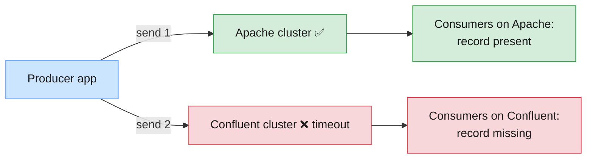

Kafka transactions span partitions of **one** cluster. Writing to two clusters
is two independent sends: one can succeed while the other fails, and the two
clusters assign different offsets and may order records differently across
partitions. Dual write is still useful — for example when the producer
team cannot accept a replication tool, or to warm up a new consumer for weeks
before a switch — if you accept its rules:

| Rule | Reason |
| ---- | ------ |
| One cluster is the **system of record**; the other is best-effort until cutover | Someone must win when they disagree |
| Every record carries a **business key** (`cdrId`) | Reconcile by ID, never by offset |
| Failures on the secondary are logged and **reconciled**, not retried forever | The secondary must not slow down the primary path |
| A **reconciliation job** compares ID sets per time window | It is your proof that nothing was lost |
| End the dual-write period on a date | Two clusters of truth is a permanent incident |

### 6.5 Choosing the strategy and the go/no-go

| Criterion | Replicate + cut over | Dual write | Big bang |
| --------- | -------------------- | ---------- | -------- |
| Billing pause | Seconds to minutes | None | Longest |
| Data-loss risk | Low (source stays authoritative) | Medium (divergence) | Low if drained, high if rushed |
| Duplicates | Small, bounded, detectable | Possible on both sides | None if drained |
| Rollback | Easy until producers move | Easy (stop writing to one) | Hard |
| Application changes | Config only | Code change in every producer | Config only |
| Fits BR-7 of the capstone (≤ 5 min pause, ≤ 15 min rollback) | ✅ | ⚠️ needs code | ❌ usually |

**Go/no-go criteria need numbers**, decided before the night: replication lag
below N records for M minutes, target end offsets equal to source end offsets
for every topic (or ID sets equal), error rate of the rehearsal below X, the
rollback timed under 15 minutes in the last rehearsal, and named owners present.
Any "no" means no-go, and no-go is a success of the process, not a failure.

> **Administrator takeaways:** migrate **one change at a time** — do not add
> schemas, rename topics or change partition counts during the move; keep the
> source **read-only** (not deleted) for the whole rollback window; and verify
> by **business IDs**, not by offsets, because offsets differ across
> clusters for every tool except Cluster Linking.

---

## 7. Best practices for application developers integrating with Kafka

### 7.1 The integration contract

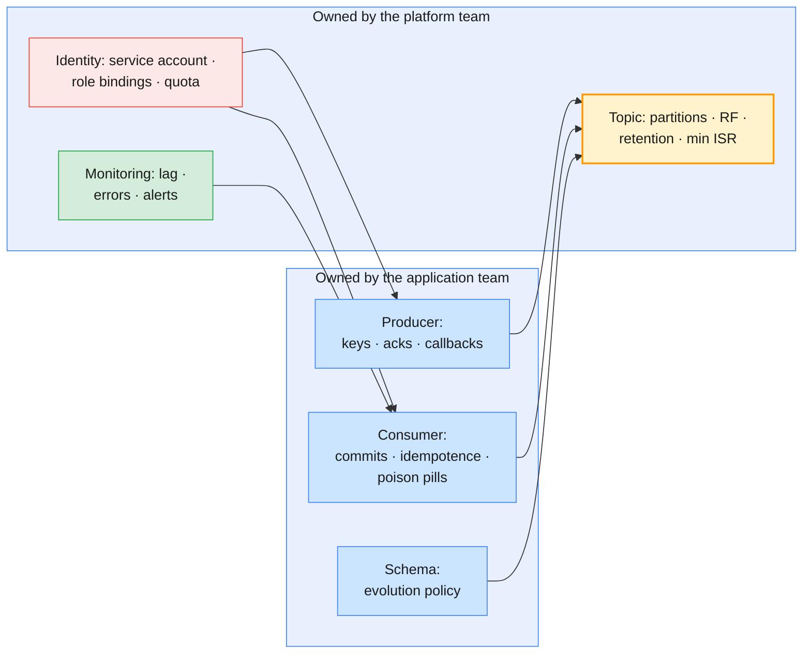

Module 9 §3 showed that Kafka loses data through configuration and
applications, almost never through the broker. That makes developers half of
the reliability story. As an administrator you will review applications
before they reach production; this section is the checklist you review them
against, and the one you hand to the teams. Each row links to where the
course explains the mechanism.

### 7.2 Producers

| Practice | Why | Where explained |
| -------- | --- | --------------- |
| **Keep `acks=all` and idempotence on** (the Kafka 3.0+ defaults); never set `acks=0`/`1` on business topics | Acknowledged means replicated to the ISR; idempotence removes retry duplicates | Module 3 §6, Module 4 §2.3 |
| **Handle every send result**: check the callback or future, and alert on failures | After `delivery.timeout.ms` (120 s) a record is dropped and only the callback knows | Module 4 §3.3, Module 9 §3.4 |
| **Choose keys deliberately**: the business entity whose order matters (MSISDN, `cdrId`) | Ordering is per partition; a null key spreads records but gives no per-entity order | Module 4 §2.2 |
| **Do not change a topic's partition count casually** — and do not code against it | Adding partitions remaps keys; consumers relying on per-key order break | Module 5 §7.4 |
| **Tune for throughput with `linger.ms`, `batch.size` and compression** before asking for more partitions | Batching is the cheapest throughput; `lz4` or `zstd` for CDR-like JSON | Module 4 §3.2, Module 3 §7.2 |
| **Respect record size limits**; put large payloads in object storage and send a reference | Oversized records fail with `RecordTooLargeException`; Cloud caps message size by cluster type | Module 9 §2.4 |
| **Close producers on shutdown** (`flush()`, `close()`) | Records still in the buffer are lost on `kill -9` | Module 4 §8.3 |
| **Use transactions only when you need read-process-write exactly-once** | They add latency and operational surface (transaction coordinator, `read_committed`) | Module 4 §7.4 |

### 7.3 Consumers

| Practice | Why | Where explained |
| -------- | --- | --------------- |
| **Commit after processing**, never before (at-least-once) | Commit-before-process loses records on a crash | Module 4 §5.2, §7.3 |
| **Make processing idempotent** (upsert by `cdrId`, dedup table) | At-least-once means duplicates after rebalances and failovers — and after migrations (§6.3) | Module 4 §7.5 |
| **Set `auto.offset.reset` consciously**; for business groups prefer an explicit reset over `latest` | A new or expired group with `latest` skips data silently | Module 4 §5.4, Module 9 §3.5 |
| **Keep the poll loop fast**; move slow work off the poll thread or reduce `max.poll.records` | Exceeding `max.poll.interval.ms` triggers a rebalance storm | Module 4 §4.4 |
| **Use the Kafka 4.x consumer protocol** (`group.protocol=consumer`) or cooperative assignment, plus static membership for stateful apps | Fewer stop-the-world rebalances during deploys | Module 4 §6.3–§6.4 |
| **Handle poison pills**: catch deserialization errors, send to a DLT with headers, continue | One bad record must not stop billing | Module 4 §9.3–§9.4 |
| **Scale to at most one consumer per partition** | Extra consumers sit idle; partitions cap parallelism | Module 4 §4.1 |
| **Shut down gracefully** (`wakeup()`, commit, `close()`) | Leaves the group cleanly instead of waiting for session timeout | Module 4 §8.4 |

### 7.4 Data contracts, configuration and secrets

| Practice | Why |
| -------- | --- |
| **Keep cluster details out of the code**: one external client file per environment, as the Module 6 Spring Boot apps did with `KAFKA_CLIENT_CONFIG` | The same jar ran on Cloud and Platform in Labs 04–06 by swapping a file |
| **Secrets from a secret store**, never in Git, images or logs | A leaked key is an incident and a rotation (Module 7 §5.3–§5.4) |
| **One service account per application**, least privilege, no shared users | Blast radius and audit trail (Module 7 §4.5) |
| **Support key rotation without downtime**: reload credentials, or deploy with two valid keys | Rotation is routine, not an outage |
| **Set a meaningful `client.id`** (`billing-rater-01`) | Quotas, broker metrics and support cases name it (Module 9 §4.4) |
| **Use Schema Registry for shared topics**; follow the agreed compatibility mode and deploy order (§3.3) | The contract is checked at send time, not discovered at 2 a.m. |
| **Treat a breaking change as a new topic or subject**, with a migration plan | Compatibility exists to prevent exactly that change in place |

### 7.5 Testing, observability and anti-patterns

| Practice | How |
| -------- | --- |
| **Test against a real broker** | A containerized Kafka in integration tests (the Module 1–2 Docker images); unit-test serialization and schema compatibility without a cluster, as Lab 06's `CdrRecordsTest` did |
| **Test failure, not just success** | Kill a broker during a test run (Module 5 Lab 03); restart the consumer mid-batch; send a poison pill |
| **Expose client metrics** | `record-error-rate`, `record-retry-rate`, `records-lag-max`, `buffer-available-bytes` (Module 9 §4.4) |
| **Log what support needs** | Topic, partition, offset and key on every processing error — never the payload of personal data |
| **Load-test at the expected peak** | `kafka-producer-perf-test.sh` for the cluster, the application's own driver for end-to-end (Module 8 §5.5) |

| Anti-pattern | What to do instead |
| ------------ | ------------------ |
| Kafka used as a request/response RPC bus with per-request reply topics | Synchronous APIs for synchronous needs; events for facts |
| One topic per customer or per MSISDN | Key by customer on a shared topic |
| Creating topics from application code at startup | Topics from the platform's catalog, reviewed (§8.2) |
| Catch-and-ignore around `send()` | Callback with alerting; fail the health check |
| Infinite in-place retries on a bad record | Bounded retries, then DLT (Module 4 §9.4) |
| Reading "the last N messages" by seeking to end minus N | Compacted topics or a state store for current state |
| Huge consumer groups to "go faster" on a 6-partition topic | Agree partition count with the platform team up front |

> **The review question for every new application:** *"Show me what happens
> to a record when the broker, your service and the network each fail once."*
> If the team can answer with configs, callbacks and a test, it is ready. If
> the answer is "Kafka is reliable", it is not.

---

## 8. Best practices for Kafka administrators and operations teams

### 8.1 The operating model

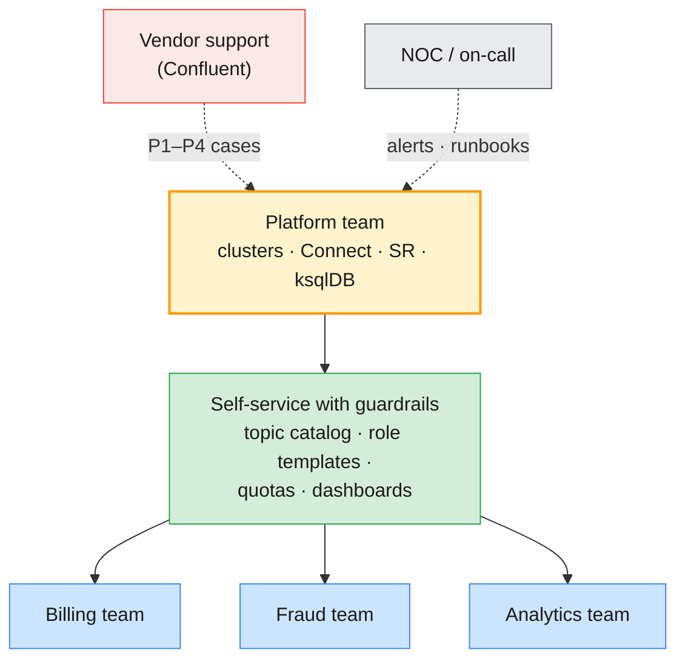

Kafka platforms fail organizationally before they fail technically: a topic
nobody owns, a credential everybody shares, an alert that pages no one. A
small platform team that offers **self-service with guardrails** scales
better than one that creates every topic by hand or one that gives every team
`SystemAdmin`.

| Responsibility | Platform team | Application team | Vendor (Cloud) |
| -------------- | ------------- | ---------------- | -------------- |
| Brokers, controllers, upgrades | ✅ (Platform) | — | ✅ (Cloud) |
| Topic catalog and guardrails | ✅ owns | Requests, reviews | Enforces Cloud limits |
| Client configuration and code | Reviews | ✅ owns | — |
| Identities and role bindings | ✅ grants | Requests least privilege | IAM platform |
| Schemas | Registry and rules | ✅ owns schemas | Registry service |
| Lag and error alerts | Platform alerts | ✅ owns group SLOs | Metrics API |
| Incidents | Incident commander | Fixes application causes | Support cases (Module 9 §6) |

### 8.2 Everything as code, every change reviewed

```mermaid
flowchart LR
    PR["Pull request<br/>topics.yaml · roles · connectors"] --> RV["Review<br/>+ automated checks"]
    RV --> PLAN["Dry run<br/>(--dry-run, validate)"]
    PLAN --> AP["Apply by pipeline<br/>with a service identity"]
    AP --> VER["Verify + audit log"]
    VER -.->|"drift found"| PR

    style PR fill:#cce5ff,stroke:#4285f4,stroke-width:1px,color:#1a1a1a
    style RV fill:#fff3cd,stroke:#ff9800,stroke-width:1px,color:#1a1a1a
    style PLAN fill:#fff3cd,stroke:#ff9800,stroke-width:1px,color:#1a1a1a
    style AP fill:#d4edda,stroke:#28a745,stroke-width:2px,color:#1a1a1a
    style VER fill:#d4edda,stroke:#28a745,stroke-width:1px,color:#1a1a1a
```

| Practice | Detail |
| -------- | ------ |
| **Topic catalog as code** | Name, partitions, RF, `min.insync.replicas`, retention, cleanup policy, owner, data class — applied by script (capstone Phase 2) |
| **Naming convention** | `<domain>.<entity>.<event>` (`cdr.voice`, `billing.charges`) plus environment or tenant prefix where the cluster is shared (`lNN.`) — it is what RBAC prefixes and quotas hang on |
| **Guardrails on the cluster** | `auto.create.topics.enable=false`, `min.insync.replicas=2` default, `unclean.leader.election.enable=false`, `default.replication.factor=3` (Module 3 §2, Module 9 §7.2) |
| **Access as code** | Role bindings and ACLs in scripts, one service account per application, deny tests in CI (Module 7 §4.4–§4.5) |
| **Connectors, schemas, ksqlDB as code** | JSON, `.avsc` and `.sql` files in Git, secrets injected at apply time (§2.3, §3.4) |
| **Change windows and dry runs** | `kafka-configs.sh` and reassignments planned and dry-run; Confluent CLI `--dry-run` where offered (Module 6 Lab 02) |
| **Detect drift** | A scheduled job compares the live cluster with the catalog and opens an issue on differences |

### 8.3 Day-2 operations routine

| Cadence | Task | Tool |
| ------- | ---- | ---- |
| **Continuous** | Alerts: under-replicated / under-min-ISR partitions, offline partitions, consumer lag (records **and** time), connector task state, disk usage, request latency | Control Center, Metrics API, Prometheus (Module 8) |
| **Daily** | Read the overnight alerts and the DLQ topics; check failed tasks and expiring certificates or keys | Dashboards, `cn …/status` |
| **Weekly** | Capacity trend (disk, throughput, partition count); top producers and consumers by `client.id`; quota hits | Module 5 §7, Module 8 §5 |
| **Monthly** | Access review: unused service accounts and keys, broad role bindings; rotate keys due | Module 7 §5.3 |
| **Quarterly** | DR drill with measured RPO/RTO; restore test of backups; game day with injected faults | §5.5, Module 9 |
| **Per release** | Upgrade plan: Kafka / Confluent version, client compatibility, rolling restart runbook, rollback | Module 5 §6 |

### 8.4 Capacity, upgrades and lifecycle

| Practice | Why |
| -------- | --- |
| **Plan capacity with failure headroom** (N-1 brokers, peak × growth) | A cluster sized for average traffic fails on its first peak night (Module 5 §7.6) |
| **Keep disks below a threshold (e.g. 70 %)** and alert well before | Reassignment and recovery need free space and bandwidth |
| **Throttle reassignments and recovery** | Protect production traffic (Module 5 §5.4) |
| **Stay within supported versions** of Kafka, Confluent Platform, clients and connectors | Support cases on unsupported versions start with "upgrade first" |
| **Upgrade in a fixed order with a rehearsal**: controllers, brokers, then Connect / SR / ksqlDB, then clients | Mixed versions are supported only in the documented directions (Module 5 §6.2) |
| **Watch licences and trials** | A Confluent Platform licence or trial expiry is an outage you can put in the calendar |
| **Decommission deliberately** | Unused topics, connectors, groups and keys are cost, attack surface and confusion |

### 8.5 Incidents, runbooks and learning

```mermaid
flowchart LR
    AL["Alert fires"] --> RB["Runbook<br/>linked from the alert"]
    RB --> TR["Triage<br/>(Module 9 §2.1)"]
    TR --> FX["Fix + verify"]
    FX --> PM["Blameless review<br/>within 5 working days"]
    PM --> PRV["Prevention action<br/>in the backlog · checklist updated"]
    PRV -.-> AL

    style AL fill:#f8d7da,stroke:#dc3545,stroke-width:1px,color:#1a1a1a
    style RB fill:#fff3cd,stroke:#ff9800,stroke-width:1px,color:#1a1a1a
    style TR fill:#fff3cd,stroke:#ff9800,stroke-width:1px,color:#1a1a1a
    style FX fill:#d4edda,stroke:#28a745,stroke-width:1px,color:#1a1a1a
    style PM fill:#cce5ff,stroke:#4285f4,stroke-width:1px,color:#1a1a1a
    style PRV fill:#d4edda,stroke:#28a745,stroke-width:2px,color:#1a1a1a
```

| Practice | Detail |
| -------- | ------ |
| **Every alert has a runbook** | Symptom, likely causes, checks, safe actions, escalation — linked from the alert itself |
| **Alerts page on business impact** | Lag in **time** against an SLO, not raw record counts that change with traffic (Module 8 §2.6) |
| **Status updates in plain language** | Impact, cause, current action, next update time — every 10–15 minutes |
| **Escalate with a complete dossier** | Time window in UTC, IDs, errors, what changed — the Module 9 §6.3 case template |
| **Blameless reviews with one prevention action each** | The prevention checklist (Module 9 §7.2) grows from real incidents |
| **Game days** | Inject faults on a schedule so runbooks are tested before they are needed |

> **The operations baseline in one sentence:** if a change is not in Git, an
> alert has no runbook, a credential has no owner, or a DR plan has no drill
> date, it is not done.

---

## 9. Hands-on lab: ecosystem, migration rehearsal and capstone

> **Lab status:** `labs/module-10/` does not exist yet. This section is a
> **preview** that reuses the commands and helpers of
> [`labs/module-06`](../labs/module-06/README.md) Labs 06–07, the variables
> of [`labs/module-09`](../labs/module-09/README.md) Lab 01 and the course
> environment of [`infra/LAB-SETUP.md`](../infra/LAB-SETUP.md) §5–§7. The
> module's labs, when written, are the runtime companion. The end-to-end
> capstone is specified in [`capstone/`](../capstone/README.md).

```mermaid
flowchart LR
    subgraph VM["Your lab VM (lab-lNN)"]
        CLI["confluent CLI · Kafka CLI · curl"]
    end
    subgraph CC["Confluent Cloud · env-lNN"]
        SRC["Schema Registry lsrc-…"]
        MCN["Managed Datagen<br/>as sa-lNN-app"]
    end
    subgraph CP["Shared Confluent Platform"]
        SRP["Schema Registry :8081"]
        CON["Connect + Replicator :8083"]
        BRK["Brokers :9092"]
    end
    APA["Shared Apache cluster<br/>(migration source)"]
    CLI --> SRC
    CLI --> MCN
    CLI --> SRP
    CLI --> CON
    APA -->|"Replicator"| CON
    CON --> BRK

    style VM fill:#e8f0fe,stroke:#4285f4,stroke-width:1px,color:#1a1a1a
    style CC fill:#e8f0fe,stroke:#4285f4,stroke-width:1px,color:#1a1a1a
    style CP fill:#e8f0fe,stroke:#4285f4,stroke-width:1px,color:#1a1a1a
    style CLI fill:#cce5ff,stroke:#4285f4,stroke-width:1px,color:#1a1a1a
    style SRC fill:#cce5ff,stroke:#4285f4,stroke-width:1px,color:#1a1a1a
    style MCN fill:#cce5ff,stroke:#4285f4,stroke-width:1px,color:#1a1a1a
    style SRP fill:#fce8e6,stroke:#ea4335,stroke-width:1px,color:#1a1a1a
    style CON fill:#fce8e6,stroke:#ea4335,stroke-width:2px,color:#1a1a1a
    style BRK fill:#fce8e6,stroke:#ea4335,stroke-width:1px,color:#1a1a1a
    style APA fill:#fff3cd,stroke:#ff9800,stroke-width:1px,color:#1a1a1a
```

Before you start, in every terminal (IDs from your Module 7–9 notes):

```bash
# (VM) - from the course repository root
source ~/kafka/confluent.env
ME=lNN; export ME
CFG=~/kafka/cp.properties; SA_CFG=~/kafka/sa-app.properties; APA_CFG=~/kafka/apache.properties
APA=$(sed -n 's/^bootstrap.servers=//p' $APA_CFG)
ENV_ID=env-xxxxx; LKC=lkc-xxxxx
confluent context use <cloud-context-name>
confluent environment use $ENV_ID && confluent kafka cluster use $LKC
CCLOUD=$(confluent kafka cluster describe -o json | jq -r .endpoint | sed 's#SASL_SSL://##')
SA=$(confluent iam service-account list -o json | jq -r --arg n "sa-$ME-app" '.[] | select(.name==$n) | .id')
CP_CONNECT=${CONNECT_URL:-https://cp-services.lab.internal:8083}
LDAP_PW=$(sed -n 's/.*password="\([^"]*\)".*/\1/p' $CFG)
AVRO=labs/module-06/lab-06/spring-boot-kafka-avro/src/main/resources/avro
mkdir -p ~/kafka/m10
total() { kafka-get-offsets.sh --bootstrap-server "$1" --command-config "$2" --topic "$3" --time -1 \
  | awk -F: '{s+=$3} END{print s}'; }
echo "$ME $ENV_ID $LKC $SA $APA"
```

### 9.1 Part A — Schema governance on Cloud and Platform

You act as the platform team: register a contract, set a stricter rule for a
business subject, and prove which changes the registry accepts (§3.3–§3.5).

```bash
# (VM) 1. Cloud registry and its own API key (Module 6 Lab 06 Part 2)
SR_ID=$(confluent schema-registry cluster describe -o json | jq -r .cluster)
SR_CC=$(confluent schema-registry cluster describe -o json | jq -r .endpoint_url)
confluent api-key create --resource $SR_ID --description "$ME m10 schema governance"
SR_KEY=<API Key>; SR_SECRET='<API Secret>'
SR=$SR_CC; SR_AUTH="$SR_KEY:$SR_SECRET"; SR_CA=
sr() { curl -s -u "$SR_AUTH" ${SR_CA:+--cacert "$SR_CA"} "$SR$1" "${@:2}"; echo; }
CT='Content-Type: application/vnd.schemaregistry.v1+json'
SUBJECT=$ME.cdr.contract-value

# 2. Register v1 as the CI pipeline would, then make the subject transitive and FULL
jq -n --rawfile s $AVRO/cdr-voice-v1.avsc '{schema: $s}' | sr /subjects/$SUBJECT/versions -X POST -H "$CT" -d @-
sr /config/$SUBJECT -X PUT -H "$CT" -d '{"compatibility":"FULL_TRANSITIVE"}'
sr /config

# 3. Test the two candidate changes without registering them
check() { jq -n --rawfile s "$AVRO/cdr-voice-$1.avsc" '{schema: $s}' \
  | sr "/compatibility/subjects/$SUBJECT/versions/latest?verbose=true" -X POST -H "$CT" -d @- | jq -c '{is_compatible}'; }
check v2
check v3-breaking

# 4. Register the accepted change
jq -n --rawfile s $AVRO/cdr-voice-v2.avsc '{schema: $s}' | sr /subjects/$SUBJECT/versions -X POST -H "$CT" -d @-
sr /subjects/$SUBJECT/versions
```

**Expected:** an `{"id":1000xx}`, then `{"compatibility":"FULL_TRANSITIVE"}`
for the subject while `GET /config` still says `BACKWARD` globally,
`{"is_compatible":true}` for v2 (a field **with** a default is compatible in
both directions), `{"is_compatible":false}` for v3-breaking, and `[1,2]`.

Repeat steps 2–4 on the **Platform** registry by repointing the helper, then
try a subject outside your prefix:

```bash
# (VM) 5. Same contract on the shared Platform registry (Module 6 Lab 06 Part 5–6)
SR=$SR_URL; SR_AUTH="$ME:$LDAP_PW"; SR_CA=$CP_CA
sr "/config/$SUBJECT?defaultToGlobal=true"
#    … run steps 2–4 again …
jq -n --rawfile s $AVRO/cdr-voice-v1.avsc '{schema: $s}' | sr /subjects/cdr.contract-value/versions -X POST -H "$CT" -d @-

# 6. Soft delete, then hard delete, your subject on both registries
sr /subjects/$SUBJECT -X DELETE
sr "/subjects/$SUBJECT?permanent=true" -X DELETE
```

**Expected:** the same accept/refuse results with small schema IDs, an
`error_code` starting with `403` for `cdr.contract-value`, then `[1,2]` twice
for the deletes. Note which registry-wide rule each side shows and who could
change it: on Cloud you can (EnvironmentAdmin), on Platform only the trainer.

### 9.2 Part B — A managed connector with its own identity

Module 6 Lab 07 created the connector with your API key in the config file.
Here it runs as `sa-lNN-app` in service-account mode, so the file holds **no
secret** (§2.3).

```bash
# (VM) 1. Topic first, then the two ACLs Confluent documents for a source connector
TOPIC=$ME.cdr.partner; NAME=$ME.partner-feed
confluent kafka topic create $TOPIC --partitions 3
confluent kafka acl create --allow --service-account $SA --operations describe --cluster-scope
confluent kafka acl create --allow --service-account $SA --operations write --topic $TOPIC

# 2. Build the config from the Lab 07 helper, swap the key for the service account
umask 077
CC_CFG=$SA_CFG NAME=$NAME TOPIC=$TOPIC labs/module-06/lab-07/datagen-config.sh cloud \
  | jq --arg sa "$SA" 'del(."kafka.api.key", ."kafka.api.secret")
       + {"kafka.auth.mode":"SERVICE_ACCOUNT","kafka.service.account.id":$sa}' \
  > ~/kafka/m10/partner-feed.json
grep -c -i secret ~/kafka/m10/partner-feed.json
jq 'del(."schema.string")' ~/kafka/m10/partner-feed.json

# 3. Create, wait for RUNNING, read status
confluent connect cluster create --config-file ~/kafka/m10/partner-feed.json
confluent connect cluster list
CID=$(confluent connect cluster list -o json | jq -r --arg n "$NAME" '.[] | select(.name==$n) | .id')
confluent connect cluster describe $CID

# 4. Prove it moves data, as the service account (WRITE implies DESCRIBE)
total $CCLOUD $SA_CFG $TOPIC; sleep 15; total $CCLOUD $SA_CFG $TOPIC

# 5. Delete in the same session, then remove the ACLs
confluent connect cluster delete $CID --force
confluent kafka acl delete --allow --service-account $SA --operations write --topic $TOPIC --force
confluent kafka acl delete --allow --service-account $SA --operations describe --cluster-scope --force
```

**Expected:** `0` from the `grep` (no secret in the file), a config showing
`"kafka.auth.mode": "SERVICE_ACCOUNT"`, a connector that goes from
`PROVISIONING` to `RUNNING`, two growing totals, and an empty connector list
after the delete. If the connector fails with an authorization error in its
`Trace`, one of the two ACLs is missing.

### 9.3 Part C — Migration rehearsal with Replicator (Apache → Platform)

A miniature of the capstone's Phase 9: copy a topic from the shared Apache
cluster into Confluent Platform, move a consumer group with an **explicit**
position decision, and verify (§6.3).

```bash
# (VM) 1. Source topic on the Apache cluster, 3 000 keyed CDRs, a consumer that read 1 000
TOPIC=$ME.cdr.migrate; GROUP=$ME.billing-mig
kafka-topics.sh --bootstrap-server $APA --command-config $APA_CFG --create --topic $TOPIC \
  --partitions 3 --replication-factor 3
seq 1 3000 | awk '{printf "91984500%02d|{\"cdrId\":\"m-%d\",\"durationSec\":%d}\n", $1%50, $1, $1%600}' \
  | kafka-console-producer.sh --bootstrap-server $APA --producer.config $APA_CFG --topic $TOPIC \
      --property parse.key=true --property key.separator='|'
kafka-console-consumer.sh --bootstrap-server $APA --consumer.config $APA_CFG --topic $TOPIC \
  --group $GROUP --from-beginning --max-messages 1000 > /dev/null
kafka-consumer-groups.sh --bootstrap-server $APA --command-config $APA_CFG --describe --group $GROUP

# 2. Target topic created from the catalog (same partitions, Platform durability settings)
confluent login --url $MDS_URL --certificate-authority-path $CP_CA --save
confluent kafka topic create $TOPIC --url $CP_REST --certificate-authority-path $CP_CA \
  --partitions 3 --replication-factor 3 --config min.insync.replicas=2

# 3. Replicator on the Platform Connect cluster (credentials stay in a mode-600 file)
cn() { curl -sS --cacert "$CP_CA" -u "$ME:$LDAP_PW" "$CP_CONNECT$1" "${@:2}"; echo; }
cn /connector-plugins | jq -r '.[].class' | grep -i replicator
jq -n --arg name "$ME.replicator" --arg topic "$TOPIC" --arg src "$APA" --arg dst "$CP" --arg ca "$CP_CA" \
      --arg sjaas "$(sed -n 's/^sasl.jaas.config=//p' $APA_CFG)" \
      --arg djaas "$(sed -n 's/^sasl.jaas.config=//p' $CFG)" '{
  name: $name, config: {
    "connector.class": "io.confluent.connect.replicator.ReplicatorSourceConnector",
    "tasks.max": "1",
    "topic.whitelist": $topic, "topic.auto.create": "false", "topic.config.sync": "false",
    "key.converter": "io.confluent.connect.replicator.util.ByteArrayConverter",
    "value.converter": "io.confluent.connect.replicator.util.ByteArrayConverter",
    "src.kafka.bootstrap.servers": $src, "src.kafka.security.protocol": "SASL_PLAINTEXT",
    "src.kafka.sasl.mechanism": "SCRAM-SHA-512", "src.kafka.sasl.jaas.config": $sjaas,
    "dest.kafka.bootstrap.servers": $dst, "dest.kafka.security.protocol": "SASL_SSL",
    "dest.kafka.sasl.mechanism": "PLAIN", "dest.kafka.sasl.jaas.config": $djaas,
    "dest.kafka.ssl.truststore.type": "PEM", "dest.kafka.ssl.truststore.location": $ca,
    "confluent.topic.replication.factor": "3" } }' > ~/kafka/m10/replicator.json
cn /connectors -X POST -H 'Content-Type: application/json' -d @$HOME/kafka/m10/replicator.json | jq -r .name
sleep 60; cn /connectors/$ME.replicator/status | jq -c '{c: .connector.state, t: [.tasks[].state]}'

# 4. Replication caught up? Compare end offsets per partition on both clusters
kafka-get-offsets.sh --bootstrap-server $APA --command-config $APA_CFG --topic $TOPIC --time -1
kafka-get-offsets.sh --bootstrap-server $CP  --command-config $CFG     --topic $TOPIC --time -1

# 5. Cut over the consumer: export positions from the source, apply them on the target
kafka-consumer-groups.sh --bootstrap-server $APA --command-config $APA_CFG --group $GROUP \
  --topic $TOPIC --reset-offsets --to-current --export --dry-run > ~/kafka/m10/positions.csv
cat ~/kafka/m10/positions.csv
kafka-consumer-groups.sh --bootstrap-server $CP --command-config $CFG --group $GROUP \
  --reset-offsets --from-file ~/kafka/m10/positions.csv --execute
kafka-consumer-groups.sh --bootstrap-server $CP --command-config $CFG --describe --group $GROUP
```

**Expected:** `ReplicatorSourceConnector` in the plugin list, a connector and
task `RUNNING`, end offsets that **match partition by partition** (sum 3 000),
a three-line CSV of `topic,partition,offset`, and on Platform a group whose
lag is **2 000** — exactly the records the source group had not read. Explain
in your notes why copying offsets was valid **here** (an empty target, no
compaction, no transactions) and which method you would use otherwise (§6.3
table). Then roll back on paper: what would you change, in which order, to
send this consumer back to the Apache cluster within 15 minutes?

> **Trainer dry-run items for Part C:** confirm that learners hold
> `ResourceOwner` on connectors `lNN.` in the Platform Connect cluster and that
> the worker principal may write `lNN.*` topics (the open items in
> [`labs/module-06/README.md`](../labs/module-06/README.md)); that Replicator
> runs under the Platform trial licence without an explicit
> `confluent.license`; and that the learner's Apache user may read with group
> `lNN.replicator` (Replicator's default consumer group is the connector name).
> If learners cannot create connectors, run Part C as a trainer demo with one
> learner's topic and let every learner do steps 1, 4 and 5.

Clean up Parts B–C:

```bash
# (VM)
cn /connectors/$ME.replicator -X DELETE
kafka-topics.sh --bootstrap-server $APA --command-config $APA_CFG --delete --topic $ME.cdr.migrate
kafka-consumer-groups.sh --bootstrap-server $APA --command-config $APA_CFG --delete --group $ME.billing-mig
confluent kafka topic delete $ME.cdr.migrate --url $CP_REST --certificate-authority-path $CP_CA --force
kafka-consumer-groups.sh --bootstrap-server $CP --command-config $CFG --delete --group $ME.billing-mig
confluent context use <cloud-context-name>
confluent kafka topic delete $ME.cdr.partner --force
confluent api-key list --resource $SR_ID        # delete the m10 key: confluent api-key delete <key> --force
rm -f ~/kafka/m10/*.json ~/kafka/m10/positions.csv
```

### 9.4 Part D — End-to-end capstone: administer, monitor and troubleshoot

The capstone is specified in [`capstone/README.md`](../capstone/README.md) and
[`capstone/part-b-confluent-kafka.md`](../capstone/part-b-confluent-kafka.md).
Module 10 opens **Phase 9** (schemas, connectors, ksqlDB, the Apache →
Confluent migration and a second site with MirrorMaker 2) and ends with
**Peak Night**, a 75-minute live exercise on the Confluent Platform cluster:

| Time | What you do | Course skills used |
| ---- | ----------- | ------------------ |
| 0–10 min | Health check, Control Center, normal load, SLOs green | Modules 6, 8 |
| 10 min | Peak load starts (200 CDR/s) | Module 8 §5 |
| 10–30 min | Fault 1: detect, diagnose, fix or escalate, verify | Module 9 §2–§5 |
| 30–50 min | Fault 2: same procedure | Module 9, Module 7 §9 |
| 50–65 min | Decision card: fail over to site 2 or hold, justified with **your measured RPO and RTO** | §5.5 |
| 65–75 min | Closing status, health check, stop the load | §8.5 |

Every ten minutes you post a status line in `peak-night/status.md`
(*Impact · Cause · Doing · Next update*) — the §8.5 practice under time
pressure.

### 9.5 Part E — Guided review and Q&A

Use these questions for the closing review. Each one should be answered with
evidence from your own labs or capstone, not from memory.

| # | Question | Where it was answered |
| - | -------- | --------------------- |
| 1 | Why is a Kafka topic not a queue, and what does that change for your MQ runbooks? | Module 1 |
| 2 | What decides whether `acks=all` actually protects a record? | Module 3 §6 |
| 3 | Where can a record be lost or duplicated between `send()` and a committed offset? | Module 4 §7.1, Module 9 §3.1 |
| 4 | What happens, step by step, when the leader's broker dies? | Module 5 §3.2 |
| 5 | What do you still operate on Confluent Cloud, and what does Confluent operate? | Module 6 §4.1 |
| 6 | How do you give a new application least privilege and rotate its key with no downtime? | Module 7 §4.5, §5.3 |
| 7 | Which three alerts would you configure first for a billing consumer, and why in time rather than records? | Module 8 §3.5 |
| 8 | Billing reports missing CDRs: what are your first five commands? | Module 9 §2.1, §3.6 |
| 9 | Why does a new consumer group on the migration target need an explicit start position? | §6.3 |
| 10 | Which compatibility mode would you set for `billing.charges`, and which side deploys first? | §3.3 |

| Observation | Concept | Where it's covered |
| ----------- | ------- | ------------------ |
| The subject is `FULL_TRANSITIVE` while the global rule stays `BACKWARD` | Per-subject compatibility overrides | §3.5 |
| v2 (default added) accepted, v3-breaking refused before registration | Compatibility check at send/CI time | §3.3–§3.4, Module 6 Lab 06 |
| `403` on a subject outside `lNN.` on Platform, not on Cloud | Shared registry with RBAC vs one registry per environment | §3.5, Module 7 §4 |
| The connector config holds no secret and runs as `sa-lNN-app` | Service-account mode, least-privilege ACLs | §2.3, Module 7 §5 |
| The connector stops writing only when deleted; pausing still bills | Managed connector cost model | §2.2 |
| End offsets match partition by partition after Replicator caught up | `topic.preserve.partitions`, empty target | §5.3, §6.2 |
| The target group shows lag 2 000 after applying exported positions | Explicit consumer-position decision | §6.3 |
| Offsets would **not** match on a compacted or pre-filled target | Offsets are cluster-local (except Cluster Linking) | §5.4, §6.5 |
| Peak Night faults found by your own alerts, fixed and verified | Detect–diagnose–fix–prevent loop | §8.5, Module 9 |

---

## 10. Bridging to the rest of the course

This is the last module. The bridge now runs back through the course and
forward into the work you will do after it.

| Question this module raises | Answered in |
| --------------------------- | ----------- |
| How do I prove the migration lost nothing at production scale? | Capstone Phase 9 (T9.5–T9.6: rehearsal, `verify-migration.sh`) |
| What are my real RPO and RTO for a second site? | Capstone Phase 9 (T9.7–T9.8: MirrorMaker 2 to site 2, failover drill) |
| Can I operate the platform under load while it breaks? | Capstone Peak Night (T9.10) |
| Which topic, durability and access settings should the migrated platform use? | [Module 3](./module-03-cluster-configuration-storage-retention.md) §6.5, [Module 7](./module-07-administering-kafka-security.md) §4.5 |
| How do I size and balance the target cluster? | [Module 5](./module-05-cluster-operations-replication-ha.md) §5 and §7 |
| What do I monitor on connectors, ksqlDB and replication? | [Module 8](./module-08-monitoring-performance-tuning.md) §2–§4, §2.4–§2.5 and §4.2 of this guide |
| Where do I start when a connector or replication stalls? | [Module 9](./module-09-troubleshooting-preventing-message-loss.md) §2 and §5 |
| What comes next: Flink, Cluster Linking, Kubernetes operators? | Beyond the course — the References (§13) |

```mermaid
flowchart LR
    F["Modules 1–2:<br/>fundamentals,<br/>install & CLI"] --> O["Modules 3–5:<br/>storage, clients,<br/>operations & HA"]
    O --> C["Modules 6–7:<br/>Confluent &<br/>security"]
    C --> R["Modules 8–9:<br/>monitor, troubleshoot,<br/>prevent loss"]
    R --> M10["Module 10:<br/>ecosystem, migration,<br/>DR & capstone"]

    style F fill:#e8f0fe,stroke:#4285f4,stroke-width:1px,color:#1a1a1a
    style O fill:#e8f0fe,stroke:#4285f4,stroke-width:1px,color:#1a1a1a
    style C fill:#e8f0fe,stroke:#4285f4,stroke-width:1px,color:#1a1a1a
    style R fill:#e8f0fe,stroke:#4285f4,stroke-width:1px,color:#1a1a1a
    style M10 fill:#fff3cd,stroke:#ff9800,stroke-width:2px,color:#1a1a1a
```

Previous guides: [Module 1](./module-01-messaging-kafka-fundamentals.md),
[Module 2](./module-02-installation-setup-cli-operations.md),
[Module 3](./module-03-cluster-configuration-storage-retention.md),
[Module 4](./module-04-producing-consuming-messages.md),
[Module 5](./module-05-cluster-operations-replication-ha.md),
[Module 6](./module-06-introducing-confluent-kafka.md),
[Module 7](./module-07-administering-kafka-security.md),
[Module 8](./module-08-monitoring-performance-tuning.md) and
[Module 9](./module-09-troubleshooting-preventing-message-loss.md).

---

## 11. Key takeaways

1. **Connectors are applications you operate:** give each one its own
   service account, keep its config in Git without secrets, create topics
   first, and alert on **task** state and DLQ growth, not connector state.
2. **Managed versus self-managed is a responsibility split:** Confluent
   patches and scales managed connectors and bills task-hours even when
   paused; on Platform you install, size and secure the workers yourself.
3. **Schema Registry moves breakage to send time:** an incompatible schema is
   refused with `409` before any record reaches Kafka.
4. **Choose compatibility per subject:** BACKWARD (the default) means
   consumers deploy first; long-lived business topics deserve a
   **transitive** mode; breaking changes go to a new topic or subject.
5. **ksqlDB puts Streams apps on your cluster:** persistent queries,
   state stores, a command topic and internal topics — and Confluent now
   recommends Flink for new stream-processing workloads.
6. **Replication is not backup:** in-cluster replication survives brokers,
   cross-cluster replication survives sites, and only point-in-time copies
   and config-as-code survive bad data and bad changes.
7. **Offsets are cluster-local:** Replicator and MirrorMaker 2 translate
   them, Cluster Linking preserves them; every failover and migration needs
   a **written** consumer-position decision.
8. **Migrate by replicating, then moving consumers first:** keep the source
   authoritative and read-only through the rollback window, verify by
   business IDs, and use numeric go/no-go criteria.
9. **Developers own half of reliability:** `acks=all` with idempotence,
   handled send callbacks, commit after processing, idempotent consumers,
   poison-pill handling and secrets outside the code.
10. **Operations is a routine, not a reaction:** everything as code, a runbook
    per alert, scheduled access reviews, rehearsed DR drills and blameless
    reviews that feed the prevention checklist.

---

## 12. Glossary

| Term | Definition |
| ---- | ---------- |
| **Kafka Connect** | Kafka's integration runtime: workers running source and sink connectors that move data between Kafka and external systems. |
| **Connector / task** | A configured instance of a connector plugin, split into tasks that do the actual data movement; tasks fail and restart independently. |
| **Fully managed connector** | A connector that Confluent Cloud runs on its own workers from a catalog, configured by the customer and billed per task-hour and throughput. |
| **Service-account mode** | `kafka.auth.mode=SERVICE_ACCOUNT`: a managed connector authenticates as a service account instead of an API key stored in its config. |
| **Dead-letter queue (DLQ)** | A topic that receives records a connector or consumer could not process, with error details in headers. |
| **Schema Registry** | The service that stores versioned schemas per subject, issues schema IDs and checks compatibility before registration. |
| **Subject** | The name under which a schema's versions evolve, by default `<topic>-key` or `<topic>-value`. |
| **Compatibility mode** | The rule a new schema version must satisfy against earlier ones: BACKWARD, FORWARD, FULL, their transitive forms, or NONE. |
| **Transitive compatibility** | A check against **all** earlier versions rather than only the latest. |
| **ksqlDB** | Confluent's streaming SQL engine on Kafka Streams; persistent queries read and write topics continuously. |
| **Persistent / push / pull query** | A query that runs forever on the server / streams results to a connected client / reads a table's current value once. |
| **RPO / RTO** | Recovery point objective (how much data may be lost) and recovery time objective (how long until service resumes). |
| **Confluent Replicator** | Confluent's Connect-based connector that copies topics, partitions and configs between clusters, with offset translation for failover. |
| **MirrorMaker 2** | Apache Kafka's Connect-based cross-cluster replication, with checkpoints for consumer-offset translation. |
| **Cluster Linking** | Confluent's broker-to-broker replication into read-only mirror topics that preserve offsets byte for byte. |
| **Offset translation** | Mapping a consumer group's committed offset on one cluster to the equivalent offset on another. |
| **Provenance header** | A header Replicator can add to show a record's origin cluster, preventing loops in active-active replication. |
| **Failover / failback** | Switching clients to the standby site / returning them to the repaired primary, planned like a migration. |
| **Dual write** | Producers writing every record to two clusters for a transition period; requires reconciliation by business key. |
| **Cutover** | The planned moment clients switch clusters — consumers first, then producers, within go/no-go criteria. |
| **Go/no-go criteria** | Numeric conditions agreed before a cutover that must all hold to proceed. |
| **Platform-as-code** | Topics, access, schemas, connectors and queries defined in reviewed files and applied by automation. |

---

## 13. References

**Apache Kafka (official)**

- Kafka Connect overview — <https://kafka.apache.org/43/kafka-connect/overview/>
- Kafka Connect user guide (error handling, internal topics, exactly-once source) — <https://kafka.apache.org/43/kafka-connect/user-guide/>
- Geo-replication (cross-cluster data mirroring) with MirrorMaker 2 — <https://kafka.apache.org/43/operations/geo-replication-cross-cluster-data-mirroring/>
- Datacenters — <https://kafka.apache.org/43/operations/datacenters/>
- Producer configs — <https://kafka.apache.org/43/configuration/producer-configs/>
- Consumer configs — <https://kafka.apache.org/43/configuration/consumer-configs/>

**Kafka Improvement Proposals (KIPs)**

- KIP-382: MirrorMaker 2.0 — <https://cwiki.apache.org/confluence/display/KAFKA/KIP-382%3A+MirrorMaker+2.0>
- KIP-848: The Next Generation of the Consumer Rebalance Protocol — <https://cwiki.apache.org/confluence/display/KAFKA/KIP-848%3A+The+Next+Generation+of+the+Consumer+Rebalance+Protocol>

**Confluent — connectors**

- Connect to External Services in Confluent Cloud (managed connectors overview) — <https://docs.confluent.io/cloud/current/connectors/overview.html>
- Datagen Source connector for Confluent Cloud — <https://docs.confluent.io/cloud/current/connectors/cc-datagen-source.html>
- Service accounts for managed connectors — <https://docs.confluent.io/cloud/current/connectors/service-account.html>
- Dead letter queue for managed sink connectors — <https://docs.confluent.io/cloud/current/connectors/dead-letter-queue.html>
- Kafka Connect on Confluent Platform — <https://docs.confluent.io/platform/current/connect/index.html>
- Kafka Connect REST API — <https://docs.confluent.io/platform/current/connect/references/restapi.html>

**Confluent — Schema Registry and stream processing**

- Schema Registry on Confluent Platform — <https://docs.confluent.io/platform/current/schema-registry/index.html>
- Schema evolution and compatibility (Platform) — <https://docs.confluent.io/platform/current/schema-registry/fundamentals/schema-evolution.html>
- Schema evolution and compatibility (Cloud) — <https://docs.confluent.io/cloud/current/sr/fundamentals/schema-evolution.html>
- Schema Registry on Confluent Cloud — <https://docs.confluent.io/cloud/current/sr/index.html>
- Schema Linking on Confluent Platform — <https://docs.confluent.io/platform/current/schema-registry/schema-linking-cp.html>
- ksqlDB for Confluent Platform — <https://docs.confluent.io/platform/current/ksqldb/overview.html>
- ksqlDB capacity planning — <https://docs.confluent.io/platform/current/ksqldb/operate-and-deploy/capacity-planning.html>
- Flink on Confluent Cloud — <https://docs.confluent.io/cloud/current/flink/overview.html>

**Confluent — multi-datacenter, DR and migration**

- Multi-datacenter deployments on Confluent Platform — <https://docs.confluent.io/platform/current/multi-dc-deployments/index.html>
- Replicate multi-datacenter topics with Replicator — <https://docs.confluent.io/platform/current/multi-dc-deployments/replicator/index.html>
- Replicator configuration reference — <https://docs.confluent.io/platform/current/multi-dc-deployments/replicator/configuration_options.html>
- Consumer offset translation for Replicator failover — <https://docs.confluent.io/platform/current/multi-dc-deployments/replicator/replicator-failover.html>
- Migrate from MirrorMaker to Replicator — <https://docs.confluent.io/platform/current/multi-dc-deployments/replicator/migrate-replicator.html>
- Cluster Linking on Confluent Platform — <https://docs.confluent.io/platform/current/multi-dc-deployments/cluster-linking/index.html>
- Geo-replication with Cluster Linking on Confluent Cloud — <https://docs.confluent.io/cloud/current/multi-cloud/cluster-linking/index.html>

**Confluent Developer**

- Kafka Connect course — <https://developer.confluent.io/courses/kafka-connect/intro/>

**Books**

- *Kafka: The Definitive Guide*, 2nd ed. (Shapira, Palino, Sivaram, Petty; O'Reilly)

---

> **Course complete.** You started in Module 1 with the difference between a
> queue and a log, and you finish able to run a Kafka platform end to end:
> installing and configuring clusters (Modules 2–3), building and tuning
> reliable clients (Module 4), keeping replicas and brokers healthy
> (Module 5), moving to Confluent Cloud and Platform (Module 6), securing them
> with RBAC and API keys (Module 7), watching them (Module 8), fixing them
> without losing data (Module 9), and extending, protecting and migrating
> them (Module 10). The capstone is where you prove it — on live clusters,
> under load, with your own runbooks. Keep the guides, the labs and your
> capstone evidence: together they are the starting kit for your production
> platform.
