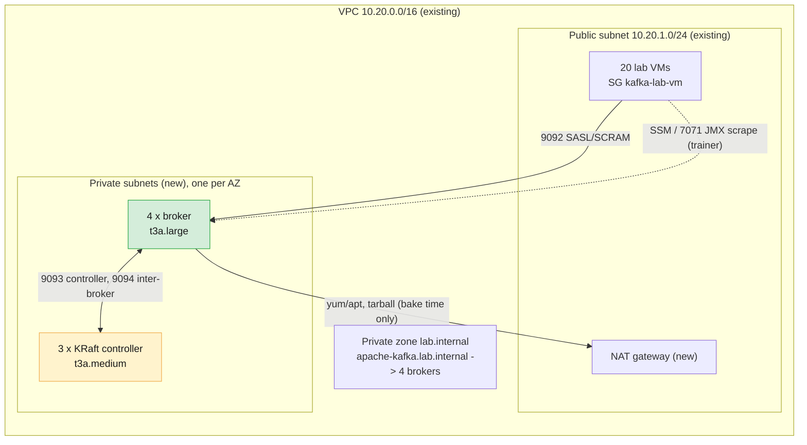

# Shared Apache Kafka cluster on AWS — provisioning plan

Status: **deployed (Phases 0–4 done, Phase 5 partly, Phase 6 not started).** See §15. Design background:
[`../LAB-SETUP.md` §4](../LAB-SETUP.md#4-shared-apache-kafka-cluster). The lab VMs
already exist ([`../README.md`](../README.md)); this plan adds the cluster next to
them, in the same VPC and AWS account, as a **separate Terraform root** so it can
be destroyed and rebuilt without touching the VMs.

| Item | Value |
| ---- | ----- |
| AWS profile / region | `kafka-training` / `ap-south-1` (account 695227035297) |
| Kafka | Apache Kafka **4.3.1**, KRaft only (same version as the lab VMs and the Docker labs) |
| Topology | 3 dedicated KRaft controllers (`t3a.medium`) + **4 brokers** (`t3a.large`, 50 GB gp2), spread over 3 AZs |
| Ownership | Cluster is **managed by the trainer**; learners can use it but never alter it |
| Client endpoint | `apache-kafka.lab.internal:9092` (hard-coded in Module 3 and 4 labs) |
| Auth / authz | SASL/SCRAM-SHA-512, one user per learner, prefix ACLs |
| Used by | Module 3 Lab 01, Module 4 Part 10 (Java clients), Module 5 reassignment, Module 7/8 comparisons |

---

## 1. What the course materials require of this cluster

Taken from `labs/module-03/`, `guides/module-04-*.md` and `LAB-SETUP.md`. Each row
is something a learner will do, so each row becomes a test in §9.

| # | Requirement | Source | How the cluster satisfies it |
| - | ----------- | ------ | ---------------------------- |
| R1 | Reachable as `apache-kafka.lab.internal:9092` from every lab VM | Lab 01 §1.1 | Private Route 53 zone `lab.internal`, multi-value A record to the 4 brokers |
| R2 | `kafka-topics.sh --list` with `~/kafka/apache.properties` prints **nothing** on first run | Lab 01 §1.1 | SCRAM user per learner; ACLs only on `lNN.*`; no pre-created topics |
| R3 | Learner never sees another learner's topics | Lab 01 §1.1 | Prefix ACLs on topics, groups and transactional IDs |
| R4 | `kafka-configs --describe --entity-type brokers --entity-default` shows `min.insync.replicas=2` as `DYNAMIC_DEFAULT_BROKER_CONFIG` | Lab 01 §1.2 | Set `min.insync.replicas=2` as a **cluster-wide dynamic default** (and statically — Lab 01 §3 expects both synonyms) |
| R5 | RF=3, 6-partition topics can be created | Lab 01 §2 | 4 brokers, `default.replication.factor=3` |
| R6 | Per-topic `kafka-configs --alter` works for own topics, live | Lab 01 §4 | `ALL` on `TOPIC lNN. (PREFIXED)` |
| R7 | Cluster-wide `--alter --entity-type brokers --entity-default` is **rejected** with `ClusterAuthorizationException` | Lab 01 §6 | No `Alter` / `AlterConfigs` on `CLUSTER` for learners |
| R8 | `auto.create.topics.enable=false` | Lab 01 §6 | Broker config |
| R9 | Per-user quotas stop a runaway producer | Lab 01 §6, Module 4 perf etiquette | User quotas (§6.3) |
| R10 | `kafka-log-dirs`, `kafka-consumer-groups`, describe of cluster work read-only | Lab 01 admin rule | `Describe` + `DescribeConfigs` on `CLUSTER` |
| R11 | Java producers/consumers (and Spring Boot apps) authenticate with the same file | Module 4 §8.2, §10 | Same listener, same SCRAM credentials |
| R12 | Trainer manages the cluster (users, ACLs, configs, reassignment execution) and demonstrates a broker failure | LAB-SETUP §3 | `trainer` is a super user; nodes reachable via SSM |
| R13 | Prometheus + Grafana on JMX metrics (Module 8) | LAB-SETUP §4 | JMX exporter on every broker, scraped from the trainer VM |

### Two conflicts with the course materials (both resolved)

1. **Reassignment vs. "no cluster Alter" (R7) — decided.** The cluster is
   **managed by the trainer**. Learners can read and describe it but never alter
   it. `kafka-reassign-partitions.sh --execute` needs `Alter` on the cluster
   resource (which would also allow creating ACLs), so learners only run
   `--generate` and `--verify` for their own topics and the **trainer executes**
   the plan. Module 5 materials must be written that way.
2. **Transactions (Module 4 §10 note) — noted.** The plan grants `ALL` on
   `TRANSACTIONAL_ID lNN. (PREFIXED)`, so the guide's fallback to the local cluster
   is no longer needed. Update that guide note once the cluster is built.

---

## 2. Architecture



| Component | Count | Type | Disk | AZ placement (`broker.rack`) |
| --------- | ----- | ---- | ---- | ---------------------------- |
| Controller (`process.roles=controller`) | 3 | `t3a.medium` (2 vCPU, 4 GB) | 20 GB gp2 | a, b, c |
| Broker (`process.roles=broker`) | 4 | `t3a.large` (2 vCPU, 8 GB) | 50 GB gp2 | a, b, c, a |

All nodes use `credit_specification { cpu_credits = "unlimited" }`, like the lab
VMs, so a burst during a load test is never throttled. The instance and disk sizes
(`t3a`, gp2) are the course-wide standard in [`../LAB-SETUP.md`](../LAB-SETUP.md).

Why these choices:

- **Dedicated controllers**, not combined mode, so Module 5 can stop a broker
  without touching quorum, and so Module 3 can show controller vs broker logs.
- **Three AZs** make `broker.rack` real: RF=3 topics get one replica per AZ,
  which is the production pattern. Cross-AZ traffic at lab volume costs cents.
- **Private subnets + NAT**, per LAB-SETUP §6: the cluster accepts client traffic
  only from the VM security group and is never exposed to the internet. The NAT
  is used only while baking and for OS patching; with a baked AMI the nodes boot
  without internet.
- **Terraform root `infra/cluster/terraform/`** reads the existing VPC and VM
  security group through data sources (tag `Name=kafka-lab`, SG name
  `kafka-lab-vm`), so it has its own state and no coupling to the VM stack.
- **Self-managed on EC2, not MSK** — the course teaches broker configuration,
  rolling restarts and reassignment that MSK hides.

---

## 3. Network and security groups

New resources (all in the cluster stack):

| Resource | Detail |
| -------- | ------ |
| 3 private subnets | `10.20.11.0/24`, `10.20.12.0/24`, `10.20.13.0/24`, one per AZ |
| NAT gateway + EIP | In the existing public subnet; private route table `0.0.0.0/0 -> NAT` |
| Private hosted zone | `lab.internal`, associated with the VPC (also used later for `cp-kafka.lab.internal`) |
| SG `kafka-lab-apache` | Attached to all 7 cluster nodes |

SG `kafka-lab-apache` ingress:

| Port | From | Purpose |
| ---- | ---- | ------- |
| 9092 | SG `kafka-lab-vm` | Client listener (SASL/SCRAM) |
| 9092, 9093, 9094 | self | Inter-broker, controller quorum, brokers to controllers |
| 7071 | SG `kafka-lab-vm` | JMX exporter, scraped by Prometheus on the trainer VM |
| 9100 | SG `kafka-lab-vm` | node_exporter |
| none from the internet | | |

Egress: all (needed for NAT-based patching and SSM). Node access is **SSM Session
Manager** via an instance profile (`AmazonSSMManagedInstanceCore`), so there is no
SSH port and no key pair on the cluster nodes.

Listeners:

| Listener | Port | Protocol | Notes |
| -------- | ---- | -------- | ----- |
| `CLIENT` | 9092 | `SASL_PLAINTEXT`, SCRAM-SHA-512 | What learners use. Plaintext on the wire inside the VPC matches the labs; TLS is the Module 7 topic |
| `BROKER` | 9094 | `SASL_PLAINTEXT`, SCRAM-SHA-512, user `broker` | Inter-broker |
| `CONTROLLER` | 9093 | `PLAINTEXT` | Locked down by SG; principal `ANONYMOUS` must be a super user on controllers |

> **Verify in the spike (§8, Phase 0):** SCRAM on the controller listener and the
> exact `super.users` needed for `ANONYMOUS` differ between Kafka versions. If 4.3.1
> supports SASL on the controller listener, use it and drop `ANONYMOUS`.

---

## 4. Node image and configuration

**Second golden AMI, `kafka-broker-golden-*`**, baked by a variant of the existing
bake script (`ami/provision-broker.sh` + `scripts/bake-broker-ami.sh`). The lab-VM
AMI is the wrong base: it carries Docker, code-server and a `learner` user with
passwordless sudo.

AMI contents: Ubuntu 24.04, Temurin 21 JRE, Kafka 4.3.1 in `/opt/kafka`,
Prometheus JMX exporter jar + config, node_exporter, systemd units
(`kafka.service`), `kafka` system user, `/var/lib/kafka/data`, SSM agent. The data
path matches the Docker labs (`/var/lib/kafka/data`), which Lab 02/03 refer to.

Per-node config is rendered by Terraform into cloud-init user data:

| Setting | Controller | Broker |
| ------- | ---------- | ------ |
| `node.id` | 1, 2, 3 | 11, 12, 13, 14 (Lab output "brokers 1,2,3" is local Docker only) |
| `process.roles` | `controller` | `broker` |
| `controller.quorum.voters` | `1@ctl-1.lab.internal:9093,2@ctl-2...,3@ctl-3...` | same |
| `broker.rack` | — | AZ id |
| `advertised.listeners` | — | `CLIENT://broker-N.lab.internal:9092,BROKER://broker-N.lab.internal:9094` |
| `cluster.id` | one value for the whole cluster, from `random_id` in Terraform (16 bytes, base64url = 22 chars) | |
| Storage | `kafka-storage.sh format -t <cluster.id> -c ... --add-scram ...` on first boot | same |

Each node gets a stable private IP and a Route 53 A record (`ctl-N`, `broker-N`
under `lab.internal`). `apache-kafka.lab.internal` is a **multi-value** A record
over the 4 brokers with health checks off, so bootstrap resolves to any broker and
clients then follow `advertised.listeners`. No NLB is needed (saves cost and one
hop to explain).

### Broker settings (static, `server.properties`)

```properties
default.replication.factor=3
min.insync.replicas=2                  # static layer (Lab 01 §3 synonym list)
num.partitions=3
auto.create.topics.enable=false        # R8
unclean.leader.election.enable=false
offsets.topic.replication.factor=3
transaction.state.log.replication.factor=3
transaction.state.log.min.isr=2
group.initial.rebalance.delay.ms=3000
log.dirs=/var/lib/kafka/data
authorizer.class.name=org.apache.kafka.metadata.authorizer.StandardAuthorizer
allow.everyone.if.no.acl.found=false
super.users=User:admin;User:trainer;User:broker
```

Left at Kafka defaults on purpose: retention (7 days), segment size, cleanup
policy, so Lab 01 Part 2/5 outputs ("built-in 604800000 ms") match.

---

## 5. Identity and secrets

| Principal | Rights | Secret |
| --------- | ------ | ------ |
| `admin` | Super user. Used only by the bootstrap scripts | Random 24 chars |
| `broker` | Super user. Inter-broker listener | Random 24 chars |
| `trainer` | Super user. Used on the trainer VM | Random 24 chars |
| `l01` … `l18` | Prefix ACLs (§6.2). `l19` spare gets the same | Random 16 chars each |

- Cluster credentials are **separate from the VM logins**. A leaked VM password
  does not leak Kafka access and vice versa.
- Generated by Terraform `random_password`, held in the cluster stack's local
  state, exported by script to a git-ignored sheet
  `infra/cluster/secrets/cluster-credentials.csv` (columns: id, user, password,
  bootstrap, config path). `*credentials*.csv` is already git-ignored; add
  `infra/cluster/secrets/` to `.gitignore` as well.
- The `admin` SCRAM credential is created at storage-format time with
  `--add-scram`; learner users are then created over the wire by the bootstrap
  script (§6.1).
- Learner config file written to each VM at `~/kafka/apache.properties`:

```properties
bootstrap.servers=apache-kafka.lab.internal:9092
security.protocol=SASL_PLAINTEXT
sasl.mechanism=SCRAM-SHA-512
sasl.jaas.config=org.apache.kafka.common.security.scram.ScramLoginModule required username="l07" password="<per-learner>";
```

---

## 6. Multi-tenancy bootstrap (`scripts/bootstrap-security.sh`)

Idempotent; reads the learner list from Terraform output; runs from the trainer
VM or via SSM on a broker. Re-running must not change anything that is already
correct.

### 6.1 Users

```bash
kafka-configs.sh --bootstrap-server $BS --command-config admin.properties --alter \
  --add-config 'SCRAM-SHA-512=[password=<pw>]' --entity-type users --entity-name l07
```

### 6.2 ACLs per learner `lNN`

| Resource | Pattern | Operation | Why |
| -------- | ------- | --------- | --- |
| `TOPIC lNN.` | PREFIXED | `ALL` | Create, produce, consume, alter own topics (R6) |
| `GROUP lNN.` | PREFIXED | `ALL` | Consumer groups |
| `TRANSACTIONAL_ID lNN.` | PREFIXED | `ALL` | Transactions (conflict 2 above) |
| `CLUSTER` | LITERAL | `Describe`, `DescribeConfigs` | `kafka-log-dirs`, `--entity-default` describe (R4, R10) |
| `CLUSTER` | — | **no** `Alter`, `AlterConfigs`, `ClusterAction`, `Create` | R7. `Create` on the cluster is not needed: `Create` on the topic prefix covers topic creation |

### 6.3 Dynamic cluster defaults and quotas

```bash
# R4: dynamic default, in addition to the static value
kafka-configs.sh ... --alter --entity-type brokers --entity-default \
  --add-config min.insync.replicas=2

# R9: default quota for every user (including future ones), per broker ...
kafka-configs.sh ... --alter --entity-type users --entity-default \
  --add-config 'producer_byte_rate=1048576,consumer_byte_rate=2097152,request_percentage=25,controller_mutation_rate=5'

# ... and a much higher one for the trainer
kafka-configs.sh ... --alter --entity-type users --entity-name trainer \
  --add-config 'producer_byte_rate=52428800,consumer_byte_rate=52428800,request_percentage=100'
```

Starting values are **1 MB/s produce and 2 MB/s consume per learner _per broker_**.
Kafka applies byte-rate quotas **per broker**, so a learner talking to all 4
brokers can reach about 4 MB/s (the spike measured 2.97 MB/s on 3 brokers against
a 1 MB/s quota). 18 learners at the cap at RF=3 would still write about 200 MB/s
cluster-wide, which a 50 GB gp2 disk cannot sustain or hold, so the quota is a
**rate guard, not a capacity guard**: the real protections are short perf runs
(Module 4 asks for ≤ 200,000 records), the disk alert (§12) and
`reset-learner.sh`. Quotas are measured over a sliding window, so a run of about
30 MB passes unthrottled: use ≥ 150,000 × 1 KB records to see the quota act.
Tune during the dry run with the `--throughput -1` perf test from Module 4 §5.

Known gap: Kafka has no per-user **topic count** or **disk** limit. Mitigations are
`controller_mutation_rate`, the 50 GB data disks as a hard stop, and a trainer-run cleanup
(`scripts/reset-learner.sh lNN` deletes `lNN.*` topics and groups) between modules.

---

## 7. Monitoring (R13)

- JMX exporter on each broker, port 7071; node_exporter on every node, port 9100.
- **Prometheus + Grafana** run as a docker compose stack on the **trainer VM**
  (Docker is already on the AMI). Targets are the private DNS names.
- Publish Grafana at `https://grafana.kafka.supercloudlabs.com` through the
  trainer VM's existing Caddy (new site block + one Route 53 A record to the
  trainer EIP). No ALB, no new security-group rule: 443 is already open.
- Dashboards: broker health, under-replicated partitions, request rate, bytes
  in/out per broker, disk, quota throttling.

---

## 8. Phased delivery

Effort is working time for one engineer, excluding AMI bake wall-clock.

| Phase | What | Output | Gate to continue | Effort |
| ----- | ---- | ------ | ---------------- | ------ |
| **0 Spike** | 3 controllers + 2 brokers in Docker on a laptop with the *same* `server.properties` templates: SCRAM via `--add-scram`, `StandardAuthorizer`, prefix ACLs, quotas, controller listener auth | Verified config + script that passes the §9 tests locally | R2–R10 pass; open questions in §3 and §1 answered | 2 h |
| **1 Terraform base** | `infra/cluster/terraform/`: private subnets, NAT, SG, private zone, IAM/SSM profile, `random_id` cluster id, passwords | `terraform plan` clean; no nodes yet | Reviewed plan | 2 h |
| **2 Broker AMI** | `provision-broker.sh`, `bake-broker-ami.sh` | `kafka-broker-golden-*` AMI | Booting an instance runs `kafka-storage format` + broker up | 1 h + ~10 min bake |
| **3 Nodes** | 3 controllers, then 4 brokers; DNS records; `apache-kafka.lab.internal` | Quorum formed, 4 brokers registered | `kafka-metadata-quorum describe --status` shows 3 voters, 4 brokers | 2 h |
| **4 Security bootstrap** | `bootstrap-security.sh`: users, ACLs, dynamic defaults, quotas | 19 learner users + trainer | R2, R3, R4, R7, R9 pass | 1 h |
| **5 Distribute client configs** | `distribute-client-config.sh`: SSH from the admin IP using `infra/secrets/kafka-lab-admin.pem`, write `~/kafka/apache.properties` (mode 600) on each of the 20 VMs; write cluster credentials CSV | Config on all VMs | `check-cluster.sh` green on 20/20 | 1 h |
| **6 Monitoring** | Prometheus + Grafana on trainer VM, Caddy site, DNS | Dashboards | Targets up, broker kill is visible | 2 h |
| **7 Dry run** | Run Module 3 Lab 01 and Module 4 Part 10 end to end as `l01`; trainer broker-failure rehearsal; load test at quota | Sign-off, tuned quotas | All of §9 | 2 h |

Total about 1.5 working days. The cluster must be ready before **Module 3 Lab 01**
(first shared-cluster lab). If time is short, Phase 6 (monitoring) can slip to
before Module 8 without affecting Modules 3–5.

Proposed layout to create:

```
infra/cluster/
  PLAN.md                    this file
  terraform/                 versions, variables, network, security, nodes, dns, outputs, node-config templates
  ami/provision-broker.sh    contents of the broker image
  scripts/
    bake-broker-ami.sh
    bootstrap-security.sh    users, ACLs, dynamic defaults, quotas (idempotent)
    distribute-client-config.sh
    check-cluster.sh         the §9 acceptance tests, run against one or all VMs
    reset-learner.sh         delete lNN.* topics/groups
    broker-failure-demo.sh   trainer drill (stop a broker, show ISR, restore)
  secrets/                   admin properties, cluster credentials CSV (git-ignored)
```

---

## 9. Acceptance tests (`check-cluster.sh`)

Run as each learner from their own VM; all must pass for 20/20 VMs.

| Test | Expected | Req |
| ---- | -------- | --- |
| `kafka-topics --list` as `lNN` on a fresh cluster | exit 0, empty | R1, R2 |
| Create `lNN.check` RF=3, 6 partitions; describe | 6 partitions, replicas on 3 different racks | R5 |
| Produce `acks=all`, consume from a group `lNN.check` | 100 records round-trip | R6, R11 |
| Produce to `l99.x` (another prefix) | `TopicAuthorizationException` | R3 |
| `kafka-configs --alter --entity-type brokers --entity-default` | `ClusterAuthorizationException` | R7 |
| `--describe --entity-type brokers --entity-default` | shows `min.insync.replicas=2` as dynamic default | R4 |
| Create topic `typo.name` | rejected (no ACL), not auto-created | R8 |
| Transactional producer with `transactional.id=lNN.tx` | commits | conflict 2 |
| `kafka-producer-perf-test --throughput -1` for 20 s | throttled near the quota | R9 |
| Stop one broker as trainer, produce `acks=all` with min.isr 2 | still succeeds; ISR shrinks to 2; restore and ISR returns to 3 | R12 |
| Prometheus target page | 4/4 brokers and 7/7 nodes up | R13 |

---

## 10. Operations runbook (to be written alongside the scripts)

- **Start / stop around class.** Stop order: brokers, then controllers; start
  order: controllers first, wait for quorum, then brokers. Private IPs and EBS
  survive stop/start, so the cluster comes back with all data. Provide
  `scripts/cluster-power.sh {start|stop}` using the `Project=kafka-training`
  and `Role=kafka-*` tags.
- **Daily check:** `kafka-metadata-quorum describe --status`,
  `kafka-topics --describe --under-replicated-partitions`, disk usage per broker.
- **Reset between modules:** `reset-learner.sh` for one learner, or all.
- **Trainer broker-failure demo:** announce in advance; `systemctl stop kafka`
  on one broker over SSM; show ISR change; restart.
- **Learner locked out / password lost:** re-run `bootstrap-security.sh` with a
  new password for that user.
- **Rolling restart / config change:** one broker at a time, wait for
  under-replicated partitions to return to 0.
- **Teardown:** `terraform destroy` in `infra/cluster/terraform`, delete the
  broker AMI and snapshots, remove the private zone if no other stack uses it.
  Learner VMs are unaffected.

---

## 11. Cost (estimates, re-price before approving)

Compute for this cluster is **≈ $0.41/hour** while running (4 × t3a.large at
$0.0752 + 3 × t3a.medium at $0.0376, us-east-1 list prices; `ap-south-1` and
sustained unlimited-credit CPU can be somewhat higher). Other items: EBS
(4 × 50 GB + 3 × 20 GB gp2 = 260 GB, roughly $26–30/month, billed while stopped),
one Elastic IP, and the NAT gateway at about $0.05/hour (≈ $35–40/month if left
up 24/7) plus data. Delete the NAT gateway while the cluster is idle once the AMI
is baked; nodes boot from the image without internet.

---

## 12. Risks

| Risk | Impact | Mitigation |
| ---- | ------ | ---------- |
| A learner fills the disk | Brokers crash for everyone. Only 50 GB per broker | Short perf runs, producer quota, trainer `reset-learner.sh`, alert at 70% disk |
| gp2 performance on 50 GB volumes: baseline 150 IOPS, burst to 3,000 from a credit bucket | Latency rises under sustained load once burst credits are spent | Quotas keep lab load low; Kafka writes are large and sequential; watch `BurstBalance` in CloudWatch during the dry run; if it drains, move the data volumes to gp3 (no downtime) |
| Misconfigured ACLs leak cross-learner access | Learners read each other's data | Acceptance tests in §9 run on every VM before class |
| Cluster-wide misconfiguration during demo | All learners blocked | Trainer rehearses in dry run; config in git; `bootstrap-security.sh` idempotent |
| SCRAM or controller-listener settings differ in 4.3.1 | Rework in Phase 3 | Phase 0 spike before any AWS spend |
| Cluster stopped by accident with learners mid-lab | Lost class time | Start/stop only through `cluster-power.sh`; auto-stop disabled until class schedule is final |
| Learner with `sudo` on their VM reads another VM's `apache.properties` | None: each file holds only that learner's SCRAM user | Per-learner credentials, mode 600 |
| Single NAT gateway / single AZ outage | Cluster unreachable | Accepted for a training cluster; AZ outage during class is out of scope |
| Learners' VMs are in one AZ, brokers in three | Slight latency variation | Accepted; Lab outputs are not latency-sensitive |

---

## 13. Decisions

### Decided

| # | Decision | Outcome |
| - | -------- | ------- |
| D1 | Cluster ownership and Module 5 reassignment | Trainer manages the cluster. Learners can use it but not alter it; the trainer executes reassignment plans |
| D2 | Broker size | `t3a.large` (was `t3a.xlarge`), 50 GB gp2, unlimited credits |
| D4a | Controller size | `t3a.medium`, 20 GB gp2 |
| D8 | Transactional-ID ACL | Granted, remove the local-cluster fallback from the Module 4 guide |
| D9 | Default learner quota | 1 MB/s produce and 2 MB/s consume per broker (set by the spike findings; revisit in the dry run) |

### Still open

Defaults in bold are what this plan assumes unless told otherwise.

| # | Decision | Options |
| - | -------- | ------- |
| D3 | Listener security | **SASL_PLAINTEXT inside the VPC (matches labs), TLS added as a Module 7 demo**; or SASL_SSL from day one |
| D4 | Controller quorum | **Static `controller.quorum.voters`**; or dynamic quorum (KIP-853) to demo add/remove controller |
| D5 | Node access | **SSM Session Manager**; or SSH via the trainer VM |
| D6 | Grafana hostname | **`grafana.kafka.supercloudlabs.com` via trainer Caddy**; or path under the trainer URL |
| D7 | Cluster node AZs | **3 AZs with `broker.rack`**; or single AZ to match the VMs and drop the rack-awareness story |

---

## 14. Phase 0 spike results

Run with `infra/cluster/spike/run-spike.sh up | test | down` (3 controllers + 3
brokers in Docker, Kafka 4.3.1, rendered from the same `config/*.tmpl` files that
the AWS nodes will use).

Passed, per learner (`l01`, `l02`): authenticate and list; create RF=3 topic;
produce `acks=all` and consume 100 records; other prefix rejected
(`TopicAuthorizationException`); cluster-wide alter rejected
(`ClusterAuthorizationException`); `min.insync.replicas=2` shown as
`DYNAMIC_DEFAULT_BROKER_CONFIG`; no auto-creation; `kafka-log-dirs` works;
transactional-ID ACL works; wrong password rejected. One broker down: `acks=all`
still succeeds with ISR 2; two brokers down: `NotEnoughReplicasException`;
brokers restart and rejoin with data intact. Re-running `bootstrap-security.sh`
is idempotent.

Answers to the open questions in §3:

- **Controller listener `PLAINTEXT` with `User:ANONYMOUS` as super user works**
  on 4.3.1. SCRAM on the controller listener was not tried; not needed.
- **`--add-scram` at `kafka-storage.sh format` on the controllers only** is enough
  to create `admin` and `broker`; the brokers are formatted without it.
- The CLIENT listener needs only a bare `ScramLoginModule required;` line; the
  BROKER listener carries the `broker` user's credentials.

Changes the spike forced:

1. **Quotas are per broker** (see §6.3); default lowered to 1 MB/s produce.
2. **Format storage only once.** A node restart must not re-run `format` (it
   fails on an already-formatted disk). The AWS first-boot script and `kafka.service`
   guard on `meta.properties`.
3. `kafka-producer-perf-test.sh` needs `--producer-props bootstrap.servers=…` in
   addition to `--producer.config`; the Module 4 materials should say so.
4. The acceptance script's negative tests were checked against the real error
   text, not just exit codes.

---

## 15. Deployment status (2026-10-01)

| Phase | State |
| ----- | ----- |
| 0 Spike | Done (§14) |
| 1 Terraform base | Applied: private subnets, SG `kafka-lab-apache`, private zone `lab.internal`, IAM/SSM profile, passwords, secrets files |
| 2 Broker AMI | Done: `kafka-broker-golden-20261001-0704` (`ami-0b2657684a4c6fcb5`) |
| 3 Nodes | Running: 3 controllers (`ctl-1..3`, ids 1–3) and 4 brokers (`broker-11..14`) on racks `ap-south-1a/b/c/a`; NAT gateway up |
| 4 Security bootstrap | Done: 19 learner users (`l01`–`l19`), `trainer` super user, prefix ACLs, `min.insync.replicas=2` dynamic default, quotas |
| 5 Client configs | **Trainer VM done. The other 19 VMs are stopped**, so `~/kafka/apache.properties` was not written. Start them, then run `scripts/distribute-client-config.sh` |
| 6 Monitoring | Not started |
| 7 Dry run | `check-cluster.sh` passes on the real cluster as `l01` and `l19` (run from the trainer VM). Not yet run from the learner VMs themselves, and the broker-failure drill was only rehearsed on the spike |

Cluster credentials: `infra/cluster/secrets/` (git-ignored): `cluster-credentials.csv`
(tracking sheet, one row per learner), `users.csv`, `admin.properties`.

### What the real deployment found

1. **`kafka` user could not write `/opt/kafka/logs`**, so every node crash-looped on
   the GC log option. Fixed on the live nodes through SSM (`LOG_DIR=/var/log/kafka`
   in `/etc/kafka/kafka.env`) and in `provision-broker.sh` and `node-boot.sh.tftpl`
   for any replacement node. The baked AMI predates the fix; the boot script
   creates the directory, so no re-bake is required.
2. **Last-line bug:** `users.csv` had no trailing newline and the `while read` loop
   skipped `trainer`, the last row, so that user was missing. Fixed in
   `bootstrap-security.sh` (accepts an unterminated last line) and in
   `secrets.tf` (file ends with a newline). The trainer user now exists.
3. **Controller port 9093 is intentionally unreachable from the lab VMs**, so
   `kafka-metadata-quorum.sh --bootstrap-controller` cannot be used from there.
   Use `--bootstrap-server apache-kafka.lab.internal:9092` with credentials.
4. **`deploy_nodes` is pinned to `true` in `terraform/terraform.tfvars`.** Its
   default is `false`, and a plain `terraform apply` without that file would
   plan to destroy the nodes.
5. A short perf run (about 30 MB) passes under the quota (burst window), as the
   spike showed; only longer runs show the per-broker limit.

### Remaining steps

1. Start the lab VMs, then `scripts/distribute-client-config.sh`, then
   `check-cluster.sh` from a learner VM.
2. Phase 6: Prometheus + Grafana on the trainer VM (targets `:7071` and `:9100`
   on the 7 node names).
3. Trainer rehearsal of `scripts/broker-failure-demo.sh` on the real cluster.
4. Update the Module 4 guide notes (transactions fallback, `--producer-props`)
   and write the Module 5 reassignment lab for the trainer-executes model.
5. Kafka UI: running on the trainer VM (`kafka-ui/README.md`, `scripts/deploy-kafka-ui.sh`).
   Public URL `https://kafka-ui.kafka.supercloudlabs.com` needs its Route 53 A record before
   the Caddy site can be enabled.
6. Stop the cluster when idle: `scripts/cluster-power.sh stop` (the NAT gateway
   keeps billing; destroy it with `terraform apply -var deploy_nodes=false` only
   when tearing the nodes down too).
