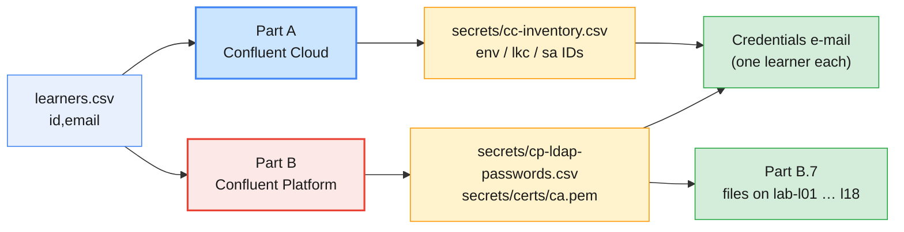

# Confluent Environment Setup for Modules 6–10 (Trainer Kit)

> **Audience:** trainer and lab/infra team
> **Design source:** [`infra/LAB-SETUP.md`](../LAB-SETUP.md) §5 (Confluent Platform), §6 (Confluent Cloud), §11 (timeline)
> **Used by:** [Module 6 labs](../../labs/module-06/README.md) and every later Confluent module

The Module 6–10 labs need two Confluent targets that do not exist in the
course infrastructure yet ([`infra/README.md`](../README.md):
*"The Confluent Platform cluster is not built yet"*):

1. a **Confluent Cloud** organization with a paid subscription, one
   environment and Basic cluster per learner, and
2. a **self-managed Confluent Platform 8.x** cluster with an **enterprise
   licence**, RBAC through MDS + LDAP, and Control Center.

This folder contains the instructions and the configuration to build both,
and to put the right files on every lab VM.

| File | Purpose |
| ---- | ------- |
| `learners.csv.example` | Template for `learners.csv` (`id,email`); the real file is git-ignored |
| `scripts/cc-provision.sh` | Cloud: environments, Basic clusters, service accounts, invitations |
| `scripts/cc-bind-roles.sh` | Cloud: `EnvironmentAdmin` for each learner after they accept |
| `scripts/cc-teardown.sh` | Cloud: delete everything the provisioning created |
| `scripts/make-certs.sh` | Platform: course CA + one TLS certificate per host |
| `scripts/gen-ldap-users.sh` | Platform: LDIF for learners, trainer and service users + password file |
| `cp-ansible/hosts.yml` | Platform: cp-ansible inventory (KRaft, TLS, RBAC/LDAP, Control Center) |
| `scripts/cp-rbac-learners.sh` | Platform: prefix role bindings and cluster `Describe` ACLs |
| `scripts/distribute-confluent-config.sh` | Lab VMs: `~/kafka/cp.properties`, `cp-ca.pem`, `confluent.env` |
| `scripts/publish-control-center.sh` | Platform: Control Center at `https://c3.kafka.supercloudlabs.com` through the trainer VM's Caddy |
| `scripts/cp-power.sh` | Platform: start / stop / status of the 8 hosts in dependency order |
| `terraform/` | Platform: the 8 EC2 hosts, security group, IAM role and `lab.internal` names |
| `confluent.env.example` | The endpoint file learners `source` in every lab |

> **Secrets:** every generated password, certificate key and ID inventory
> lands in `infra/confluent/secrets/`, which is git-ignored together with
> `learners.csv`. Send each learner **only their own** credentials, as the
> course does for the Apache cluster (`infra/LAB-SETUP.md` §9).



| When (from `LAB-SETUP.md` §11) | Step |
| ------------------------------ | ---- |
| **T-21** | Collect learner e-mails; choose the Cloud payment route (A.1); request the CP licence decision (B.1) |
| **T-14** | Create the Cloud organization and billing guardrails (A.2–A.3) |
| **T-10** | Provision Cloud (A.4); build CP — **trial clock starts** (B.2–B.6) |
| **T-7** | Distribute files (B.7); dry-run all three Module 6 labs on `lab-l01` (Part E) |
| **T-3** | Send credentials e-mails; learners accept invitations; run `cc-bind-roles.sh` |
| **Day 1** | Re-run `cc-bind-roles.sh` for late acceptors |

---

## Part A — Confluent Cloud subscription and provisioning

### A.1 Choose how to pay

Confluent Cloud is billed by usage. Pick the route before you create the
organization, because it decides who signs up and with which account:

| Route | How it works | Fits when |
| ----- | ------------ | --------- |
| **Free trial credit** | New organizations get free credit when they sign up (USD 400 at the time of writing; check the sign-up page) | Dry runs, a single small course; add a payment method before credit runs out or clusters are suspended |
| **Pay-as-you-go, direct** | Credit card or bank transfer in *Billing & payment* (prepaid cards are not accepted) | Short engagements billed to the training provider |
| **Cloud marketplace (AWS, Azure, Google Cloud)** | Subscribe to Confluent Cloud in the marketplace; usage appears on the cloud bill, pay-as-you-go or against a commitment | The client already buys through AWS Marketplace — the course infrastructure runs on AWS anyway |
| **Annual commitment** | Minimum-spend contract with volume discounts, via Confluent sales or a marketplace private offer | The client will keep using Confluent Cloud after the course |
| **Promo code** | Redeem in the Console (*Billing & payment → Payment details*) or with `confluent billing promo add <code>` | Confluent partner or event credits |

Budget from `LAB-SETUP.md` §10: **≈ USD 200–500** for 18 Basic clusters at
low throughput, one Standard cluster and short-lived Datagen connectors
(Module 10). Check current prices on the Confluent Cloud pricing page for the
region you choose.

### A.2 Create the organization

1. Sign up at `https://confluent.cloud/signup` with a **role mailbox** the
   training team controls (for example `kafka-training@<company>`), not a
   personal address — the organization owner must outlive one person.
2. Name the organization after the course (for example *Kafka Admin
   Course*). Turn on **MFA** for the owner.
3. **Administration → Accounts & access → Invite** a second trainer and give
   them `OrganizationAdmin`. One locked-out owner must not block the course.
4. Complete the payment route from A.1 under **Administration → Billing &
   payment**.

### A.3 Billing guardrails

- Set cost **notifications** in *Billing & payment* at about 50 % and 80 %
  of the budget, sent to both trainers.
- Clusters are created only by the scripts below. Learners are
  `EnvironmentAdmin` in their own environment only, so they cannot create
  Dedicated or Enterprise clusters elsewhere; ask them not to add clusters to
  their environment either.
- Managed connectors bill per task-hour: delete them at the end of every
  Module 10 lab (`LAB-SETUP.md` §6).

### A.4 Provision environments, clusters and invitations

From the admin laptop (Confluent CLI v4+, `jq`):

```bash
# (admin laptop) - from infra/confluent
cp learners.csv.example learners.csv        # then fill in the 18 real rows: id,email
confluent login --save                      # as an OrganizationAdmin
confluent organization describe             # make sure this is the course org

CC_CLOUD=aws CC_REGION=ap-south-1 TRAINER=1 ./scripts/cc-provision.sh learners.csv
```

For each learner the script creates, or reuses when it already exists:

| Resource | Name | Notes |
| -------- | ---- | ----- |
| Environment | `env-lNN` | Stream Governance *Essentials* (default); Schema Registry for Module 10 |
| Kafka cluster | `lNN-basic` | Basic, single-zone, same region as the lab VMs (`ap-south-1`) |
| Service account | `sa-lNN-app` | Pre-created for Module 7, per `LAB-SETUP.md` §6 |
| Invitation | learner's e-mail | Sent by Confluent; the learner sets a password on acceptance |

With `TRAINER=1` it also creates `env-trainer` with the Standard cluster
`trainer-standard` (demos, Module 9 faults, Module 10 capstone). The IDs land
in `secrets/cc-inventory.csv`; clusters reach status `UP` within minutes —
check with `confluent kafka cluster list --all`.

### A.5 Grant each learner their environment

A user gets an ID only after accepting the invitation, so bind roles after
the T-3 e-mail and again on day 1:

```bash
# (admin laptop) - from infra/confluent
./scripts/cc-bind-roles.sh secrets/cc-inventory.csv
```

`WAIT lNN` lines name learners who have not accepted yet; the exit code is
non-zero until everyone is bound. The result is exactly one binding per
learner: `EnvironmentAdmin` on `env-lNN`. That role lets learners create
topics, API keys and (Module 7) role bindings in their own environment and
nowhere else.

### A.6 Verify as a learner

Use a test learner (or the trainer's own invited test address) on `lab-l01`:

```bash
# (VM)
confluent login --save
confluent environment list                  # exactly one row: env-l01
confluent iam rbac role-binding list --current-user --environment <env-id> --inclusive
```

Then run Lab 01 Parts 2–5 and Lab 02 end to end (Part E).

---

## Part B — Confluent Platform enterprise cluster

### B.1 Decide the licence

| Licence | Brokers | Duration | Use it for |
| ------- | ------- | -------- | ---------- |
| **Enterprise trial** (built in, no key) | Any | **30 days** from first start; enterprise features then stop | The course, if CP is installed **no earlier than T-10** (`LAB-SETUP.md` §12) |
| **Developer** | **1 broker** per cluster | No expiry | Not this course: the shared cluster has 3 brokers |
| **Enterprise subscription** | Any | Contract term | Courses longer than the trial, re-runs, or a client that keeps the cluster; the key comes from Confluent sales/support |

For a subscription, put the key in `CONFLUENT_LICENSE` and uncomment the
`confluent.license` lines in `cp-ansible/hosts.yml` (brokers, Schema Registry,
Connect, ksqlDB, Control Center). Write the expiry date into the trainer
runbook either way.

### B.2 Hosts, DNS and network

Terraform in `terraform/` builds the hosts (Ubuntu 24.04) in the private
subnets of `infra/cluster/terraform`, reusing its NAT gateway and the
`lab.internal` zone. The hosts have no SSH port: Ansible tunnels SSH through
SSM Session Manager, so the admin laptop needs the AWS CLI and the
`session-manager-plugin`.

```bash
# (admin laptop) - from infra/confluent/terraform
terraform init
terraform apply          # 8 hosts, security group, IAM role, DNS; writes ../secrets/ansible-ssm.yml
```

| Host (Route 53 private zone `lab.internal`) | Role | Size |
| ------------------------------------------- | ---- | ---- |
| `cp-ctl-1` … `cp-ctl-3` | KRaft controllers | t3a.medium (4 GB), 20 GB gp3 |
| `cp-broker-1` … `cp-broker-3` | Confluent Server brokers (MDS, Admin REST) | t3a.large (8 GB), 100 GB gp3 |
| `cp-services` | Schema Registry, Connect, ksqlDB, Control Center | t3a.large (8 GB + 4 GB swap), 100 GB gp3 |
| `cp-ldap` | OpenLDAP | t3a.small, 20 GB gp3 |
| **`cp-kafka`** | Multi-value A record → the three brokers | — (bootstrap name in learner configs) |

| Port | From | To | Purpose |
| ---- | ---- | -- | ------- |
| **9092** | Lab VM security group | Brokers | Learner clients (`CLIENT`, SASL_SSL/PLAIN + LDAP) |
| **8090** | Lab VM SG | Brokers | MDS login and Admin REST (`confluent login --url`, `--url …/kafka`) |
| **9021** | Trainer VM | `cp-services` | Control Center, published through Caddy (B.8) |
| 9091, 9071 | CP hosts | Brokers | Inter-broker and component listeners |
| 9093 | Brokers | Controllers | KRaft |
| 8081, 8083, 8088 | Lab VM SG + CP hosts | `cp-services` | Schema Registry, Connect, ksqlDB (Module 10) |
| 389 | CP hosts | `cp-ldap` | LDAP binds from MDS and the brokers |
| 443 (egress) | CP hosts | Internet via NAT | Packages; Health+ telemetry (Module 8) |

Never open 9092, 8090 or 9021 to the internet.

### B.3 Certificates

```bash
# (admin laptop) - from infra/confluent
./scripts/make-certs.sh
```

This creates `secrets/certs/ca.pem` (the course CA) and a certificate per
host. Broker certificates also carry **`cp-kafka.lab.internal`**, so clients
that bootstrap through the shared name pass hostname verification. Validity
defaults to 120 days (`CERT_DAYS`).

### B.4 OpenLDAP users

LDAP users exist for every lab VM (`l01`…`l19`), not only the learners who
have a Cloud e-mail, so the ID list is generated rather than taken from
`learners.csv`:

```bash
# (admin laptop) - from infra/confluent
{ echo id; for i in $(seq -w 1 19); do echo "l$i"; done; } > secrets/cp-learners.csv
./scripts/gen-ldap-users.sh secrets/cp-learners.csv
```

The LDIF holds `l01`…`l19`, `trainer`, the groups `learners` and
`trainers`, and the service users cp-ansible needs: `mds`,
`kafka_broker`, `schema_registry`, `connect_worker`, `ksql`,
`control_center`. Clear-text passwords, including the directory's own
`ldap_admin`, exist only in `secrets/cp-ldap-passwords.csv`.

### B.5 Install with cp-ansible

```bash
# (admin laptop) - from infra/confluent/cp-ansible
python3 -m venv ~/.venvs/cp-ansible && ~/.venvs/cp-ansible/bin/pip install 'ansible>=10,<11' bcrypt   # full package (community.general); bcrypt for Control Center
export PATH=~/.venvs/cp-ansible/bin:$PATH
ansible-galaxy collection install confluent.platform:8.3.2   # pin = confluent_package_version
INV=(-i hosts.yml -i ../secrets/ansible-ssm.yml)

# secrets as environment variables (gen-ldap-users.sh prints these export lines)
export CP_MDS_PASSWORD=… CP_BROKER_LDAP_PASSWORD=… CP_SR_LDAP_PASSWORD=…
export CP_CONNECT_LDAP_PASSWORD=… CP_KSQL_LDAP_PASSWORD=… CP_C3_LDAP_PASSWORD=…
# export CONFLUENT_LICENSE=…        # subscription only (B.1)

ansible "${INV[@]}" all -m ping                       # SSH over SSM to all 8 hosts
ansible-playbook "${INV[@]}" ldap.yml                 # OpenLDAP + users (B.4); before the brokers start
ansible-playbook "${INV[@]}" confluent.platform.all   # about 30-40 minutes; ansible.cfg here sets hash_behaviour=merge
```

What the inventory sets, and why:

| Setting | Value | Reason |
| ------- | ----- | ------ |
| `kafka_controller` group | 3 hosts | KRaft-only CP 8.x, dedicated controllers as on the Apache cluster |
| `ssl_enabled`, `ssl_custom_certs` | `true` | Every listener on TLS with the course CA (B.3) |
| `rbac_enabled` + `mds_super_user` | `true`, `mds` | MDS issues tokens; role bindings authorize (Module 7) |
| `kafka_controller_ssl_mutual_auth_enabled`, `broker` listener `ssl_mutual_auth_enabled` | `true`, client auth `required` | RBAC needs an authenticated principal for controllers and brokers; they use their host certificates. Learner and component listeners are unchanged |
| `localhost` host entry | `ansible_connection: local`, no `become` | cp-ansible checks the certificates on the admin laptop; without this it tries `sudo` there |
| `kafka_broker_custom_listeners.client` | `:9092`, `sasl_protocol: plain` | The learner listener; `internal` moved to 9071 so the documented bootstrap stays `cp-kafka.lab.internal:9092` |
| `listener.name.client.plain.sasl.server.callback.handler.class` | `LdapAuthenticateCallbackHandler` | `PLAIN` passwords checked against LDAP, so one password works for Kafka clients, MDS and Control Center |
| `ldap.*` | `ou=people` / `ou=groups`, `uid`, `groupOfNames` | Matches the LDIF from B.4 |
| `auto.create.topics.enable=false`, RF 3, `min.insync.replicas=2`, no unclean election | | Same guardrails as the shared Apache cluster (`LAB-SETUP.md` §4) |
| `confluent.balancer.enable=true` | | Self-Balancing on, so Lab 03 Part 1.2 shows it |
| `control_center_next_gen` group | `cp-services` | Control Center 2.x (separate product since CP 8.0) |
| `required_total_memory_mb_*`, `*_service_environment_overrides` | Controller heap 1.5 GB, broker 3 GB; SR 0.5, Connect 1, ksqlDB 1, C3 2 GB | Fits t3a.medium/t3a.large; cp-ansible's defaults assume 7 GB+ per host |
| `kafka_connect_confluent_hub_plugins` | `confluentinc/kafka-connect-datagen:0.7.2` | Datagen Source plugin for Module 6 Lab 07, installed from Confluent Hub with `confluent connect plugin install` into `/usr/share/java/connect_plugins` (on the worker's `plugin.path`). `cp-services` needs outbound HTTPS to `hub-downloads.confluent.io` |

**Cluster already installed?** Add the plugin without a full re-run: only the
Connect role runs, and it restarts the worker (running connectors pause for
about a minute):

```bash
# (admin laptop) - from infra/confluent/cp-ansible, same venv and exports as above
ansible-playbook "${INV[@]}" confluent.platform.all --tags kafka_connect --limit kafka_connect,localhost
```

> **Before the real run:** compare `hosts.yml` with the sample inventories in
> the cp-ansible collection version you installed (KRaft + RBAC + LDAP +
> custom certs). Variable names do change between major versions; the
> playbook's validation tasks name any variable it does not accept.

### B.6 Learner role bindings and ACLs

Create an admin client config for `mds` (git-ignored), log the CLI in to MDS,
and bind every learner:

```bash
# (trainer VM: a temporary copy of this folder's script, cp-learners.csv, certs/ca.pem; delete it afterwards)
cat > secrets/mds-admin.properties <<EOF
bootstrap.servers=cp-kafka.lab.internal:9092
security.protocol=SASL_SSL
sasl.mechanism=PLAIN
sasl.jaas.config=org.apache.kafka.common.security.plain.PlainLoginModule required username="mds" password="$CP_MDS_PASSWORD";
ssl.truststore.type=PEM
ssl.truststore.location=$PWD/secrets/certs/ca.pem
EOF
chmod 600 secrets/mds-admin.properties

confluent login --url https://cp-kafka.lab.internal:8090 --certificate-authority-path secrets/certs/ca.pem
./scripts/cp-rbac-learners.sh secrets/cp-learners.csv     # also sets the cluster default min.insync.replicas=2
confluent logout
```

| Principal | Binding | Effect in the labs |
| --------- | ------- | ------------------ |
| `User:lNN` | `ResourceOwner` on `Topic:lNN.` (prefix) | Create, configure, produce, consume, delete own topics; `other.topic` denied (Lab 03 Part 5) |
| `User:lNN` | `ResourceOwner` on `Group:lNN.` (prefix) | Own consumer groups (`lNN.analytics`) |
| `User:lNN` (except any listed in `RESOURCE_OWNER_ONLY` in the script) | `SystemAdmin` on the Kafka cluster | Full control of the Kafka cluster: brokers and broker configs, every topic and group (including other learners'), role bindings, the full Control Center view and alert triggers. Overrides the prefix isolation of the two rows above |
| `User:lNN` | ACL `Describe`, `DescribeConfigs` on the cluster | Read brokers, quorum and broker configs (Lab 03 Part 1); no `Alter` |
| `User:lNN` | `ResourceOwner` on `Subject:lNN.` (prefix) in Schema Registry `schema-registry` | Register, read and delete schemas of own topics (Module 6 Lab 06) |
| `User:lNN` | `ResourceOwner` on `Connector:lNN.` (prefix) in Connect `connect-cluster` | Create, pause, restart and delete own connectors; other names refused (Module 6 Lab 07). Makes the Connect cluster visible in Control Center |
| `User:lNN` | `DeveloperWrite` on `KsqlCluster:ksql-cluster` in ksqlDB `default_` | Submit statements and queries (Module 6 Lab 08). Makes the ksqlDB cluster visible in Control Center |
| `User:ksql`, `User:connect_worker` | `ResourceOwner` on `Topic:lNN.` and `Subject:lNN.` (prefix) | Persistent queries and connectors run as these service principals |
| `User:trainer` | `SystemAdmin` on the Kafka cluster, Schema Registry, Connect and ksqlDB | Demos, resets, the full Control Center view of every component |

> **Learners are `SystemAdmin`:** any learner can read, change or delete any topic or
> group, alter broker configs and create or delete role bindings, including other
> learners' and the trainer's. The labs' "refused" steps on the Kafka cluster
> (Module 6 Lab 03 Part 5, Lab 05 Part 4, Module 7 Lab 02 Parts 3-4) then succeed.
> Schema Registry, Connect and ksqlDB keep their prefix bindings.
> For monitoring only, bind `Operator` instead: it is the narrowest role with
> `ControlCenterBrokerMetrics:Read`, which Control Center 2.x needs for the Brokers page
> (without it: `403 must have broker metrics access`); Kafka ACLs do not count.

### B.7 Distribute client files to the lab VMs

```bash
# (admin laptop) - from infra/confluent
mkdir -p secrets && cp confluent.env.example secrets/confluent.env   # edit C3_URL if needed
./scripts/distribute-confluent-config.sh            # all VMs, or: ./scripts/distribute-confluent-config.sh l01 l02
```

Each VM receives, next to the existing `apache.properties`:

| File | Mode | Content |
| ---- | ---- | ------- |
| `~/kafka/cp.properties` | 600 | `SASL_SSL`, `PLAIN`, the learner's LDAP user, PEM truststore |
| `~/kafka/cp-ca.pem` | 644 | Course CA |
| `~/kafka/confluent.env` | 644 | `CP`, `MDS_URL`, `CP_REST`, `CP_CA`, `C3_URL`, `SR_URL`, `KSQL_URL`, `CONNECT_URL` — endpoints only |

### B.8 Publish Control Center

The course VMs use Caddy and Let's Encrypt instead of an ALB
([`infra/README.md`](../README.md)). Control Center is published the same way
as Kafka UI, through the trainer VM:

```bash
# (admin laptop, from an admin IP) - from infra/confluent
./scripts/publish-control-center.sh          # default name: c3.kafka.supercloudlabs.com
```

The script upserts the Route 53 A record (not managed by Terraform, like
`kafka-ui`), copies the course CA to `/etc/caddy/cp-ca.pem`, writes the site
block `/etc/caddy/c3.caddy` (imported from the Caddyfile), reloads Caddy and
waits for the Let's Encrypt certificate. Caddy adds no authentication:
Control Center itself asks for the LDAP user and checks it through MDS.

Port 443 on the trainer VM is open to the internet, as for the lab VMs, so the
login page is public. Restrict 443 to the client's egress IPs if required.
If you choose another URL, pass it to the script, change `C3_URL` in
`secrets/confluent.env` and re-run B.7.

### B.9 Verify

```bash
# (VM: lab-l01)
source ~/kafka/confluent.env
kafka-broker-api-versions.sh --bootstrap-server $CP --command-config ~/kafka/cp.properties | grep -c "(id:"   # 3
kafka-metadata-quorum.sh --bootstrap-server $CP --command-config ~/kafka/cp.properties describe --status
confluent login --url $MDS_URL --certificate-authority-path $CP_CA
confluent kafka topic create l01.smoke --url $CP_REST --certificate-authority-path $CP_CA --partitions 1 --replication-factor 3
confluent kafka topic create other.smoke --url $CP_REST --certificate-authority-path $CP_CA --partitions 1   # must be denied
confluent kafka topic delete l01.smoke --url $CP_REST --certificate-authority-path $CP_CA --force
curl -sI $C3_URL | head -1
curl -s --cacert $CP_CA -u l01:<password> $CONNECT_URL/connector-plugins | jq -r '.[].class' | grep -i datagen   # DatagenConnector
```

---

## Part C — Self-study: your own trial organization

Learners who repeat Labs 01–02 after the course (or without the course org)
can use a personal trial:

1. Sign up at `https://confluent.cloud/signup`; the new organization comes
   with free trial credit.
2. Create an environment and a Basic cluster with the CLI, then follow
   Lab 01 from Part 2 using your own IDs:

```bash
# (VM or laptop)
confluent login --save
confluent environment create env-l00 -o json | jq -r .id          # your env ID
confluent environment use <env-id>
confluent kafka cluster create l00-basic --cloud aws --region ap-south-1 --type basic
```

3. Delete the cluster when you are done
   (`confluent kafka cluster delete <lkc-id> --force`) so the credit is not
   consumed by idle storage.

Lab 03 needs Confluent Platform with RBAC and Control Center; on your own,
follow it as a reading exercise or watch the trainer's demo. The `cp-kafka`
compose files in [`labs/setup/`](../../labs/setup/) run Confluent's packaging of
Apache Kafka without the enterprise features (guide §2.3).

---

## Part D — Teardown

Immediately after the course (`LAB-SETUP.md` §13):

```bash
# (admin laptop) - from infra/confluent
REMOVE_USERS=1 ./scripts/cc-teardown.sh secrets/cc-inventory.csv      # type DELETE to confirm
```

Then: delete any connectors left in `env-trainer`, check **Billing &
payment** shows no running clusters, cancel the marketplace subscription or
payment method if the org is not reused, and `terraform destroy` the CP
hosts with the rest of the course infrastructure. Destroy `infra/confluent/secrets/`
last, after the credentials have been rotated or the users deleted.

---

## Part E — Dry run (T-7)

Run every Module 6 lab on `lab-l01` as a learner and tick the result:

| Check | Lab / part | Expected |
| ----- | ---------- | -------- |
| Files present, `confluent.env` correct | Lab 01 Part 1 | 4 files, endpoints resolve |
| Cloud login, one environment, `EnvironmentAdmin` | Lab 01 Parts 2–3 | Only `env-l01` visible |
| API key, `ccloud.properties`, Apache CLI against Cloud | Lab 01 Parts 4–5 | Topic listed, RF 3 |
| Guardrails rejected; offsets reset | Lab 02 Parts 2, 4 | RF 2, `min.insync.replicas=3`, broker alter refused |
| Cloud Console create / produce / delete | Lab 02 Parts 5–6 | Visible in the CLI |
| CP brokers, quorum, `confluent.*` configs | Lab 03 Part 1 | 3 brokers, 3 voters, balancer on |
| Control Center login and tour | Lab 03 Parts 2–3 | Brokers page loads; all topic names, own groups only |
| MDS login, Admin REST, `curl` | Lab 03 Part 4 | Topic created via REST |
| `other.topic` denied in CLI, Apache CLI and UI | Lab 03 Part 5 | 403 / `TopicAuthorizationException` |

Copy the real outputs you capture into the labs where IDs, counts or message
wording differ from your environment.
