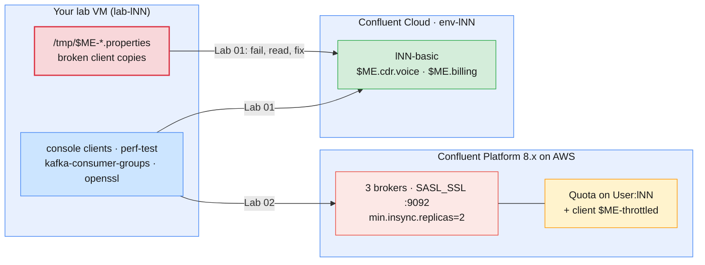

# Module 9 Labs — Troubleshooting & Preventing Message Loss on Confluent Kafka

> **Course:** Apache Kafka & Confluent Kafka Administration
> **Companion guide:** *`guides/module-09-…` is not written yet.* Until it is, the labs
> cite [Module 8 guide §2.6 and §8](../../guides/module-08-monitoring-performance-tuning.md)
> (lag, troubleshooting), [Module 4 guide §3.3, §5.4, §5.5 and §7.1](../../guides/module-04-producing-consuming-messages.md)
> (delivery timeout, offset reset, delivery semantics) and
> [Module 3 guide §5 and §6](../../guides/module-03-cluster-configuration-storage-retention.md)
> (retention, `acks` and `min.insync.replicas`).
> **Module objective:** Troubleshoot Confluent Kafka clusters and diagnose, resolve, and
> prevent message loss and other production issues.

Module 8 taught you to watch the two Confluent targets. In this module you
break them on purpose, read the evidence, and fix them. Every fault is
scoped to **your own** client, topic or group, so nobody else's lab breaks.
Lab 01 runs on **Confluent Cloud** (`env-lNN`). You work through a triage
ladder for connectivity, authentication and authorization faults, catch an
oversized record that the producer drops, and remediate consumer lag without
losing the data you skip. Lab 02 runs on the **self-hosted Confluent Platform
cluster on AWS**. You audit topic durability (`acks`, replication factor,
`min.insync.replicas`), throttle your own producer with a quota until records
expire, let retention delete records a group never read, and finish with a
prevention checklist and an escalation ticket. Do the labs in order.

| # | Lab | Level | Time | What you will do |
| - | --- | ----- | ---- | ---------------- |
| 01 | [Connectivity, client errors & consumer lag on Confluent Cloud](lab-01-connectivity-client-errors-lag-confluent-cloud.md) | Beginner | 75 min | Walk the triage ladder (DNS → TCP → TLS → SASL → RBAC → topic), fix four broken client configs, catch an oversized record the producer drops silently, analyse lag and skip a backlog with a rollback file, write an escalation note |
| 02 | [Message loss: acks, replication, quotas & retention on Confluent Platform](lab-02-message-loss-acks-quotas-retention-platform-aws.md) | Intermediate → Advanced | 85 min | Audit three topics for durability, see why `acks=all` on RF 1 is no guarantee, read a broker-failure demo, throttle your producer with a quota until records expire, watch retention delete unread records, fill in a prevention checklist |

Estimated total: **about 2 h 40 min**, including checkpoint questions.

> **Trainers:** start the Confluent Platform cluster (LDAP → controllers →
> brokers → services) at least 15 minutes before Lab 02. See
> [`infra/guides/confluent-platform-cluster-connect.md`](../../infra/guides/confluent-platform-cluster-connect.md).
> Lab 02 Part 2 has an **optional** trainer demo that stops one Platform
> broker for five minutes; announce it, because every learner's RF 1
> partitions on that broker go offline. In the dry run with a learner login
> (`lab-l19`), check that `confluent kafka topic create … --replication-factor 1`
> is accepted, and that `kafka-configs.sh --alter --entity-type users` works with
> the learner's `SystemAdmin` binding (Lab 02 Part 4).

---

## Prerequisites

| Requirement | Check with | Notes |
| ----------- | ---------- | ----- |
| Module 8 completed | `confluent context list` | Cloud and Platform contexts both saved |
| `sa-lNN-app` and `~/kafka/sa-app.properties` | `ls -l ~/kafka/sa-app.properties` | Lab 01 breaks copies of this file, never the file itself |
| `~/kafka/metrics.netrc` and `~/kafka/lag-watch.sh` from Module 8 Lab 01 | `ls -l ~/kafka/` | Lab 01 Part 5 confirms the fix on Metrics API data (optional) |
| Topic `$ME.cdr.voice` on Cloud | `confluent kafka topic list` | Kept since Module 7 Lab 01 (6 partitions) |
| Platform files `~/kafka/cp.properties`, `cp-ca.pem`, `confluent.env` | `ls -l ~/kafka/` | Lab 02 |
| Your LDAP password | Your credentials e-mail | `confluent login --url` in Lab 02 |
| Confluent CLI v4.x, Kafka 4.x CLI, `jq`, `openssl` | `confluent version`, `openssl version` | In the VM image |
| Two or three terminals | — | Producer, consumer and diagnosis side by side |

> **No Docker in this module.** Nothing runs locally and no ports need to be
> free.

> **Using the course AWS VMs?** Your VM (`lab-lNN`) already has the CLIs and
> the prepared files under `~/kafka/`. Open it in the browser IDE or VS Code
> Remote-SSH and run the labs there exactly as written. See
> [`infra/LAB-SETUP.md`](../../infra/LAB-SETUP.md) §4–§7 for the full course
> environment.

---

## Lab environment

The targets are the same as in Modules 6–8. What is new is that you create
the faults yourself, on your own client files, topics and groups.



| Target | Identity | Names used in the labs | Faults you create |
| ------ | -------- | ---------------------- | ----------------- |
| **Confluent Cloud** (Lab 01) | `sa-lNN-app`, Kafka key in `~/kafka/sa-app.properties` | Topic `$ME.cdr.voice`, group `$ME.billing` | Broken copies of the client file, a missing topic, a missing role binding, an oversized record, a lagging group |
| **Confluent Platform on AWS** (Lab 02) | Your LDAP user `lNN` (`~/kafka/cp.properties`) | Topics `$ME.cdr.rf1`, `$ME.cdr.weak`, `$ME.cdr.safe`, `$ME.cdr.short`; group `$ME.rating` | Weak topic settings, a quota on your own client ID, a retention shorter than your consumer's lag |

### Everyday commands

In every new terminal:

```bash
# (VM)
source ~/kafka/confluent.env            # CP, MDS_URL, CP_REST, CP_CA, C3_URL (no secrets)
ME=lNN                                  # your prefix: l01 … l18
CFG=~/kafka/cp.properties               # your LDAP user on Confluent Platform (Lab 02)
SA_CFG=~/kafka/sa-app.properties        # sa-lNN-app on Confluent Cloud (Lab 01)

kafka-broker-api-versions.sh --bootstrap-server $CP --command-config $CFG | grep "(id:"
kafka-consumer-groups.sh --bootstrap-server $CP --command-config $CFG --describe --group $ME.rating
```

> **Convention used in the labs**
>
> - `# (VM)`: run on **your lab VM**, against Confluent Cloud or the shared
>   Confluent Platform cluster, with your prefix (`$ME`). Every command block
>   in this module uses it. `# (VM) - terminal 2` marks a block that keeps
>   running while you work in the first terminal.
> - **Broken** client files live in `/tmp/$ME-*.properties`, are created with
>   `umask 077`, and are deleted at the end of each part. The real files in
>   `~/kafka/` are never edited.
> - Secrets never appear in commands or notes. Where a lab prints a client
>   file, it masks the password with `sed`.

---

## Troubleshooting

These are the errors the labs make you meet on purpose. If one appears
**outside** the part that creates it, use the fix column.

| Symptom | Likely cause | Fix |
| ------- | ------------ | --- |
| `Couldn't resolve server … from bootstrap.servers as DNS resolution failed` | Typo in the bootstrap host | Copy the endpoint from `confluent kafka cluster describe` (Lab 01 Part 2) |
| `Bootstrap broker … disconnected` repeated, then `Request METADATA failed` | Client speaks PLAINTEXT to a SASL_SSL listener: `--command-config` forgotten | Pass the client file; check `security.protocol=SASL_SSL` |
| `SaslAuthenticationException: Authentication failed` | Wrong, deleted or not-yet-active API key, or wrong LDAP password | `confluent api-key list`; wait 1–2 min after creating a key |
| `TopicAuthorizationException: Not authorized to access topics: [lNN.…]` | Role binding missing (on Cloud, `DeveloperWrite` was removed in Module 8) | Lab 01 Part 3 grants it; remove it again at clean up |
| `TopicAuthorizationException` on a topic nobody can find, or `Topic lNN.… not present in metadata after … ms` | The topic does not exist (auto-creation is off on both targets); without rights on the name you get the authorization error instead | Check `confluent kafka topic list` as an administrator before granting anything (Lab 01 Part 3) |
| `RecordTooLargeException` | Record above `max.request.size` (client) or `max.message.bytes` (topic) | Lab 01 Part 4: shrink the record or raise the topic limit deliberately |
| `Expiring N record(s) … ms has passed since batch creation` | Producer throttled or blocked longer than `delivery.timeout.ms` | Lab 02 Part 4: remove the quota or slow the producer; raise `delivery.timeout.ms` |
| `OffsetOutOfRangeException: Fetch position … is out of range` | Retention deleted records the group had not read, with `auto.offset.reset=none` | Lab 02 Part 5: decide where to restart and reset the group deliberately |

---

## Cleaning up after the module

Each lab ends with its own clean up. After both labs:

- **Kept on Cloud:** `sa-lNN-app` with `DeveloperRead` on `Topic:$ME.cdr.voice`
  and `Group:$ME.billing`, `MetricsViewer`, both keys, and the topic
  `$ME.cdr.voice`. Module 10 builds connectors and schemas next to it.
- **Removed on Cloud:** the `DeveloperWrite` binding that Lab 01 adds back for
  the tickets, and every `/tmp/$ME-*` file. The test CDRs stay in
  `$ME.cdr.voice` until retention removes them.
- **Removed on Platform:** your `$ME.cdr.*` topics (`rf1`, `weak`, `safe`,
  `short`, and `strict` if you joined the trainer demo), the `$ME.rating`
  group, and the quota on `User:lNN` / client `$ME-throttled`.

To check what is left:

```bash
# (VM)
ls /tmp/$ME-* 2>/dev/null; echo "tmp files left: $?"   # 2 = none left
kafka-configs.sh --bootstrap-server $CP --command-config $CFG --describe --entity-type users --entity-name $ME --entity-type clients
confluent context use <your Cloud context name>
SA=$(confluent iam service-account list -o json | jq -r --arg n "sa-$ME-app" '.[] | select(.name==$n) | .id')
confluent iam rbac role-binding list --principal User:$SA --inclusive
```

The trainer deletes the service account, its keys and your environment at the end of
the course ([`infra/confluent/README.md` Part D](../../infra/confluent/README.md#part-d--teardown)).
