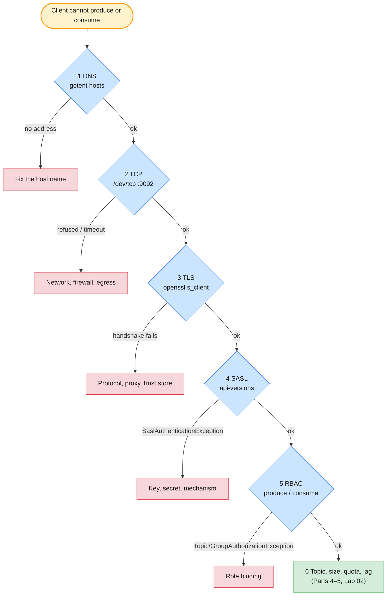
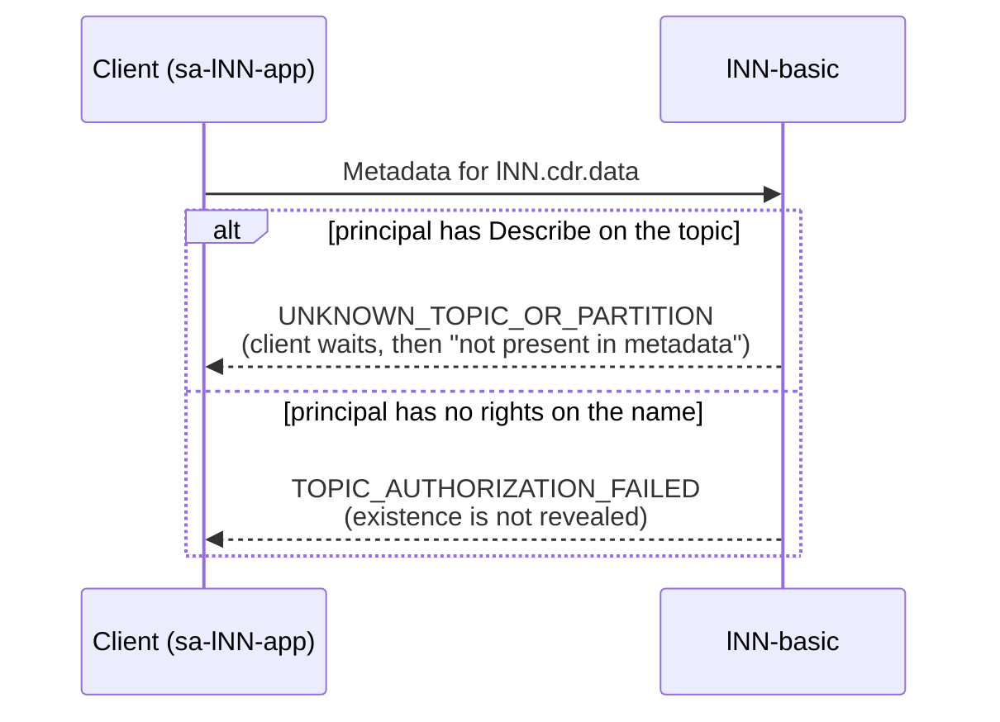
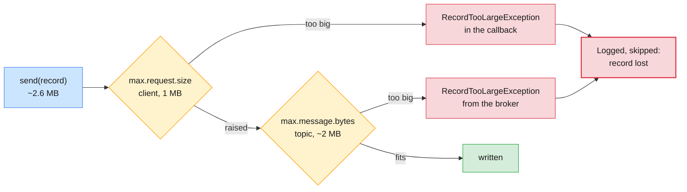

# Lab 01 — Connectivity, Client Errors & Consumer Lag on Confluent Cloud

| | |
| --- | --- |
| **Level** | Beginner |
| **Duration** | ~75 minutes |
| **Guide sections** | Module 6 §5 (API keys, client configuration) · Module 7 §4–§5 (RBAC, API keys) · Module 4 §5.4 `auto.offset.reset` · Module 4 §5.5 Resetting offsets as an administrator · Module 4 §7.1 Where messages can be lost · Module 8 §2.6 Consumer lag · Module 8 §8 Troubleshooting |
| **You will need** | Module 8 done: `sa-lNN-app` with `DeveloperRead` and `MetricsViewer`, its key in `~/kafka/sa-app.properties`, the topic `$ME.cdr.voice` (6 partitions) and the group `$ME.billing`; your Cloud CLI context; three terminals |

## Learning objectives

By the end of this lab you will be able to:

1. Walk the **triage ladder** for a client that cannot connect (DNS → TCP →
   TLS → authentication → authorization → topic) and name the rung from the
   first error line.
2. Diagnose and fix a **typo in the bootstrap address**, a **missing client
   config**, a **wrong API secret** and a **missing role binding**.
3. Explain why a principal without rights gets `TopicAuthorizationException`
   even for a topic that **does not exist**.
4. Show how a producer that only **logs** errors loses an **oversized
   record**, and count the loss from offsets.
5. Analyse **consumer lag**, then remediate it in two ways: drain it, or
   skip a backlog deliberately **with a rollback file**.
6. Write an **escalation note** that Confluent Support can act on.

## Why this lab

On Confluent Cloud you cannot log in to a broker, read `server.log` or run
`tcpdump`. Your evidence is the **client's error message**, the **CLI**, and
the **Metrics API**. Most Cloud tickets that reach a platform team are client
problems: a pasted endpoint, a forgotten config file, a key that was rotated,
a binding that was never made. In this lab you cause each of them on purpose,
on copies of your own client file, and practise reading the one line that
tells you which layer failed.



---

## Before you start — variables (5 min)

Use the IDs from your notes (Module 7 Lab 01, Module 8 Lab 01):

```bash
# (VM)
confluent context list                  # the * must be on your Cloud context
ME=lNN                                  # your prefix
ENV_ID=env-7qk3x2                       # ← your env-lNN ID
LKC=lkc-9xw2pq                          # ← your lNN-basic cluster ID
confluent environment use $ENV_ID
confluent kafka cluster use $LKC
CCLOUD=$(confluent kafka cluster describe -o json | jq -r .endpoint | sed 's#SASL_SSL://##')
CCHOST=${CCLOUD%:*}
SA=$(confluent iam service-account list -o json | jq -r --arg n "sa-$ME-app" '.[] | select(.name==$n) | .id')
SA_CFG=~/kafka/sa-app.properties
SCOPE="--environment $ENV_ID --cloud-cluster $LKC --kafka-cluster $LKC"
echo "$ENV_ID $LKC $SA $CCLOUD"
```

**Expected:**

```
env-7qk3x2 lkc-9xw2pq sa-1a2b3c pkc-xxxxx.ap-south-1.aws.confluent.cloud:9092
```

Copy the block into terminals 2 and 3 when you open them.

---

## Part 1 — The triage ladder on a healthy client (10 min)

Before you break anything, record what **healthy** looks like on each rung.
During an incident you compare against this.

```bash
# (VM)
getent hosts $CCHOST                                              # 1 DNS
timeout 5 bash -c "</dev/tcp/$CCHOST/9092" && echo "TCP 9092 open" # 2 TCP
openssl s_client -connect $CCLOUD -servername $CCHOST -brief </dev/null 2>&1 | head -8   # 3 TLS
```

**Expected** (addresses and the certificate name are yours):

```
13.235.xx.xx    pkc-xxxxx.ap-south-1.aws.confluent.cloud
…
TCP 9092 open
CONNECTION ESTABLISHED
Protocol version: TLSv1.3
Ciphersuite: TLS_AES_256_GCM_SHA384
Peer certificate: CN=…
Hash used: SHA256
Signature type: …
Verification: OK
```

The `openssl` line to look for is **`Verification: OK`**: the VM trusts the
certificate Confluent Cloud presents, using the operating system's CA store.
A Java client does the same with the JDK's trust store, so Cloud clients need
no `ssl.truststore.*` settings. Platform clients do (Module 6 Lab 05 Part 6).

Now the two Kafka rungs, as the application:

```bash
# (VM)
kafka-broker-api-versions.sh --bootstrap-server $CCLOUD --command-config $SA_CFG | grep -c "(id:"   # 4 SASL
kafka-topics.sh --bootstrap-server $CCLOUD --command-config $SA_CFG --list                       # 5 RBAC (Describe)
```

**Expected:** a number of brokers (Confluent decides how many, and it can
change), then the one topic the application may describe:

```
…
l07.cdr.voice
```

| Rung | Healthy evidence | Your value |
| ---- | ---------------- | ---------- |
| **1 DNS** | `getent` prints at least one address | |
| **2 TCP** | `TCP 9092 open` | |
| **3 TLS** | `Verification: OK` | |
| **4 SASL** | `api-versions` lists brokers | |
| **5 RBAC** | `--list` shows `$ME.cdr.voice` | |

> **Note:** `--list` shows only the topics the principal may **describe**.
> The application sees one topic; you, as `EnvironmentAdmin`, see all of
> `lNN-basic`. An empty list is an authorization answer, not proof that the
> cluster is empty.

---

## Part 2 — Connectivity and authentication faults (15 min)

You get three tickets from the mediation team. Reproduce each one, record
the **first meaningful error line**, name the rung, fix it.

Create the broken copies first. They live in `/tmp`, only you can read them,
and Part 2 deletes them:

```bash
# (VM)
umask 077
sed "s/password='[^']*'/password='not-the-secret'/" $SA_CFG > /tmp/$ME-badsecret.properties
sed 's/password=.*/password=<hidden>;/' /tmp/$ME-badsecret.properties | grep sasl.jaas
ls -l /tmp/$ME-*.properties
```

**Expected:** the `sasl.jaas.config` line with the real key as `username`
and the password masked, and one `-rw-------` file.

### Ticket A — "The new collector can't find Kafka"

The collector was configured from an e-mail, with one letter changed in the
host name:

```bash
# (VM)
BAD_HOST=$(echo $CCHOST | sed 's/^pkc-/pkc-x/')
timeout 30 kafka-broker-api-versions.sh --bootstrap-server $BAD_HOST:9092 --command-config $SA_CFG 2>&1 \
  | grep -vE '^\s+at ' | head -4
```

**Expected** (dry run with the same Kafka 4.x client):

```
[2026-10-11 20:16:41,754] WARN Couldn't resolve server pkc-xxxxxx.ap-south-1.aws.confluent.cloud:9092 from bootstrap.servers as DNS resolution failed for pkc-xxxxxx.ap-south-1.aws.confluent.cloud (org.apache.kafka.clients.ClientUtils)
No resolvable bootstrap urls given in bootstrap.servers
org.apache.kafka.common.config.ConfigException: No resolvable bootstrap urls given in bootstrap.servers
```

Rung 1. The client gave up **at once**: there was nothing to connect to.
Confirm with `getent hosts $BAD_HOST` (no output, exit code 2).

### Ticket B — "It hangs, then fails with METADATA"

An operator ran the tool on the right host but forgot `--command-config`.
Without it the client speaks **PLAINTEXT** to a listener that expects TLS:

```bash
# (VM)
timeout 60 kafka-broker-api-versions.sh --bootstrap-server $CCLOUD 2>&1 | grep -vE '^\s+at ' | head -4
```

**Expected** (the shape from a dry run against a TLS-only port; host and
times are yours):

```
[2026-10-11 20:16:43,117] WARN [LegacyAdminClient clientId=admin-1] Bootstrap broker pkc-xxxxx.ap-south-1.aws.confluent.cloud:9092 (id: -1 rack: null isFenced: false) disconnected (org.apache.kafka.clients.NetworkClient)
Request METADATA failed on brokers [pkc-xxxxx.ap-south-1.aws.confluent.cloud:9092 (id: -1 rack: null isFenced: false)]
java.lang.RuntimeException: Request METADATA failed on brokers [pkc-xxxxx.ap-south-1.aws.confluent.cloud:9092 (id: -1 rack: null isFenced: false)]
```

DNS and TCP worked (Part 1). The server closed the connection because the
first bytes were not a TLS handshake. **"disconnected" right after connect**
almost always means a protocol mismatch: PLAINTEXT against SSL, or the other
way round.

### Ticket C — "Authentication failed since this morning"

The secret in the application's file no longer matches its key (someone
pasted the wrong one during a rotation, as in Module 7 Lab 01 Part 5):

```bash
# (VM)
timeout 60 kafka-broker-api-versions.sh --bootstrap-server $CCLOUD \
  --command-config /tmp/$ME-badsecret.properties 2>&1 | grep -E 'Exception' | sort -u | head -3
```

**Expected:** a line with **`SaslAuthenticationException`** and
`Authentication failed`. TLS worked; Confluent Cloud rejected the
key and secret pair.

> **Common trap:** a **new** key gives the same error for a minute or two
> after `api-key create`, until it propagates. A **deleted** key gives it
> forever. Check with `confluent api-key list --resource $LKC` before you
> rotate again; rotating in a panic creates a third key and a second outage.

### Record and clean up

| Ticket | First meaningful error | Rung | Fix |
| ------ | ---------------------- | ---- | --- |
| **A** wrong host | | | |
| **B** no client config | | | |
| **C** wrong secret | | | |

```bash
# (VM)
rm -f /tmp/$ME-badsecret.properties
ls /tmp/$ME-*.properties 2>&1 | head -1
```

**Expected:** `ls: cannot access '/tmp/lNN-*.properties': No such file or directory`.

---

## Part 3 — Authorization: forbidden or missing? (10 min)

### Ticket D — "Mediation can't write CDRs"

The application authenticates. Try to write one CDR:

```bash
# (VM)
echo '966500000001:{"type":"voice","dur":42}' | \
  kafka-console-producer.sh --bootstrap-server $CCLOUD --command-config $SA_CFG \
  --topic $ME.cdr.voice --reader-property parse.key=true --reader-property key.separator=: 2>&1 \
  | grep -E 'Exception' | sort -u | head -2
```

**Expected** (the same error you met in Module 7 Lab 01 Part 4):

```
org.apache.kafka.common.errors.TopicAuthorizationException: Not authorized to access topics: [l07.cdr.voice]
```

Rung 5: the key is fine, the **role binding** is missing. You removed
`DeveloperWrite` at the end of Module 8 Lab 01. Check, then grant it on the
one topic:

```bash
# (VM)
confluent iam rbac role-binding list --principal User:$SA --inclusive
confluent iam rbac role-binding create --principal User:$SA --role DeveloperWrite $SCOPE --resource Topic:$ME.cdr.voice
```

Wait 30–60 seconds (Cloud bindings propagate), then run the producer command
again. **Expected:** no output: the record was written.

### Ticket E — "Not authorized on `cdr.data`, please grant it"

The data-usage collector asks for write access to `$ME.cdr.data`. Before you
grant anything, try it as the application:

```bash
# (VM)
echo '966500000001:{"type":"data","mb":12}' | \
  kafka-console-producer.sh --bootstrap-server $CCLOUD --command-config $SA_CFG \
  --topic $ME.cdr.data --reader-property parse.key=true --reader-property key.separator=: 2>&1 \
  | grep -E 'Exception' | sort -u | head -2
confluent kafka topic list | grep -c "$ME.cdr.data"
```

**Expected:** `TopicAuthorizationException: Not authorized to access topics:
[lNN.cdr.data]`, then `0`: the topic **does not exist**.



> **What this shows:** Kafka does not tell a principal without rights
> whether a topic exists, otherwise anyone could probe for topic names. So
> "not authorized" can mean "missing". **Check that the topic exists, as an
> administrator, before you grant access.** Here the right fix is to create
> the topic through your normal change process (auto-creation is off on
> Confluent Cloud), not to add a binding. Leave it uncreated: the ticket goes
> back to the requester.

---

## Part 4 — Message loss you did not see: an oversized record (15 min)

Some losses raise no alarm. The console producer, like many real
applications, **logs** a failed send and moves on to the next record. Read
the topic's size limit first, as yourself:

```bash
# (VM)
confluent kafka topic describe $ME.cdr.voice | grep max.message.bytes
```

**Expected:** a line with `max.message.bytes` and its value. Note the
number (Basic clusters default to about 2 MB at the time of writing):

```bash
# (VM)
MAX=2097164        # ← the value you just read
```

Build a batch of seven CDRs. The fourth is a "CDR" with a huge attachment,
500 KB above the limit:

```bash
# (VM)
BIG=$(head -c $((MAX + 500000)) /dev/zero | tr '\0' x)
{ for i in 1 2 3; do echo "96650000000$i:{\"type\":\"voice\",\"dur\":6$i}"; done
  echo "966500000004:{\"type\":\"voice\",\"note\":\"$BIG\"}"
  for i in 5 6 7; do echo "96650000000$i:{\"type\":\"voice\",\"dur\":6$i}"; done
} > /tmp/$ME-batch.txt
unset BIG; wc -lc /tmp/$ME-batch.txt
```

Count the records in the topic, send the batch with the **default** client
settings, count again:

```bash
# (VM)
count() { kafka-get-offsets.sh --bootstrap-server $CCLOUD --command-config $SA_CFG --topic $ME.cdr.voice \
            | awk -F: '{s+=$3} END{print s}'; }
BEFORE=$(count)
kafka-console-producer.sh --bootstrap-server $CCLOUD --command-config $SA_CFG --topic $ME.cdr.voice \
  --reader-property parse.key=true --reader-property key.separator=: < /tmp/$ME-batch.txt 2>&1 \
  | grep -E 'Exception' | cut -c1-200
echo "written: $(( $(count) - BEFORE )) of 7"
```

**Expected:**

```
org.apache.kafka.common.errors.RecordTooLargeException: The message is 2597xxx bytes when serialized which is larger than 1048576, which is the value of the max.request.size configuration.
written: 6 of 7
```

The **client** refused the record: its own `max.request.size` (1 MB by
default) is smaller than the record. Someone "fixes" this by raising the
client limit. Try that:

```bash
# (VM)
BEFORE=$(count)
kafka-console-producer.sh --bootstrap-server $CCLOUD --command-config $SA_CFG --topic $ME.cdr.voice \
  --command-property max.request.size=$((MAX * 4)) \
  --reader-property parse.key=true --reader-property key.separator=: < /tmp/$ME-batch.txt 2>&1 \
  | grep -E 'Exception' | cut -c1-200
echo "written: $(( $(count) - BEFORE )) of 7"
```

**Expected:**

```
org.apache.kafka.common.errors.RecordTooLargeException: The request included a message larger than the max message size the server will accept.
written: 6 of 7
```

Both error texts come from a dry run with the same Kafka 4.x client against a
local broker; the byte count in the first one is yours.

Now the **broker** refused it: the topic's `max.message.bytes` is the real
limit. In both runs the producer kept going, and the other six CDRs were
written.

| Run | Who refused | Error | Records written | Lost |
| --- | ----------- | ----- | --------------- | ---- |
| **Default client** | | | | |
| **`max.request.size` raised** | | | | |



> **What this shows:** `acks=all` and three replicas protect a record that
> **reaches** the broker. A record the client drops, or the broker refuses,
> is lost **before** any of that applies. The loss is visible only in the
> producer's callback and in its `record-error-total` metric (Lab 02 Part 4).
> An application that ignores the callback (Module 6 Lab 04 Part 3:
> "Message published successfully") loses data without a trace.

| Fix | When it is right |
| --- | ---------------- |
| Stop the application on a send error, or retry into a dead-letter store | Always: never only log a failed `send()` |
| Store the attachment elsewhere (object storage) and send a **reference** | Large payloads that are not events ("claim check") |
| Raise the topic's `max.message.bytes` (and the client's `max.request.size`) | Records that are legitimately a little larger, within your cluster type's limit; consumers' `max.partition.fetch.bytes` must follow |
| Alert on `record-error-total > 0` | Every production producer |

```bash
# (VM)
rm -f /tmp/$ME-batch.txt
```

---

## Part 5 — Consumer lag: analyse, then remediate (15 min)

### 5.1 Build a backlog

The billing job was down overnight. Simulate the night's traffic (30,000
CDRs, about 15 seconds):

```bash
# (VM)
kafka-producer-perf-test.sh --bootstrap-server $CCLOUD --command-config $SA_CFG \
  --topic $ME.cdr.voice --num-records 30000 --record-size 200 --throughput 2000 \
  --command-property client.id=$ME-mediation acks=all | tail -1
kafka-consumer-groups.sh --bootstrap-server $CCLOUD --command-config $SA_CFG --describe --group $ME.billing
```

**Expected:** one summary line (`30000 records sent, …`), then six partitions
with lag, and no active members. Add up the `LAG` column.

### 5.2 Analyse before you act

Answer from the output. These are the questions to ask on every lag ticket
(Module 8 §2.6):

| Question | Your answer | What it tells you |
| -------- | ----------- | ----------------- |
| How many active members does the group have? | | 0 = the consumer is **down**, not slow |
| Is the lag spread over all partitions, or in one? | | One hot partition = a key problem; more consumers will not help |
| Is the lag growing, stable, or shrinking? (describe twice, 30 s apart) | | Growing with members = consumers too slow |
| How old is the oldest unread record, compared with the topic's `retention.ms`? | | Lag older than retention is **loss** (Lab 02 Part 5) |

### 5.3 Remediation A — drain with more consumers

Start **two** billing consumers in the same group, in terminals 2 and 3:

```bash
# (VM) - terminal 2 (and the same in terminal 3)
kafka-console-consumer.sh --bootstrap-server $CCLOUD --command-config $SA_CFG \
  --topic $ME.cdr.voice --group $ME.billing --timeout-ms 30000 > /dev/null
```

While they run, in terminal 1:

```bash
# (VM)
kafka-consumer-groups.sh --bootstrap-server $CCLOUD --command-config $SA_CFG --describe --group $ME.billing --members
```

**Expected:** two members, three partitions each (`#PARTITIONS` column).
With six partitions you can scale to six consumers; a seventh would sit idle.
When both terminals print `Processed a total of … messages`, describe the
group again: `LAG` is **0** everywhere.

### 5.4 Remediation B — skip a backlog deliberately, with a rollback file

Sometimes the business decides a backlog is worthless (for example, a
real-time fraud score on yesterday's calls). Then you **skip** it. That is
deliberate message loss, so do it the administrator's way: save the current
offsets first.

Make a small backlog again (5,000 records), then plan the skip:

```bash
# (VM)
kafka-producer-perf-test.sh --bootstrap-server $CCLOUD --command-config $SA_CFG \
  --topic $ME.cdr.voice --num-records 5000 --record-size 200 --throughput 2000 \
  --command-property client.id=$ME-mediation acks=all | tail -1
umask 077
kafka-consumer-groups.sh --bootstrap-server $CCLOUD --command-config $SA_CFG --reset-offsets \
  --group $ME.billing --topic $ME.cdr.voice --to-current --dry-run --export > /tmp/$ME-billing-rollback.csv
cat /tmp/$ME-billing-rollback.csv
kafka-consumer-groups.sh --bootstrap-server $CCLOUD --command-config $SA_CFG --reset-offsets \
  --group $ME.billing --topic $ME.cdr.voice --to-latest --dry-run
```

**Expected:** a CSV with one `topic,partition,offset` line per partition
(the format from a dry run is `l19.cdr.voice,0,500`), then a
`GROUP TOPIC PARTITION NEW-OFFSET` table with the log-end offsets.

Execute the skip, check, then **change your mind** and roll back from the
file:

```bash
# (VM)
kafka-consumer-groups.sh --bootstrap-server $CCLOUD --command-config $SA_CFG --reset-offsets \
  --group $ME.billing --topic $ME.cdr.voice --to-latest --execute
kafka-consumer-groups.sh --bootstrap-server $CCLOUD --command-config $SA_CFG --describe --group $ME.billing
kafka-consumer-groups.sh --bootstrap-server $CCLOUD --command-config $SA_CFG --reset-offsets \
  --group $ME.billing --from-file /tmp/$ME-billing-rollback.csv --execute
kafka-consumer-groups.sh --bootstrap-server $CCLOUD --command-config $SA_CFG --describe --group $ME.billing
```

**Expected:** after the skip, `LAG` 0 on every partition; after the
rollback, the 5,000 records are lag again.

> **Common trap:** a reset is refused while consumers in the group are
> running. The tool says the group must be **inactive**. Stop every member
> first; in production, that means a planned stop of the application.

> **Administrator rule:** an offset reset is a data decision, not a
> technical one. Get the owner's approval in the ticket, export the current
> offsets, run `--dry-run`, then `--execute`, and keep the CSV with the
> change record.

Drain what is left, so the group ends clean:

```bash
# (VM)
kafka-console-consumer.sh --bootstrap-server $CCLOUD --command-config $SA_CFG \
  --topic $ME.cdr.voice --group $ME.billing --timeout-ms 20000 > /dev/null
kafka-consumer-groups.sh --bootstrap-server $CCLOUD --command-config $SA_CFG --describe --group $ME.billing
```

**Expected:** `LAG` 0 on every partition. Optional: run
`~/kafka/lag-watch.sh $LKC $ME.billing 1000` from Module 8 in terminal 3 and
watch the Metrics API agree a few minutes later.

---

## Part 6 — Escalate: what Confluent Support needs (5 min)

You own the clients, the configuration and the role bindings. Confluent owns
the brokers, the network up to the endpoint, and the Metrics API. Before you
open a ticket, rule out your side with the ladder from Part 1, and check
**status.confluent.cloud** for a published incident.

Fill in this note for Ticket B as if it had not been solved. Support can act
on it without asking you a single question:

```
Organization ID / Environment / Cluster : <org id> / env-lNN / lkc-…
Severity and business impact            : e.g. Sev 2: mediation cannot publish CDRs, billing delayed
Started (UTC) / still happening?        : 2026-10-12T09:41Z / yes
Client                                  : kafka-clients 4.x, Java 21, from lab-lNN (egress IP …)
Principal                               : sa-… (API key ID only, NEVER the secret)
Exact error (first meaningful line)     : …
Ladder results                          : DNS ok · TCP ok · TLS ok · SASL fails
What changed                            : key rotated at 09:30 UTC
Evidence attached                       : client log (DEBUG, 5 min around the error), Metrics API query
```

| You own | Confluent owns |
| ------- | -------------- |
| Client config, versions, retries, error handling | Brokers, storage, replication, upgrades |
| API keys, role bindings, service accounts | Endpoint availability, TLS certificates |
| Topic settings, consumer groups, offsets | Cluster capacity within the cluster type's limits |

> **Note:** the response time Confluent commits to depends on your support
> plan and the severity you choose. Read your contract before your first
> incident, not during it. Never paste an API **secret** into a ticket; the
> key ID is enough for Support to find it.

---

## Checkpoint questions

<details>
<summary>1. A client prints <code>Bootstrap broker … disconnected</code> over and over. DNS and TCP checks pass. What do you check first, and why?</summary>

The protocol. A disconnect immediately after the TCP connection means the
server did not like the first bytes, which is what happens when a PLAINTEXT
client talks to a TLS listener (Ticket B), or an SSL client to a PLAINTEXT
port. Check that the client file is passed at all and that
`security.protocol=SASL_SSL`. Authentication errors come later and have
their own exception.
</details>

<details>
<summary>2. A team asks you to grant write access because they get <code>TopicAuthorizationException</code> on a topic. What do you check before you grant it?</summary>

That the topic exists, and that its name is the one they mean. Kafka
returns an authorization error for a topic the principal may not describe,
whether it exists or not, so a typo or a missing topic looks exactly like a
missing binding (Ticket E). Check as an administrator with
`confluent kafka topic list`, then grant the narrowest role on the exact
topic.
</details>

<details>
<summary>3. Your producer uses <code>acks=all</code> and the topic has three replicas. How did a CDR still get lost in Part 4?</summary>

`acks=all` protects a record that the broker accepts. The oversized record
was refused, first by the client's `max.request.size`, then by the topic's
`max.message.bytes`, so replication never started. The producer reported the
failure only in its callback; the console producer logs it and continues,
like many applications. Fix the error handling, and alert on
`record-error-total`.
</details>

<details>
<summary>4. Lag on <code>$ME.billing</code> is 2 million records, all on partition 3, with six consumers running. Will adding consumers help?</summary>

No. One partition is consumed by one member of the group at a time, so
lag concentrated in one partition means a hot key or a slow record on that
partition, not too few consumers. Look at the keys being produced
(for example one MSISDN or a test number producing most traffic) and the
processing time per record. More consumers help only when lag is spread
over partitions that have no consumer capacity left.
</details>

<details>
<summary>5. The business wants yesterday's fraud backlog skipped. List your steps.</summary>

Get the owner's approval in the change ticket. Stop the application so the
group is inactive. Export the current offsets with `--reset-offsets
--to-current --dry-run --export`, run the real reset with `--dry-run` and
check the new offsets, then `--execute`. Keep the CSV: `--from-file` restores
the old position if the decision is reversed while the records are still
retained.
</details>

<details>
<summary>6. What would you put in a Confluent Support ticket, and what would you never put in it?</summary>

Put the organization, environment and cluster IDs, the severity and business
impact, the start time in UTC, client version and host, the API key **ID**,
the exact first error line, what you already ruled out (the ladder), what
changed, and logs around the error. Never paste an API secret, a password, or
customer data such as real MSISDNs from the records.
</details>

---

## Clean up

Remove the write access you granted for the tickets, and the rollback file:

```bash
# (VM)
confluent iam rbac role-binding delete --principal User:$SA --role DeveloperWrite $SCOPE --resource Topic:$ME.cdr.voice
confluent iam rbac role-binding list --principal User:$SA --inclusive
rm -f /tmp/$ME-billing-rollback.csv /tmp/$ME-*.properties /tmp/$ME-batch.txt
ls /tmp/$ME-* 2>&1 | head -1
```

**Expected:** bindings `DeveloperRead` on `Topic:$ME.cdr.voice` and
`Group:$ME.billing`, plus `MetricsViewer` on `env-lNN`; then
`ls: cannot access '/tmp/lNN-*': No such file or directory`.

Lab 02 moves to the Confluent Platform cluster on AWS, where you can see
replicas, set quotas and watch retention at work.

**Next:** [Lab 02 — Message loss: acks, replication, quotas & retention on Confluent Platform](lab-02-message-loss-acks-quotas-retention-platform-aws.md)
