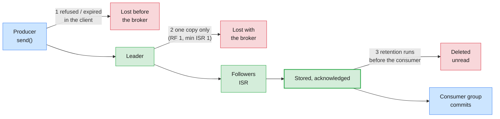
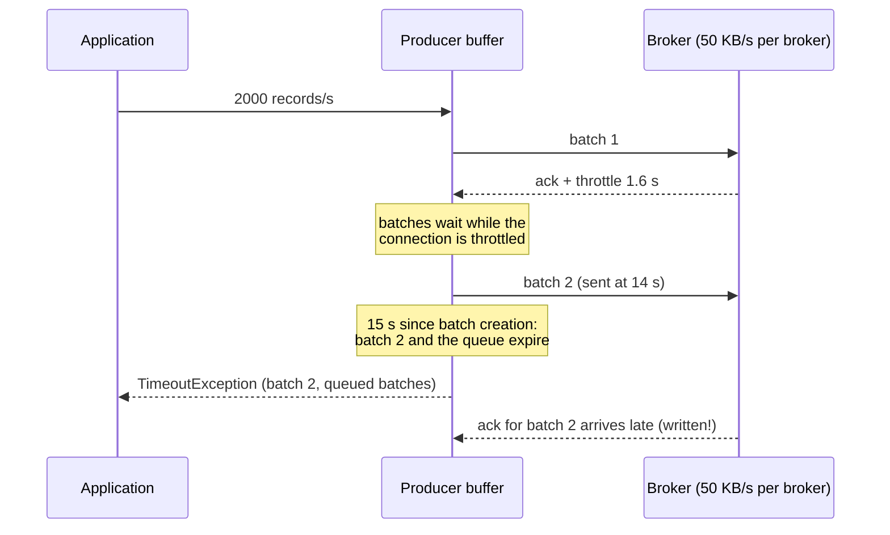

# Lab 02 — Message Loss: acks, Replication, Quotas & Retention on Confluent Platform

| | |
| --- | --- |
| **Level** | Intermediate → Advanced |
| **Duration** | ~85 minutes |
| **Guide sections** | Module 3 §6.1 The durability contract · Module 3 §6.2 How an `acks=all` write succeeds · Module 3 §5.2 Time-based retention · Module 4 §3.3 Retries and the delivery timeout · Module 4 §5.4 `auto.offset.reset` · Module 4 §7.1 Where messages can be lost or duplicated · Module 8 §5.4 Self-managed Confluent Platform: quotas |
| **You will need** | Lab 01 done; the shared Confluent Platform cluster **started by the trainer**; `~/kafka/cp.properties`, `cp-ca.pem`, `confluent.env`; your LDAP password; two terminals |

## Learning objectives

By the end of this lab you will be able to:

1. **Audit** a topic's durability from its replication factor,
   `min.insync.replicas` and the producer's `acks`, and explain why
   `acks=all` on a single replica protects nothing.
2. Predict, from `kafka-topics.sh --describe`, what a **broker failure** does
   to each topic, and read `NOT_ENOUGH_REPLICAS` as protection, not as loss.
3. Apply a **producer quota** to your own client, measure the throttling, and
   show how throttling plus a short `delivery.timeout.ms` turns into
   **expired, lost and in-doubt** records.
4. Show how **retention** deletes records a lagging group never read, and
   how `auto.offset.reset` decides whether that loss is loud or silent.
5. Fill in a **prevention checklist** for your topics and clients, and say
   what to collect before you escalate on a self-managed cluster.

This lab gives less step-by-step help than Lab 01. Each part states the goal
and the key commands. You read the results and fill in the tables.

## Why this lab

Most "Kafka lost my messages" incidents are not broker bugs. The records
were refused, expired in the producer, written to a single copy, or deleted
by retention before anyone read them, and nothing alarmed. On Confluent
Platform you can see all of it: replicas, ISR, quotas and log start offsets.



> **Shared-cluster rule:** your LDAP user holds `SystemAdmin` on this
> cluster (Module 7 Lab 02 Part 3), so the tools will let you change things
> that are not yours. Change **only** `$ME.*` topics and groups, and set a
> quota **only** on your own user and your own client ID. Keep the rates as
> written.

---

## Before you start — variables (5 min)

```bash
# (VM)
source ~/kafka/confluent.env            # CP, MDS_URL, CP_REST, CP_CA, C3_URL
ME=lNN                                  # your prefix
CFG=~/kafka/cp.properties               # your LDAP user on Confluent Platform
REST="--url $CP_REST --certificate-authority-path $CP_CA"
count() { kafka-get-offsets.sh --bootstrap-server $CP --command-config $CFG --topic $1 | awk -F: '{s+=$3} END{print s}'; }
kafka-broker-api-versions.sh --bootstrap-server $CP --command-config $CFG | grep "(id:"
```

**Expected:** one line per broker:

```
cp-broker-1.lab.internal:9092 (id: 1 rack: null isFenced: false) -> (
cp-broker-2.lab.internal:9092 (id: 2 rack: null isFenced: false) -> (
cp-broker-3.lab.internal:9092 (id: 3 rack: null isFenced: false) -> (
```

Switch the Confluent CLI to your Platform context; log in again with your
LDAP password if the token has expired:

```bash
# (VM)
confluent login --url $MDS_URL --certificate-authority-path $CP_CA --save
confluent context list
```

**Expected:** `Logged in as "lNN".` and the `*` on the Platform context.
Copy the variable block into terminal 2.

---

## Part 1 — Three topics, three durability promises (15 min)

The cluster default is `min.insync.replicas=2` with
`default.replication.factor=3` (Module 7 §3.5).
Create one topic that follows it and two that weaken it:

```bash
# (VM)
confluent kafka topic create $ME.cdr.rf1  $REST --partitions 3 --replication-factor 1
confluent kafka topic create $ME.cdr.weak $REST --partitions 3 --replication-factor 3 --config min.insync.replicas=1
confluent kafka topic create $ME.cdr.safe $REST --partitions 3 --replication-factor 3
kafka-topics.sh --bootstrap-server $CP --command-config $CFG --describe --topic "$ME\.cdr\..*"
```

**Expected:** three `Created topic` lines, then the description. Abridged,
from a dry run (your leaders and replica lists differ):

```
Topic: l19.cdr.rf1	TopicId: _MJUWycTRMWBZto_0-E9pA	PartitionCount: 3	ReplicationFactor: 1	Configs: min.insync.replicas=2
	Topic: l19.cdr.rf1	Partition: 0	Leader: 3	Replicas: 3	Isr: 3	Elr: 	LastKnownElr: 
	Topic: l19.cdr.rf1	Partition: 1	Leader: 1	Replicas: 1	Isr: 1	Elr: 	LastKnownElr: 
	Topic: l19.cdr.rf1	Partition: 2	Leader: 2	Replicas: 2	Isr: 2	Elr: 	LastKnownElr: 
…
```

> **If the RF 1 create is refused:** a create-topic policy may forbid it.
> Then the cluster already enforces one item of the checklist in Part 6.
> Write that down and continue with the other two topics.

Now ask the cluster which partitions are **below their minimum ISR**, with
every broker healthy:

```bash
# (VM)
kafka-topics.sh --bootstrap-server $CP --command-config $CFG --describe --under-min-isr-partitions --topic "$ME\.cdr\..*"
```

**Expected:** all three partitions of `$ME.cdr.rf1`, and nothing else. One
replica can never reach a minimum of two.

Write ten CDRs to each topic with `acks=all`:

```bash
# (VM)
for t in rf1 weak safe; do
  seq -f "96650000%04g:{\"type\":\"voice\",\"dur\":30}" 1 10 | \
    kafka-console-producer.sh --bootstrap-server $CP --command-config $CFG --topic $ME.cdr.$t \
    --command-property acks=all --reader-property parse.key=true --reader-property key.separator=: 2>&1 \
    | grep -E 'Exception' | sort -u
  echo "$ME.cdr.$t: $(count $ME.cdr.$t) records"
done
```

**Expected:** no exceptions and `10 records` for each topic, **including**
`rf1`. A dry run on Apache Kafka 4.3.1 showed it: the broker accepts
`acks=all` on a one-replica partition even though the partition is listed as
under its minimum ISR.

> **If `rf1` fails with `NotEnoughReplicasException` instead:** this broker
> enforces `min.insync.replicas` against RF 1 strictly. That is the safer
> behaviour; write it in the table, and note that every `acks=all` producer
> on such a topic is down until the topic gets more replicas.

| Topic | RF | `min.insync.replicas` | `acks=all` accepted? | Copies of each acknowledged record |
| ----- | -- | --------------------- | -------------------- | ---------------------------------- |
| **`$ME.cdr.rf1`** | | | | |
| **`$ME.cdr.weak`** | | | | |
| **`$ME.cdr.safe`** | | | | |

> **What this shows:** `acks=all` means "every replica **in the ISR**". With
> one replica, the ISR is the leader alone, so `acks=all` is the same as
> `acks=1`. With `min.insync.replicas=1`, the ISR may shrink to the leader
> and writes go on, on a single copy. Only RF 3 **and** `min.insync.replicas=2`
> **and** `acks=all` together guarantee two copies of every acknowledged
> record (Module 3 §6.1). The producer setting alone guarantees nothing.

---

## Part 2 — What a broker failure would do (10 min)

You may not stop a broker on the shared cluster. Predict instead, from the
`Leader` and `Replicas` columns of Part 1. Pick the broker that leads one of
your `rf1` partitions:

| If that broker stops… | `$ME.cdr.rf1` | `$ME.cdr.weak` | `$ME.cdr.safe` |
| --------------------- | ------------- | -------------- | -------------- |
| Can producers still write every partition? | | | |
| Can consumers read every record? | | | |
| If its **disk** is lost too, are records lost? | | | |
| And if a **second** broker stops? | | | |

### Optional: the trainer's broker-stop demo

If the trainer announces it, they stop **one** Platform broker for about five
minutes (`sudo systemctl stop confluent-server` on that broker). During the
demo, create a fourth topic that needs **every** replica in sync, and try to
write to it:

```bash
# (VM)
confluent kafka topic create $ME.cdr.strict $REST --partitions 3 --replication-factor 3 --config min.insync.replicas=3
kafka-topics.sh --bootstrap-server $CP --command-config $CFG --describe --unavailable-partitions --topic "$ME\.cdr\..*"
kafka-topics.sh --bootstrap-server $CP --command-config $CFG --describe --under-replicated-partitions --topic "$ME\.cdr\..*"
seq 1 3 | kafka-console-producer.sh --bootstrap-server $CP --command-config $CFG --topic $ME.cdr.strict \
  --command-property acks=all --command-property delivery.timeout.ms=12000 --command-property request.timeout.ms=5000 \
  2>&1 | grep -vE '^\s+at ' | head -5
```

**Expected** (from a dry run on a 3-broker Kafka 4.3.1 cluster with broker 3
stopped):

```
	Topic: l19.cdr.rf1	Partition: 0	Leader: none	Replicas: 3	Isr: 	Elr: 3	LastKnownElr: 3
…
	Topic: l19.cdr.safe	Partition: 0	Leader: 2	Replicas: 2,3,1	Isr: 2,1	Elr: 	LastKnownElr: 
…
[2026-10-11 20:08:56,223] WARN [Producer clientId=console-producer] Got error produce response with correlation id 6 on topic-partition l19.cdr.strict-2, retrying (2 attempts left). Error: NOT_ENOUGH_REPLICAS (org.apache.kafka.clients.producer.internals.Sender)
…
[2026-10-11 20:08:57,018] ERROR Error when sending message to topic l19.cdr.strict with key: null, value: 1 bytes with error: (org.apache.kafka.clients.producer.internals.ErrorLoggingCallback)
org.apache.kafka.common.errors.NotEnoughReplicasException: Messages are rejected since there are fewer in-sync replicas than required.
```

- `rf1` partition on the stopped broker: **`Leader: none`**. Nothing can read or
  write it until the broker returns (`unclean.leader.election.enable=false`
  on this cluster). If the disk had died, those records would be gone.
- `safe` partitions: one replica left the ISR, writes go on with two copies.
- `strict`: the broker **refuses** writes. The producer retried, then gave up.

> **What this shows:** `NotEnoughReplicasException` is the cluster keeping
> its promise. The record was **not** acknowledged, so a producer that
> handles the error can retry or stop, and nothing is lost silently. The
> dangerous outcome is the quiet one: `weak` kept accepting writes on a
> single copy.

After the trainer restarts the broker, the `--under-replicated-partitions`
command prints nothing again.

---

## Part 3 — Start the retention clock (5 min)

Part 5 needs a few minutes of waiting, so start it now. Create a rating
topic with a **two-minute** retention, write 1,000 CDRs, and let a rating
job read only the first 100:

```bash
# (VM)
confluent kafka topic create $ME.cdr.short $REST --partitions 1 --replication-factor 3 \
  --config retention.ms=120000 --config segment.ms=60000
kafka-producer-perf-test.sh --bootstrap-server $CP --command-config $CFG --topic $ME.cdr.short \
  --num-records 1000 --record-size 100 --throughput 500 | tail -1
kafka-console-consumer.sh --bootstrap-server $CP --command-config $CFG --topic $ME.cdr.short \
  --group $ME.rating --from-beginning --max-messages 100 > /dev/null
kafka-consumer-groups.sh --bootstrap-server $CP --command-config $CFG --describe --group $ME.rating
date -u +%T
```

**Expected:** `Processed a total of 100 messages`, then:

```
Consumer group 'l19.rating' has no active members.

GROUP           TOPIC           PARTITION  CURRENT-OFFSET  LOG-END-OFFSET  LAG             CONSUMER-ID     HOST            CLIENT-ID
l19.rating      l19.cdr.short   0          100             1000            900             -               -               -
```

Write the time down. The rating job is now "down for maintenance". Brokers
check retention every few minutes (`log.retention.check.interval.ms`,
5 minutes by default), so come back in Part 5.

---

## Part 4 — Quotas and throttling: when the cluster protects itself (20 min)

A quota caps how fast one client may produce or fetch. When a client goes
over, the broker does not refuse its requests; it **delays the response**
(throttles). Throttling protects other tenants, and it costs the throttled
producer latency. Combined with a tight delivery timeout, it costs records.

### 4.1 Baseline

```bash
# (VM)
kafka-producer-perf-test.sh --bootstrap-server $CP --command-config $CFG --topic $ME.cdr.safe \
  --num-records 6000 --record-size 200 --throughput 1000 \
  --command-property client.id=$ME-free acks=all | tail -1
```

**Expected:** about `1000 records/sec (0.19 MB/sec)` with a low average
latency. The format, from a dry run:

```
6000 records sent, 996.677741 records/sec (0.19 MB/sec), 12.55 ms avg latency, 390.00 ms max latency, 7 ms 50th, 51 ms 95th, 105 ms 99th, 120 ms 99.9th.
```

### 4.2 Set a quota on your own client

Limit the pair **your user + client ID `$ME-throttled`** to 50 KB/s. This
is the most specific quota level, so it applies even if the trainer has set
a quota on your user, and it affects no one else:

```bash
# (VM)
kafka-configs.sh --bootstrap-server $CP --command-config $CFG --alter \
  --entity-type users --entity-name $ME --entity-type clients --entity-name $ME-throttled \
  --add-config producer_byte_rate=51200
kafka-configs.sh --bootstrap-server $CP --command-config $CFG --describe \
  --entity-type users --entity-name $ME --entity-type clients --entity-name $ME-throttled
```

**Expected:**

```
Completed updating config for user l19.
Quota configs for user-principal 'l19', client-id 'l19-throttled' are producer_byte_rate=51200.0
```

> **Common trap:** `--entity-type users` with **`--entity-default`**, or with
> another user's name, throttles other people. On a shared cluster, quota
> changes beyond your own user are the trainer's job, like any other
> cluster-wide change.

### 4.3 Throttled, but nothing lost

Same producer, now under the quota. `--print-metrics` dumps the client's
metrics at the end:

```bash
# (VM)
kafka-producer-perf-test.sh --bootstrap-server $CP --command-config $CFG --topic $ME.cdr.safe \
  --num-records 20000 --record-size 200 --throughput 1000 \
  --command-property client.id=$ME-throttled acks=all --print-metrics 2>&1 \
  | grep -E 'records sent|produce-throttle-time-(avg|max)|^producer-metrics:record-error-total'
```

**Expected:** the first five seconds near 1,000 records/sec (the quota is
measured over a window, so a short burst gets through), then a lower,
uneven rate with the average latency climbing into seconds. The metrics show
throttling and **no** errors. From a dry run on three brokers:

```
4834 records sent, 945.8 records/sec (0.18 MB/sec), 17.3 ms avg latency, 319.0 ms max latency.
3270 records sent, 570.6 records/sec (0.11 MB/sec), 233.7 ms avg latency, 2807.0 ms max latency.
4368 records sent, 857.1 records/sec (0.16 MB/sec), 3508.3 ms avg latency, 4862.0 ms max latency.
3775 records sent, 704.9 records/sec (0.13 MB/sec), 3446.0 ms avg latency, 4600.0 ms max latency.
3470 records sent, 685.9 records/sec (0.13 MB/sec), 6759.8 ms avg latency, 7619.0 ms max latency.
20000 records sent, 738.225306 records/sec (0.14 MB/sec), 2731.66 ms avg latency, 7619.00 ms max latency, 2994 ms 50th, 7194 ms 95th, 7447 ms 99th, 7605 ms 99.9th.
producer-metrics:produce-throttle-time-avg:{client-id=l19-throttled}                    : 51.870
producer-metrics:produce-throttle-time-max:{client-id=l19-throttled}                    : 1334.000
producer-metrics:record-error-total:{client-id=l19-throttled}                           : 0.000
```

Why 0.14 MB/s and not 0.05? **Quotas are enforced per broker.** The topic's
three partitions have their leaders on three brokers, and each broker allows
the client 50 KB/s, so the client gets up to about 150 KB/s in total. Size a
quota with the number of brokers the client writes to in mind.

The records waited in the producer's buffer, but every one was written
inside the default `delivery.timeout.ms` of 120 seconds. Open Control Center
(`$C3_URL`) → your cluster → **Topics** → `$ME.cdr.safe`: production flattens
while the run lasts.

### 4.4 Throttled with a tight timeout: lost and in-doubt records

Someone "tuned" the mediation producer for fast failure:
`delivery.timeout.ms=15000` (and `request.timeout.ms=10000`, which must be
smaller). Now send faster than the quota allows:

```bash
# (VM)
BEFORE=$(count $ME.cdr.safe)
kafka-producer-perf-test.sh --bootstrap-server $CP --command-config $CFG --topic $ME.cdr.safe \
  --num-records 30000 --record-size 200 --throughput 2000 \
  --command-property client.id=$ME-throttled acks=all delivery.timeout.ms=15000 request.timeout.ms=10000 \
  --print-metrics > /tmp/$ME-expiry.out 2> /tmp/$ME-expiry.err
echo "on the broker: $(( $(count $ME.cdr.safe) - BEFORE ))"
grep 'records sent' /tmp/$ME-expiry.out | tail -1
grep -E '^producer-metrics:record-(error|send)-total' /tmp/$ME-expiry.out
head -1 /tmp/$ME-expiry.err; grep -c Expiring /tmp/$ME-expiry.err
```

**Expected** (from the dry run; your counts differ, the pattern holds):

```
on the broker: 18149
15263 records sent, 509.258950 records/sec (0.10 MB/sec), 6964.95 ms avg latency, 14997.00 ms max latency, 8766 ms 50th, 14731 ms 95th, 14960 ms 99th, 14992 ms 99.9th.
producer-metrics:record-error-total:{client-id=l19-throttled}                           : 14737.000
producer-metrics:record-send-total:{client-id=l19-throttled}                            : 18149.000
org.apache.kafka.common.errors.TimeoutException: Expiring 78 record(s) for l19.cdr.safe-1:15001 ms has passed since batch creation. The request has not been sent, or no server response has been received yet.
14737
```

Fill in the accounting:

| Count | Dry run | Yours |
| ----- | ------- | ----- |
| **Records the application sent** | 30,000 | |
| **Reported successful** (`records sent` in the summary) | 15,263 | |
| **Reported failed** (`record-error-total`, `Expiring` lines) | 14,737 | |
| **Actually on the broker** | 18,149 | |
| **Truly lost** (sent − on the broker) | 11,851 | |
| **Written, but reported as failed** (on the broker − reported successful) | 2,886 | |

> **What this shows:** two problems at once. **Loss:** records that waited
> in the buffer past `delivery.timeout.ms` were expired by the client and
> never sent. **Doubt:** some batches had been sent and written, but the
> answer came back too late, so the client reported them as failed. An
> application that "retries the failures" would write those 2,886 CDRs
> twice. A `TimeoutException` on send means **unknown**, not "not written".



| Fix | Why |
| --- | --- |
| Keep `delivery.timeout.ms` at its default (120 s) or higher | Give retries and throttling time to finish; tune it down only with a reason |
| Keep `enable.idempotence=true` (the Kafka 4.x default with `acks=all`) | The producer's own retries never duplicate (Module 4 §2.3) |
| Treat a send timeout as **in doubt**; make consumers idempotent | Application-level resends then do no harm (Module 4 §7.5) |
| Alert on `record-error-total` and `produce-throttle-time-avg` | Throttling shows up minutes before expiry |
| Size quotas from measured peaks, and raise them before a known peak | A quota is a limit you chose; it should not be your outage |

### 4.5 Remove the quota

```bash
# (VM)
kafka-configs.sh --bootstrap-server $CP --command-config $CFG --alter \
  --entity-type users --entity-name $ME --entity-type clients --entity-name $ME-throttled \
  --delete-config producer_byte_rate
kafka-configs.sh --bootstrap-server $CP --command-config $CFG --describe \
  --entity-type users --entity-name $ME --entity-type clients
rm -f /tmp/$ME-expiry.out /tmp/$ME-expiry.err
```

**Expected:** `Completed updating config for user lNN.`, then no quota line
for `lNN-throttled`.

---

## Part 5 — Retention deleted the backlog (15 min)

Back to the rating job from Part 3. Ask for the topic's **earliest**
(`--time -2`) and **latest** (`--time -1`) offsets. Repeat every 30 seconds
until the earliest offset moves away from 0:

```bash
# (VM)
kafka-get-offsets.sh --bootstrap-server $CP --command-config $CFG --topic $ME.cdr.short --time -2
kafka-get-offsets.sh --bootstrap-server $CP --command-config $CFG --topic $ME.cdr.short --time -1
kafka-consumer-groups.sh --bootstrap-server $CP --command-config $CFG --describe --group $ME.rating
```

**Expected,** once retention has run. The dry run wrote 10 more records
after the first 1,000, so it shows 1010 where you see 1000; deletion came
about 2½ minutes after the retention period ended:

```
l19.cdr.short:0:1010
l19.cdr.short:0:1010
…
GROUP           TOPIC           PARTITION  CURRENT-OFFSET  LOG-END-OFFSET  LAG             CONSUMER-ID     HOST            CLIENT-ID
l19.rating      l19.cdr.short   0          100             1010            910             -               -               -
```

The earliest offset equals the log end: **every** record was deleted,
including the ones the rating job never read. Yet the group still reports
the lag (900 for you). Lag counts offsets, not records that still exist.

### 5.1 The loud way: `auto.offset.reset=none`

```bash
# (VM)
kafka-console-consumer.sh --bootstrap-server $CP --command-config $CFG --topic $ME.cdr.short \
  --group $ME.rating --command-property auto.offset.reset=none --timeout-ms 15000 2>&1 \
  | grep -vE '^\s+at |KIP-848' | cut -c1-250
```

**Expected** (dry run):

```
[2026-10-11 20:15:53,878] ERROR Error processing message, terminating consumer process:  (org.apache.kafka.tools.consumer.ConsoleConsumer)
org.apache.kafka.clients.consumer.OffsetOutOfRangeException: Fetch position FetchPosition{offset=100, offsetEpoch=Optional.empty, currentLeader=LeaderAndEpoch{leader=Optional[kafka-3:29092 (id: 3 rack: null isFenced: false)], epoch=0}} is out of range for partition l19.cdr.short-0
Processed a total of 0 messages
```

The consumer **stops** and says why: its committed position (100) no longer
exists. Someone has to decide where to restart.

### 5.2 The silent way: the default, `latest`

```bash
# (VM)
kafka-console-consumer.sh --bootstrap-server $CP --command-config $CFG --topic $ME.cdr.short \
  --group $ME.rating --timeout-ms 10000 > /dev/null 2>&1
kafka-consumer-groups.sh --bootstrap-server $CP --command-config $CFG --describe --group $ME.rating
```

**Expected** (dry run):

```
GROUP           TOPIC           PARTITION  CURRENT-OFFSET  LOG-END-OFFSET  LAG             CONSUMER-ID     HOST            CLIENT-ID
l19.rating      l19.cdr.short   0          1010            1010            0               -               -               -
```

`LAG 0`. The dashboard is green, the alert resolves, and 900 CDRs were never
rated. With `earliest` the consumer would also have jumped, to the oldest
record **still** retained, which here is the same place.

| Setting | What happens when the committed offset was deleted | Who notices |
| ------- | -------------------------------------------------- | ----------- |
| **`none`** | | |
| **`latest`** (Kafka default) | | |
| **`earliest`** | | |

> **Administrator rule:** retention is a **deadline** for every consumer
> group. Size `retention.ms` for the longest outage you must survive plus a
> margin (billing: days, not hours), alert on lag **before** it nears that
> deadline, and choose `auto.offset.reset` per application: `none` or
> `earliest` where every record matters, `latest` only where old data is
> worthless.

---

## Part 6 — Prevention checklist and escalation (15 min, advanced)

Audit your own topics and the clients you ran in this module. Use the
commands below to fill the **Your status** column; mark each line ✅ or ❌.

```bash
# (VM)
for t in rf1 weak safe short; do
  echo "== $ME.cdr.$t"
  kafka-configs.sh --bootstrap-server $CP --command-config $CFG --describe --entity-type topics \
    --entity-name $ME.cdr.$t --all | grep -E '^\s+(min.insync.replicas|unclean.leader.election.enable|retention.ms|max.message.bytes)='
done
kafka-topics.sh --bootstrap-server $CP --command-config $CFG --describe --under-min-isr-partitions --topic "$ME\.cdr\..*"
```

**Expected:** four settings per topic, each followed by
`sensitive=false synonyms={…}` showing where the value comes from
(`DYNAMIC_TOPIC_CONFIG` for what you set, `STATIC_BROKER_CONFIG` or
`DEFAULT_CONFIG` for inherited values), then the `rf1` partitions again.

| Layer | Check | How to verify | Your status |
| ----- | ----- | ------------- | ----------- |
| **Topic** | RF ≥ 3 | `--describe`: `ReplicationFactor` | rf1: · weak: · safe: |
| **Topic** | `min.insync.replicas` = 2 (RF − 1) | `kafka-configs --describe --all` | |
| **Topic** | `unclean.leader.election.enable=false` | same | |
| **Topic** | `retention.ms` > longest consumer outage + margin | same; compare with lag age | short: |
| **Topic** | `max.message.bytes` covers the largest legitimate record | same; Lab 01 Part 4 | |
| **Producer** | `acks=all`, `enable.idempotence=true` | client config, startup log | |
| **Producer** | `delivery.timeout.ms` not cut below the default | client config | Part 4.4: |
| **Producer** | Send callback **stops or dead-letters** on error | code review | Module 6 Lab 04 app: |
| **Consumer** | Commit **after** processing; `auto.offset.reset` chosen per application | client config, code review | Part 5: |
| **Cluster** | No RF 1 topics; `--under-min-isr-partitions` empty | `kafka-topics --describe --under-min-isr-partitions` | |
| **Monitoring** | Alerts on lag, under-replicated / under-min-ISR partitions, `record-error-total`, throttle time | Control Center triggers (Module 8 Lab 02 Part 4), Prometheus | |
| **Process** | Offset resets and retention changes go through a change ticket with an export | Lab 01 Part 5.4 | |

### Escalating on a self-managed cluster

On Confluent Platform **you** run the brokers, so Confluent Support (with a
subscription) needs evidence that only you can collect. Before you open a
case, gather:

| Evidence | Where it comes from on this cluster |
| -------- | ----------------------------------- |
| Platform version and cluster ID | `confluent cluster describe --url $MDS_URL --certificate-authority-path $CP_CA` (Module 7 Lab 02) or the Control Center cluster page |
| Exact client error, client version, UTC time window | The application's log |
| Topic and group state at the time | `kafka-topics.sh --describe`, `kafka-consumer-groups.sh --describe` (as in this lab) |
| Broker logs around the time window | `/var/log/kafka/server.log*` and `journalctl -u confluent-server` on each broker (the trainer's job here) |
| Metrics before and during | Control Center charts, Prometheus |
| Recent changes | Change tickets: config, quotas, upgrades, certificate rotation |

> **Note:** the same rule as on Cloud: never attach passwords, keys or
> `cp.properties` to a case. Mask secrets in any config you send.

---

## Checkpoint questions

<details>
<summary>1. A producer team says "we use <code>acks=all</code>, so we can't lose data". Which two topic settings do you check, and why?</summary>

The replication factor and `min.insync.replicas`. `acks=all` waits only for
the replicas currently in the ISR. With RF 1, or with `min.insync.replicas=1`,
the ISR can be the leader alone, so an acknowledged record may exist on one
disk. Only RF 3 with `min.insync.replicas=2` guarantees two copies of every
acknowledged record (Part 1).
</details>

<details>
<summary>2. During the broker demo, the <code>strict</code> topic threw <code>NotEnoughReplicasException</code> while <code>weak</code> kept working. Which topic behaved better?</summary>

`strict`. It refused writes it could not store on enough replicas, and told
the producer, which can retry later or stop. Nothing was acknowledged that
could be lost. `weak` kept acknowledging records stored on fewer copies, so a
second failure at that moment would lose acknowledged data without anyone
being told. Availability and durability trade against each other; choose per
topic.
</details>

<details>
<summary>3. In Part 4.4 the broker held more records than the producer reported as successful. Explain, and say what a naive retry would do.</summary>

The client expires batches that are older than `delivery.timeout.ms`,
including batches already sent whose response arrived late because the
connection was throttled. Those were written but reported as failed. A naive
application-level retry would write them a second time, so a send timeout
must be treated as "in doubt": de-duplicate downstream, or use idempotent
consumers, and keep the timeout long enough that it rarely fires.
</details>

<details>
<summary>4. Billing reports lag 0 and all alerts are green, but finance says 900 CDRs were never billed. What happened, and how do you prove it?</summary>

Retention deleted the records while the group was behind, and the consumer
reset to `latest`, which committed past the gap and made the lag 0 (Part 5.2).
Prove it with the timeline: the group's last committed offset before the
outage, the topic's earliest offset after retention ran (`--time -2`), and
the consumer's reset in its log. Prevent it with longer retention, lag-age
alerts, and `auto.offset.reset=none` or `earliest` for billing.
</details>

<details>
<summary>5. A tenant complains that their producer got slow at 09:00 although the brokers are idle. What do you check first?</summary>

Quotas. A throttled client is slowed by design while the brokers are idle.
Check `produce-throttle-time-avg` in the client's metrics, and
`kafka-configs.sh --describe --entity-type users --entity-name <user>
--entity-type clients` for quotas at the user, client-ID and default
levels. Either the client's traffic grew past the quota, or someone changed
a quota; confirm before you raise it.
</details>

<details>
<summary>6. You must escalate a "lost messages" case to Confluent Support on the Platform cluster. What do you collect first?</summary>

The exact time window in UTC, the topic and group descriptions (RF,
`min.insync.replicas`, ISR, offsets), the client's errors and version, the
broker logs from every broker for that window, the metrics before and during
the incident, and the list of recent changes. Run the Part 6 checklist first:
most losses turn out to be configuration, and the evidence shows it.
</details>

---

## Clean up

> **Warning:** delete only your own `$ME.*` topics and groups. Read each
> command before you run it.

```bash
# (VM)
for t in rf1 weak safe short strict; do
  kafka-topics.sh --bootstrap-server $CP --command-config $CFG --delete --if-exists --topic $ME.cdr.$t
done
kafka-consumer-groups.sh --bootstrap-server $CP --command-config $CFG --delete --group $ME.rating
kafka-topics.sh --bootstrap-server $CP --command-config $CFG --list | grep "^$ME\." ; echo "own topics left: $?"
kafka-configs.sh --bootstrap-server $CP --command-config $CFG --describe --entity-type users --entity-name $ME --entity-type clients
confluent context use <your Cloud context name>
```

**Expected:** `Deletion of requested consumer groups ('lNN.rating') was
successful.`, no `lNN.` topics (`own topics left: 1`, grep found nothing),
no quota for `lNN-throttled`, and the `*` back on your Cloud context.

> **Next module:** *Module 10 — Ecosystem, Migration, Backup/DR & Capstone*.
> You add managed connectors and Schema Registry on Confluent Cloud, copy
> data from the Apache cluster into Confluent Platform with Replicator for
> backup and migration, and finish with a capstone that combines
> administration, monitoring and the troubleshooting from this module.
