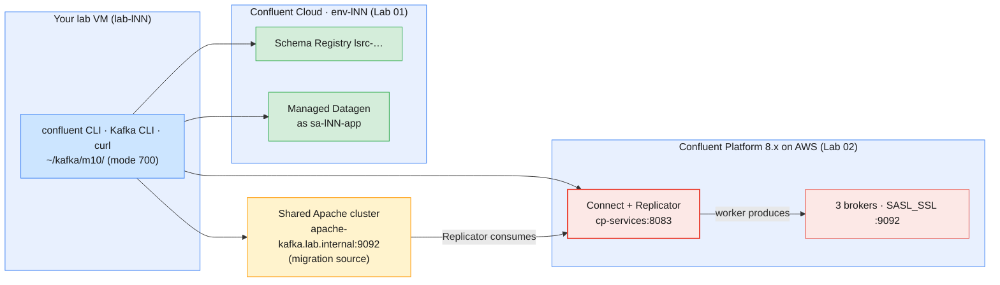

# Module 10 Labs — Ecosystem, Migration, Backup/DR & Capstone

> **Course:** Apache Kafka & Confluent Kafka Administration
> **Companion guide:** [`guides/module-10-ecosystem-migration-backup-dr-capstone.md`](../../guides/module-10-ecosystem-migration-backup-dr-capstone.md)
> **Module objective:** Administer the Confluent Kafka ecosystem and evaluate migration
> considerations from Apache Kafka to Confluent Kafka.

The last module runs the ecosystem **the way a platform team runs it in
production**. Lab 01 is on **Confluent Cloud** (`env-lNN`). You register a
data contract from a file, lock it with a per-subject rule, and review
schema changes before anyone deploys them. You run a managed connector as a
service account with no secret in its file, then close with an access
review. Lab 02 is on the **self-hosted Confluent Platform cluster on AWS**.
You use Replicator to copy a topic from the shared Apache cluster, cut a
consumer over with a written position decision, and run a failover drill
that measures RPO, RTO and duplicates. You finish with a capstone drill
that combines administering, monitoring and troubleshooting. Do the labs in
order.

| # | Lab | Level | Time | What you will do |
| - | --- | ----- | ---- | ---------------- |
| 01 | [Data contracts and managed connectors on Confluent Cloud, the production way](lab-01-data-contracts-managed-connectors-confluent-cloud.md) | Beginner | 75 min | Register a CDR contract as a pipeline would, set `FULL_TRANSITIVE` on one subject, review four change requests (and catch the check that checks too little), run a managed Datagen connector as `sa-lNN-app` with two ACLs and no secret, delete it to stop the bill, run an access review |
| 02 | [Migration rehearsal, DR drill and capstone on Confluent Platform](lab-02-replicator-migration-dr-capstone-platform-aws.md) | Intermediate → Advanced | 95 min | Take an inventory of an Apache topic, replicate it into Platform with Replicator configured as code, move a consumer with an explicit position, cut the link and measure RPO, fail over by timestamp and count duplicates, then diagnose and fix a broken replication change under time pressure and write the go/no-go |

Estimated total: **about 2 h 50 min**, including checkpoint questions. The
guided review and Q&A of the outline is the closing table of Lab 02
(Part 6). The full capstone, *Peak Night*, follows in
[`capstone/part-b-confluent-kafka.md`](../../capstone/part-b-confluent-kafka.md).

> **Trainers:** start the **Apache cluster** and the **Confluent Platform
> cluster** (LDAP → controllers → brokers → services) at least 15 minutes
> before Lab 02. In the dry run with a learner login (`lab-l19`), check the
> following:
> 1. `GET /connector-plugins` on Connect lists
>    `io.confluent.connect.replicator.ReplicatorSourceConnector`.
> 2. The Connect worker on `cp-services` can reach
>    `apache-kafka.lab.internal:9092`.
> 3. The worker principal may write `lNN.*` topics. Replicator's records
>    are produced by the **worker**, not by `dest.kafka.*`.
> 4. The learner holds `ResourceOwner` on connectors `lNN.`.
> 5. Replicator starts under the Platform trial licence without
>    `confluent.license`.
>
> If item 3 or 4 fails, run Lab 02 Part 2 as a demo with one learner's
> topic. Every learner can still do Parts 1, 3 and 4 against that copy
> ([guide §9.3](../../guides/module-10-ecosystem-migration-backup-dr-capstone.md#93-part-c--migration-rehearsal-with-replicator-apache--platform)).

---

## Prerequisites

| Requirement | Check with | Notes |
| ----------- | ---------- | ----- |
| Module 9 completed | `confluent context list` | Cloud and Platform contexts both saved |
| `sa-lNN-app` and `~/kafka/sa-app.properties` | `ls -l ~/kafka/sa-app.properties` | Lab 01 runs the connector as this service account |
| Course repository on the VM | `ls labs/module-06/lab-07/datagen-config.sh` | Lab 01 reuses the Module 6 schemas and connector helper |
| Platform files `~/kafka/cp.properties`, `cp-ca.pem`, `confluent.env` | `ls -l ~/kafka/` | Lab 02 (`confluent.env` gives `CP`, `MDS_URL`, `CP_REST`, `CP_CA`, `C3_URL`) |
| Apache client file `~/kafka/apache.properties` | `kafka-topics.sh --bootstrap-server apache-kafka.lab.internal:9092 --command-config ~/kafka/apache.properties --list` | Lab 02 uses the shared Apache cluster as the migration source (Modules 3–5) |
| Your LDAP password | Your credentials e-mail | `confluent login --url` in Lab 02 |
| Confluent CLI v4.x, Kafka 4.x CLI, `jq`, `curl` | `confluent version`, `kafka-topics.sh --version` | In the VM image |
| Two terminals | — | Lab 02 runs a producer while you work |

> **No Docker in this module.** Nothing runs locally and no ports need to be
> free. The capstone adds your own Docker cluster as a second site later.

> **Using the course AWS VMs?** Your VM (`lab-lNN`) already has the CLIs,
> the prepared files under `~/kafka/` and the course repository. Open it in
> the browser IDE or VS Code Remote-SSH and run the labs there exactly as
> written. See [`infra/LAB-SETUP.md`](../../infra/LAB-SETUP.md) §5–§7 for
> the full course environment.

---

## Lab environment

Module 10 uses three of the four course targets.



| Target | Identity | Names used in the labs |
| ------ | -------- | ---------------------- |
| **Confluent Cloud** (Lab 01) | You (EnvironmentAdmin) for admin; `sa-lNN-app` for the connector | Subject `$ME.cdr.contract-value`, topic `$ME.cdr.partner`, connector `$ME.partner-feed` |
| **Shared Apache cluster** (Lab 02) | Your SCRAM user `lNN` (`~/kafka/apache.properties`) | Topics `$ME.cdr.migrate`, `$ME.cdr.sms`; groups `$ME.billing-mig`, `$ME.fraud-dr` |
| **Confluent Platform on AWS** (Lab 02) | Your LDAP user `lNN` (`~/kafka/cp.properties`) | The same topic and group names; connector `$ME.replicator` |

### Everyday commands

In every new terminal:

```bash
# (VM) - from the course repository root
source ~/kafka/confluent.env            # CP, MDS_URL, CP_REST, CP_CA, C3_URL, SR_URL (no secrets)
ME=lNN; export ME                       # your prefix: l01 … l18
CFG=~/kafka/cp.properties               # your LDAP user on Confluent Platform
APA_CFG=~/kafka/apache.properties       # your SCRAM user on the Apache cluster
APA=$(sed -n 's/^bootstrap.servers=//p' $APA_CFG)

kafka-consumer-groups.sh --bootstrap-server $CP  --command-config $CFG     --describe --group $ME.billing-mig
kafka-consumer-groups.sh --bootstrap-server $APA --command-config $APA_CFG --describe --group $ME.billing-mig
```

> **Convention used in the labs**
>
> - `# (VM)`: run on **your lab VM**, against Confluent Cloud, the shared
>   Apache cluster or the shared Confluent Platform cluster, with your
>   prefix (`$ME`). Every command block in this module uses it.
>   `# (VM) - terminal 2` marks a block that keeps running while you work
>   in terminal 1.
> - Files you build (connector configs, position exports) go in
>   `~/kafka/m10/`, mode 700. Files that hold a password are created with
>   `umask 077` and deleted at clean up. Secrets never appear in a command
>   you type or in your notes.

---

## Troubleshooting

| Symptom | Likely cause | Fix |
| ------- | ------------ | --- |
| `{"error_code":401,"message":"Unauthorized"}` from Schema Registry on Cloud | Kafka key used, or the new Schema Registry key is not active yet | Use the `--resource lsrc-…` key; wait a minute (Lab 01 Part 1) |
| A schema passes `…/versions/latest` but registration fails with `40901` | The subject's rule is transitive; the `latest` check compares one version only | Check with `POST /compatibility/subjects/<subject>/versions` (Lab 01 Part 2.3) |
| Managed connector `FAILED` with an authorization error in its `Trace` | One of the two ACLs is missing or names another topic | `confluent kafka acl list --service-account $SA` (Lab 01 Part 3.2) |
| Replicator task `FAILED`: destination topic does not exist | `topic.auto.create=false` and the topic was not created from the catalog | Create it with the source's partition count, restart the task (Lab 02 Part 5) |
| Target end offsets lower than source, not moving | Replicator paused or failed, or the worker cannot reach the Apache cluster | `cn /connectors/$ME.replicator/status`; trainer checks worker networking |
| Replicator `RUNNING`, target topic exists, nothing copied on a **rerun** | Connect kept the source offsets of a deleted connector with the same name | Create it under a new name, e.g. `$ME.replicator-2` (Lab 02 Part 5.3) |
| Target group lag equals the whole topic, or 0 after cutover | Position not set (`auto.offset.reset` decided instead) | Set it explicitly: `--from-file` or `--to-datetime` (Lab 02 Parts 3–4) |
| `Error: Assignments can only be reset if the group … is inactive` | A consumer of the group is still running | Stop it (`Ctrl+C`), then reset |

---

## Cleaning up after the module

Each lab ends with its own clean up. After both labs:

- **Removed on Cloud:** the subject `$ME.cdr.contract-value` (soft and hard
  delete), the topic `$ME.cdr.partner`, the connector and its two ACLs,
  and the Schema Registry key from Lab 01.
- **Removed on Apache and Platform:** the connector `$ME.replicator`, the
  topics `$ME.cdr.migrate` and `$ME.cdr.sms` on both clusters, the groups
  `$ME.billing-mig` and `$ME.fraud-dr` on both clusters, and Replicator's
  own group `$ME.replicator` on the Apache cluster.
- **Kept:** `sa-lNN-app`, its Kafka key and role bindings, and the topic
  `$ME.cdr.voice` on Cloud. The capstone's Phase 9 builds on them.

To check what is left:

```bash
# (VM)
ls ~/kafka/m10/
kafka-topics.sh --bootstrap-server $APA --command-config $APA_CFG --list | grep "^$ME\.cdr\.\(migrate\|sms\)"
kafka-topics.sh --bootstrap-server $CP  --command-config $CFG     --list | grep "^$ME\.cdr\.\(migrate\|sms\)"
confluent context use <your Cloud context name>
confluent connect cluster list
confluent api-key list
```

**Expected:** an empty `~/kafka/m10/`, no matching topics on either cluster,
an empty connector list, and no key described as "m10".

At the end of the course the trainer deletes the service account, its keys and your Cloud environment
([`infra/confluent/README.md` Part D](../../infra/confluent/README.md#part-d--teardown)).
