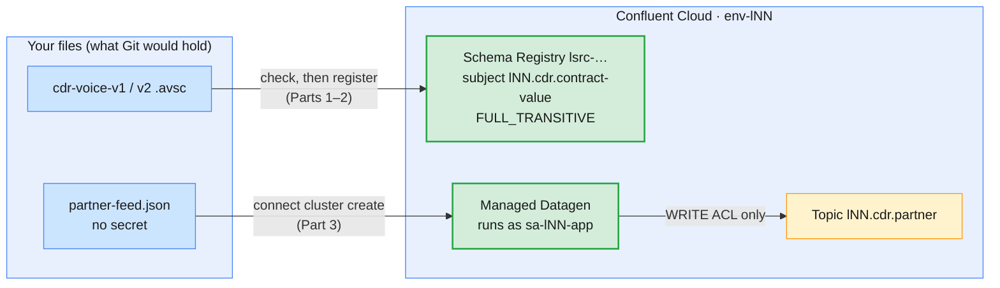
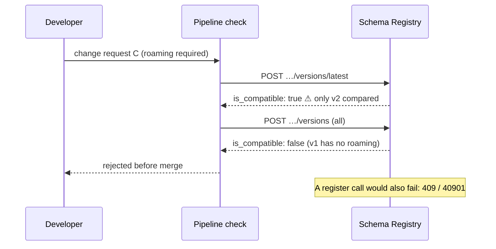
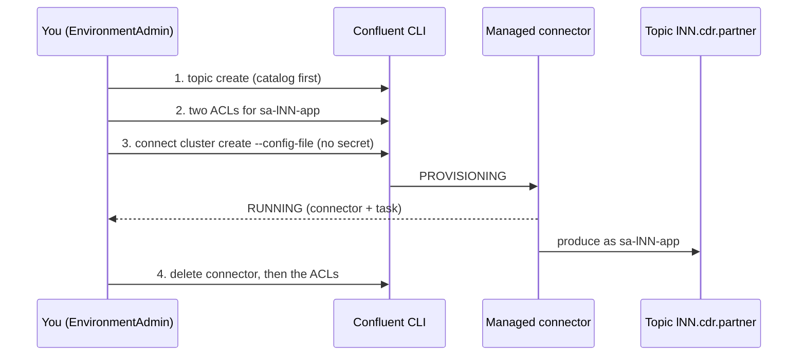

# Lab 01 — Data contracts and managed connectors on Confluent Cloud, the production way

| | |
| --- | --- |
| **Level** | Beginner |
| **Duration** | ~75 minutes |
| **Guide sections** | §2.2 Fully managed versus self-managed · §2.3 Operating a managed connector · §3.3 Compatibility types · §3.4 Evolving a CDR schema safely · §3.5 Administering Schema Registry · §7.4 Data contracts, configuration and secrets · §8.2 Everything as code · §8.3 Day-2 operations routine |
| **You will need** | Module 9 done; your Cloud environment `env-lNN` with `lNN-basic`; `sa-lNN-app` and its client file `~/kafka/sa-app.properties` (Module 7 Lab 01); the course repository on your VM (schemas from [Module 6 Lab 06](../module-06/lab-06-schema-registry-confluent-cloud-platform.md), the connector helper from [Module 6 Lab 07](../module-06/lab-07/datagen-config.sh)); `jq`, `curl`; one terminal |

## Learning objectives

By the end of this lab you will be able to:

1. **Register** a schema the way a CI pipeline would, and set a
   **per-subject** compatibility rule stricter than the registry's default.
2. **Test** candidate schema changes before anyone registers them, and
   explain why a **transitive** rule needs the all-versions check, not the
   `latest` check.
3. Create a **fully managed connector** that runs as a **service account**,
   with no secret in its configuration file and only the two ACLs it needs.
4. **Prove** the connector moves data, read its connector and task state,
   and **delete** it to stop the bill.
5. Run a **monthly access review** of your Cloud environment: API keys,
   role bindings and ACLs, each with a keep-or-remove decision.
6. Check the contract and the connector you built against the
   **developer integration checklist** of §7.

## Why this lab

In Module 6 you met Schema Registry and Kafka Connect as features: a schema
was registered by the first `send()`, and a connector ran with your personal
API key in its file. Both work, and both are how production incidents start.
A developer's laptop changes the contract of a billing topic. A connector
stops when the person whose key it used leaves the company. A secret sits in
a JSON file that somebody pastes into a ticket.

This lab does the same two jobs **the way a platform team runs them in
production**: the contract is registered and checked from a file, as a
pipeline would; the subject gets a rule that protects every record still on
the topic; the connector gets its own identity and the minimum rights; and
everything you create is reviewed and removed again.



---

## Before you start — variables (5 min)

Use the IDs from your notes (Module 7 Lab 01, Module 9 Lab 01). Run every
command in this lab from the **root of the course repository** on your VM.

```bash
# (VM) - from the course repository root
confluent context list                  # the * must be on your Cloud context
ME=lNN                                  # your prefix
export ME
ENV_ID=env-7qk3x2                       # ← your env-lNN ID
LKC=lkc-9xw2pq                          # ← your lNN-basic cluster ID
confluent environment use $ENV_ID
confluent kafka cluster use $LKC
CCLOUD=$(confluent kafka cluster describe -o json | jq -r .endpoint | sed 's#SASL_SSL://##')
SA=$(confluent iam service-account list -o json | jq -r --arg n "sa-$ME-app" '.[] | select(.name==$n) | .id')
SA_CFG=~/kafka/sa-app.properties
AVRO=labs/module-06/lab-06/spring-boot-kafka-avro/src/main/resources/avro
mkdir -p ~/kafka/m10 && chmod 700 ~/kafka/m10
total() { kafka-get-offsets.sh --bootstrap-server $CCLOUD --command-config $SA_CFG --topic $1 --time -1 \
  | awk -F: '{s+=$3} END{print s}'; }
ls $AVRO; echo "$ENV_ID $LKC $SA $CCLOUD"
```

**Expected:**

```
cdr-voice-v1.avsc  cdr-voice-v2.avsc  cdr-voice-v3-breaking.avsc
env-7qk3x2 lkc-9xw2pq sa-1a2b3c pkc-xxxxx.ap-south-1.aws.confluent.cloud:9092
```

If `$SA` is empty, the service account has a different name in your
environment: run `confluent iam service-account list` and set `SA=sa-…` by
hand.

---

## Part 1 — Put the contract in the registry (15 min)

You act as the **platform team**. A new partner feed will publish voice CDRs,
and six teams will read them. Before any producer exists, the contract goes
into the registry, and the rule that protects it is set.

### 1.1 Find the registry and give it its own key

Schema Registry is a separate resource with its own API key; the Kafka key in
`sa-app.properties` gets `401` there (Module 6 Lab 06).

```bash
# (VM)
SR_ID=$(confluent schema-registry cluster describe -o json | jq -r .cluster)
SR_CC=$(confluent schema-registry cluster describe -o json | jq -r .endpoint_url)
echo "$SR_ID $SR_CC"
confluent api-key create --resource $SR_ID --description "$ME m10 schema governance"
```

**Expected:** `lsrc-xxxxxx https://psrc-xxxxx.ap-south-1.aws.confluent.cloud`,
then a table with `API Key` and `API Secret`. Copy the secret now; Confluent
shows it once.

Keep the key in **shell variables only** for this lab. No file is written.

```bash
# (VM) - paste your key and secret
SR_KEY=<API Key>
SR_SECRET='<API Secret>'
SR=$SR_CC; SR_AUTH="$SR_KEY:$SR_SECRET"; SR_CA=
sr() { curl -s -u "$SR_AUTH" ${SR_CA:+--cacert "$SR_CA"} "$SR$1" "${@:2}"; echo; }
CT='Content-Type: application/vnd.schemaregistry.v1+json'
SUBJECT=$ME.cdr.contract-value
sr /config
```

**Expected:** `{"compatibilityLevel":"BACKWARD"}`, the registry-wide default.
`{"error_code":401,…}` means the key is not active yet: wait a minute.

> **Best practice:** in production this key belongs to the **CI pipeline's
> service account**, lives in a secret store and is injected at run time
> (§7.4). A key owned by a person dies with that person's account. In the
> lab you own the key, and Part 5 deletes it.

### 1.2 Register v1 as a pipeline would

A pipeline registers the reviewed `.avsc` file from Git. It never lets a
producer do it at run time.

```bash
# (VM)
jq -n --rawfile s $AVRO/cdr-voice-v1.avsc '{schema: $s}' \
  | sr /subjects/$SUBJECT/versions -X POST -H "$CT" -d @- | jq .id
sr /subjects/$SUBJECT/versions
```

**Expected:** a schema ID of **100000 or more** (Cloud IDs start at
100000), then `[1]`.

### 1.3 Lock the subject

Ask which rule protects this subject now, then set a stricter one for this
subject only:

```bash
# (VM)
sr /config/$SUBJECT
sr "/config/$SUBJECT?defaultToGlobal=true"
sr /config/$SUBJECT -X PUT -H "$CT" -d '{"compatibility":"FULL_TRANSITIVE"}'
sr /config/$SUBJECT
sr /config
```

**Expected:**

```
{"error_code":40408,"message":"Subject 'lNN.cdr.contract-value' does not have subject-level compatibility configured"}
{"compatibilityLevel":"BACKWARD"}
{"compatibility":"FULL_TRANSITIVE"}
{"compatibilityLevel":"FULL_TRANSITIVE"}
{"compatibilityLevel":"BACKWARD"}
```

The subject had no rule of its own and inherited `BACKWARD`. Now it has
`FULL_TRANSITIVE`, while every other subject keeps the global `BACKWARD`.

| Setting | Means for this CDR contract | Why the platform team chose it |
| ------- | --------------------------- | ------------------------------ |
| **FULL** | Old readers read new records, **and** new readers read old records | Producers and the six consumer teams can deploy **in any order** (§3.3) |
| **TRANSITIVE** | Every new version is checked against **all** versions, not only the latest | The topic keeps 7 days of records; a consumer that rewinds meets version 1 |
| **Per subject** | Only this contract is strict | Teams with short-lived topics keep the faster `BACKWARD` default |

---

## Part 2 — Review changes before anyone deploys them (15 min)

Three change requests arrive from the developers. You test each one
**without registering it**, as the review step of a pipeline would (§8.2).

### 2.1 Two ways to ask

The registry offers two compatibility endpoints. Define one helper for each:

```bash
# (VM)
check_latest() { jq -n --rawfile s "$1" '{schema: $s}' \
  | sr "/compatibility/subjects/$SUBJECT/versions/latest?verbose=true" -X POST -H "$CT" -d @- | jq -c '{is_compatible}'; }
check_all() { jq -n --rawfile s "$1" '{schema: $s}' \
  | sr "/compatibility/subjects/$SUBJECT/versions?verbose=true" -X POST -H "$CT" -d @- \
  | jq -c '{is_compatible, why: (.messages[0] // "")}'; }
```

| Helper | Endpoint | Compares the candidate with |
| ------ | -------- | --------------------------- |
| `check_latest` | `POST /compatibility/subjects/<subject>/versions/latest` | The **latest** version only |
| `check_all` | `POST /compatibility/subjects/<subject>/versions` | **All** versions the subject's rule asks for |

### 2.2 Change request A: add `roaming` with a default; B: add `network` without one

```bash
# (VM)
check_all $AVRO/cdr-voice-v2.avsc
check_all $AVRO/cdr-voice-v3-breaking.avsc
```

**Expected:**

```
{"is_compatible":true,"why":""}
{"is_compatible":false,"why":"{errorType:'READER_FIELD_MISSING_DEFAULT_VALUE', description:'The field 'network' at path '/fields/5' in the new schema has no default value and is missing in the old schema', additionalInfo:'network'}"}
```

Request A is accepted: a field **with** a default can be read in both
directions. Request B is refused, and the reason names the field and the rule.
The reply goes back to the developer **before** any code is deployed.

Register the accepted change:

```bash
# (VM)
jq -n --rawfile s $AVRO/cdr-voice-v2.avsc '{schema: $s}' \
  | sr /subjects/$SUBJECT/versions -X POST -H "$CT" -d @- | jq .id
sr /subjects/$SUBJECT/versions
```

**Expected:** a new ID, then `[1,2]`.

### 2.3 Change request C: "make roaming mandatory"

A developer asks to remove the default from `roaming`: "every new CDR has it
now". Build the candidate from v2 and ask **both** ways:

```bash
# (VM)
jq '(.fields[] | select(.name=="roaming")) |= del(.default)' $AVRO/cdr-voice-v2.avsc > ~/kafka/m10/cdr-voice-v2-strict.avsc
jq -c '.fields[4]' ~/kafka/m10/cdr-voice-v2-strict.avsc
check_latest ~/kafka/m10/cdr-voice-v2-strict.avsc
check_all    ~/kafka/m10/cdr-voice-v2-strict.avsc
```

**Expected:**

```
{"name":"roaming","type":"boolean","doc":"v2: call made outside the home network"}
{"is_compatible":true}
{"is_compatible":false,"why":"{errorType:'READER_FIELD_MISSING_DEFAULT_VALUE', description:'The field 'roaming' at path '/fields/4' in the new schema has no default value and is missing in the old schema', additionalInfo:'roaming'}"}
```

The two answers differ. Compared with version 2 only, the change is
harmless: v2 records always carry `roaming`. Compared with version 1, it
breaks: a consumer on the new schema that rewinds to a v1 record has no value
for `roaming`. The `latest` endpoint checks only the latest version, even
though the subject's rule is transitive. Now try to register it anyway:

```bash
# (VM)
jq -n --rawfile s ~/kafka/m10/cdr-voice-v2-strict.avsc '{schema: $s}' \
  | sr /subjects/$SUBJECT/versions -X POST -H "$CT" -d @- | jq -c '{error_code}'
```

**Expected:** `{"error_code":40901}`. Registration applies the full
transitive rule, so the registry refuses the change.



> **Common trap — a green check that checked too little:** a pipeline that
> calls `…/versions/latest` passes request C, and the failure appears only
> at deploy time as a `409` from the producer's serializer, or not at all if
> producers may not register. For subjects with a transitive rule, the
> review step must call **`POST /compatibility/subjects/<subject>/versions`**.
> This lab's `check_all` is that call.

One more request for comparison. Drop `durationSec`, which has no default:

```bash
# (VM)
jq 'del(.fields[] | select(.name=="durationSec"))' $AVRO/cdr-voice-v2.avsc > ~/kafka/m10/cdr-voice-no-duration.avsc
check_all ~/kafka/m10/cdr-voice-no-duration.avsc
```

**Expected:** `false`, with *The field 'durationSec' … in the old schema has
no default value and is missing in the new schema*. Under the global
`BACKWARD` rule this deletion would pass, because new readers can ignore
the field. Old readers, such as the billing job that needs `durationSec`,
would then fail. FULL protects the readers you have today as well as
future ones.

| Change request | `BACKWARD` (global) | `FULL_TRANSITIVE` (this subject) | Decision |
| -------------- | ------------------- | -------------------------------- | -------- |
| **A** add `roaming` with default | ✅ | ✅ | Registered as v2 |
| **B** add `network`, no default | ❌ | ❌ | Back to the developer: add a default |
| **C** make `roaming` required | ✅ against latest | ❌ against v1 | Refused: old records still on the topic |
| **D** drop `durationSec` | ✅ | ❌ | Refused: billing reads it; a breaking change is a **new topic** (§3.4) |

> **Best practice for producers:** with the contract registered by the
> pipeline, every producer runs with `auto.register.schemas=false` and,
> where it fits, `use.latest.version=true` (§3.4). A producer whose schema
> was never registered then fails at its first send, in a test environment,
> and the contract cannot change from a laptop.

---

## Part 3 — A managed connector with its own identity (20 min)

The partner's records reach Kafka through a fully managed connector. In
Module 6 Lab 07 the connector used **your** API key, and its file held the
secret. Here it runs as **`sa-lNN-app`** in service-account mode: the
connector authenticates as the service account, and its file holds **no
secret** (§2.3). The Datagen connector stands in for the real feed.



### 3.1 The topic first

The connector does not create its topic. On the course clusters,
auto-creation is off, and a missing topic makes the **task** fail later
(Module 6 Lab 07 Part 4).

```bash
# (VM)
TOPIC=$ME.cdr.partner; NAME=$ME.partner-feed
confluent kafka topic create $TOPIC --partitions 3
```

**Expected:** `Created topic "lNN.cdr.partner".`

### 3.2 Exactly two ACLs

For a **source** connector in service-account mode, Confluent documents two
ACLs: `DESCRIBE` on the cluster and `WRITE` on the target topic.

```bash
# (VM)
confluent kafka acl create --allow --service-account $SA --operations describe --cluster-scope
confluent kafka acl create --allow --service-account $SA --operations write --topic $TOPIC
confluent kafka acl list --service-account $SA
```

**Expected:** each `create` prints the ACL it added. The list shows the two
rows: `DESCRIBE` on the `CLUSTER` resource `kafka-cluster`, and `WRITE` on
`TOPIC` `lNN.cdr.partner` with pattern `LITERAL`.

> **Note:** the service account also keeps its Module 7–9 **role bindings**
> (`DeveloperRead` on `$ME.cdr.voice`, `MetricsViewer`). Cloud checks both
> RBAC and ACLs. ACLs are what Confluent's connector documentation lists for
> service-account mode. A `DeveloperWrite` role binding on the topic would
> work too. Pick one model per environment and keep it in code.

### 3.3 The configuration as code, without a secret

Reuse the Module 6 helper. It reads the key from the client file you give it,
so remove the key and secret and switch the authentication mode with `jq`:

```bash
# (VM)
umask 077
CC_CFG=$SA_CFG NAME=$NAME TOPIC=$TOPIC labs/module-06/lab-07/datagen-config.sh cloud \
  | jq --arg sa "$SA" 'del(."kafka.api.key", ."kafka.api.secret")
       + {"kafka.auth.mode":"SERVICE_ACCOUNT","kafka.service.account.id":$sa}' \
  > ~/kafka/m10/partner-feed.json
grep -c -i secret ~/kafka/m10/partner-feed.json
jq 'del(."schema.string")' ~/kafka/m10/partner-feed.json
```

**Expected:**

```
0
{
  "name": "lNN.partner-feed",
  "connector.class": "DatagenSource",
  "kafka.auth.mode": "SERVICE_ACCOUNT",
  "kafka.topic": "lNN.cdr.partner",
  "output.data.format": "JSON",
  "max.interval": "1000",
  "tasks.max": "1",
  "kafka.service.account.id": "sa-1a2b3c"
}
```

`0` lines contain a secret. This file could go into Git, a pull request or a
support ticket as it is. That is the test for a connector config.

| | Module 6 Lab 07 | This lab |
| --- | --- | --- |
| **Identity** | Your user's API key | `sa-lNN-app` |
| **Secret in the file** | Yes, mode 600, deleted after | **None** |
| **What breaks when you leave** | The connector | Nothing: the service account is not a person |
| **Rights** | Everything you can do in `env-lNN` | `DESCRIBE` cluster + `WRITE` one topic |

### 3.4 Create it and wait for `RUNNING`

> **Warning:** a managed connector bills for every task-hour **from now
> until you delete it**, even while paused. Part 4 deletes it within the
> session.

```bash
# (VM)
confluent connect cluster create --config-file ~/kafka/m10/partner-feed.json
CID=$(confluent connect cluster list -o json | jq -r --arg n "$NAME" '.[] | select(.name==$n) | .id')
echo "$CID"
confluent connect cluster list
```

**Expected:** `Created connector lNN.partner-feed lcc-xxxxx`, the `lcc-…` ID,
and a list row with status `PROVISIONING`. Repeat the last command every 30
seconds until the status is `RUNNING` (one to three minutes).

```bash
# (VM)
confluent connect cluster describe $CID
```

**Expected:** the connector's ID, name, status `RUNNING` and type `source`;
one **task** with status `RUNNING`; and the configuration, including
`kafka.auth.mode` `SERVICE_ACCOUNT` and your service account ID. If the status
is `FAILED`, read the `Trace`: an authorization error means one of the two
ACLs is missing or names the wrong topic.

---

## Part 4 — Prove it, read its state, stop the bill (10 min)

### 4.1 Prove that data moves, as the service account

`total` reads the end offsets with the service account's own client file.
`WRITE` on the topic implies `DESCRIBE`, so the same two ACLs cover it:

```bash
# (VM)
total $TOPIC; sleep 20; total $TOPIC
```

**Expected:** two numbers, the second larger (the connector writes up to one
record per second). Earlier modules taught you to count end offsets, and
here they are the evidence that the connector works.

### 4.2 What to monitor on a connector

| Signal | Where | Alert when |
| ------ | ----- | ---------- |
| **Connector status** | `connect cluster describe`, Cloud Console | Not `RUNNING` |
| **Task status** | Same, per task | Any task `FAILED`. A connector can show `RUNNING` with a failed task (§2.4) |
| **Records in / out** | Cloud Console connector page, Metrics API (Module 8 Lab 01) | Drops to zero while the source has data |
| **DLQ topic** (`dlq-lcc-…`, sink connectors) | Topic end offsets | Grows at all: each record is work for a person |

### 4.3 Delete it now, then take the rights away

```bash
# (VM)
confluent connect cluster delete $CID --force
confluent kafka acl delete --allow --service-account $SA --operations write --topic $TOPIC --force
confluent kafka acl delete --allow --service-account $SA --operations describe --cluster-scope --force
sleep 20
confluent connect cluster list
confluent kafka acl list --service-account $SA
total $TOPIC
```

**Expected:** a deletion message for the connector and for each ACL, an
empty connector list and an empty ACL list. Then `total` prints
`Error occurred: Could not match any topic-partitions with the specified filters`
and an empty line. The service account can no longer even see the topic, so
to it the topic looks like it does not exist (Module 9 Lab 01 Part 3).
Least privilege works in both directions: the rights existed exactly as long
as the connector did. If `total` still prints a number, wait a minute for the
ACL change to reach every broker and run it again.

> **Cost rule (§2.2):** *paused* still bills; *deleted* does not. The JSON
> file is the connector's backup. Recreating it from the file takes one
> command and a minute of provisioning.

---

## Part 5 — Access review and the integration checklist (10 min)

### 5.1 The monthly access review, done today

§8.3 puts an **access review** in the monthly routine: every key, role
binding and ACL has an owner and a reason, or it goes. Run it on your
environment:

```bash
# (VM)
confluent api-key list --resource $LKC
confluent api-key list --resource $SR_ID
confluent iam rbac role-binding list --principal User:$SA --inclusive
confluent kafka acl list
```

**Expected:** two key tables. The first, for the Kafka cluster, lists the
key of `sa-lNN-app` (owner `sa-…`) and any other Kafka key still alive. The
second, for the registry, lists the Schema Registry key from Part 1 (owner:
your user) and any key left over from Module 6 Lab 06. Next come the service
account's role bindings: `DeveloperRead` on `Topic:lNN.cdr.voice` and
`Group:lNN.billing`, plus `MetricsViewer`. Last, **no** ACLs. Add the Cloud
API key for the Metrics API from Module 8 Lab 01 to the table if you kept
it; `confluent api-key list` without `--resource` shows it.

Copy this table into your notes and fill in the last two columns from the
output:

| Credential or grant | Owner | Still needed? | Action |
| ------------------- | ----- | ------------- | ------ |
| Kafka key of `sa-lNN-app` | `sa-lNN-app` | | |
| `DeveloperRead` on `lNN.cdr.voice`, `lNN.billing` | `sa-lNN-app` | | |
| `MetricsViewer` | `sa-lNN-app` | | |
| Schema Registry key "m10 schema governance" | you | | |
| Any other key in the list | | | |

> **What a reviewer looks for:** keys owned by **people** that machines
> use; keys with no description; two active keys for one owner long after a
> rotation (Module 7 Lab 01); role bindings wider than one prefix; ACLs
> with no connector or application behind them. Each finding becomes a
> ticket with an owner, not a mental note.

### 5.2 Review what you built against §7

Answer each row with evidence from this lab, in one line:

| Practice (§7.2–§7.4, §8.2) | Evidence from this lab |
| -------------------------- | ---------------------- |
| The contract is in Git and registered by a pipeline, not by producers | |
| The compatibility rule matches the data's life on the topic | |
| Candidate schemas are checked against **all** versions before merge | |
| A breaking change becomes a new topic or subject | |
| A connector has its own identity and the minimum rights | |
| No secret exists in any file that could reach Git or a ticket | |
| Unused connectors are deleted, not paused | |
| Every credential has an owner and a reason | |

---

## Checkpoint questions

<details>
<summary>1. The global rule is BACKWARD and your subject says FULL_TRANSITIVE. Which rule applies when a producer registers a new version under your subject, and which applies to a brand-new subject?</summary>

The subject-level rule wins for its own subject: the new version must pass
`FULL_TRANSITIVE`, which the `40901` in Part 2.3 proved. A new subject has
no rule of its own, so it inherits the global `BACKWARD`. That is why
`GET /config/<subject>` returned `40408` before you set it, and why
`?defaultToGlobal=true` showed the inherited rule.
</details>

<details>
<summary>2. Change request C passed one check and failed the other. Why, and what should your pipeline call?</summary>

`…/versions/latest` compares the candidate with version 2 only, and v2
records always carry `roaming`. `…/versions` applies the subject's
transitive rule and also compares with version 1, whose records have no
`roaming` and give a new reader no default to fall back on. For transitive
subjects the pipeline must call `POST /compatibility/subjects/<subject>/versions`,
or it approves changes the registry later refuses.
</details>

<details>
<summary>3. Why is FULL_TRANSITIVE a good default for a billing CDR contract, and what does it cost?</summary>

FULL lets producers and consumers deploy in any order, which matters when
six teams read one topic. TRANSITIVE protects consumers that rewind to old
records within the retention window. The cost is fewer allowed changes: you
may add or remove only fields that have defaults. Anything else becomes a
planned new topic or subject with a migration, which for a billing contract
is the right amount of friction.
</details>

<details>
<summary>4. The connector is RUNNING but `total` stops growing. What do you check, in which order?</summary>

First the **task** state and its `Trace` in `confluent connect cluster
describe`, because a failed task does not change the connector's state.
Next, whether the topic still exists and the two ACLs are still there
(`confluent kafka acl list --service-account $SA`). An access cleanup that
removed `WRITE` looks exactly like this. Last, the Cloud Console's
records-in chart for the connector. Fix the cause before you restart
anything, and alert on task state so you hear about it before a user does.
</details>

<details>
<summary>5. A colleague wants to pause the connector over the weekend "to save money". What do you tell them?</summary>

A paused managed connector still accrues its hourly base cost (§2.2), so
pausing saves nothing. Delete it. The configuration file has no secret and
lives in Git, so Monday's recreate is one `confluent connect cluster create
--config-file` and about a minute of provisioning. Remove the ACLs with it
if nothing else uses them, and grant them again from the same script.
</details>

<details>
<summary>6. In the access review you find a Kafka key owned by a person and used by a production connector. What is the fix, and how do you do it without downtime?</summary>

Move the connector to service-account mode: grant the service account its
two ACLs, update the connector's configuration to `SERVICE_ACCOUNT` with the
account ID, and check that the task is `RUNNING` and records still flow.
Only then delete the person's key. This is the Module 7 rotation pattern
(new credential first, verify, then remove the old one) applied to an
identity change.
</details>

---

## Clean up

> **Warning:** the hard delete (`permanent=true`) cannot be undone. Run it
> only on **your** subject.

```bash
# (VM)
sr /subjects/$SUBJECT -X DELETE                     # soft delete: [1,2]
sr "/subjects/$SUBJECT?permanent=true" -X DELETE    # hard delete: [1,2]
sr /subjects | jq -r '.[]' | grep "^$ME\.cdr\.contract" ; echo "contract subjects left: $?"
confluent kafka topic delete $TOPIC --force
confluent api-key delete $SR_KEY --force
unset SR_KEY SR_SECRET SR_AUTH
rm -f ~/kafka/m10/partner-feed.json ~/kafka/m10/cdr-voice-*.avsc
confluent connect cluster list
```

**Expected:** `[1,2]` twice, `contract subjects left: 1` (nothing found),
`Deleted topic "lNN.cdr.partner".`, a confirmation for the key, and an empty
connector list.

**Kept for Lab 02 and beyond:** `sa-lNN-app`, its Kafka key and role
bindings, and the topic `$ME.cdr.voice`. Lab 02 works on the Confluent
Platform cluster; you switch CLI context there.

**Next:** [Lab 02 — Migration rehearsal, DR drill and capstone on Confluent Platform](lab-02-replicator-migration-dr-capstone-platform-aws.md)
