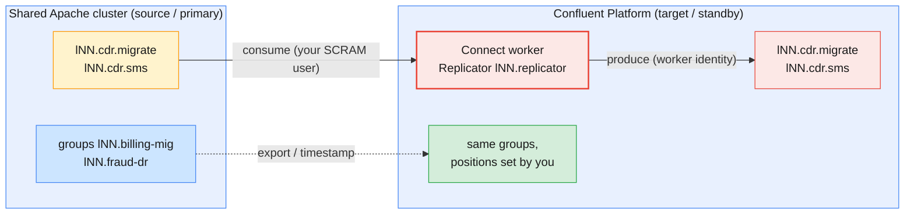
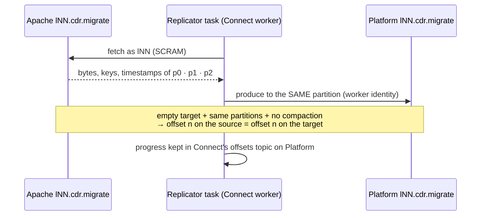
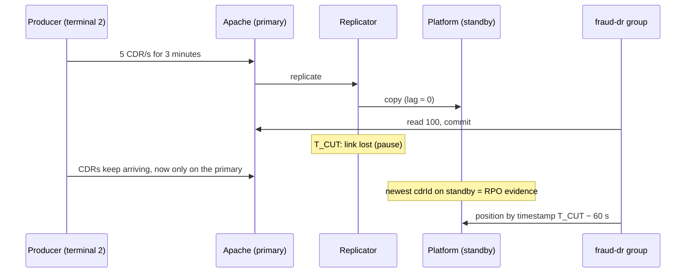

# Lab 02 — Migration rehearsal, DR drill and capstone on Confluent Platform

| | |
| --- | --- |
| **Level** | Intermediate → Advanced |
| **Duration** | ~95 minutes |
| **Guide sections** | §5.1 Replication is not backup · §5.3 Confluent Replicator · §5.5 A failover and failback runbook · §6.1 Assess before you move · §6.3 Client cutover: consumers first · §6.5 Choosing the strategy and the go/no-go · §8.3 Day-2 operations routine · §8.5 Incidents, runbooks and learning |
| **You will need** | Lab 01 done; `~/kafka/cp.properties`, `~/kafka/cp-ca.pem`, `~/kafka/confluent.env` (Platform) and `~/kafka/apache.properties` (Apache cluster); your LDAP password; `jq`, `curl`; **two terminals** |

## Learning objectives

By the end of this lab you will be able to:

1. Take an **inventory** of a topic and its consumer group on the Apache
   cluster before you move anything.
2. Configure **Confluent Replicator** as code, explain each setting that
   matters on a shared cluster, and prove it caught up **partition by
   partition**.
3. **Cut over** a consumer group to Confluent Platform with an explicit,
   written position decision, and verify it with **business IDs**, not
   offsets.
4. Run a **DR drill**: cut the replication link while records flow, measure
   **RPO** and **RTO**, and fail a group over by timestamp. Then explain why
   the safety margin turns a silent **gap** into bounded **duplicates**.
5. **Diagnose and fix** a replication change that stalls silently while
   every state says `RUNNING`, and report it in plain status lines: the
   capstone loop of administer, monitor and troubleshoot.
6. Fill in a **go/no-go** card with numbers from your own rehearsal.

## Why this lab

Management wants the CDR platform moved from Apache Kafka to Confluent
without pausing billing. The regulator separately asks what happens if a
site is lost. Both questions have the same answer: copy the data across
clusters, decide **where every consumer resumes**, and prove it with
numbers. The course's [LAB-SETUP §5](../../infra/LAB-SETUP.md) uses one
exercise for both: **Replicator from the shared Apache cluster into
Confluent Platform**.

You rehearse the migration first (Parts 1–3). Then you treat the same pair
of clusters as primary and standby and break the link on purpose (Part 4).
Part 5 is a short capstone drill: a change request, a fault you have not
been told about, a clock, and a status report. It is a 20-minute version of
the capstone's *Peak Night*.



---

## Before you start — variables (5 min)

```bash
# (VM)
source ~/kafka/confluent.env            # CP, MDS_URL, CP_REST, CP_CA, C3_URL
ME=lNN; export ME                       # your prefix
CFG=~/kafka/cp.properties               # your LDAP user on Confluent Platform
APA_CFG=~/kafka/apache.properties       # your SCRAM user on the Apache cluster
APA=$(sed -n 's/^bootstrap.servers=//p' $APA_CFG)
CP_CONNECT=${CONNECT_URL:-https://cp-services.lab.internal:8083}
REST="--url $CP_REST --certificate-authority-path $CP_CA"
TOPIC=$ME.cdr.migrate
LDAP_PW=$(sed -n 's/.*password="\([^"]*\)".*/\1/p' $CFG)
cn() { curl -sS --cacert "$CP_CA" -u "$ME:$LDAP_PW" "$CP_CONNECT$1" "${@:2}"; echo; }
# tot <bootstrap> <config> <topic>: sum of the end offsets of all partitions
tot() { kafka-get-offsets.sh --bootstrap-server $1 --command-config $2 --topic $3 --time -1 | awk -F: '{s+=$3} END{print s}'; }
mkdir -p ~/kafka/m10 && chmod 700 ~/kafka/m10
echo "$ME $APA $CP $CP_CONNECT"
```

**Expected:** your prefix, `apache-kafka.lab.internal:9092`,
`cp-kafka.lab.internal:9092` and `https://cp-services.lab.internal:8083`.

Switch the Confluent CLI to your Platform context; log in again if the
token has expired:

```bash
# (VM)
confluent login --url $MDS_URL --certificate-authority-path $CP_CA --save
cn / | jq -c '{version}'
```

**Expected:** `Logged in as "lNN".` and the Connect version, for example
`{"version":"8.3.2-ce"}`. Copy the variable block into terminal 2.

> **Note:** the Kafka 4.3 console tools print `Warning: --producer.config is
> deprecated … Use --command-config instead` and similar lines for
> `--consumer.config` and `--property`. They still work exactly as before;
> the lab keeps the flags the rest of the course uses.

---

## Part 1 — Assess the source (10 min)

You are taking over a CDR topic on the Apache cluster. A billing consumer
has read part of it. First build the situation, then take the inventory a
migration starts with (§6.1).

```bash
# (VM) - build the source: 3 000 keyed CDRs, a billing consumer that read 1 000
kafka-topics.sh --bootstrap-server $APA --command-config $APA_CFG --create --topic $TOPIC \
  --partitions 3 --replication-factor 3
seq 1 3000 | awk '{printf "91984500%02d|{\"cdrId\":\"m-%d\",\"durationSec\":%d}\n", $1%50, $1, $1%600}' \
  | kafka-console-producer.sh --bootstrap-server $APA --producer.config $APA_CFG --topic $TOPIC \
      --property parse.key=true --property key.separator='|'
kafka-console-consumer.sh --bootstrap-server $APA --consumer.config $APA_CFG --topic $TOPIC \
  --group $ME.billing-mig --from-beginning --max-messages 1000 > /dev/null
```

**Expected:** `Created topic lNN.cdr.migrate.` and `Processed a total of 1000 messages`.

Now the inventory, as you would take it for every topic on the migration
list:

```bash
# (VM)
kafka-topics.sh --bootstrap-server $APA --command-config $APA_CFG --describe --topic $TOPIC | head -1
kafka-configs.sh --bootstrap-server $APA --command-config $APA_CFG --describe --topic $TOPIC
kafka-get-offsets.sh --bootstrap-server $APA --command-config $APA_CFG --topic $TOPIC --time -1
kafka-consumer-groups.sh --bootstrap-server $APA --command-config $APA_CFG --describe --group $ME.billing-mig
```

**Expected** (the partition split is the same for everyone, because the
keys are the same):

```
Topic: lNN.cdr.migrate	TopicId: …	PartitionCount: 3	ReplicationFactor: 3	Configs: min.insync.replicas=2
Dynamic configs for topic lNN.cdr.migrate are:
lNN.cdr.migrate:0:960
lNN.cdr.migrate:1:840
lNN.cdr.migrate:2:1200

GROUP           TOPIC           PARTITION  CURRENT-OFFSET  LOG-END-OFFSET  LAG   …
lNN.billing-mig lNN.cdr.migrate 0          960             960             0     …
lNN.billing-mig lNN.cdr.migrate 1          40              840             800   …
lNN.billing-mig lNN.cdr.migrate 2          0               1200            1200  …
```

The group has **not** read 1 000 records evenly. It read all 960 records of
partition 0 and 40 of partition 1, and nothing of partition 2. A position is
a per-partition fact, so any method that moves the group must keep it per
partition.

Copy this inventory card into your notes and fill it in:

| Item | Value on the Apache cluster | Must be equal on Platform? |
| ---- | --------------------------- | -------------------------- |
| **Partitions** | 3 | **Yes**: the key → partition mapping depends on it |
| **Replication factor / `min.insync.replicas`** | 3 / 2 (cluster default) | Platform's own durability rules apply (Module 9 §7) |
| **Topic configs** (retention, cleanup) | defaults | Recreate deliberately; do not sync blindly |
| **Records** (end offsets) | 960 / 840 / 1200 | Yes, after replication |
| **Group positions** | 960 / 40 / 0 | Set explicitly (Part 3) |
| **Clients and owners** | billing (consumer), mediation (producer) | Each gets a cutover step |

---

## Part 2 — Replicate with Replicator, configured as code (20 min)

### 2.1 The target topic first

The target topic is created from your catalog with the **source's partition
count** and Platform's durability settings. Replicator is not allowed to
create it (`topic.auto.create=false` below).

```bash
# (VM)
confluent kafka topic create $TOPIC $REST --partitions 3 --replication-factor 3 \
  --config min.insync.replicas=2
cn /connector-plugins | jq -r '.[].class' | grep -i replicator
```

**Expected:** `Created topic "lNN.cdr.migrate".` and
`io.confluent.connect.replicator.ReplicatorSourceConnector`.

### 2.2 Build the configuration

Replicator runs on the Platform **Connect** cluster, close to the
destination, as Confluent recommends (§5.3). It reads the Apache cluster
with **your** SCRAM user. The worker writes the records to Platform with
**its own** identity. The `dest.kafka.*` settings serve Replicator's admin
calls on the destination.

```bash
# (VM)
umask 077
jq -n --arg name "$ME.replicator" --arg topic "$TOPIC" --arg src "$APA" --arg dst "$CP" --arg ca "$CP_CA" \
      --arg sjaas "$(sed -n 's/^sasl.jaas.config=//p' $APA_CFG)" \
      --arg djaas "$(sed -n 's/^sasl.jaas.config=//p' $CFG)" '{
  name: $name, config: {
    "connector.class": "io.confluent.connect.replicator.ReplicatorSourceConnector",
    "tasks.max": "1",
    "topic.whitelist": $topic,
    "topic.auto.create": "false",
    "topic.config.sync": "false",
    "offset.timestamps.commit": "false",
    "key.converter": "io.confluent.connect.replicator.util.ByteArrayConverter",
    "value.converter": "io.confluent.connect.replicator.util.ByteArrayConverter",
    "src.kafka.bootstrap.servers": $src, "src.kafka.security.protocol": "SASL_PLAINTEXT",
    "src.kafka.sasl.mechanism": "SCRAM-SHA-512", "src.kafka.sasl.jaas.config": $sjaas,
    "dest.kafka.bootstrap.servers": $dst, "dest.kafka.security.protocol": "SASL_SSL",
    "dest.kafka.sasl.mechanism": "PLAIN", "dest.kafka.sasl.jaas.config": $djaas,
    "dest.kafka.ssl.truststore.type": "PEM", "dest.kafka.ssl.truststore.location": $ca,
    "confluent.topic.replication.factor": "3" } }' > ~/kafka/m10/replicator.json
ls -l ~/kafka/m10/replicator.json
jq '.config | with_entries(select(.key | test("jaas") | not))' ~/kafka/m10/replicator.json | head -8
```

**Expected:** `-rw-------`, then the start of the configuration with the two
JAAS lines filtered out of the view.

> **Administrator rule:** this file holds **two passwords** (your SCRAM and
> LDAP passwords inside the JAAS lines), because a self-managed connector
> that reads one cluster and writes another needs credentials for both.
> Keep it mode 600, never print it unfiltered, and delete it at clean up. In
> production the values come from a **config provider** (for example
> `${file:/etc/connect/secrets.properties:src.jaas}`) so the JSON in Git
> holds references only. That is the self-managed equivalent of Lab 01's
> service-account mode.

The settings that matter on a shared cluster, and why:

| Setting | Value | Why here |
| ------- | ----- | -------- |
| **`topic.whitelist`** | `lNN.cdr.migrate` | Copy exactly the topics on the migration list. Never use a regex that could match another learner's prefix |
| **`topic.auto.create`** | `false` | The catalog creates topics, with Platform's RF and `min.insync.replicas`. Part 5 shows the price |
| **`topic.config.sync`** | `false` | Source configs (retention, cleanup) are recreated deliberately, not copied blindly |
| **`offset.timestamps.commit`** | `false` | When `true`, Replicator creates a `__consumer_timestamps` topic **on the source** for offset translation. Your Apache user may create only `lNN.*` topics (see the trap below) |
| **`key.converter` / `value.converter`** | `ByteArrayConverter` | Copy bytes unchanged: no deserialization, no schema questions |
| **`topic.preserve.partitions`** | *(default `true`)* | Record in partition *p* on the source lands in partition *p* on the target |

> **Common trap — the default `offset.timestamps.commit=true`:** in a local
> test with Replicator 8.3.2 and a source user that has only prefix ACLs, the
> connector showed `RUNNING` and its task `FAILED` with
> `TopicAuthorizationException: Authorization failed.` thrown from
> `ConsumerTimestampsWriter`. The worker log said
> `Failed to create topic __consumer_timestamps in the source cluster`. On a
> real migration, the platform team creates that topic on the source in
> advance and grants the Replicator user access. Without it there is no
> offset translation, and Part 4 shows what you do instead.

### 2.3 Create, wait, check

```bash
# (VM)
cn /connectors -X POST -H 'Content-Type: application/json' -d @$HOME/kafka/m10/replicator.json | jq -r '.name // .message'
sleep 60
cn /connectors/$ME.replicator/status | jq -c '{c: .connector.state, t: [.tasks[].state]}'
```

**Expected:** `lNN.replicator`, then `{"c":"RUNNING","t":["RUNNING"]}`. If
the task is `FAILED`, read its trace with
`cn /connectors/$ME.replicator/status | jq -r '.tasks[0].trace' | head -5`
and check the troubleshooting table in the [README](README.md).

### 2.4 Caught up? Prove it per partition

```bash
# (VM)
kafka-get-offsets.sh --bootstrap-server $APA --command-config $APA_CFG --topic $TOPIC --time -1
kafka-get-offsets.sh --bootstrap-server $CP  --command-config $CFG     --topic $TOPIC --time -1
```

**Expected:** the same three lines twice:

```
lNN.cdr.migrate:0:960
lNN.cdr.migrate:1:840
lNN.cdr.migrate:2:1200
```



> **Note:** Replicator also commits its position to a group named after the
> connector, `lNN.replicator`, on the **source**. Do not use that group as
> your replication-lag signal. In the local test its committed offsets
> trailed the real progress for minutes. The comparison of end offsets above
> is the check that counts. In production you also watch the connector's
> metrics in Control Center.

---

## Part 3 — Cut over the consumer with a written position decision (15 min)

The rule from §6.3: **consumers move first**, while the source stays
authoritative, and every group's start position is a written decision.
`auto.offset.reset` must not make that decision for you.

### 3.1 Decide

| Method | Valid here? | Why |
| ------ | ----------- | --- |
| **Same offsets** (export and apply) | **Yes** | Empty target, same partitions, no compaction, no transactions: offsets are identical (Part 2.4) |
| Translated offsets (interceptor) | No | Timestamp commit is off, and the console consumer has no interceptor |
| By timestamp | Possible | Gives a bounded set of duplicates. Part 4 uses it, where exported offsets are not available |
| `latest` / `earliest` | **No** | Skips 2 000 unread CDRs silently / re-bills 1 000 |

Write the decision in one line in your notes, for example: *"billing-mig:
same offsets from the Apache export, valid because target offsets equal
source offsets per partition (checked 14:05 UTC)."*

### 3.2 Export from the source, apply on the target

```bash
# (VM)
kafka-consumer-groups.sh --bootstrap-server $APA --command-config $APA_CFG --group $ME.billing-mig \
  --topic $TOPIC --reset-offsets --to-current --export --dry-run > ~/kafka/m10/positions.csv
cat ~/kafka/m10/positions.csv
kafka-consumer-groups.sh --bootstrap-server $CP --command-config $CFG --group $ME.billing-mig \
  --reset-offsets --from-file ~/kafka/m10/positions.csv --execute
kafka-consumer-groups.sh --bootstrap-server $CP --command-config $CFG --describe --group $ME.billing-mig
```

**Expected:**

```
lNN.cdr.migrate,2,0
lNN.cdr.migrate,1,40
lNN.cdr.migrate,0,960

GROUP           TOPIC           PARTITION  NEW-OFFSET
lNN.billing-mig lNN.cdr.migrate 2          0
lNN.billing-mig lNN.cdr.migrate 1          40
lNN.billing-mig lNN.cdr.migrate 0          960

Consumer group 'lNN.billing-mig' has no active members.

GROUP           TOPIC           PARTITION  CURRENT-OFFSET  LOG-END-OFFSET  LAG   …
lNN.billing-mig lNN.cdr.migrate 0          960             960             0     …
lNN.billing-mig lNN.cdr.migrate 1          40              840             800   …
lNN.billing-mig lNN.cdr.migrate 2          0               1200            1200  …
```

A total lag of **2 000** on Platform: exactly the records the group had not
read on Apache.

### 3.3 Verify with business IDs, not offsets

Offsets matched here, but the proof a migration owes the business is that
the **same record** waits at the same place. Read the first unread record of
partition 1 on both clusters:

```bash
# (VM)
for c in "$APA $APA_CFG" "$CP $CFG"; do set -- $c
  kafka-console-consumer.sh --bootstrap-server $1 --consumer.config $2 --topic $TOPIC \
    --partition 1 --offset 40 --max-messages 1 --property print.timestamp=true --property print.key=true 2>/dev/null
done
```

**Expected:** the same line twice, with the same key, `cdrId` and
`CreateTime`. Replicator keeps the producer's timestamp:

```
CreateTime:1791762624375	9198450041	{"cdrId":"m-141","durationSec":141}
CreateTime:1791762624375	9198450041	{"cdrId":"m-141","durationSec":141}
```

> **Administrator takeaway:** on the real night, the evidence is a
> reconciliation of `cdrId` sets per time window between the two clusters
> (§6.4). Offsets match only in this special case. With any other copy
> tool, a compacted topic or a pre-filled target, they do not, and the
> business IDs still must.

**Roll back on paper.** In your notes, write the steps that would send
`billing-mig` back to the Apache cluster within 15 minutes, in order:
stop the consumer on Platform; export its Platform positions; and so on.
Part 6 asks for this as a go/no-go criterion.

---

## Part 4 — DR drill: cut the link, measure RPO, fail over by timestamp (20 min)

Now treat the clusters differently: **Apache is the primary site, Platform
the standby**. A fraud consumer runs on the primary. You lose the link while
CDRs flow and fail the fraud group over to the standby.



### 4.1 The fraud group reads everything so far on the primary

```bash
# (VM) - terminal 1
kafka-console-consumer.sh --bootstrap-server $APA --consumer.config $APA_CFG --topic $TOPIC \
  --group $ME.fraud-dr --from-beginning --max-messages 3000 > /dev/null
```

**Expected:** `Processed a total of 3000 messages`.

### 4.2 Start the live traffic (terminal 2)

```bash
# (VM) - terminal 2: 900 CDRs at about 5 per second, numbered m-3001 … m-3900
for i in $(seq 3001 3900); do
  printf '91984500%02d|{"cdrId":"m-%d","durationSec":%d}\n' $((i%50)) $i $((i%600)); sleep 0.2
done | kafka-console-producer.sh --bootstrap-server $APA --producer.config $APA_CFG --topic $TOPIC \
         --property parse.key=true --property key.separator='|'
```

It runs for about three minutes. Go back to terminal 1 straight away.

### 4.3 The consumer keeps working, then the link fails

About 20 seconds after the producer started, let the fraud consumer read and
commit another 100 records on the primary:

```bash
# (VM) - terminal 1
kafka-console-consumer.sh --bootstrap-server $APA --consumer.config $APA_CFG --topic $TOPIC \
  --group $ME.fraud-dr --max-messages 100 > /dev/null
```

> **Common trap — `--timeout-ms` with live traffic:** `--timeout-ms` ends
> the consumer only after that much **idle** time. With 5 records per
> second it never goes idle and runs until the producer stops. Use
> `--max-messages` to read a fixed amount.

Ten seconds later the link between the sites is lost. You simulate it by
pausing Replicator, and you write down the time. The incident clock starts:

```bash
# (VM) - terminal 1
cn /connectors/$ME.replicator/pause -X PUT
T_CUT_S=$(date -u +%s)
T_CUT=$(date -u -d @$T_CUT_S +%Y-%m-%dT%H:%M:%S); T_POS=$(date -u -d @$((T_CUT_S-60)) +%Y-%m-%dT%H:%M:%S)
echo "T_CUT=$T_CUT  T_POS=$T_POS"
cn /connectors/$ME.replicator/status | jq -c '{c: .connector.state, t: [.tasks[].state]}'
```

**Expected:** two UTC times 60 seconds apart, then
`{"c":"PAUSED","t":["PAUSED"]}`. `T_POS` is the cut minus the runbook's
safety margin; Part 4.5 explains it.

### 4.4 Measure the RPO with business IDs

Wait until terminal 2 has finished (its prompt returns). Then compare the two
sites by the **newest `cdrId`** each holds. A small function reads the last
record of every partition, so it needs no consumer group:

```bash
# (VM) - terminal 1
newest() { kafka-get-offsets.sh --bootstrap-server $1 --command-config $2 --topic $TOPIC --time -1 \
  | while IFS=: read -r t p end; do
      kafka-console-consumer.sh --bootstrap-server $1 --consumer.config $2 --topic $t --partition $p \
        --offset $((end-1)) --max-messages 1 2>/dev/null
    done | sed -n 's/.*"cdrId":"m-\([0-9]*\)".*/\1/p' | sort -n | tail -1; }
echo "records:   primary=$(tot $APA $APA_CFG $TOPIC)  standby=$(tot $CP $CFG $TOPIC)"
echo "newest ID: primary=m-$(newest $APA $APA_CFG)  standby=m-$(newest $CP $CFG)"
```

**Expected** (your numbers differ; the shape does not). From the local
test of this lab, with the cut 32 seconds after the producer started:

```
records:   primary=3900  standby=3161
newest ID: primary=m-3900  standby=m-3161
```

> **Why `newest` reads by partition:** a console consumer without `--group`
> invents a group named `console-consumer-…`. On the Apache cluster your
> ACLs allow only groups that start with `lNN.`, so that consumer is
> refused. Reading with `--partition` and `--offset` needs no group.

| Measure | How | Local test | Your value |
| ------- | --- | ---------- | ---------- |
| **Records only on the primary** | primary − standby | 739 | |
| **Their ID range** | `m-<standby+1>` … `m-<primary>` | m-3162 … m-3900 | |
| **Traffic they represent** | records ÷ 5 per second | ≈ 148 s | |
| **Live records that reached the standby** | standby − 3 000 | 161, all sent in the 32 s before the cut | |

Up to the cut, the standby had everything. The RPO of a healthy
asynchronous link is seconds, but only for data written **before** the
link failed. Everything the primary accepted afterwards exists on one site
only. If the primary is then lost, those 739 CDRs are your real data loss.
If it comes back, they are reconciled by `cdrId` on failback (§5.5 step
7), not by offsets.

### 4.5 Fail over the fraud group by timestamp

In a real outage the primary is gone, so you cannot export its positions.
Your runbook says: *set positions by timestamp, `T_CUT` minus a safety
margin of 60 seconds.* Compare the margin with no margin, both as dry
runs first:

```bash
# (VM) - terminal 1
for t in $T_CUT $T_POS; do echo "== to-datetime $t"
  kafka-consumer-groups.sh --bootstrap-server $CP --command-config $CFG --group $ME.fraud-dr \
    --topic $TOPIC --reset-offsets --to-datetime ${t}.000Z --dry-run
done
```

Because this is a drill, the primary is still alive, and you can check the
answer against what the group really committed there:

```bash
# (VM) - terminal 1
kafka-consumer-groups.sh --bootstrap-server $APA --command-config $APA_CFG --describe --group $ME.fraud-dr
```

**Expected** (local test, per partition p0 / p1 / p2; a line such as
`Warn: Partition 2 … is empty. Falling back to latest known offset.` can
appear when no record in a partition is newer than the timestamp):

| Position source | p0 | p1 | p2 | Total | Compared with the real commit (3 100) |
| --------------- | -- | -- | -- | ----- | -------------------------------------- |
| Real commit on the primary | 991 | 868 | 1 241 | 3 100 | — |
| `--to-datetime T_CUT` | 1 008 | 882 | 1 263 | 3 153 | **53 CDRs never checked for fraud**: a silent gap |
| `--to-datetime T_CUT − 60 s` | 960 | 840 | 1 200 | 3 000 | **100 duplicates**: bounded, detectable |

The margin reaches back to before the producer started, so the group
restarts exactly at the 3 000 records it had read in Part 4.1 and re-reads
the 100 from Part 4.3. `T_CUT` alone lands **after** the 53 CDRs that
arrived between the group's last commit (10 seconds before the cut) and the
cut itself. The group never processed them, and nothing would ever tell you.

> **Administrator rule:** when positions are set by time, **err on the
> early side**. A margin larger than the consumer's commit interval and its
> processing delay turns a gap into duplicates, and idempotent consumers
> (§7.3) absorb duplicates. Nothing absorbs a gap. The margin belongs in the
> runbook, with the number.

Apply the margin and measure the **RTO** from your decision to the first
record processed on the standby:

```bash
# (VM) - terminal 1
T_DECIDE=$(date -u +%T)
kafka-consumer-groups.sh --bootstrap-server $CP --command-config $CFG --group $ME.fraud-dr \
  --topic $TOPIC --reset-offsets --to-datetime ${T_POS}.000Z --execute > /dev/null
kafka-console-consumer.sh --bootstrap-server $CP --consumer.config $CFG --topic $TOPIC \
  --group $ME.fraud-dr --max-messages 1 2>/dev/null
echo "decided $T_DECIDE  first record on standby $(date -u +%T)"
```

**Expected** (local test):

```
{"cdrId":"m-3001","durationSec":1}
decided 00:28:04  first record on standby 00:28:08
```

The first record on the standby is `m-3001`, the first CDR of the live
traffic. The 100 live CDRs the group had already processed on the primary
(31, 28 and 41 per partition) are processed a second time: the 100
duplicates from the table. The technical part of the RTO took four seconds. In a real
failover, most of the RTO is spent **before** `T_DECIDE`: detection,
confirmation and the decision itself (§5.5 steps 1–3).

### 4.6 Restore the link

```bash
# (VM) - terminal 1
cn /connectors/$ME.replicator/resume -X PUT
sleep 30
echo "records: primary=$(tot $APA $APA_CFG $TOPIC)  standby=$(tot $CP $CFG $TOPIC)"
```

**Expected:** two equal totals. Replicator kept its position in Connect's
offsets topic and copied the stranded records when the link came back. In
a real failback the standby has also taken writes by then, so the direction
reverses and the plan follows §5.5 step 7.

---

## Part 5 — Capstone drill: administer, monitor, troubleshoot (20 min)

> **The scenario, 20 minutes on the clock.** The SMS team asks to have its
> topic replicated as well. The change ticket says: *"Add `lNN.cdr.sms` to
> the Replicator whitelist."* You apply the ticket exactly as written, then
> run your monitoring, find out whether it worked, and report. Write a
> status line in `~/kafka/m10/status.md` at minute 0, 10 and 20 in the
> capstone's format: **Impact · Cause · Doing · Next update**.

```bash
# (VM) - minute 0: the SMS team's topic on the Apache cluster, with traffic
kafka-topics.sh --bootstrap-server $APA --command-config $APA_CFG --create --topic $ME.cdr.sms \
  --partitions 2 --replication-factor 3
seq 1 500 | awk '{printf "91984500%02d|{\"smsId\":\"s-%d\"}\n", $1%50, $1}' \
  | kafka-console-producer.sh --bootstrap-server $APA --producer.config $APA_CFG --topic $ME.cdr.sms \
      --property parse.key=true --property key.separator='|'
echo "$(date -u +%H:%M) Impact: none · Cause: — · Doing: adding $ME.cdr.sms to replication (ticket) · Next update: +10 min" >> ~/kafka/m10/status.md
```

### 5.1 Administer: apply the ticket as code

Change the file, not the live connector. Then apply the file:

```bash
# (VM)
jq --arg t "$TOPIC,$ME.cdr.sms" '.config["topic.whitelist"] = $t' ~/kafka/m10/replicator.json > ~/kafka/m10/replicator.new \
  && mv ~/kafka/m10/replicator.new ~/kafka/m10/replicator.json
jq '.config' ~/kafka/m10/replicator.json \
  | cn /connectors/$ME.replicator/config -X PUT -H 'Content-Type: application/json' -d @- \
  | jq -r '.config["topic.whitelist"]'
```

**Expected:** `lNN.cdr.migrate,lNN.cdr.sms`. The `jq -r` at the end matters:
the reply echoes the whole configuration, passwords included.

### 5.2 Monitor: is it working?

Wait a minute, then check what most people check first, followed by what
actually counts:

```bash
# (VM)
cn /connectors/$ME.replicator/status | jq -c '{c: .connector.state, t: [.tasks[].state]}'
for t in $TOPIC $ME.cdr.sms; do
  echo "$t primary=$(tot $APA $APA_CFG $t) standby=$(tot $CP $CFG $t)"
done
```

Read the output carefully before you go on. Then answer in your notes:
what does the state say, what do the totals say, and which one does the
business care about?

<details>
<summary>What you should have found (open after you have written your answer)</summary>

```
{"c":"RUNNING","t":["RUNNING"]}
lNN.cdr.migrate primary=3900 standby=3900
Error occurred: Could not match any topic-partitions with the specified filters
lNN.cdr.sms primary=500 standby=
```

Every state is `RUNNING`, and the SMS data is not on the standby at all:
the topic does not exist there. In the local test with Replicator 8.3.2,
the task did **not** fail. It assigned the `sms` partitions, logged only
warnings, and moved nothing for as long as the topic was missing. This is
a **silent stall**, and only the end-offset comparison catches it. The
Module 6 Lab 07 rule ("read the task, not the connector") is not enough
here. You need a check on the data itself.
</details>

```bash
# (VM) - minute 10
echo "$(date -u +%H:%M) Impact: SMS records not replicated to the standby (DR gap for SMS) · Cause: under investigation · Doing: comparing topics on both sites · Next update: +10 min" >> ~/kafka/m10/status.md
```

### 5.3 Troubleshoot and fix

Diagnose it yourself before reading the hint. You have the config file,
the status and the two clusters.

<details>
<summary>Hint</summary>

`grep -o '"topic.auto.create": "[a-z]*"' ~/kafka/m10/replicator.json`.
Who creates destination topics in this design (Part 2.1), and did that
happen for `sms`?
</details>

The fix follows the catalog rule from Part 2.1: create the target with the
**source's** partition count, and leave the connector alone.

```bash
# (VM)
kafka-topics.sh --bootstrap-server $APA --command-config $APA_CFG --describe --topic $ME.cdr.sms | head -1
confluent kafka topic create $ME.cdr.sms $REST --partitions 2 --replication-factor 3 \
  --config min.insync.replicas=2
sleep 60
kafka-get-offsets.sh --bootstrap-server $APA --command-config $APA_CFG --topic $ME.cdr.sms --time -1
kafka-get-offsets.sh --bootstrap-server $CP  --command-config $CFG     --topic $ME.cdr.sms --time -1
```

**Expected:** `PartitionCount: 2` on the source, `Created topic
"lNN.cdr.sms".`, then the same two lines on both sites:

```
lNN.cdr.sms:0:270
lNN.cdr.sms:1:230
```

In two local tests with Replicator 8.3.2, replication of the new topic
started 22 and 37 seconds after the topic was created, with no restart.
If yours stays empty after two minutes, restart the task with
`cn /connectors/$ME.replicator/tasks/0/restart -X POST` and check the
trap below.

> **Common trap — a connector name that was used before:** Connect keeps a
> source connector's offsets after `DELETE /connectors/<name>`. A new
> connector with the **same name** resumes from them. In a local test, a
> recreated `lNN.replicator` sought straight to the old end offsets of a
> recreated `lNN.cdr.sms` and copied nothing, while every state said
> `RUNNING`. `DELETE /connectors/<name>/offsets` reported success but did
> not change that. If you run this lab a second time, give the connector a
> new name (`$ME.replicator-2`). In production, never reuse a replication
> connector's name for a different data set.

```bash
# (VM) - minute 20
echo "$(date -u +%H:%M) Impact: resolved, SMS replicated, both sites equal (500 / 500) · Cause: target topic missing, topic.auto.create=false · Doing: runbook change (topic before whitelist) + end-offset check per replicated topic · Next update: closing" >> ~/kafka/m10/status.md
cat ~/kafka/m10/status.md
```

| Capstone step | What you did | Course skill |
| ------------- | ------------ | ------------ |
| **Administer** | Changed the connector through its config file, not by hand | §8.2, Module 6 Lab 07 |
| **Monitor** | Compared end offsets per replicated topic, not only states | Module 8 §3, §8.3 |
| **Troubleshoot** | Found the cause in the design (`topic.auto.create=false`), fixed it at the catalog | Module 9 §2 triage |
| **Prevent** | Runbook order: target topic → whitelist → offset check | Module 9 §7, §8.5 |
| **Communicate** | Three status lines in business terms | §8.5, capstone Peak Night |

> **Prevention, written as the review would:** *"Every Replicator change
> request includes the catalog entry for each new topic. The pipeline
> applies the topic before the connector config. The replication check
> compares end offsets for every whitelisted topic and alerts on a
> difference that persists for 5 minutes."*

---

## Part 6 — Go/no-go and guided review (5 min)

Fill in the go/no-go card for the migration you rehearsed, with **your**
numbers (§6.5). A single "no" means no-go, and no-go is the process working.

| Criterion | Target | Your rehearsal | Go? |
| --------- | ------ | -------------- | --- |
| End offsets equal per partition, every topic | Equal for 5 min | | |
| Business-ID check (first unread record, newest record) | Identical on both sites | | |
| Every group's position decision written down and applied | 100 % of groups | | |
| Rollback of `billing-mig` timed (on paper today) | ≤ 15 min | | |
| Failover margin and duplicates measured | Duplicates ≤ 1 min of traffic, no gap | | |
| Silent-stall check in place for every replicated topic | Yes | | |

Then pick **three** questions from the closing review in the guide
([§9.5](../../guides/module-10-ecosystem-migration-backup-dr-capstone.md#95-part-e--guided-review-and-qa)).
Answer each with **evidence from your own labs**, a command output or a
number, not from memory. Questions 3, 8 and 9 connect directly to today.

---

## Checkpoint questions

<details>
<summary>1. Why could you copy the consumer group's offsets from Apache to Platform in Part 3, and when would that be wrong?</summary>

Because the target topic was empty, had the same partition count, and
Replicator preserves partitions. The source held no compaction or
transaction markers, so offset *n* on the source was the same record as
offset *n* on the target (Part 2.4 and 3.3 proved it). On a pre-filled
target, a compacted topic, or with any tool other than Cluster Linking, the
offsets drift. Copying them would then skip or repeat records; use
translation or timestamps instead.
</details>

<details>
<summary>2. In the DR drill, the timestamp without a margin gave a higher position than the group's real commit. Why is that worse than the duplicates the margin gives?</summary>

The group had committed a few seconds before `T_CUT`, while records kept
arriving. Resetting to `T_CUT` places the group **after** records it never
processed, so those CDRs are silently skipped: no error, no lag, just a
gap. The 60-second margin places it **before** the real commit, so the
consumer re-reads about 100 records. An idempotent consumer absorbs those,
and they can be counted. A gap can only be found later by reconciliation.
</details>

<details>
<summary>3. What were your RPO and RTO in Part 4, and what would change them most in production?</summary>

RPO for data written before the cut was seconds, because the link was
current. Everything after the cut existed only on the primary, which
counts against RPO when the primary is really lost. RTO from decision to the
first record was seconds. In production, detection, confirmation and the
decision dominate the RTO. Replication lag at the moment of the outage,
which depends on bandwidth and on the Connect cluster's health, dominates
the RPO. Both are measured in drills, not estimated.
</details>

<details>
<summary>4. Replicator showed RUNNING / RUNNING while a topic was not replicated at all. How should you monitor replication instead?</summary>

Compare the data, not the states: for every whitelisted topic, compare end
offsets (or the newest business ID) on both sites. Alert when the
difference does not shrink within an agreed time. Add Replicator's own lag
metrics in Control Center, and keep the state alert for hard failures. A
monitoring design that only reads states would have reported Part 5 as
healthy.
</details>

<details>
<summary>5. Why does the Replicator config file hold passwords while Lab 01's connector config held none, and how would you remove them in production?</summary>

The managed connector on Cloud authenticates as a service account by ID,
and Confluent holds the credentials. A self-managed Replicator reads one
cluster and writes another, so it needs client credentials for both,
inside its config. In production you replace the values with references to
a **config provider** (a file, Vault or a secret manager), so the JSON in
Git holds `${…}` placeholders. Each side uses a dedicated service
principal with only the topics and groups it needs, not a learner's or
administrator's login.
</details>

<details>
<summary>6. Management asks why you did not simply dual-write from the mediation producer to both clusters. What do you answer?</summary>

Dual write needs a code change in every producer, and two independent
sends can diverge: one succeeds, the other times out (§6.4). Then one
cluster must be declared the system of record and a reconciliation job
must prove nothing was lost. Replicate-and-cut-over keeps the source
authoritative until producers move, needs only configuration changes, and
lets you roll back by pointing consumers back. That is why it fits a pause
of 5 minutes or less with a 15-minute rollback.
</details>

---

## Clean up

> **Warning:** delete only your own `$ME.*` topics, groups and connector.
> Stop every consumer and producer first (`Ctrl+C`).

```bash
# (VM)
cn /connectors/$ME.replicator -X DELETE
for t in $TOPIC $ME.cdr.sms; do
  kafka-topics.sh --bootstrap-server $APA --command-config $APA_CFG --delete --if-exists --topic $t
  kafka-topics.sh --bootstrap-server $CP  --command-config $CFG     --delete --if-exists --topic $t
done
kafka-consumer-groups.sh --bootstrap-server $APA --command-config $APA_CFG --delete \
  --group $ME.billing-mig --group $ME.fraud-dr --group $ME.replicator
kafka-consumer-groups.sh --bootstrap-server $CP  --command-config $CFG --delete \
  --group $ME.billing-mig --group $ME.fraud-dr
rm -f ~/kafka/m10/replicator.json ~/kafka/m10/positions.csv
cp ~/kafka/m10/status.md ~/kafka/m10-status-$(date -u +%Y%m%d).md && rm -f ~/kafka/m10/status.md
cn /connectors | jq -c '[.[] | select(startswith(env.ME))]'
confluent context use <your Cloud context name>
```

**Expected:** an empty reply from the `DELETE`, then
`Deletion of requested consumer groups ('lNN.fraud-dr', 'lNN.billing-mig', 'lNN.replicator') was successful.`
on Apache and the same for the two groups on Platform, then `[]` for your
connectors. Your status log is kept as `~/kafka/m10-status-<date>.md` for
the capstone write-up. The connector's source offsets stay in the Connect
cluster's offsets topic; that is why a rerun needs a new connector name
(Part 5.3).

> **Course complete.** You have run Kafka from a single Docker broker to a
> migration rehearsal and a DR drill across clusters. You administered,
> secured, monitored, troubleshot and moved it, with evidence at every
> step. The capstone's
> [Phase 9 and Peak Night](../../capstone/part-b-confluent-kafka.md#peak-night)
> put all of it together under load, with faults you have not seen. Bring
> today's runbook, your status log and your go/no-go card.
