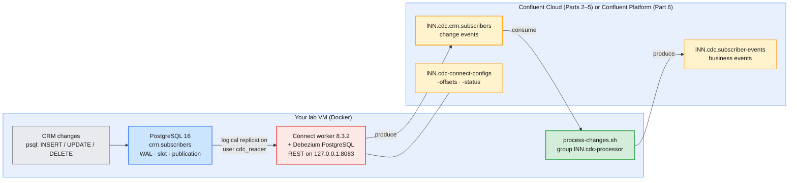
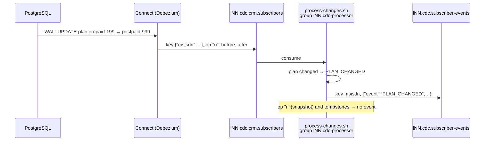

# Lab 03 — Change data capture from PostgreSQL on Confluent Cloud and Confluent Platform

| | |
| --- | --- |
| **Level** | Beginner |
| **Duration** | ~85 minutes |
| **Guide sections** | §2.1 Kafka Connect in one picture · §2.2 Fully managed versus self-managed · §2.5 Self-managed Connect (production baseline) · §7.4 Data contracts, configuration and secrets · §8.2 Everything as code |
| **You will need** | Lab 01 done (`sa-lNN-app` and `~/kafka/sa-app.properties`, your `env-lNN` and `lNN-basic` IDs); the Platform files `~/kafka/cp.properties`, `cp-ca.pem`, `confluent.env`; Docker on your VM (`docker compose version`); `jq`, `curl`; two terminals. The helper files are in [`lab-03/`](lab-03/) |

## Learning objectives

By the end of this lab you will be able to:

1. Explain **change data capture (CDC)**: how a connector turns the inserts,
   updates and deletes of a database table into Kafka records, and what the
   **snapshot**, the **replication slot** and the **publication** are for.
2. Run a **self-managed Connect worker** in Docker next to a database and
   connect it to **Confluent Cloud** as a service account with prefixed ACLs,
   and to **Confluent Platform** as your LDAP user.
3. Create a **Debezium PostgreSQL** connector whose configuration file holds
   **no password**, and read its connector and task state.
4. Read a CDC **change event**: `op`, `before`, `after`, `source`, the
   record key and the **tombstone** after a delete.
5. **Consume and process** the change stream with a small service that turns
   database changes into business events, and show that it resumes where it
   stopped.
6. Find and remove an **abandoned replication slot**, the CDC failure that
   fills a database server's disk.

## Why this lab

The CRM database of a telecom operator knows when a subscriber joins, changes
plan, is suspended for non-payment or ports out to another operator. Billing,
the network provisioning system and the customer-notification service all need
to know **at once**. The old answer is a nightly export or each team polling
the table. Both are late, and both put load on the database.

**Change data capture** reads the database's own transaction log instead. Every
committed change becomes a Kafka record within a second, in commit order per
row, without one extra query against the table. Module 6 Lab 07 showed Connect
with an invented data source (Datagen). This lab connects a real database:
a PostgreSQL container on your VM.



**Why not a fully managed connector on Cloud?** Confluent Cloud's catalog does
have a managed PostgreSQL CDC connector. It runs in Confluent's network and must
open a connection **to** your database (guide §2.2, the *Networking* row). Your
VM accepts no inbound connections from the internet, and a Basic cluster has no
private networking. This is the usual situation for a database in a private
data centre, and the usual answer is the one you build here: a **self-managed
worker next to the database** that connects **out** to Kafka. Only the worker's
Kafka connection changes between Cloud and Platform:

| | Confluent Cloud (Parts 2–5) | Confluent Platform on AWS (Part 6) |
| --- | --- | --- |
| **Where Connect runs** | Your VM, container `cdc-connect` | The same container |
| **Kafka identity of the worker** | `sa-lNN-app`, from `~/kafka/sa-app.properties` | Your LDAP user, from `~/kafka/cp.properties` |
| **Rights it needs** | Two **prefixed ACLs** on `lNN.cdc` that you create | Already there: you are `ResourceOwner` on `lNN.` topics and groups |
| **TLS** | Public CA, nothing to configure | The course CA `cp-ca.pem` |
| **Connector configuration** | `./cdc-connector.sh cloud` | `./cdc-connector.sh platform`, identical except the slot name |
| **Cost** | No connector task-hours: the worker is yours. You pay for the data in the cluster | Nothing extra |

---

## Before you start — variables (5 min)

Run every command from the **lab folder** on your VM. Use the IDs from your
Lab 01 notes.

```bash
# (VM) - from the course repository root
cd labs/module-10/lab-03
source ~/kafka/confluent.env                # CP (Platform bootstrap) and the other Platform URLs
ME=lNN                                      # your prefix
ENV_ID=env-7qk3x2                           # ← your env-lNN ID
LKC=lkc-9xw2pq                              # ← your lNN-basic cluster ID
export ME CDC_DIR=$HOME/kafka/m10/cdc       # docker compose reads both
SA_CFG=~/kafka/sa-app.properties            # Cloud: sa-lNN-app
CFG=~/kafka/cp.properties                   # Platform: your LDAP user
CCLOUD=$(sed -n 's/^bootstrap.servers=//p' $SA_CFG)
docker compose version; echo "$ME $CCLOUD $CP"
```

**Expected:** `Docker Compose version v2.24` or later (the Compose file needs it), then your prefix, your
Cloud bootstrap endpoint and `cp-kafka.lab.internal:9092`.

Three helpers keep the commands short. Define them now; Part 5 shows how to
define them in a second terminal.

```bash
# (VM)
sql()  { docker exec cdc-postgres psql -U postgres -d crm -c "$1"; }      # the CRM database
cn()   { curl -sS "localhost:8083$1" "${@:2}"; echo; }                    # the Connect worker on this VM
peek() { kafka-console-consumer.sh --bootstrap-server $BS --command-config $KCFG \
           --topic ${1:-$ME.cdc.crm.subscribers} --group $ME.cdc-peek \
           --command-property enable.auto.commit=false --from-beginning --timeout-ms 10000 \
           --formatter-property print.key=true --formatter-property key.separator=" | " 2>/dev/null; }
```

| Helper | What it does |
| ------ | ------------ |
| `sql "<statement>"` | Runs SQL as the database administrator, inside the container. You play the **CRM application**. |
| `cn /path` | Calls the Connect REST API. It listens on `127.0.0.1` only: no other machine can reach it, so it needs no login here. |
| `peek [topic]` | Reads a topic from the beginning and stops after 10 seconds of silence. It never commits offsets, so every `peek` shows everything again. `$BS` and `$KCFG` choose the cluster; you set them in Part 2 and Part 6. |

> **Note:** `peek` hides the consumer's messages on stderr, including the
> `TimeoutException` it prints when it stops. If it prints **nothing**, run the
> same command without `2>/dev/null` to see why (usually a missing ACL).

---

## Part 1 — The CRM database (10 min)

### 1.1 Create the database passwords, outside the repository

The database needs two passwords: one for its administrator and one for the
connector's user. They are generated here and never typed or written into
the course repository:

```bash
# (VM)
( umask 077; mkdir -p $CDC_DIR
  [ -f $CDC_DIR/pg-admin.env ] || echo "POSTGRES_PASSWORD=$(openssl rand -hex 16)" > $CDC_DIR/pg-admin.env
  [ -f $CDC_DIR/cdc-db.env ]   || echo "CDC_DB_PASSWORD=$(openssl rand -hex 16)"   > $CDC_DIR/cdc-db.env )
ls -l $CDC_DIR
```

**Expected:** two files, both `-rw-------`. Docker Compose reads them as
`env_file`s (look at [`docker-compose.yml`](lab-03/docker-compose.yml)): the
database gets both, the Connect worker gets **only** `cdc-db.env`.

### 1.2 Build the image and start PostgreSQL

```bash
# (VM)
docker compose build
docker compose up -d postgres
docker compose ps
```

`build` takes one to two minutes the first time. It starts from
`confluentinc/cp-kafka-connect:8.3.2` and installs the Debezium PostgreSQL
plugin **3.2.6** from Confluent Hub ([`Dockerfile`](lab-03/Dockerfile)).

**Expected** (after a few seconds):

```
NAME           IMAGE                COMMAND                  SERVICE    CREATED         STATUS                   PORTS
cdc-postgres   postgres:16-alpine   "docker-entrypoint.s…"   postgres   9 seconds ago   Up 8 seconds (healthy)   5432/tcp
```

`5432/tcp` without an address means the port is **not published**: only
containers on this Compose network can reach the database.

### 1.3 Look at the data and at what makes CDC possible

```bash
# (VM)
sql "SELECT msisdn, name, plan, status, circle FROM crm.subscribers ORDER BY msisdn;"
```

**Expected:**

```
    msisdn    |    name     |     plan     | status | circle 
--------------+-------------+--------------+--------+--------
 919845000001 | Asha Rao    | prepaid-299  | ACTIVE | KA
 919845000002 | Vikram Shah | postpaid-599 | ACTIVE | MH
 919845000003 | Meera Iyer  | prepaid-199  | ACTIVE | TN
 919845000004 | Rahul Verma | postpaid-999 | ACTIVE | DL
 919845000005 | Fatima Khan | prepaid-299  | ACTIVE | KA
(5 rows)
```

[`init-crm.sh`](lab-03/init-crm.sh) built the table and prepared four
things that every PostgreSQL CDC setup needs. Check them:

```bash
# (VM)
sql "SHOW wal_level;"
sql "SELECT pubname, schemaname, tablename FROM pg_publication_tables;"
sql "SELECT rolname, rolcanlogin, rolreplication, rolsuper FROM pg_roles WHERE rolname = 'cdc_reader';"
sql "SELECT relname, relreplident FROM pg_class WHERE relname = 'subscribers';"
```

**Expected:** `logical`; one row `cdc_subscribers | crm | subscribers`;
`cdc_reader | t | t | f`; `subscribers | f`.

| What | Value | Why CDC needs it |
| ---- | ----- | ---------------- |
| **`wal_level`** | `logical` | PostgreSQL writes every change to its **write-ahead log (WAL)** first. At `logical` the WAL holds enough detail to rebuild the changed rows, which is what the connector reads. |
| **Publication** `cdc_subscribers` | `crm.subscribers` only | The list of tables whose changes may leave the database. The connector cannot stream a table that is not in it. |
| **User** `cdc_reader` | login, replication, **not** superuser | The connector's own database identity: it may read the table and the change stream, nothing else. |
| **`REPLICA IDENTITY FULL`** | `f` | Updates and deletes carry the **old** row as well, so a consumer sees *what changed*, not only the result. |

The connector also needs a line in `pg_hba.conf` that allows a replication
connection from another container. Without it, the connector fails with a
`no pg_hba.conf entry for replication connection` error:

```bash
# (VM)
docker exec cdc-postgres tail -1 /var/lib/postgresql/data/pg_hba.conf
```

**Expected:** `host replication cdc_reader all scram-sha-256`.

> **Administrator rule:** in production these four items are a change
> request to the **database team**, not something a Kafka administrator
> sets alone. `wal_level` needs a database restart. Ask for them early in
> the project.

---

## Part 2 — A Connect worker for Confluent Cloud (15 min)

### 2.1 Point the Cloud tools at your cluster

```bash
# (VM)
confluent context list                      # the * must be on your Cloud context
confluent environment use $ENV_ID
confluent kafka cluster use $LKC
SA=$(confluent iam service-account list -o json | jq -r --arg n "sa-$ME-app" '.[] | select(.name==$n) | .id')
BS=$CCLOUD KCFG=$SA_CFG                     # peek reads Cloud as sa-lNN-app
echo $SA
```

**Expected:** `sa-…`. If it is empty, find the ID with
`confluent iam service-account list` and set `SA=sa-…` by hand.

### 2.2 Topics first, then exactly the rights the worker needs

You create the two data topics yourself, from the "catalog", with the
partition count you chose:

```bash
# (VM)
confluent kafka topic create $ME.cdc.crm.subscribers   --partitions 3
confluent kafka topic create $ME.cdc.subscriber-events --partitions 3
```

**Expected:** `Created topic "lNN.cdc.crm.subscribers".` and the same for
`lNN.cdc.subscriber-events`.

Everything this lab puts on the cluster starts with **`lNN.cdc`**: the two
data topics, the worker's three internal topics, the worker's group
`lNN.cdc-connect` and the processor's group `lNN.cdc-processor`. Two
**prefixed** ACLs therefore cover all of it, and nothing else:

```bash
# (VM)
confluent kafka acl create --allow --service-account $SA \
  --operations read,write,create,describe,describe-configs --topic $ME.cdc --prefix
confluent kafka acl create --allow --service-account $SA \
  --operations read --consumer-group $ME.cdc --prefix
confluent kafka acl list --service-account $SA
```

**Expected:** six rows for `sa-…`: five operations on the topic `lNN.cdc`
and `READ` on the group `lNN.cdc`, all with pattern type `PREFIXED`.

| Operation | Who needs it |
| --------- | ------------ |
| `CREATE` | The worker creates its three internal topics the first time it starts |
| `WRITE` | The connector's task writes change events; the processor writes business events |
| `READ` | The worker reads its internal topics back; the processor and `peek` read the change events |
| `DESCRIBE`, `DESCRIBE_CONFIGS` | The worker checks that its internal topics exist and are compacted |
| `READ` on the group | The worker group `lNN.cdc-connect` and the processor group `lNN.cdc-processor` |

### 2.3 The worker's Kafka connection, generated, not typed

[`worker-config.sh`](lab-03/worker-config.sh) copies the connection lines of a
client file into `CONNECT_*` variables for the container:

```bash
# (VM)
./worker-config.sh cloud
```

**Expected:**

```
wrote /home/learner/kafka/m10/cdc/worker.env for cloud (10 settings), secrets hidden:
CONNECT_BOOTSTRAP_SERVERS=pkc-xxxxx.ap-south-1.aws.confluent.cloud:9092
CONNECT_SECURITY_PROTOCOL=SASL_SSL
CONNECT_SASL_MECHANISM=PLAIN
CONNECT_SASL_JAAS_CONFIG=org.apache.kafka.common.security.plain.PlainLoginModule required username='SAKEY2XXXXXXXXXX' password=<hidden>;
```

Each setting is written for the worker itself and again with the `PRODUCER_`
and `CONSUMER_` prefixes. A source task produces with **its own** producer,
which does not inherit the worker's security settings.

> **Common trap:** without the `producer.`-prefixed settings, the worker
> starts and joins its group, the connector is created, and then the task
> fails to reach the cluster. It is the most common mistake with
> self-managed Connect on a secured cluster.

The other settings are in `docker-compose.yml` and hold no secret. Read the
`environment:` block of the `connect` service: internal topic names under
your prefix, replication factor 3, JSON converters, and the **config
provider** you use in Part 3.

### 2.4 Start the worker

```bash
# (VM)
docker compose up -d connect
until curl -sf localhost:8083/connectors > /dev/null; do sleep 5; done
cn / | jq
cn /connector-plugins | jq -r '.[] | "\(.type)\t\(.class)\t\(.version)"'
```

**Expected** (the worker needs 30–60 seconds to start):

```json
{
  "version": "8.3.2-ccs",
  "commit": "bb4ca81d942ac80659451d34a248ff9a9034c7ad",
  "kafka_cluster_id": "lkc-9xw2pq"
}
```

```
source	io.debezium.connector.postgresql.PostgresConnector	3.2.6.Final
source	org.apache.kafka.connect.mirror.MirrorCheckpointConnector	8.3.2-ccs
source	org.apache.kafka.connect.mirror.MirrorHeartbeatConnector	8.3.2-ccs
source	org.apache.kafka.connect.mirror.MirrorSourceConnector	8.3.2-ccs
```

`kafka_cluster_id` is **your Cloud cluster**: a worker on your VM is now part
of a Connect cluster whose state lives in Confluent Cloud. The plugin list holds
Debezium (from the `Dockerfile`) and the MirrorMaker 2 connectors that come
with every Connect worker.

```bash
# (VM)
confluent kafka topic list | grep "$ME.cdc"
```

**Expected:** five topics: your two data topics and
`lNN.cdc-connect-configs`, `lNN.cdc-connect-offsets`,
`lNN.cdc-connect-status`, which the worker created as `sa-lNN-app`.

If `until` never ends, read `docker logs cdc-connect | grep -E "ERROR|Authorization"`.
An `AuthorizationException` there means an ACL from 2.2 is missing.

---

## Part 3 — The CDC connector and the snapshot (15 min)

### 3.1 The configuration, with no password in it

```bash
# (VM)
./cdc-connector.sh cloud | jq .config
```

**Expected:**

```json
{
  "connector.class": "io.debezium.connector.postgresql.PostgresConnector",
  "tasks.max": "1",
  "database.hostname": "postgres",
  "database.port": "5432",
  "database.dbname": "crm",
  "database.user": "cdc_reader",
  "database.password": "${env:CDC_DB_PASSWORD}",
  "plugin.name": "pgoutput",
  "publication.name": "cdc_subscribers",
  "publication.autocreate.mode": "disabled",
  "slot.name": "cdc_cloud",
  "table.include.list": "crm.subscribers",
  "topic.prefix": "lNN.cdc",
  "snapshot.mode": "initial"
}
```

| Setting | Meaning |
| ------- | ------- |
| `database.hostname` = `postgres` | The Compose service name: the worker reaches the database over the Compose network |
| `database.password` = `${env:CDC_DB_PASSWORD}` | A **config provider** reference. The worker looks the value up in its own environment when it starts the task. The JSON, the REST API and the `lNN.cdc-connect-configs` topic only ever hold the reference |
| `plugin.name` = `pgoutput` | PostgreSQL's built-in logical decoding plugin: nothing to install in the database |
| `publication.name`, `publication.autocreate.mode=disabled` | Use the publication the database team created; do not create one (that would need more rights) |
| `slot.name` = `cdc_cloud` | The **replication slot**: the database remembers how far this connector has read in the WAL. Part 6 shows why that matters |
| `topic.prefix` + `table.include.list` | Topic name = `<prefix>.<schema>.<table>` = `lNN.cdc.crm.subscribers` |
| `snapshot.mode` = `initial` | On the first start, read every existing row once, then stream changes |

> **What this shows:** the connector file is safe to keep in Git and to paste
> into a ticket. The allow-list in `docker-compose.yml`
> (`CONNECT_CONFIG_PROVIDERS_ENV_PARAM_ALLOWLIST_PATTERN: ^CDC_.*$`) stops a
> connector from reading other variables, such as the worker's own Kafka
> secret.

### 3.2 Create it

```bash
# (VM)
./cdc-connector.sh cloud | cn /connectors -X POST -H 'Content-Type: application/json' -d @- | jq -c '{name, type, tasks}'
sleep 15
cn /connectors/$ME.cdc-crm/status | jq
```

**Expected:**

```
{"name":"lNN.cdc-crm","type":"source","tasks":[]}
```

```json
{
  "name": "lNN.cdc-crm",
  "connector": {
    "state": "RUNNING",
    "worker_id": "connect:8083",
    "version": "3.2.6.Final"
  },
  "tasks": [
    {
      "id": 0,
      "state": "RUNNING",
      "worker_id": "connect:8083",
      "version": "3.2.6.Final"
    }
  ],
  "type": "source"
}
```

Check what the worker stored, and where the connector writes:

```bash
# (VM)
cn /connectors/$ME.cdc-crm/config | jq -r '."database.password"'
cn /connectors/$ME.cdc-crm/topics | jq -c
```

**Expected:** `${env:CDC_DB_PASSWORD}`, the reference and not the password,
then `{"lNN.cdc-crm":{"topics":["lNN.cdc.crm.subscribers"]}}`.

### 3.3 Read the snapshot

```bash
# (VM)
peek | head -1
```

**Expected** (one line; your timestamps differ):

```
{"msisdn":"919845000001"} | {"before":null,"after":{"msisdn":"919845000001","name":"Asha Rao","plan":"prepaid-299","status":"ACTIVE","circle":"KA","updated_at":"2026-10-12T03:08:17.123978Z"},"source":{"version":"3.2.6.Final","connector":"postgresql","name":"lNN.cdc","ts_ms":1791774619138,"snapshot":"first","db":"crm","sequence":"[null,\"26693048\"]","ts_us":1791774619138059,"ts_ns":1791774619138059000,"schema":"crm","table":"subscribers","txId":751,"lsn":26693048,"xmin":null},"transaction":null,"op":"r","ts_ms":1791774619253,"ts_us":1791774619253898,"ts_ns":1791774619253898001}
```

This is a Debezium **change event**. The part before `|` is the record
**key**, the rest is the **value**, called the *envelope*:

| Field | In this record | Meaning |
| ----- | -------------- | ------- |
| **Key** | `{"msisdn":"919845000001"}` | The table's primary key. Kafka hashes it to choose the partition, so **all changes to one subscriber stay in order** in one partition |
| **`op`** | `r` | `r` = read during the snapshot, `c` = create (insert), `u` = update, `d` = delete |
| **`before`** | `null` | The row before the change (Part 4) |
| **`after`** | the row | The row after the change |
| **`source`** | `snapshot`, `lsn`, `txId`, `ts_ms` | Where and when: snapshot or not, position in the WAL, transaction, commit time |

Now all five, short:

```bash
# (VM)
peek | cut -d'|' -f2- | jq -c '{op, after: (.after | {msisdn, plan, status})}'
```

**Expected:** five lines with `"op":"r"`, one per subscriber. Their order
can differ from the table: the keys are spread over three partitions, and
Kafka orders records **within** a partition, not across partitions.

---

## Part 4 — Change the database, watch the events (10 min)

You are the CRM application. One subscriber joins, one upgrades, one is
suspended for non-payment and one ports out to another operator:

```bash
# (VM)
sql "INSERT INTO crm.subscribers (msisdn, name, plan, circle) VALUES ('919845000006', 'Arjun Nair', 'prepaid-199', 'KL');"
sql "UPDATE crm.subscribers SET plan = 'postpaid-599', updated_at = now() WHERE msisdn = '919845000001';"
sql "UPDATE crm.subscribers SET status = 'SUSPENDED', updated_at = now() WHERE msisdn = '919845000003';"
sql "DELETE FROM crm.subscribers WHERE msisdn = '919845000005';"
```

**Expected:** `INSERT 0 1`, `UPDATE 1`, `UPDATE 1`, `DELETE 1`.

Show only the changes, without the snapshot, in one line each:

```bash
# (VM)
changes() { peek | jq -R -c 'split(" | ") | (.[0] | fromjson | .msisdn) as $m | (.[1] | fromjson) as $v
  | if $v == null then {msisdn: $m, value: null}
    elif $v.op == "r" then empty
    else {msisdn: $m, op: $v.op, before: ($v.before | if . then {plan, status} else null end),
                                 after:  ($v.after  | if . then {plan, status} else null end)} end'; }
changes
```

**Expected** (the order across subscribers can differ):

```
{"msisdn":"919845000006","op":"c","before":null,"after":{"plan":"prepaid-199","status":"ACTIVE"}}
{"msisdn":"919845000001","op":"u","before":{"plan":"prepaid-299","status":"ACTIVE"},"after":{"plan":"postpaid-599","status":"ACTIVE"}}
{"msisdn":"919845000005","op":"d","before":{"plan":"prepaid-299","status":"ACTIVE"},"after":null}
{"msisdn":"919845000005","value":null}
{"msisdn":"919845000003","op":"u","before":{"plan":"prepaid-199","status":"ACTIVE"},"after":{"plan":"prepaid-199","status":"SUSPENDED"}}
```

| Change | What the event shows |
| ------ | -------------------- |
| **Insert** (`c`) | `before` is `null`, `after` is the new row |
| **Update** (`u`) | **Both** rows, so a consumer sees that the plan went from `prepaid-299` to `postpaid-599`. That is `REPLICA IDENTITY FULL` at work |
| **Delete** (`d`) | `before` is the removed row, `after` is `null` |
| **Tombstone** (`value: null`) | A second record after every delete, same key, **no value**. On a topic with `cleanup.policy=compact`, it tells Kafka to remove the key for good |

See a whole update once:

```bash
# (VM)
peek | grep 919845000001 | tail -1 | cut -d'|' -f2- | jq '{op, before, after}'
```

**Expected:** `"op": "u"` with the full old row (`prepaid-299`, the original
`updated_at`) and the full new row (`postpaid-599`, a new `updated_at`).

### 4.1 The replication slot

The database keeps track of the connector's position:

```bash
# (VM)
SLOTS="SELECT slot_name, plugin, active, confirmed_flush_lsn,
  pg_size_pretty(pg_wal_lsn_diff(pg_current_wal_lsn(), restart_lsn)) AS retained_wal FROM pg_replication_slots;"
sql "$SLOTS"
```

**Expected** (your LSN and size differ):

```
 slot_name |  plugin  | active | confirmed_flush_lsn | retained_wal 
-----------+----------+--------+---------------------+--------------
 cdc_cloud | pgoutput | t      | 0/19753B0           | 24 kB
(1 row)
```

`active = t`: the connector is connected. `confirmed_flush_lsn` is the last
WAL position the connector has confirmed. The database keeps every WAL file
from `restart_lsn` on, **for as long as the slot exists**, so the connector
can continue where it stopped after a restart. `retained_wal` is small
because the connector keeps up. Remember this column for Part 6.

---

## Part 5 — Consume and process the changes (10 min)

A change event says *a row changed*. The notification, billing and
provisioning teams want *what happened to the subscriber*.
[`process-changes.sh`](lab-03/process-changes.sh) is a small service that
does that translation:



| Change event | Business event | Action for the downstream team |
| ------------ | -------------- | ------------------------------ |
| `op` = `c` | `NEW_SUBSCRIBER` | Send a welcome SMS |
| `op` = `u`, plan changed | `PLAN_CHANGED` | Re-rate from today |
| `op` = `u`, status changed | `STATUS_CHANGED` | Bar outgoing calls, or restore service |
| `op` = `d` | `SUBSCRIBER_REMOVED` | Close the billing account |
| `op` = `r`, or a tombstone | *(none)* | The snapshot is the **starting state**, not a change |

### 5.1 Start the processor in terminal 2

Open a second terminal on the VM:

```bash
# (VM) - terminal 2
cd labs/module-10/lab-03
ME=lNN; export ME
SA_CFG=~/kafka/sa-app.properties
./process-changes.sh $(sed -n 's/^bootstrap.servers=//p' $SA_CFG) $SA_CFG
```

**Expected:** `processing lNN.cdc.crm.subscribers -> lNN.cdc.subscriber-events (Ctrl-C to stop)`,
an informational line about the KIP-848 consumer protocol, then one line per
change from Part 4 (the order across subscribers can differ):

```
919845000006|{"msisdn":"919845000006","changedAt":"2026-10-12T03:14:01Z","event":"NEW_SUBSCRIBER","plan":"prepaid-199","circle":"KL","action":"send welcome SMS"}
919845000001|{"msisdn":"919845000001","changedAt":"2026-10-12T03:14:01Z","event":"PLAN_CHANGED","from":"prepaid-299","to":"postpaid-599","action":"re-rate from today"}
919845000005|{"msisdn":"919845000005","changedAt":"2026-10-12T03:14:01Z","event":"SUBSCRIBER_REMOVED","lastPlan":"prepaid-299","action":"close billing account"}
919845000003|{"msisdn":"919845000003","changedAt":"2026-10-12T03:14:01Z","event":"STATUS_CHANGED","from":"ACTIVE","to":"SUSPENDED","action":"bar outgoing calls"}
```

Four events from ten records: five snapshot reads and the tombstone produced
none. Leave it running.

### 5.2 A live change

In **terminal 1**, the customer pays and the account is restored:

```bash
# (VM) - terminal 1
sql "UPDATE crm.subscribers SET status = 'ACTIVE', updated_at = now() WHERE msisdn = '919845000003';"
```

**Expected in terminal 2**, within a second or two:

```
919845000003|{"msisdn":"919845000003","changedAt":"2026-10-12T03:15:09Z","event":"STATUS_CHANGED","from":"SUSPENDED","to":"ACTIVE","action":"restore service"}
```

From the `UPDATE` in the database to the business event on a second topic
took no polling and no extra query against the CRM table.

### 5.3 Stop, change, restart

Stop the processor in terminal 2 with **Ctrl-C**. It prints
`Processed a total of 11 messages`. Then, in terminal 1:

```bash
# (VM) - terminal 1
sql "UPDATE crm.subscribers SET plan = 'postpaid-999', updated_at = now() WHERE msisdn = '919845000006';"
kafka-consumer-groups.sh --bootstrap-server $BS --command-config $KCFG --describe --group $ME.cdc-processor 2>/dev/null
```

**Expected:** a lag of `1` on one partition: the change waits in Kafka while
the processor is down. Start it again in terminal 2 (arrow up, Enter).

**Expected:** **one** event only, `PLAN_CHANGED` from `prepaid-199` to
`postpaid-999`, and `Processed a total of 1 messages` when you stop it later.
The group's committed offsets told it where to continue. Stop it with
**Ctrl-C**.

Read the business events topic once:

```bash
# (VM) - terminal 1
peek $ME.cdc.subscriber-events
```

**Expected:** the six business events, keyed by MSISDN.

> **Note:** the processor commits its consumer offsets automatically, every
> few seconds. If it stops between reading a change and writing the event,
> the change is read again on restart: **at least once**, as in Module 4. A
> real service makes the event idempotent, for example with the source
> `lsn` as an event ID.

---

## Part 6 — The same pipeline on Confluent Platform (20 min)

The CRM team now wants the stream on the company's own Confluent Platform
cluster. You move the worker. The database and the connector file stay as they
are.

### 6.1 Stop the Cloud pipeline

```bash
# (VM)
cn /connectors/$ME.cdc-crm -X DELETE
sleep 5
cn /connectors
sql "$SLOTS"
```

**Expected:** an empty reply (`204`), then `[]`, then:

```
 slot_name |  plugin  | active | confirmed_flush_lsn | retained_wal 
-----------+----------+--------+---------------------+--------------
 cdc_cloud | pgoutput | f      | 0/1975580           | 344 bytes
(1 row)
```

The connector is gone, but the **slot is still there**, inactive. (If
`active` still shows `t`, the task is still stopping: run `sql "$SLOTS"`
again.) Debezium
does not drop its slot when you delete the connector, because a new connector
with the same slot could continue without losing a change.

### 6.2 What an abandoned slot costs

The CRM database is busy with other work: a nightly billing job writes a
temporary table of 200 000 rows. It has nothing to do with the
`subscribers` table:

```bash
# (VM)
sql "CREATE TABLE crm.billing_batch AS SELECT g AS id, md5(g::text) AS note FROM generate_series(1, 200000) g; DROP TABLE crm.billing_batch;"
sql "$SLOTS"
```

**Expected:** `SELECT 200000`, `DROP TABLE`, then `retained_wal` in **megabytes**
(18 MB in the test run) for `cdc_cloud`, with the same `confirmed_flush_lsn`
as before: nobody reads, and nothing is released.

The slot holds back **all** WAL from its position on, from every table,
because the database cannot know which part an inactive reader still needs.
On a production CRM database, an abandoned slot grows by gigabytes per day
until the disk is full and the database stops. That is the most common
production incident with PostgreSQL CDC.

> **Administrator rule:** when a CDC connector is retired, **drop its slot**
> in the same change. Monitor `pg_replication_slots` for `active = f` and for
> `retained_wal` growing, the way you monitor consumer lag in Kafka.

The Cloud slot will never be used again:

```bash
# (VM)
sql "SELECT pg_drop_replication_slot('cdc_cloud');"
sql "$SLOTS"
```

**Expected:** one row with an empty `pg_drop_replication_slot` column, then
`(0 rows)`.

### 6.3 Point the worker at Confluent Platform

```bash
# (VM)
./worker-config.sh platform
```

**Expected:**

```
wrote /home/learner/kafka/m10/cdc/worker.env for platform (16 settings), secrets hidden:
CONNECT_BOOTSTRAP_SERVERS=cp-kafka.lab.internal:9092
CONNECT_SECURITY_PROTOCOL=SASL_SSL
CONNECT_SASL_MECHANISM=PLAIN
CONNECT_SASL_JAAS_CONFIG=org.apache.kafka.common.security.plain.PlainLoginModule required username="lNN" password=<hidden>;
CONNECT_SSL_TRUSTSTORE_TYPE=PEM
CONNECT_SSL_TRUSTSTORE_LOCATION=/etc/kafka-connect/ca.pem
```

Six more settings than Cloud: the course CA, three times. The script also
copied `cp-ca.pem` to `$CDC_DIR/ca.pem`, which the container mounts.

Create the data topics on Platform, then restart the worker with the new
connection:

```bash
# (VM)
BS=$CP KCFG=$CFG                            # peek now reads Platform
for t in crm.subscribers subscriber-events; do
  kafka-topics.sh --bootstrap-server $CP --command-config $CFG --create --topic $ME.cdc.$t --partitions 3 --replication-factor 3
done
docker compose up -d connect
until curl -sf localhost:8083/connectors > /dev/null; do sleep 5; done
cn / | jq -r .kafka_cluster_id
cn /connectors
```

**Expected:** `Created topic lNN.cdc.crm.subscribers.` and
`Created topic lNN.cdc.subscriber-events.`, then Compose reports
`Container cdc-connect Recreated` because `worker.env` changed. The cluster ID
is now the **Platform** cluster's, and the connector list is `[]`: the new
cluster has its own, empty, `lNN.cdc-connect-*` topics. Your LDAP user
created them; you need no new ACL, because you are `ResourceOwner` on `lNN.`.

### 6.4 The same connector, a new slot

```bash
# (VM)
diff <(./cdc-connector.sh cloud) <(./cdc-connector.sh platform)
./cdc-connector.sh platform | cn /connectors -X POST -H 'Content-Type: application/json' -d @- | jq -r .name
sleep 15
cn /connectors/$ME.cdc-crm/status | jq -c '{c: .connector.state, t: [.tasks[].state]}'
sql "SELECT slot_name, active FROM pg_replication_slots;"
```

**Expected:**

```
14c14
<     "slot.name": "cdc_cloud",
---
>     "slot.name": "cdc_platform",
```

then `lNN.cdc-crm`, `{"c":"RUNNING","t":["RUNNING"]}` and one slot,
`cdc_platform | t`.

```bash
# (VM)
peek | jq -R -c 'split(" | ") | (.[1] | fromjson) | {op, after: (.after | {msisdn, plan, status})}'
```

**Expected** (in any order):

```
{"op":"r","after":{"msisdn":"919845000002","plan":"postpaid-599","status":"ACTIVE"}}
{"op":"r","after":{"msisdn":"919845000004","plan":"postpaid-999","status":"ACTIVE"}}
{"op":"r","after":{"msisdn":"919845000001","plan":"postpaid-599","status":"ACTIVE"}}
{"op":"r","after":{"msisdn":"919845000006","plan":"postpaid-999","status":"ACTIVE"}}
{"op":"r","after":{"msisdn":"919845000003","plan":"prepaid-199","status":"ACTIVE"}}
```

> **What this shows:** a new connector starts with a **snapshot of today's
> table**, not with its history. Platform has five `r` records with the
> current plans. Fatima (`…005`) is missing, and nothing says she ever
> existed: her `INSERT`, the upgrades and the suspension are on the Cloud
> topic only. If consumers need the history, you copy the topic (Replicator,
> Lab 02); a new CDC connector cannot rebuild it.

### 6.5 Process on Platform

```bash
# (VM) - terminal 2
source ~/kafka/confluent.env
./process-changes.sh $CP ~/kafka/cp.properties
```

**Expected:** the start line and the KIP-848 line, then **nothing**: the
snapshot creates no business events. In terminal 1:

```bash
# (VM) - terminal 1
sql "UPDATE crm.subscribers SET plan = 'prepaid-299', updated_at = now() WHERE msisdn = '919845000004';"
```

**Expected in terminal 2:**

```
919845000004|{"msisdn":"919845000004","changedAt":"2026-10-12T03:20:02Z","event":"PLAN_CHANGED","from":"postpaid-999","to":"prepaid-299","action":"re-rate from today"}
```

Stop the processor with **Ctrl-C**: `Processed a total of 6 messages` (five
snapshot records and one change). The same script, the same connector and
the same database worked on both platforms. Only `worker.env` changed.

---

## Checkpoint questions

<details>
<summary>1. Why does CDC read the WAL instead of running <code>SELECT … WHERE updated_at > ?</code> every few seconds?</summary>

Polling misses **deletes** (the row is gone), misses changes that a
transaction makes and reverts between two polls, depends on every
application setting `updated_at` correctly, and adds query load on the
database. The WAL already holds every committed change in commit order, so
reading it is complete and adds almost no load. The cost is setup on the
database side: `wal_level=logical`, a publication, a replication user and a
slot.
</details>

<details>
<summary>2. Why is the record key the primary key, and what would go wrong without a key?</summary>

Kafka keeps order **per partition**. With the MSISDN as the key, every change
to one subscriber lands in the same partition, so `SUSPENDED` can never
overtake `ACTIVE` for the same customer. Without a key, the records would be
spread round-robin, and a consumer could apply an older change after a newer
one. Order **across** subscribers is not guaranteed, and it does not need to be.
</details>

<details>
<summary>3. The connector configuration contains <code>${env:CDC_DB_PASSWORD}</code>. Where is the real password, and who can read it?</summary>

In `$CDC_DIR/cdc-db.env` (mode 600) on the VM. Docker Compose passes it to the
worker container as an environment variable, and the worker resolves the
reference only when it starts the task. The JSON file, the REST API
(`GET /connectors/…/config`) and the `lNN.cdc-connect-configs` topic hold the
reference only. The allow-list `^CDC_.*$` keeps connectors from reading other
variables. In production, the provider points at a secrets manager such as
Vault, and the principle is the same.
</details>

<details>
<summary>4. You delete a CDC connector you no longer need. What else must you remove, and what happens if you forget?</summary>

The **replication slot** in the database, with
`pg_drop_replication_slot('<slot.name>')`. An inactive slot keeps all WAL
from its position on, for every table, so the database disk grows until it is
full (Part 6.2). Also remove the topics, and on Cloud the ACLs, if nobody
else uses them.
</details>

<details>
<summary>5. On Cloud the worker ran as <code>sa-lNN-app</code> with two prefixed ACLs. Why prefixed, and why not just give it <code>DeveloperManage</code> on the cluster?</summary>

The worker needs to create and use **several** topics and groups (its three
internal topics, the change topic, two groups) whose names you know only by
their pattern. A prefix (`lNN.cdc`) gives it exactly that family and nothing
else. A cluster-wide role would let a misconfigured connector, or anyone who
can reach the worker's REST API, write to every topic of the cluster: least
privilege, guide §7 and §8.
</details>

<details>
<summary>6. The worker in this lab is a single container. What would you change before running it in production?</summary>

Guide §2.5: at least **two workers** in the same group so the task moves when
one stops; the REST API behind TLS and authentication (here it is protected
only by listening on `127.0.0.1`); the image and plugin version pinned (done)
and the same on every worker; monitoring of the task state and of the
database slot (`active`, `retained_wal`); and on the database side, a limit
such as PostgreSQL's `max_slot_wal_keep_size`, so that an abandoned slot
cannot fill the disk.
</details>

---

## Troubleshooting

| Symptom | Likely cause | Fix |
| ------- | ------------ | --- |
| `required variable CDC_DIR is missing a value: export CDC_DIR first` (or `ME`) | New terminal, variables not exported | `export ME=lNN CDC_DIR=$HOME/kafka/m10/cdc` |
| `until curl …` never ends; `docker logs cdc-connect` shows `TopicAuthorizationException` or `GroupAuthorizationException` | An ACL from Part 2.2 is missing, or `worker.env` was built from another client file | `confluent kafka acl list --service-account $SA`; rerun `./worker-config.sh cloud` and `docker compose up -d connect` |
| Worker logs `Failed to resolve 'cp-kafka.lab.internal'` or `pkc-…` | The container cannot resolve or reach the cluster | `docker exec cdc-connect getent hosts cp-kafka.lab.internal`; ask the trainer about DNS on the VM |
| Platform worker logs `PKIX path building failed` | `ca.pem` is empty: `worker.env` and `ca.pem` were built for Cloud | `./worker-config.sh platform`, then `docker compose up -d connect` |
| Task `FAILED`, trace `no pg_hba.conf entry for replication connection` | The `pg_hba.conf` line from `init-crm.sh` is missing (the database volume is older than the script) | `docker compose down -v` and start again from Part 1.2 |
| Task `FAILED`, trace mentions the password or `${env:CDC_DB_PASSWORD}` | `cdc-db.env` changed after the database was created, or the variable is not passed | `docker exec cdc-connect printenv CDC_DB_PASSWORD` must print a value; if the files were recreated, `docker compose down -v` and start again |
| Task `FAILED`: `Topic lNN.cdc.crm.subscribers not present in metadata after 60000 ms` | The data topic was not created first (Part 2.2 / 6.3) | Create it, then `cn /connectors/$ME.cdc-crm/tasks/0/restart -X POST` |
| `peek` prints nothing | Wrong `BS`/`KCFG` pair, or a missing ACL | `echo $BS $KCFG`; run the `kafka-console-consumer.sh` line without `2>/dev/null` |
| `retained_wal` keeps growing, `active = f` | A slot without a connector | Drop it: `sql "SELECT pg_drop_replication_slot('<slot>');"` |

---

## Clean up

> **Warning:** remove only your own resources: everything starts with
> `lNN.cdc` on the clusters, and the Docker project is `m10-cdc` on your VM.

**The worker, the slot and the database:**

```bash
# (VM) - from labs/module-10/lab-03
cn /connectors/$ME.cdc-crm -X DELETE
docker compose stop connect
sql "SELECT pg_drop_replication_slot('cdc_platform');"
docker compose down -v
docker image rm m10-cdc-connect:8.3.2
rm -r $CDC_DIR
```

**Expected:** an empty reply, `Container cdc-connect Stopped`, the slot
dropped, Compose removing `cdc-connect`, `cdc-postgres`, the volume
`m10-cdc_pgdata` and the network, then the image removed. `rm` deletes the
two password files, `worker.env` and `ca.pem`.

The order matters. A deleted connector's task needs a moment to stop, and
until it has, the slot is in use:
`ERROR:  replication slot "cdc_platform" is active for PID …`. Stopping the
worker first also empties its group, so you can delete the group below.
Here the volume is deleted right after, but on a real database the
`pg_drop_replication_slot` line is the one that matters.

**Confluent Platform:**

```bash
# (VM)
for t in cdc.crm.subscribers cdc.subscriber-events cdc-connect-configs cdc-connect-offsets cdc-connect-status; do
  kafka-topics.sh --bootstrap-server $CP --command-config $CFG --delete --if-exists --topic $ME.$t
done
kafka-consumer-groups.sh --bootstrap-server $CP --command-config $CFG --delete \
  --group $ME.cdc-processor --group $ME.cdc-connect
```

**Expected:** no output from the topic deletes, then
`Deletion of requested consumer groups ('lNN.cdc-connect', 'lNN.cdc-processor') was successful.`
(the order of the two names may differ). If it says `GroupNotEmptyException`
for `lNN.cdc-connect`, the worker is still running: `docker compose stop connect`.

**Confluent Cloud:**

```bash
# (VM)
for t in cdc.crm.subscribers cdc.subscriber-events cdc-connect-configs cdc-connect-offsets cdc-connect-status; do
  confluent kafka topic delete $ME.$t --force
done
confluent kafka acl delete --allow --service-account $SA \
  --operations read,write,create,describe,describe-configs --topic $ME.cdc --prefix --force
confluent kafka acl delete --allow --service-account $SA \
  --operations read --consumer-group $ME.cdc --prefix --force
confluent kafka acl list --service-account $SA
```

**Expected:** five `Deleted topic "lNN.…".` lines, the deleted ACLs, then
no `lNN.cdc` rows left for `sa-…`. The groups `lNN.cdc-processor` and
`lNN.cdc-connect` stay on Cloud until they expire (7 days without a member),
because `sa-lNN-app` has no right to delete groups and should not get one for
this.

**Back to the capstone:** the full
[Peak Night](../../capstone/part-b-confluent-kafka.md#peak-night) drill
follows. A CDC pipeline has two places that can fall behind, the Kafka
consumer **and** the database slot. When you check lag on Peak Night, check both.
